# B2B Direct Bulk Ordering — Luồng Nghiệp Vụ & Bộ Test Case Đầy Đủ (E2E + Screenshots)

Tài liệu này mô tả chi tiết **luồng nghiệp vụ đặt hàng doanh nghiệp B2B (Direct Bulk Ordering)** và toàn bộ **11 kịch bản kiểm thử End-to-End (`TC01a` → `TC09`)** đã được thực thi tự động bằng Playwright trên môi trường live Frontend (`http://localhost:5173`) + Backend (`http://localhost:8089`).

> [!NOTE]
> - Kịch bản kiểm thử tự động: [`b2b-ordering-full-e2e.mjs`](file:///Users/admin/Desktop/PRN232/mooncake-fe/tests/b2b-ordering-full-e2e.mjs)
> - Thư mục ảnh chụp nhập input & trạng thái UI: [`./test-flows/b2b-ordering/screenshots/`](./test-flows/b2b-ordering/screenshots/) (17 ảnh PNG)
> - Luồng thanh toán VNPay Sandbox & xử lý hoàn tiền / khiếu nại sau khi đơn đã thu tiền: xem [`B2B_REFUND_MANUAL_TEST_GUIDE.md`](./B2B_REFUND_MANUAL_TEST_GUIDE.md)

---

## 1. Sơ Đồ Luồng Đặt Hàng Doanh Nghiệp B2B (End-to-End Flow)

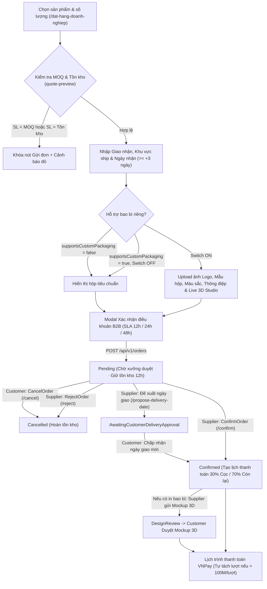

---

## 2. Tài Khoản & Dữ Liệu Kiểm Thử (Live Environment)

| Vai trò | Số điện thoại | Mật khẩu | Ghi chú |
|---|---|---|---|
| **Customer** | `0988000101` | `Password123!` | Nguyễn Văn Hoàng |
| **Supplier (`test-nguyet-pho-shop-a`)** | `0988000103` | `123456` | Nguyễn Minh Khang · Nguyệt Phố Sài Gòn |

| Sản phẩm dùng trong bộ test | Product ID | Shop | MOQ | Biến thể | Bao bì riêng | Ghi chú chính sách |
|---|---|---|---|---|---|---|
| Bánh Dẻo Khoai Môn Sữa Dừa Non Bến Tre | `0242075c-33ce-44f2-8b27-784f82c9d5f6` | `smartstock-store` | `100` | `2` | `true` (4 mẫu) | Không cấu hình bảng phí ship |
| Hộp Bánh Nướng Hạt Sen Trắng Trứng Muối Cổ Điển (4 Bánh) | `229cb978-6eab-44fc-9639-c3c85c8b11f8` | `test-nguyet-pho-shop-a` | `10` | `2` (`300k`, `350k`) | `false` | 3 vùng ship (`SELF_PICKUP`, `HCM_INNER`, `SOUTH_PROVINCE`) |
| Hộp Quà Hoàng Kim Đế Vương Bào Ngư & Kim Sa | `795f93a0-bc6c-4dd2-ae53-4db2e2e70e69` | `test-nguyet-pho-shop-a` | `5` | `3` (v2 tồn kho `10`) | `true` (2 mẫu) | Tier 1 (`5%`), Tier 2 (`10%`), Cọc `30%` |
| Đại Lễ 8 Bánh Cung Đình Bát Bửu Bào Ngư Vi Cá Yến Sào | `0c509a10-1eaf-46e3-bbd0-547be4a57493` | `test-nguyet-pho-shop-a` | `100` | `1` (`2.45M`) | `true` | Tổng đơn 200 hộp = `441M`, cọc 30% = `132.3M` (> `100M` ngưỡng tách VNPay) |

---

## 3. Bảng Tổng Hợp Kết Quả Chạy E2E (Lần chạy gần nhất)

- **Kết quả**: **11/11 PASS**, `Page errors: 0`
- **Đơn hàng tạo ra khi chạy live**:
  - `MC-20261115123856-7166A8CCF1` (`TC02` -> Supplier Reject `TC07` -> `Cancelled`)
  - `MC-20261115123906-F06761FCE9` (`TC03` -> Customer Self-Cancel `TC06` -> `Cancelled`)
  - `MC-20261115123931-48F852E190` (`TC05` -> Confirm & Mockup & VNPay Schedule `TC09` -> `Confirmed`, sau đó hủy giải phóng giữ kho sau khi chụp ảnh xong)
  - `MC-20261115123958-60374F7B4C` (`TC08` -> Delivery Proposal & Approval -> `Confirmed`, sau đó hủy giải phóng giữ kho sau khi chụp ảnh xong)

| Mã TC | Tên Kịch Bản | Trạng thái | Ảnh minh chứng |
|---|---|---|---|
| `TC01a` | Chặn gửi đơn khi số lượng nhỏ hơn MOQ (`50 < 100`) | PASS | `01a_tc01_validation_moq_below_min.png` |
| `TC01b` | Validate input giao nhận & thiết kế bao bì bắt buộc / sai định dạng | PASS | `01b_...`, `01c_...` |
| `TC01c` | Chặn gửi đơn khi vượt tồn kho khả dụng của biến thể (`45 > 10`) | PASS | `01d_tc01_validation_exceed_stock.png` |
| `TC02` | Đặt đơn chuẩn không hỗ trợ bao bì riêng + nhiều biến thể + ship nội thành | PASS | `02a_...`, `02b_...` |
| `TC03` | Đơn sỉ đạt Tier 2 (`10%`), miễn phí ship liên tỉnh (`>= 50M`), Switch bao bì OFF | PASS | `03_tc03_bulk_tier_discount_free_ship_switch_off.png` |
| `TC04` | Báo giá đơn giá trị lớn vượt ngưỡng 100 triệu/lượt VNPay (`441M` / cọc `132.3M`) | PASS | `04_tc04_mega_order_quote_split_threshold.png` |
| `TC05` | Đơn đa biến thể + bật thiết kế bao bì riêng + mẫu hộp + logo + Live 3D Studio | PASS | `05a_...`, `05b_...` |
| `TC06` | Customer tự hủy đơn ở trạng thái `Pending` trên `/don-hang-cua-toi` | PASS | `06_tc06_customer_cancel_pending_order.png` |
| `TC07` | Supplier từ chối đơn `Pending` kèm lý do và hoàn tồn kho | PASS | `07a_tc07_supplier_reject_order.png` |
| `TC08` | Supplier đề xuất ngày giao hàng mới & Customer duyệt đồng ý | PASS | `07b_...`, `07c_...` |
| `TC09` | Supplier xác nhận đơn + gửi Mockup 3D, Customer duyệt Mockup & xem lịch VNPay 30%/70% | PASS | `08a_...`, `08b_...`, `08c_...` |

---

## 4. Chi Tiết Từng Test Case & Hình Ảnh Nhập Input Thực Tế

### `TC01a` — Kiểm tra ràng buộc MOQ (Số lượng tối thiểu)

- **Đường dẫn**: `/dat-hang-doanh-nghiep?productId=0242075c-33ce-44f2-8b27-784f82c9d5f6`
- **Input nhập**: Nhập số lượng dòng biến thể 1 = `50` (MOQ của sản phẩm = `100`).
- **Kết quả mong đợi & thực tế**:
  - Hiển thị cảnh báo đỏ `"Chưa đạt số lượng đặt hàng tối thiểu của xưởng (100 hộp)"`.
  - Box dự toán hiển thị lỗi từ API `quote-preview` (`requires a minimum quantity of 100`).
  - Nút `Gửi đơn đặt hàng` bị vô hiệu hóa (`disabled`).

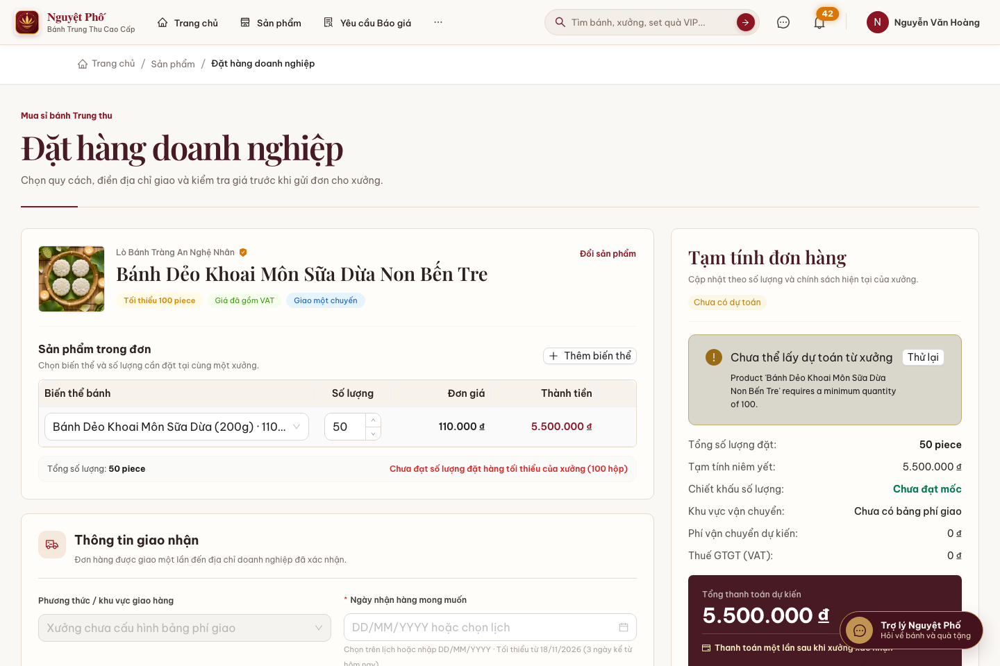

---

### `TC01b` — Kiểm tra Validate Form Giao Nhận & Bao Bì Doanh Nghiệp

- **Đường dẫn**: `/dat-hang-doanh-nghiep?productId=0242075c-33ce-44f2-8b27-784f82c9d5f6`
- **Input nhập**:
  - Đặt lại số lượng = `100`, bật Switch `Bật thiết kế bao bì riêng`.
  - Ngày nhận hàng nhập ngày không hợp lệ (`today + 1 ngày`, nhỏ hơn tối thiểu `+3 ngày`).
  - `recipientName` = `""` (rỗng), `recipientPhone` = `"123"`, `deliveryAddress` = `""`.
  - `companyName` = `""`, chưa tải ảnh logo doanh nghiệp lên (không còn ô nhập link HTTPS thủ công).
  - Nhấn `Gửi đơn đặt hàng`.
- **Kết quả mong đợi & thực tế**: Hiển thị đầy đủ 6 thông báo lỗi inline của AntD Form tương ứng từng ô (kể cả `"Vui lòng tải lên ảnh logo doanh nghiệp."`) và không gọi API tạo đơn.

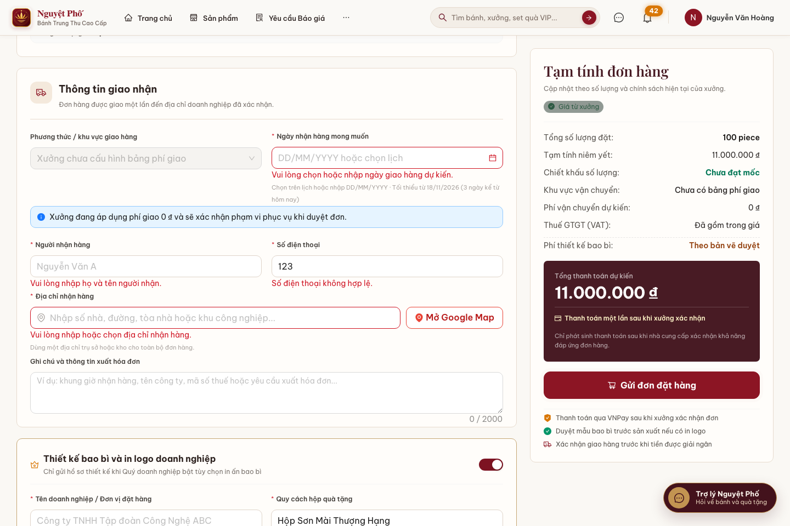
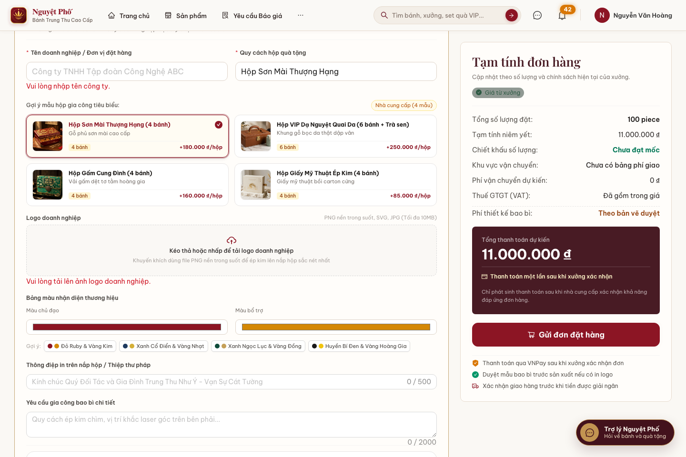

---

### `TC01c` — Kiểm tra Giới Hạn Tồn Kho Biến Thể (`availableStock`)

- **Đường dẫn**: `/dat-hang-doanh-nghiep?productId=795f93a0-bc6c-4dd2-ae53-4db2e2e70e69`
- **Input nhập**: Thêm dòng biến thể thứ 2 (*Hộp Quà Hoàng Gia Long Phụng Đặc Biệt (1.200g)* — tồn kho khả dụng = `10`), nhập số lượng = `45`.
- **Kết quả mong đợi & thực tế**: API `quote-preview` trả HTTP `409`, UI hiện cảnh báo `"Variant 'Hộp Quà Hoàng Gia Long Phụng Đặc Biệt (1.200g)' has only 10 units available."` và khóa nút `Gửi đơn đặt hàng`.

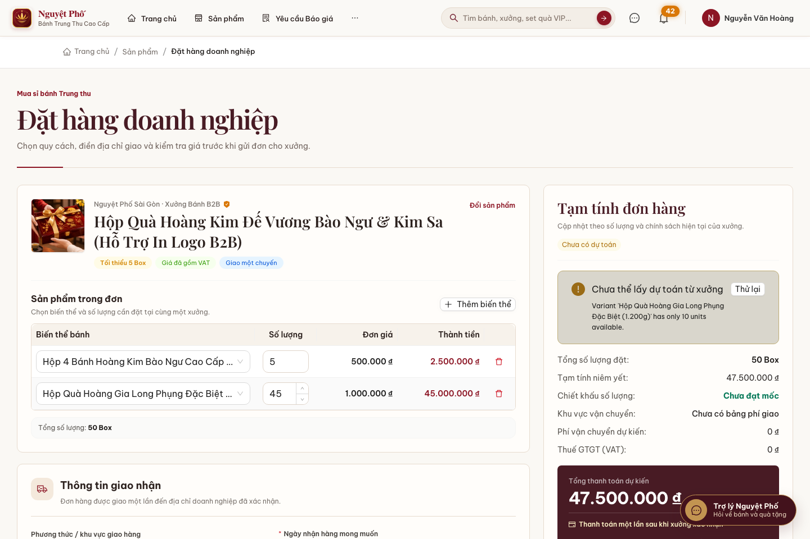

---

### `TC02` — Đặt Đơn Chuẩn (`supportsCustomPackaging = false`) + Đa Biến Thể + Phí Ship Nội Thành

- **Đường dẫn**: `/dat-hang-doanh-nghiep?productId=229cb978-6eab-44fc-9639-c3c85c8b11f8`
- **Input nhập**:
  - Biến thể 1 (`300.000 ₫`): `15` hộp; bấm `Thêm biến thể` -> Biến thể 2 (`350.000 ₫`): `10` hộp (tổng `25` hộp = `8.000.000 ₫`).
  - Khu vực giao hàng: `HCM_INNER` (`TP.HCM Noi Thanh · 150.000 ₫ · 1 ngày`).
  - Ngày giao dự kiến: `today + 7 ngày`.
  - Người nhận: `Trần Minh Quân (E2E TC02)`, SĐT: `0988000101`.
  - Địa chỉ: `720A Điện Biên Phủ, Phường 22, Quận Bình Thạnh, TP. Hồ Chí Minh`.
  - Ghi chú: `[E2E-TC02] Đơn hộp tiêu chuẩn đa biến thể giao nội thành TP.HCM`.
- **Kết quả mong đợi & thực tế**:
  - Khu vực thiết kế bao bì riêng **không hiển thị**.
  - Tổng thanh toán dự kiến: `8.150.000 ₫` (đã cộng `150.000 ₫` phí vận chuyển), cọc 30%: `2.445.000 ₫`.
  - Modal điều khoản mở ra đúng dữ liệu SLA (`12h / 24h / 48h`) và tạo thành công đơn `MC-20261115122300-831F8BE368`.

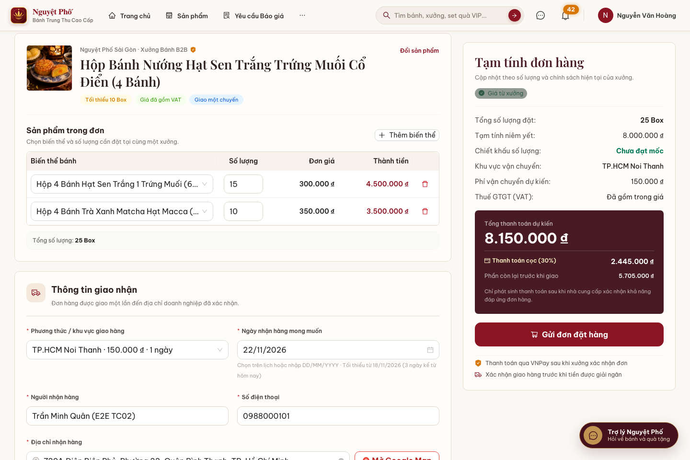
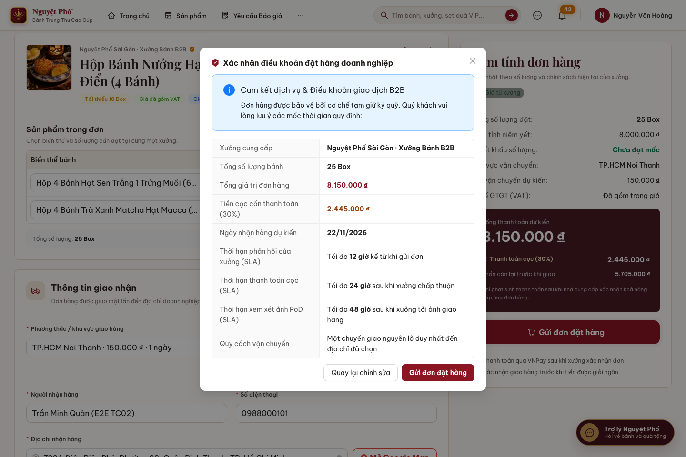

---

### `TC03` — Đơn Sỉ Chiết Khấu Tier 2 (`10%`) + Miễn Phí Ship Ngưỡng `>= 50M` + Tắt Bao Bì Riêng

- **Đường dẫn**: `/dat-hang-doanh-nghiep?productId=795f93a0-bc6c-4dd2-ae53-4db2e2e70e69`
- **Input nhập**:
  - Biến thể 1 (`500.000 ₫`): `120` hộp -> kích hoạt `TEST Tier 2 (100+ Boxes - 10% Off)`.
  - Khu vực giao hàng: `SOUTH_PROVINCE` (`Mien Nam Lien Tinh · 350.000 ₫ · 3 ngày`).
  - Giữ Switch `Bật thiết kế bao bì riêng` ở trạng thái **OFF**.
  - Địa chỉ: `Số 8 Đại lộ Hữu Nghị, KCN VSIP 1, TP. Thuận An, Bình Dương`, người nhận: `Lê Bảo Ngọc (E2E TC03)`.
- **Kết quả mong đợi & thực tế**:
  - Chiết khấu `-6.000.000 ₫`, phí vận chuyển tự giảm về `0 ₫` (do đạt ngưỡng freeship `50.000.000 ₫`), tổng `54.000.000 ₫`, cọc 30% = `16.200.000 ₫`.
  - Tạo thành công đơn `MC-20261115122311-410A77B25D` với `customPackaging = null`.

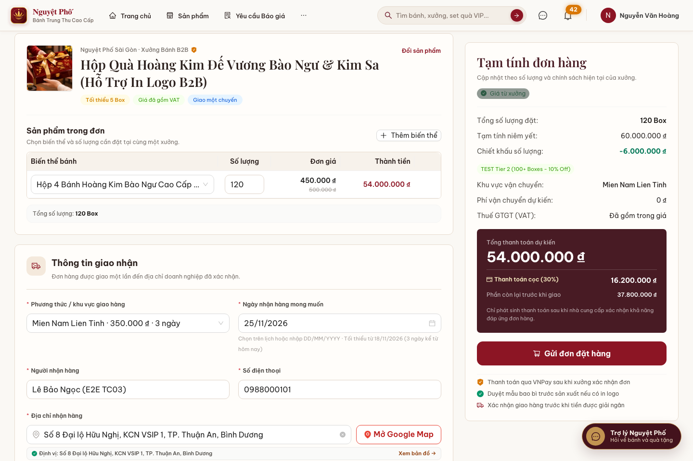

---

### `TC04` — Kiểm Tra Dự Toán Đơn Hàng Giá Trị Lớn Vượt Ngưỡng `100M` VNPay

- **Đường dẫn**: `/dat-hang-doanh-nghiep?productId=0c509a10-1eaf-46e3-bbd0-547be4a57493`
- **Input nhập**: Số lượng `200` hộp (`2.450.000 ₫/hộp`), khu vực `TP.HCM Noi Thanh`, người nhận `Phạm Hoàng Long (E2E Mega Quote)`.
- **Kết quả mong đợi & thực tế**:
  - Chiết khấu 10% (`-49.000.000 ₫`), tổng thanh toán `441.000.000 ₫`.
  - Khoản cọc 30% = `132.300.000 ₫` (> ngưỡng `100.000.000 ₫`/lượt giao dịch VNPay -> sẵn sàng tách thành nhiều lượt thanh toán sau khi xác nhận).

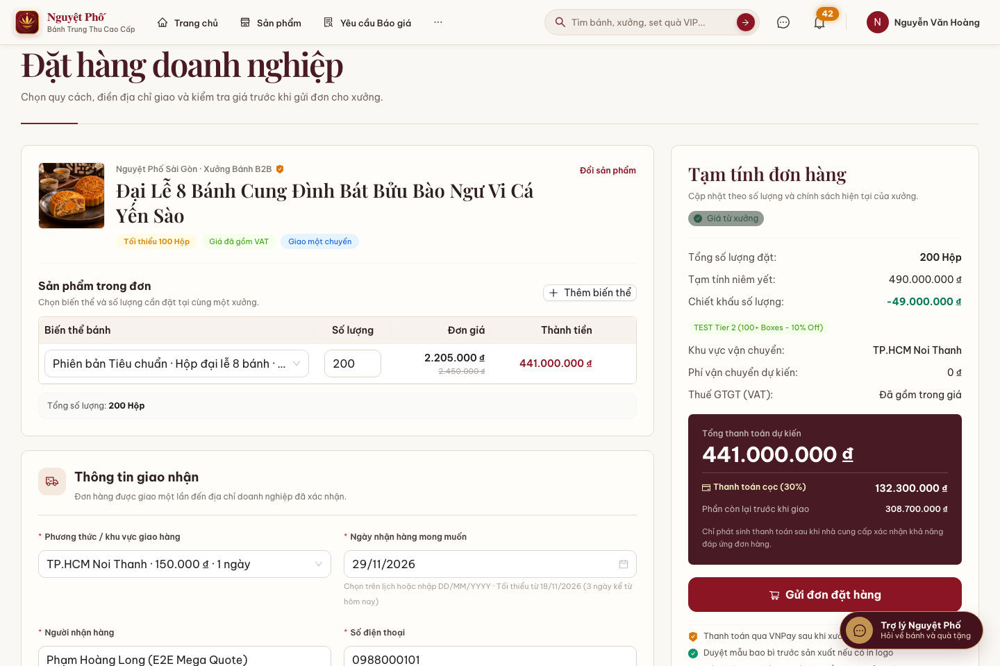

---

### `TC05` — Đặt Đơn Thiết Kế Bao Bì Riêng + Đa Biến Thể + Live 3D Studio

- **Đường dẫn**: `/dat-hang-doanh-nghiep?productId=795f93a0-bc6c-4dd2-ae53-4db2e2e70e69`
- **Input nhập**:
  - Biến thể 1: `95` hộp (`500k` -> đạt Tier 1 `-5%` = `-2.375.000 ₫`), Biến thể 2: `5` hộp (`1.000k`) -> tổng `100` hộp.
  - Khu vực giao: `TP.HCM Noi Thanh` (miễn phí ship vì `>= 20M`).
  - Bật Switch `Bật thiết kế bao bì riêng` -> **ON**:
    - Tên công ty: `Tập Đoàn Công Nghệ Ánh Trăng VN`
    - Chọn mẫu hộp số 2: `Hộp trà ô long` (`Wood & Lacquer`)
    - Upload file ảnh PNG logo doanh nghiệp (`POST /api/v1/custom-packaging/upload-logo` -> HTTP `200`, hiển thị thumbnail xem trước ngay trong form)
    - Bảng màu gợi ý: `Xanh Ngọc Lục & Vàng Đồng` (`#0f4c3a`, `#c5a059`)
    - Thông điệp nắp hộp: `Kính Chúc Quý Đối Tác Trung Thu Đoàn Viên & Thịnh Vượng`
    - Yêu cầu gia công: `Ép kim nhũ vàng logo mặt trước, cán màng nhung lì xanh ngọc lục bảo, kèm thiệp A6.`
- **Kết quả mong đợi & thực tế**:
  - `LiveBoxPreviewStudio` cập nhật tức thời logo vừa upload, màu sắc và chất liệu hộp.
  - Tổng đơn `50.125.000 ₫` (cọc 30% = `15.037.500 ₫`), tạo thành công đơn `MC-20261115123931-48F852E190`.

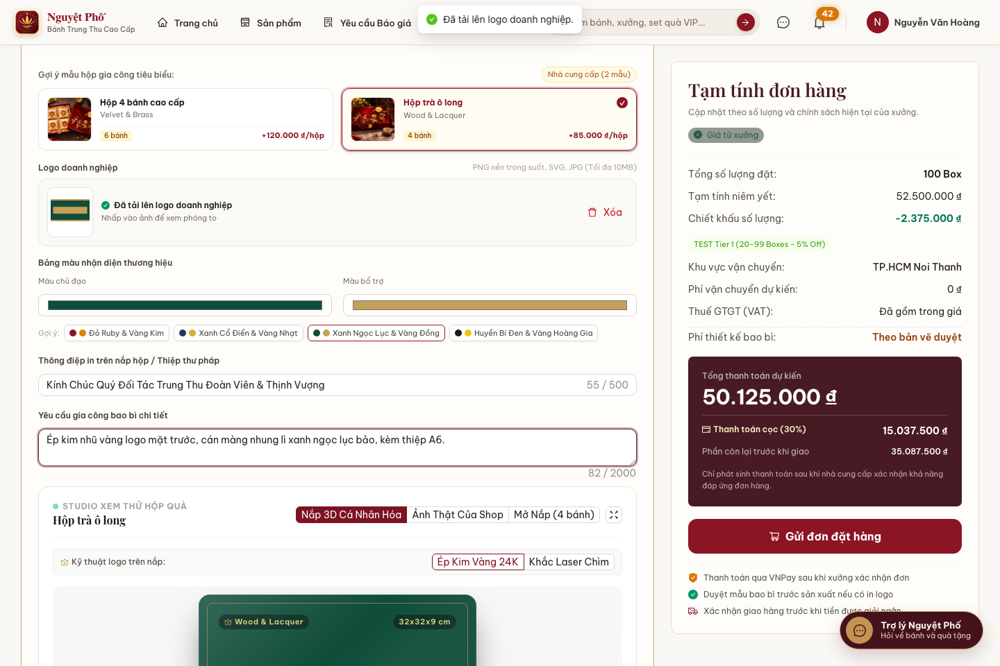
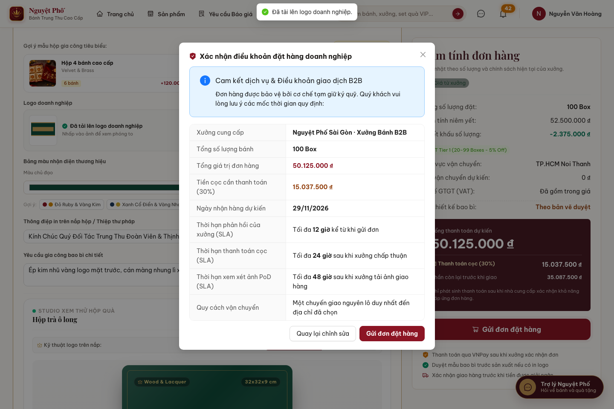

---

### `TC06` — Customer Tự Hủy Đơn Chờ Duyệt (`Pending -> Cancelled`)

- **Đường dẫn**: `/don-hang-cua-toi`
- **Hành động**: Chọn đơn `MC-20261115123906-F06761FCE9` (`TC03`), bấm `Hủy đơn hàng`, nhập lý do `[E2E-TC06] Khách hàng thay đổi sang mẫu hộp thiết kế in logo riêng` -> gửi yêu cầu (`POST /api/v1/orders/{id}/cancel`).
- **Kết quả**: Đơn chuyển ngay sang trạng thái `Đã hủy` (`Cancelled`) và giải phóng tồn kho.

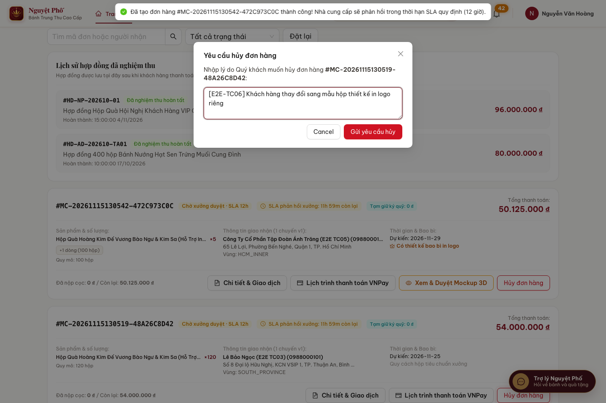

---

### `TC07` — Supplier Từ Chối Đơn `Pending` (`Pending -> Cancelled`)

- **Đường dẫn**: `/nha-cung-cap/quan-ly-don-hang`
- **Hành động**: Đăng nhập Supplier (`0988000103`), tại đơn `MC-20261115123856-7166A8CCF1` (`TC02`), bấm nút thao tác `...` -> chọn `Từ chối`, nhập `[E2E-TC07] Xưởng tạm hết khuôn hộp 4 bánh cổ điển trong tuần này` -> bấm `Xác nhận từ chối` (`POST /api/v1/orders/{id}/reject`).
- **Kết quả**: Đơn chuyển sang `Đã hủy` và hoàn tồn kho cho xưởng.

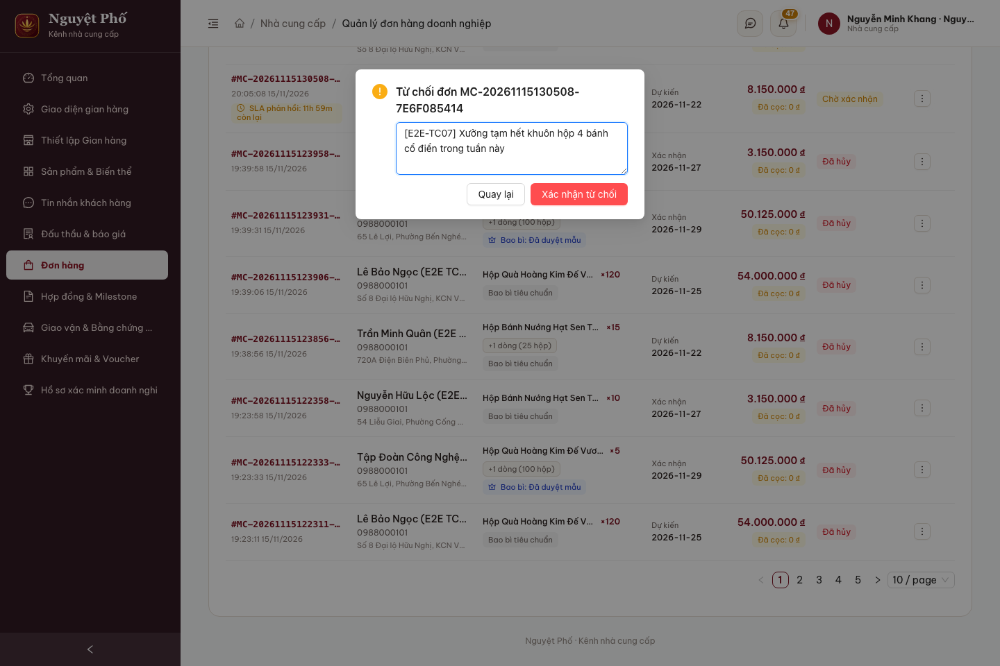

---

### `TC08` — Supplier Đề Xuất Ngày Giao Mới & Customer Chấp Nhận (`Pending -> AwaitingCustomerDeliveryApproval -> Confirmed`)

- **Hành động**:
  1. Tạo đơn nhẹ `MC-20261115123958-60374F7B4C` (`10` hộp -> `3.150.000 ₫`).
  2. Supplier bấm nút thao tác `...` -> chọn `Đề xuất ngày` -> chọn ngày `today + 12 ngày`, nhập lý do `[E2E-TC08] Điều chỉnh thêm 7 ngày do lịch xếp lò cao điểm` (`POST /propose-delivery-date`).
  3. Customer mở `/don-hang-cua-toi`, bấm `Duyệt ngày giao hàng` -> chọn `Chấp Nhận Ngày Giao Mới` (`POST /delivery-proposal/respond`).
- **Kết quả**: Đơn tự động chuyển sang `Confirmed` theo ngày giao mới đã chốt.

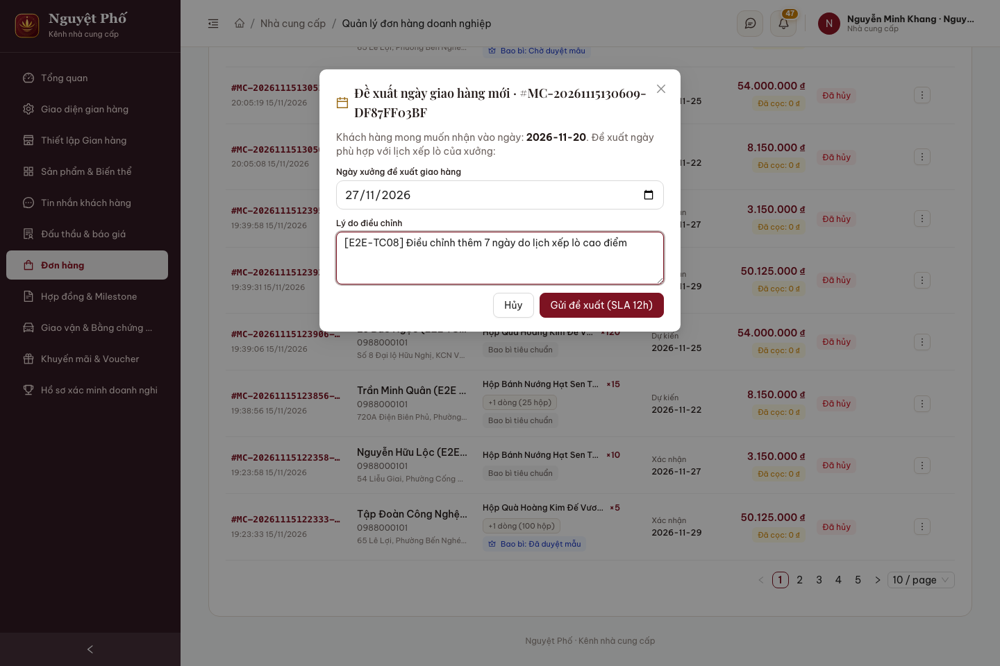
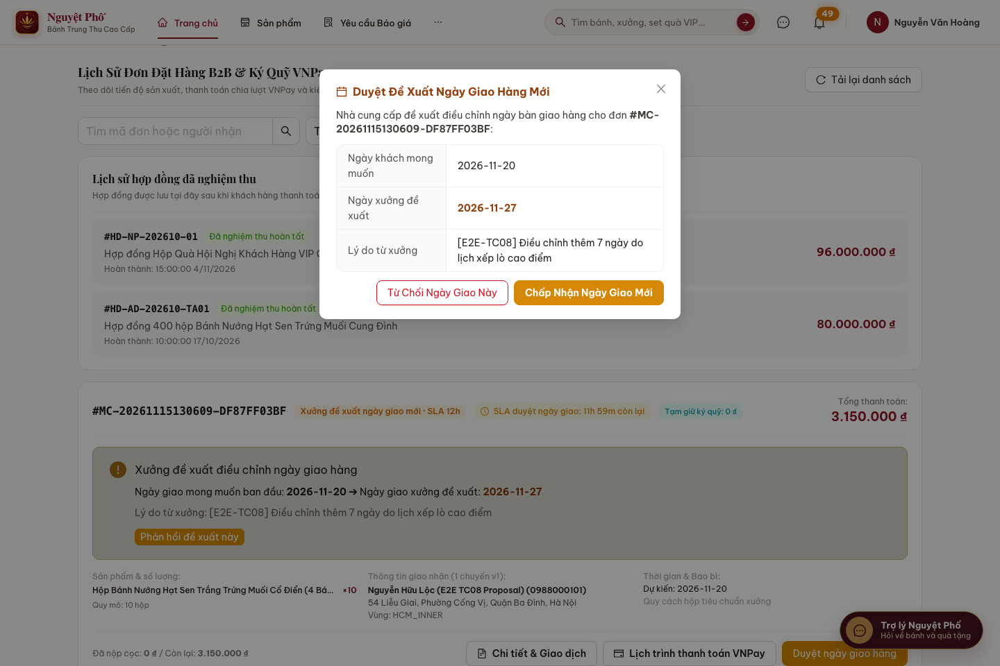

---

### `TC09` — Supplier Xác Nhận Đơn + Gửi Mockup 3D & Customer Duyệt Mockup + Lịch Thanh Toán VNPay 30%/70%

- **Hành động**:
  1. Supplier bấm nút thao tác `...` -> chọn `Xác nhận đơn` trên đơn bao bì riêng `MC-20261115123931-48F852E190` (`TC05`) (`POST /confirm` -> `Confirmed`).
  2. Supplier bấm nút thao tác `...` -> chọn `Bao bì` -> kiểm tra ảnh logo khách hàng đã tải lên hiển thị trực tiếp trong modal (`<Image>` preview), upload file ảnh mockup PNG (`POST /api/v1/custom-packaging/upload-logo` -> HTTP `200`, không còn ô nhập link HTTPS), nhập ghi chú phối cảnh 3D -> bấm `Gửi mockup cho khách duyệt` (`POST /custom-packaging/revisions`).
  3. Customer mở `/don-hang-cua-toi`, bấm `Xem & Duyệt Mockup 3D` -> kiểm tra ảnh bản vẽ mockup hiển thị trực tiếp để phóng to xem chi tiết -> bấm `Duyệt và tiến hành sản xuất` (`POST /review` -> `Approved`).
  4. Customer mở `Lịch trình thanh toán VNPay` kiểm tra chia nghĩa vụ thanh toán.
- **Kết quả**:
  - Mockup chuyển sang `Approved`.
  - Lịch thanh toán hiển thị đủ 2 nghĩa vụ: **Order deposit (30%) = `15.037.500 ₫`** (nút `Thanh toán VNPay ngay`) và **Remaining balance before shipping (70%) = `35.087.500 ₫`**.

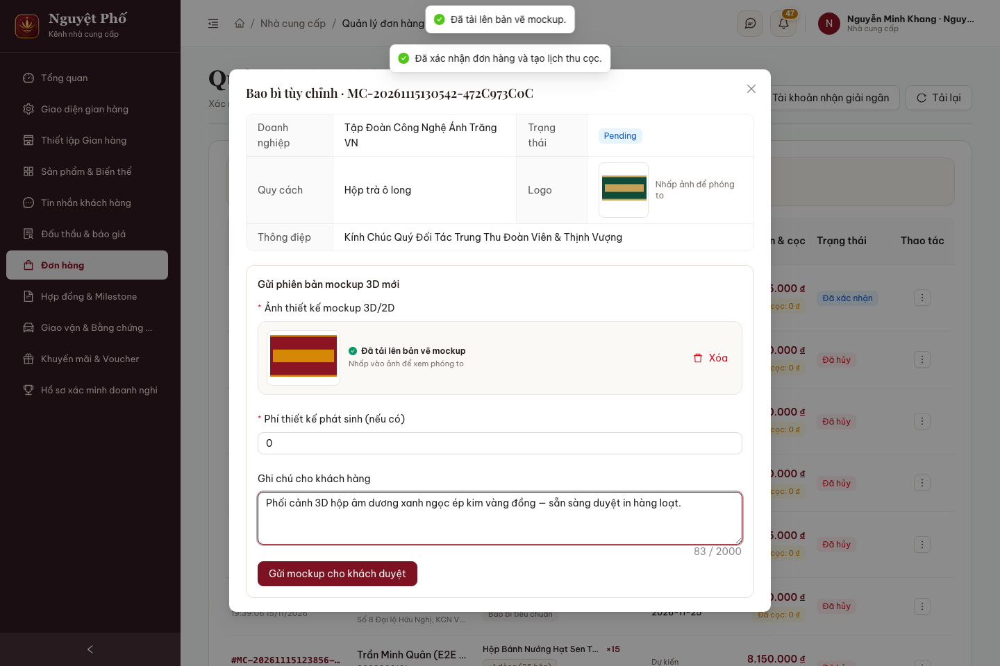
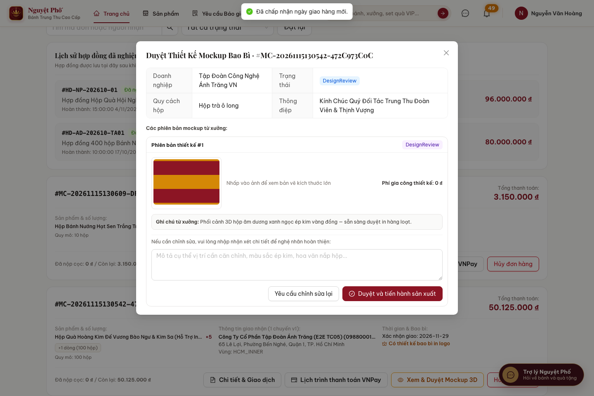
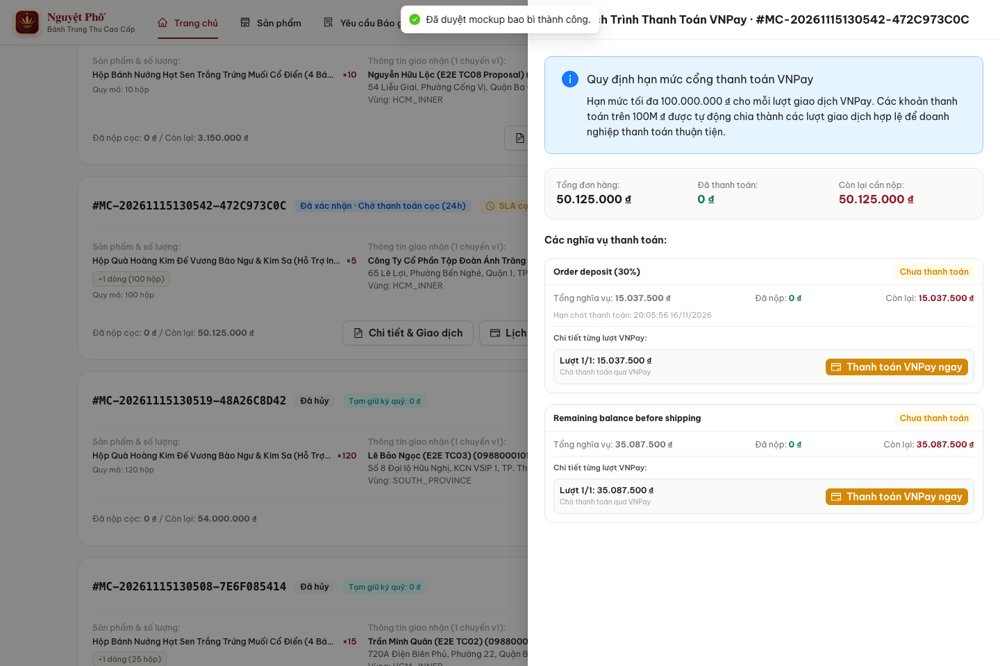

---

## 5. Bug UI Phát Hiện & Đã Khắc Phục Trong Quá Trình Kiểm Thử

- **File**: [`MyOrders.jsx`](file:///Users/admin/Desktop/PRN232/mooncake-fe/src/Pages/Customer/MyOrders.jsx)
- **Nguyên nhân**: Backend trả về `allowedActions: ['CancelOrder']` cho đơn `Pending` và đơn `Confirmed` chưa nộp cọc (dùng endpoint `POST /api/v1/orders/{id}/cancel`), chỉ trả `'RequestCancellation'` sau khi đã phát sinh thanh toán. Tuy nhiên `MyOrders.jsx` trước đây chỉ kiểm tra `allowedActions.includes('RequestCancellation')` nên khách hàng không thấy nút hủy đối với đơn `Pending`.
- **Khắc phục**: Cập nhật `MyOrders.jsx` hiển thị nút `Hủy đơn hàng` khi `allowedActions.includes('CancelOrder')` (gọi `orderService.cancel(...)`) và giữ nguyên `Yêu cầu hủy đơn` cho `RequestCancellation` (`orderService.requestCancellation(...)`), đồng thời verify `npm run build` (`vite build`) thành công 0 lỗi.

---

## 6. Cách Chạy Lại Bộ Test Tự Động

Đảm bảo Backend đang chạy ở `http://localhost:8089` và Frontend đang chạy ở `http://localhost:5173`, sau đó chạy:

```bash
node /Users/admin/Desktop/PRN232/mooncake-fe/tests/b2b-ordering-full-e2e.mjs
```
