# 🥮 Mooncake Marketplace – Feature Analysis & DB Design

> Phân tích tính năng & nghiệp vụ · Thiết kế Database Conceptual (PlantUML)

---

## 📊 Tổng quan thống kê

| Chỉ số | Giá trị |
|--------|---------|
| Tổng tính năng | 28 |
| Modules | 11 |
| 🔴 P0 Critical | 12 |
| 🟠 P1 High | 12 |
| 🟡 P2 Medium | 4 |
| DB Tables | 31 |

---

## 📋 Tab 1: Phân tích Tính năng

### Các Module

| ID | Tên Module |
|----|-----------|
| 1 | Người dùng & Phân quyền |
| 2 | Gian hàng (Shop) |
| 3 | Sản phẩm |
| 4 | Đặt hàng B2B |
| 5 | RFQ / Báo giá |
| 6 | Hợp đồng |
| 7 | Giao nhận |
| 8 | Đánh giá & Uy tín |
| 9 | AI |
| 10 | Thanh toán |
| 11 | Hệ thống & Vận hành |

---

### Module 1 – Người dùng & Phân quyền

#### Tính năng #1 – Đăng ký / Đăng nhập đa vai trò
- **Priority:** 🔴 P0 Critical  
- **Actors:** Customer, Supplier, Admin  
- **Mô tả nghiệp vụ:**  
  Hệ thống hỗ trợ 3 vai trò: **Customer** (khách hàng doanh nghiệp), **Supplier** (nhà cung cấp bánh) và **Admin** (quản trị viên nền tảng). Khi đăng ký, người dùng chọn vai trò; Supplier phải cung cấp thêm thông tin pháp lý (công ty, MST, địa chỉ). Hỗ trợ xác thực: Email/Password + OTP qua Email hoặc SMS. Sử dụng **JWT Access Token + Refresh Token**: access token ngắn hạn (15 phút), tự gia hạn qua refresh token. Rate-limit chống brute-force, lock tài khoản sau N lần sai.

#### Tính năng #2 – Xác minh & Duyệt nhà cung cấp
- **Priority:** 🔴 P0 Critical  
- **Actors:** Admin, Supplier  
- **Mô tả nghiệp vụ:**  
  Sau đăng ký, tài khoản Supplier ở trạng thái **pending_verification** – chưa được tạo gian hàng, tham gia đấu thầu. Admin xem xét hồ sơ: tên công ty, MST, tài liệu (GPKD, ATTP...). Admin **phê duyệt** (→ verified) hoặc **từ chối** (kèm lý do). Hệ thống gửi email kết quả. Supplier đã verified hiển thị badge **✓ Verified** trên gian hàng. Admin có thể thu hồi xác minh nếu phát hiện vi phạm. Lưu lại lịch sử thao tác duyệt (audit log).

---

### Module 2 – Gian hàng (Shop)

#### Tính năng #3 – Tạo & Quản lý gian hàng
- **Priority:** 🔴 P0 Critical  
- **Actors:** Supplier, Admin  
- **Mô tả nghiệp vụ:**  
  Mỗi Supplier (đã verified) được sở hữu **1 gian hàng duy nhất**. Gian hàng gồm: tên, slug URL (vd: /shop/banhtuyen), mô tả, banner, logo. Trang profile công khai hiển thị: sản phẩm, điểm uy tín, badge, đánh giá, thông tin liên hệ. Trạng thái: **active / inactive / suspended**. Supplier có thể tạm ẩn (inactive). Admin có quyền suspend vi phạm. Trang gian hàng hỗ trợ lọc sản phẩm theo danh mục, khoảng giá, biến thể ngay trong shop.

#### Tính năng #4 – Tùy chỉnh giao diện gian hàng
- **Priority:** 🟠 P1 High  
- **Actors:** Supplier, Admin  
- **Mô tả nghiệp vụ:**  
  Hệ thống cung cấp ≥5 **template giao diện**. Mỗi template định nghĩa layout và **CSS variables** (màu chủ đạo, nền, text, border-radius, font scale). Supplier chọn template, override variables qua color picker (không cần code). **Live preview** trực tiếp trước khi lưu. Thay đổi template bất kỳ lúc, không mất dữ liệu sản phẩm. Admin quản lý kho template: thêm mới, ẩn/hiện, gắn nhãn "premium". DB lưu `custom_colors: JSON` chứa các giá trị override theo từng gian hàng.

---

### Module 3 – Sản phẩm

#### Tính năng #5 – Quản lý sản phẩm & biến thể
- **Priority:** 🔴 P0 Critical  
- **Actors:** Supplier  
- **Mô tả nghiệp vụ:**  
  Supplier thêm sản phẩm: tên, mô tả, danh mục, **giá cơ bản**, số lượng đặt tối thiểu (`min_order_qty`) và tối đa, ảnh gallery (nhiều ảnh, 1 ảnh primary). Mỗi sản phẩm **bắt buộc có ít nhất 1 biến thể (variant)**: loại vỏ (nướng/dẻo/snow-skin), nhân (đậu xanh, thập cẩm, sầu riêng...), kích thước/trọng lượng, hộp gift set. Mỗi variant: SKU riêng, điều chỉnh giá, tồn kho độc lập. **Khi khách đặt hàng, bắt buộc chọn variant cụ thể** – không thể đặt sản phẩm ở cấp độ product. Trạng thái sản phẩm: **active / inactive / out_of_stock**. Đánh dấu sản phẩm "hỗ trợ đóng gói doanh nghiệp".

#### Tính năng #6 – Tìm kiếm & Khám phá sản phẩm
- **Priority:** 🟠 P1 High  
- **Actors:** Customer, Supplier  
- **Mô tả nghiệp vụ:**  
  **Full-text search** toàn nền tảng: tên sản phẩm, tên gian hàng, mô tả. Bộ lọc đa chiều: danh mục, khoảng giá, số lượng tối thiểu, hỗ trợ đóng gói, điểm uy tín NCC, khu vực. Sắp xếp: giá tăng/giảm, uy tín, đánh giá, mới nhất, bán chạy. **Autocomplete** gợi ý khi nhập. AI gợi ý sản phẩm liên quan theo lịch sử xem và mua. Kết quả hỗ trợ multi-select filter. Index Elasticsearch hoặc PostgreSQL FTS.

---

### Module 4 – Đặt hàng B2B

#### Tính năng #7 – Đặt hàng số lượng lớn (Bulk Order)
- **Priority:** 🔴 P0 Critical  
- **Actors:** Customer, Supplier  
- **Mô tả nghiệp vụ:**  
  Customer chọn sản phẩm rồi **bắt buộc chọn biến thể (variant) cụ thể** (loại vỏ, nhân, kích thước...) trước khi thêm vào đơn. Nhập số lượng ≥ `min_order_qty`. Hệ thống kiểm tra tồn kho theo variant, tự động áp dụng promotion rule có lợi nhất. Customer điền: địa chỉ giao, ngày giao mong muốn, ghi chú, yêu cầu đóng gói. Đơn gửi Supplier → **xác nhận hoặc từ chối** (kèm lý do). Workflow: **pending → confirmed → processing → shipped → delivered** hoặc cancelled. Supplier nhận thông báo đơn mới; Customer theo dõi trạng thái real-time. Đơn hàng lớn (> ngưỡng cấu hình) có thể yêu cầu **đặt cọc trước**.

#### Tính năng #8 – Khuyến mãi / Chiết khấu theo số lượng
- **Priority:** 🔴 P0 Critical  
- **Actors:** Supplier, Customer  
- **Mô tả nghiệp vụ:**  
  Supplier thiết lập **bảng giá bậc thang (tiered pricing)**. Ví dụ: 50–99 hộp → -5%; 100–499 hộp → -10%; ≥500 hộp → -15%. 3 loại chiết khấu: **percentage** (%), **fixed_amount** (trừ số tiền cố định), **fixed_price** (giá/đơn vị cố định). Rule có thể áp dụng cho 1 sản phẩm cụ thể hoặc toàn bộ gian hàng. Khi đặt hàng, hệ thống chọn rule có lợi nhất. Rule có **thời hạn hiệu lực** (start_date – end_date). Trang sản phẩm hiển thị bảng giá bậc thang trực quan. Discount chi tiết hiển thị rõ trong giỏ hàng.

#### Tính năng #9 – Đóng gói & In logo doanh nghiệp
- **Priority:** 🟠 P1 High  
- **Actors:** Customer, Supplier  
- **Mô tả nghiệp vụ:**  
  Khi đặt hàng sản phẩm hỗ trợ "Custom Packaging", Customer kích hoạt và cung cấp: **upload logo** công ty (PNG/SVG, ≤5MB), loại hộp (đơn, đôi, gift set), màu sắc hộp, câu chúc Tết in trên hộp, ghi chú yêu cầu thiết kế. Supplier đánh giá tính khả thi, upload **file mockup thiết kế** để Customer duyệt. Vòng lặp duyệt có thể diễn ra nhiều lần. Workflow: **pending → design_review → approved → in_production → completed** hoặc rejected. Phát sinh phí thiết kế/in ấn được cộng vào đơn hàng. Lưu file thiết kế cuối cùng làm tài liệu hợp đồng.

---

### Module 5 – RFQ / Báo giá

#### Tính năng #10 – Tạo yêu cầu báo giá (RFQ)
- **Priority:** 🔴 P0 Critical  
- **Actors:** Customer  
- **Mô tả nghiệp vụ:**  
  Customer tạo RFQ gồm: tiêu đề + mô tả nhu cầu; **danh sách hàng hóa** (tên sản phẩm, số lượng, đơn vị, yêu cầu kỹ thuật, yêu cầu đóng gói, giá mục tiêu/đơn vị); địa chỉ và **ngày cần giao hàng**; khoảng ngân sách (min–max); **deadline nhận báo giá**. Lưu dạng draft trước khi publish. Sau publish → status **open**. RFQ number tự sinh: `RFQ-YYYY-XXXXXX`. Customer có thể đính kèm file yêu cầu kỹ thuật (PDF/Excel). Chỉnh sửa RFQ trước khi có bid.

#### Tính năng #11 – Mời nhà cung cấp tham gia RFQ
- **Priority:** 🟠 P1 High  
- **Actors:** Customer, Supplier, System  
- **Mô tả nghiệp vụ:**  
  Customer **chủ động mời** tối đa N Supplier (mặc định 10) tham gia RFQ. Hệ thống **gợi ý Supplier phù hợp** dựa trên: danh mục sản phẩm, điểm uy tín, lịch sử giao dịch, khu vực. Supplier nhận thông báo lời mời (in-app + email), xem chi tiết RFQ. Supplier có thể: tham gia (submit bid) hoặc **từ chối kèm lý do**. Tracking: **invited / viewed / bid_submitted / declined**. Sau deadline → đóng cổng nhận bid. Customer xem tổng quan: X mời / Y gửi bid / Z từ chối.

#### Tính năng #12 – Nhà cung cấp gửi báo giá (Bid)
- **Priority:** 🔴 P0 Critical  
- **Actors:** Supplier, Customer  
- **Mô tả nghiệp vụ:**  
  Supplier tạo bid chi tiết: **báo giá từng item** (giá/đơn vị, subtotal, ghi chú item), tổng giá trị đơn hàng, thời gian giao hàng dự kiến (số ngày từ ký HĐ), **thời hạn hiệu lực báo giá** (validity_days), điều kiện đặc biệt, file đính kèm (catalogue, chứng chỉ). Bid có thể chỉnh sửa trước deadline RFQ. Bid number: `BID-YYYY-XXXXXX`. Trạng thái: **submitted → accepted / cancelled**. Customer nhận thông báo bid mới, so sánh tất cả báo giá từ các NCC bằng bảng side-by-side.

#### Tính năng #13 – Chọn báo giá & Hủy các báo giá còn lại
- **Priority:** 🔴 P0 Critical  
- **Actors:** Customer, System  
- **Mô tả nghiệp vụ:**  
  Sau khi nhận đủ báo giá (hoặc hết deadline), Customer xem xét và **accept 1 báo giá hợp lý nhất** hoặc **cancel báo giá không phù hợp**. Không có vòng thương lượng – quyết định dựa hoàn toàn trên báo giá Supplier gửi lên. **Hệ thống tự động xử lý khi Customer accept 1 bid:** Bid được chọn → status **accepted**; Toàn bộ bid khác trong RFQ → status **cancelled**; RFQ → status **awarded**; Gửi thông báo NCC thắng kèm yêu cầu ký HĐ; Gửi thông báo NCC thua (không lộ giá đối thủ); Kích hoạt luồng tạo hợp đồng. **Sau khi HĐ được 2 bên ký, hệ thống yêu cầu Customer thanh toán đặt cọc (milestone M1)** – hợp đồng chỉ chuyển sang **active** sau khi xác nhận nhận được tiền cọc. Customer có thể ghi chú lý do lựa chọn.

---

### Module 6 – Hợp đồng

#### Tính năng #15 – Tạo & Ký kết hợp đồng điện tử
- **Priority:** 🔴 P0 Critical  
- **Actors:** Customer, Supplier  
- **Mô tả nghiệp vụ:**  
  Sau khi bid accepted, **hệ thống tự sinh draft hợp đồng** từ: thông tin 2 bên, danh sách hàng hóa + giá đã thống nhất, điều khoản giao hàng, điều khoản thanh toán (bao gồm **đặt cọc bắt buộc**), **chế tài vi phạm (penalty_terms)**. Cả 2 bên review, có thể yêu cầu chỉnh sửa (qua comment nội tuyến). Ký điện tử: checkbox xác nhận + **OTP xác thực**. **PDF hợp đồng** được tạo và lưu trữ sau khi 2 bên ký. Contract number: `HĐ-YYYY-XXXXXX`. Status: **draft → pending_signature → signed → pending_deposit → active**. Hợp đồng chỉ chuyển sang **active** sau khi Customer thanh toán đặt cọc (milestone M1 = đặt cọc) được xác nhận.

#### Tính năng #16 – Theo dõi tiến độ & Milestone hợp đồng
- **Priority:** 🟠 P1 High  
- **Actors:** Supplier, Customer, System  
- **Mô tả nghiệp vụ:**  
  Hợp đồng chia thành **các mốc (milestones)**: tên, mô tả, due_date, giá trị thanh toán tương ứng. **M1 là đặt cọc bắt buộc** – Customer phải thanh toán mốc này sau khi ký, hợp đồng mới chuyển sang **active** và Supplier bắt đầu sản xuất. Ví dụ: M1 – Đặt cọc 30% (D+0, bắt buộc trước khi active); M2 – Giao hàng 50% (D+15); M3 – Nghiệm thu & thanh toán 70% còn lại (D+30). Supplier cập nhật hoàn thành từng milestone (kèm bằng chứng). Customer xác nhận. **Cảnh báo tự động:** T-7, T-3, T-1 ngày trước due_date và khi overdue. Ghi lại `completion_date` thực tế vs `due_date`. Dashboard tổng quan tiến độ tất cả hợp đồng đang hoạt động.

#### Tính năng #17 – Xử lý vi phạm hợp đồng
- **Priority:** 🟠 P1 High  
- **Actors:** Supplier, Customer, Admin, System  
- **Mô tả nghiệp vụ:**  
  Khi milestone/deadline quá hạn → hệ thống tự gắn cờ **overdue**. Supplier có thể khai báo sự cố và **xin gia hạn** (kèm lý do + ngày đề xuất mới). Customer: chấp thuận gia hạn (cập nhật deadline) hoặc khởi động xử lý vi phạm. Phân loại: **late** (trễ nhưng vẫn hoàn thành) hoặc **breach** (không thực hiện). Breach → contract status "breached" → **trừ điểm uy tín nặng (-20đ)**. Customer khởi động **tranh chấp (disputed)** → Admin can thiệp phân xử. Toàn bộ lịch sử vi phạm ghi vào `reputation_logs`.

#### Tính năng #18 – Hoàn thành hợp đồng & Chốt kết quả
- **Priority:** 🟠 P1 High  
- **Actors:** Supplier, Customer, System  
- **Mô tả nghiệp vụ:**  
  Sau khi toàn bộ milestone hoàn thành, Supplier bấm "Yêu cầu nghiệm thu". Customer xác nhận hoàn thành. Hệ thống ghi nhận: **completed_on_time** (đúng hạn) hoặc **completed_late** (trễ nhưng hoàn thành). Điểm uy tín được cộng theo kết quả (+10đ đúng hạn, +3đ trễ). Hệ thống kích hoạt **luồng đánh giá** (review request). Hợp đồng được lưu trong lịch sử cả 2 bên. Kích hoạt thanh toán milestone cuối cùng (nếu còn).

---

### Module 7 – Giao nhận

#### Tính năng #19 – Quản lý đơn giao hàng
- **Priority:** 🟡 P2 Medium  
- **Actors:** Supplier, Customer, Admin  
- **Mô tả nghiệp vụ:**  
  2 chế độ giao hàng: **(1) Self-arranged:** Supplier tự vận chuyển, chỉ cần cập nhật trạng thái + mã tracking. **(2) Platform-managed:** nền tảng điều phối, kết nối đơn vị vận chuyển đối tác. Mỗi delivery ghi: địa chỉ lấy, địa chỉ giao, người nhận + SĐT, ngày dự kiến, mã tracking. Workflow: **pending → confirmed → picked_up → in_transit → delivered / failed / returned**. Một hợp đồng có thể có **nhiều chuyến giao (nhiều đợt)**. Customer và Supplier đều theo dõi real-time. Thông báo tự động tại mỗi bước thay đổi trạng thái.

#### Tính năng #20 – Xác minh giao nhận bằng ảnh (PoD)
- **Priority:** 🟡 P2 Medium  
- **Actors:** Delivery Staff, Customer, Supplier  
- **Mô tả nghiệp vụ:**  
  **Proof of Delivery**: ảnh xác minh tại các bước. **Loại ảnh:** pickup (ảnh hàng trước khi vận chuyển), in_transit (tùy chọn), delivery (giao thành công + chữ ký người nhận), failed_attempt (bằng chứng giao thất bại). **Metadata:** timestamp tự động, tọa độ GPS (nếu có). Nhân viên giao hàng upload qua mobile app. Cả Customer và Supplier đều xem được ảnh PoD. **Ảnh PoD là bằng chứng pháp lý** trong tranh chấp. Kiểm tra metadata tính toàn vẹn của ảnh (không bị chỉnh sửa). Lưu trữ vĩnh viễn trên cloud storage.

---

### Module 8 – Đánh giá & Uy tín

#### Tính năng #21 – Đánh giá & Phản hồi sau giao dịch (Transaction Review)
- **Priority:** 🟠 P1 High  
- **Actors:** Customer, Supplier, Admin  
- **Mô tả nghiệp vụ:**  
  Sau Order delivered hoặc Contract completed → hệ thống gửi **lời nhắc đánh giá** (in-app + email, nhắc sau 3 ngày nếu chưa đánh giá). Customer đánh giá 4 tiêu chí (1–5★): **Chất lượng sản phẩm, Đúng hạn giao hàng, Dịch vụ hỗ trợ, Tổng thể**; kèm nhận xét văn bản và ảnh đính kèm (tùy chọn). Đánh giá mặc định public, có thể chọn ẩn danh. Supplier được phép **phản hồi 1 lần** mỗi đánh giá. Admin ẩn review vi phạm chính sách. Review hiển thị trên trang gian hàng với ngày, ảnh người dùng, phân loại theo tiêu chí.

#### Tính năng #22 – Đánh giá & Bình luận sản phẩm / Biến thể (Product Review)
- **Priority:** 🟠 P1 High  
- **Actors:** Customer, Supplier, Admin  
- **Mô tả nghiệp vụ:**  
  Sau khi đơn hàng delivered, Customer có thể viết **đánh giá trực tiếp trên trang sản phẩm / biến thể** mà họ đã mua. Hiển thị dạng **luồng bình luận** dưới trang chi tiết sản phẩm (tương tự TikTok/Shopee). Nội dung review gồm: **ảnh/video món hàng thực tế** (tùy chọn), điểm sao (1–5★), nhận xét văn bản, tag **variant cụ thể** (ví dụ: “Bánh nhân đậu xanh 150g”). Chỉ khách hàng đã mua variant đó mới được review (✅ Verified Purchase). Supplier được phản hồi 1 lần mỗi review. Khách khác có thể **thích (like)** review. Admin ẩn review vi phạm. **Thống kê hiển thị trên trang sản phẩm:** tổng số review, điểm trung bình, phân phối sao (1–5★), lọc theo biến thể cụ thể.

#### Tính năng #22 – Tính điểm uy tín nhà cung cấp
- **Priority:** 🟠 P1 High  
- **Actors:** System, Customer, Admin  
- **Mô tả nghiệp vụ:**  
  **Reputation score** tính liên tục từ sự kiện:
  - Hoàn thành đúng hạn: **+10đ**
  - Hoàn thành trễ: **-5đ**
  - Vi phạm (breach): **-20đ**
  - Review 5★: **+3đ**
  - Review 4★: **+1đ**
  - Review 1–2★: **-2đ**
  - Penalty Admin áp dụng: **-N đ**

  Mọi thay đổi ghi vào `reputation_logs` (event_type, score_delta, reason, reference). **Hạng badge:** Mới (0–20), Tin cậy (21–50), Uy tín (51–80), Đối tác Vàng (81+). Điểm uy tín ảnh hưởng: thứ tự tìm kiếm, ưu tiên gợi ý RFQ, badge hiển thị. Biểu đồ lịch sử điểm theo thời gian.

---

### Module 9 – AI

#### Tính năng #23 – AI Chatbot – Tư vấn & Lịch sử bánh TT
- **Priority:** 🟡 P2 Medium  
- **Actors:** Customer, Supplier  
- **Mô tả nghiệp vụ:**  
  Tích hợp **LLM API (Claude / GPT-4)** với 2 nhóm tính năng:  
  1. **Tư vấn sản phẩm (RAG):** khách hàng mô tả nhu cầu (số lượng, ngân sách, khẩu vị, mục đích biếu tặng/công ty), AI gợi ý sản phẩm từ catalog thực tế của nền tảng; so sánh sản phẩm; giải thích khác biệt nhân bánh/loại vỏ.  
  2. **Kiến thức văn hóa:** lịch sử & ý nghĩa bánh Trung Thu; phân biệt bánh nướng/dẻo/snow-skin; phong tục tặng bánh Việt Nam và Trung Hoa.  
  Conversation history lưu DB. Widget chatbot nhúng vào mọi trang. **Phase 2:** fine-tune model riêng trên dữ liệu nền tảng.

#### Tính năng #24 – AI Phân tích dữ liệu bán hàng
- **Priority:** 🟡 P2 Medium  
- **Actors:** Admin, Supplier  
- **Mô tả nghiệp vụ:**  
  **Analytics dashboard thông minh** cho 2 đối tượng:  
  - **Admin (toàn nền tảng):** GMV theo ngày/tuần/tháng, số đơn hàng/hợp đồng, top sản phẩm/NCC, phân tích theo vùng/danh mục, tỷ lệ thắng RFQ.  
  - **Supplier (gian hàng):** doanh thu theo sản phẩm/variant, tỷ lệ hoàn thành, khách hàng quay lại (retention), tồn kho cảnh báo.  
  Gọi **Anthropic API** để generate **natural language insights**. Export báo cáo PDF. **Phase 2:** time-series demand forecasting model (dự báo nhu cầu mùa Trung Thu).

---

### Module 10 – Thanh toán

#### Tính năng #25 – Thanh toán đơn hàng & Hợp đồng
- **Priority:** 🟠 P1 High  
- **Actors:** Customer, System  
- **Mô tả nghiệp vụ:**  
  Hỗ trợ: **Chuyển khoản ngân hàng** (Vietcombank, Techcombank, MB...), **Ví điện tử** (MoMo, ZaloPay, VNPay).  
  - **Đơn hàng thường:** thanh toán 1 lần; hỗ trợ COD với giới hạn giá trị.  
  - **Hợp đồng:** thanh toán theo milestone – xác nhận milestone xong → kích hoạt lệnh thanh toán tương ứng.  
  Mỗi giao dịch có `payment_number`, trạng thái tracking (pending → processing → completed / failed / refunded). Webhook tự động cập nhật trạng thái từ payment gateway. Xử lý hoàn tiền (refund) khi đơn hủy. Lịch sử giao dịch đầy đủ cho cả 2 bên.

---

### Module 11 – Hệ thống & Vận hành

#### Tính năng #26 – Thông báo real-time
- **Priority:** 🟠 P1 High  
- **Actors:** All Users, System  
- **Mô tả nghiệp vụ:**  
  Push notification đúng đối tượng theo sự kiện.  
  - **Customer nhận:** có bid mới, bid được accept/reject, yêu cầu thương lượng, HĐ được ký, milestone hoàn thành, giao hàng thành công, nhắc đánh giá.  
  - **Supplier nhận:** RFQ mới / lời mời, bid shortlisted/rejected, yêu cầu thương lượng, HĐ ký, milestone sắp đến hạn (T-7, T-3, T-1), đánh giá mới.  
  **Kênh phân phối:** In-app (WebSocket real-time), Email. Phase 2: push notification mobile, SMS. Badge đếm chưa đọc. Cấu hình **notification preferences** theo loại thông báo.

#### Tính năng #27 – Quản trị hệ thống (Admin Dashboard)
- **Priority:** 🔴 P0 Critical  
- **Actors:** Admin  
- **Mô tả nghiệp vụ:**  
  Admin toàn quyền vận hành nền tảng:  
  - **User management:** duyệt NCC, khóa/mở tài khoản, chỉnh vai trò.  
  - **Shop management:** xem/suspend/activate gian hàng, xem metrics từng shop.  
  - **Catalog:** quản lý danh mục sản phẩm, bộ template giao diện.  
  - **Dispute handling:** xem xét tranh chấp, can thiệp, phân xử, áp penalty.  
  - **Analytics dashboard:** tổng quan nền tảng (user, đơn, GMV, top suppliers/products).  
  - **System config:** ngưỡng reputation, quy tắc tính điểm, chính sách phí nền tảng, template email.  
  - **Content moderation:** ẩn review vi phạm, xử lý báo cáo từ user.

#### Tính năng #28 – Báo cáo & Thống kê đa chiều
- **Priority:** 🟠 P1 High  
- **Actors:** Admin, Supplier, Customer  
- **Mô tả nghiệp vụ:**  
  - **Admin:** GMV, số đơn hàng/HĐ, tỷ lệ thành công RFQ, NCC vi phạm, sản phẩm best-seller, conversion funnel (RFQ → Bid → Contract).  
  - **Supplier:** doanh thu, số đơn, tỷ lệ hoàn thành, điểm uy tín qua thời gian, tỷ lệ thắng thầu.  
  - **Customer:** lịch sử đơn hàng/HĐ, tổng chi tiêu, NCC đã làm việc.  
  Lọc theo **khoảng thời gian**. Biểu đồ trực quan: line chart doanh số, bar chart top products. **Export CSV / Excel / PDF**. Tích hợp AI Analytics để sinh insights ngôn ngữ tự nhiên.

---

## 🗄️ Tab 2: Database Design (PlantUML)

### 30 Entities – Tổng quan

| # | Tên Entity / Bảng | Mô tả |
|---|-------------------|-------|
| 1 | `users` | Tài khoản người dùng đa vai trò (Customer/Supplier/Admin) |
| 2 | `supplier_profiles` | Hồ sơ công ty, điểm uy tín tổng hợp của NCC |
| 3 | `customer_profiles` | Hồ sơ khách hàng doanh nghiệp |
| 4 | `shop_templates` | Các template giao diện gian hàng có sẵn |
| 5 | `shops` | Gian hàng của nhà cung cấp (1 NCC = 1 shop) |
| 6 | `categories` | Danh mục bánh phân cấp (self-reference) |
| 7 | `products` | Sản phẩm bánh Trung Thu |
| 8 | `product_variants` | Biến thể sản phẩm (nhân, vỏ, kích thước) |
| 9 | `product_images` | Ảnh gallery sản phẩm |
| 10 | `promotion_rules` | Quy tắc chiết khấu bậc thang theo SL |
| 11 | `orders` | Đơn hàng mua trực tiếp |
| 12 | `order_items` | Chi tiết variant trong đơn (bắt buộc chọn variant) |
| 13 | `custom_packagings` | Yêu cầu đóng hộp, in logo doanh nghiệp |
| 14 | `request_for_quotations` | Yêu cầu báo giá (Request for Quotation) |
| 15 | `rfq_items` | Danh sách hàng hóa trong RFQ |
| 16 | `rfq_invitations` | Lời mời NCC tham gia RFQ |
| 17 | `bids` | Báo giá của nhà cung cấp |
| 18 | `bid_items` | Chi tiết báo giá từng rfq_item |
| 19 | `contracts` | Hợp đồng mua bán điện tử |
| 20 | `contract_milestones` | Các mốc tiến độ & thanh toán của HĐ |
| 21 | `deliveries` | Đơn vận chuyển giao hàng |
| 22 | `delivery_proofs` | Ảnh xác minh giao nhận (PoD) |
| 23 | `reviews` | Đánh giá giao dịch (order/contract) của KH |
| 24 | `product_reviews` | Bình luận/review trực tiếp trên sản phẩm/variant |
| 25 | `reputation_logs` | Log mỗi lần thay đổi điểm uy tín NCC |
| 26 | `ai_conversations` | Phiên hội thoại với AI chatbot |
| 27 | `ai_messages` | Từng tin nhắn trong phiên AI |
| 28 | `ai_analytics_reports` | Báo cáo phân tích do AI sinh ra |
| 29 | `payments` | Giao dịch thanh toán (đơn hàng & HĐ) |
| 30 | `notifications` | Thông báo real-time gửi đến người dùng |
| 31 | `contract_deposit_rules` | Cấu hình % đặt cọc bắt buộc trong hợp đồng |

---

### Quan hệ chính giữa các bảng

| From | To | Cardinality | Mô tả quan hệ |
|------|----|-------------|---------------|
| `users` | `supplier_profiles` | 1 → 0..1 | 1 tài khoản → tối đa 1 hồ sơ NCC |
| `users` | `customer_profiles` | 1 → 0..1 | 1 tài khoản → tối đa 1 hồ sơ KH |
| `supplier_profiles` | `shops` | 1 → 1 | Mỗi NCC sở hữu đúng 1 gian hàng |
| `shops` | `shop_templates` | N → 1 | Nhiều shop dùng chung 1 template |
| `shops` | `products` | 1 → N | 1 gian hàng có nhiều sản phẩm |
| `products` | `product_variants` | 1 → N | 1 sản phẩm có nhiều biến thể |
| `products` | `product_images` | 1 → N | 1 sản phẩm có nhiều ảnh |
| `products` | `categories` | N → 1 | Sản phẩm thuộc 1 danh mục |
| `shops` | `promotion_rules` | 1 → N | 1 shop thiết lập nhiều rule khuyến mãi |
| `customer_profiles` | `orders` | 1 → N | KH đặt nhiều đơn hàng |
| `orders` | `order_items` | 1 → N | 1 đơn có nhiều dòng sản phẩm |
| `orders` | `custom_packagings` | 1 → 0..1 | Đơn hàng có thể có 1 yêu cầu custom packaging |
| `customer_profiles` | `request_for_quotations` | 1 → N | KH tạo nhiều RFQ |
| `request_for_quotations` | `rfq_items` | 1 → N | 1 RFQ có nhiều dòng hàng hóa |
| `request_for_quotations` | `rfq_invitations` | 1 → N | 1 RFQ mời nhiều NCC |
| `request_for_quotations` | `bids` | 1 → N | 1 RFQ nhận nhiều báo giá |
| `bids` | `bid_items` | 1 → N | 1 bid báo giá chi tiết từng rfq_item |
| `bids` | `contracts` | 1 → 0..1 | Bid được accept → sinh 1 hợp đồng |
| `contracts` | `contract_milestones` | 1 → N | 1 HĐ chia nhiều mốc tiến độ |
| `contracts` | `deliveries` | 1 → 0..1 | 1 HĐ giao hàng 1 lần |
| `orders` | `deliveries` | 1 → 0..1 | 1 đơn hàng trực tiếp giao 1 lần |
| `deliveries` | `delivery_proofs` | 1 → N | 1 chuyến giao có nhiều ảnh PoD |
| `customer_profiles` | `reviews` | 1 → N | KH viết đánh giá giao dịch |
| `product_variants` | `product_reviews` | 1 → N | Biến thể được review trực tiếp |
| `products` | `product_reviews` | 1 → N | Sản phẩm có nhiều bình luận |
| `customer_profiles` | `product_reviews` | 1 → N | KH đã mua mới được review (Verified Purchase) |
| `supplier_profiles` | `reputation_logs` | 1 → N | Mỗi sự kiện uy tín ghi 1 log |
| `users` | `ai_conversations` | 1 → N | User khởi động nhiều phiên chatbot |
| `ai_conversations` | `ai_messages` | 1 → N | Phiên chatbot chứa nhiều tin nhắn |
| `orders` | `payments` | 1 → N | 1 đơn hàng có thể có nhiều giao dịch |
| `contract_milestones` | `payments` | 1 → N | Mỗi milestone trigger 1+ giao dịch |
| `users` | `notifications` | 1 → N | User nhận nhiều thông báo |

---

### PlantUML – Conceptual ERD

> **Conceptual Diagram** chỉ thể hiện **Entity + Relationship + Cardinality**, không hiện attributes.
> Mục đích: truyền đạt tổng quan cấu trúc dữ liệu cho stakeholders, BA, và developers.

```plantuml
@startuml Mooncake_Marketplace_Conceptual_ERD

!theme plain
hide circle
skinparam linetype ortho
skinparam roundcorner 8
skinparam defaultFontName "Segoe UI"
skinparam defaultFontSize 12

skinparam class {
  BackgroundColor #FAFAFA
  BorderColor #333333
  FontColor #111111
  FontSize 13
  FontStyle bold
  BorderThickness 2
  ArrowColor #555555
}

skinparam note {
  BackgroundColor #FFFDE7
  BorderColor #FBC02D
  FontColor #333333
  FontSize 10
}

' ╔══════════════════════════════════════════════════════════════╗
' ║  ENTITY DEFINITIONS                                         ║
' ║  Conceptual: entity name only, no attributes                ║
' ╚══════════════════════════════════════════════════════════════╝

' ── GROUP 1: USER MANAGEMENT ──────────────────────
package "User Management" as pkg_user #E3F2FD {
  class "Users" as users
  class "Supplier Profiles" as supplier_profiles
  class "Customer Profiles" as customer_profiles
}

' ── GROUP 2: SHOP & TEMPLATE ──────────────────────
package "Shop & Template" as pkg_shop #E8F5E9 {
  class "Shop Templates" as shop_templates
  class "Shops" as shops
}

' ── GROUP 3: PRODUCTS ─────────────────────────────
package "Product Catalog" as pkg_product #FFF3E0 {
  class "Categories" as categories
  class "Products" as products
  class "Product Variants" as product_variants
  class "Product Images" as product_images
}

' ── GROUP 4: PROMOTIONS ───────────────────────────
package "Promotions" as pkg_promo #FCE4EC {
  class "Promotion Rules" as promotion_rules
}

' ── GROUP 5: ORDERS ───────────────────────────────
package "Orders" as pkg_order #E8EAF6 {
  class "Orders" as orders
  class "Order Items" as order_items
  class "Custom Packagings" as custom_packagings
}

' ── GROUP 6: RFQ / QUOTATION ──────────────────────
package "RFQ & Quotation" as pkg_rfq #F3E5F5 {
  class "Request for Quotations" as request_for_quotations
  class "RFQ Items" as rfq_items
  class "RFQ Invitations" as rfq_invitations
  class "Bids" as bids
  class "Bid Items" as bid_items
}

' ── GROUP 7: CONTRACTS ────────────────────────────
package "Contracts" as pkg_contract #EFEBE9 {
  class "Contracts" as contracts
  class "Contract Milestones" as contract_milestones
  class "Contract Deposit Rules" as contract_deposit_rules
}

' ── GROUP 8: DELIVERIES ───────────────────────────
package "Deliveries" as pkg_delivery #E0F7FA {
  class "Deliveries" as deliveries
  class "Delivery Proofs" as delivery_proofs
}

' ── GROUP 9: REVIEWS & REPUTATION ─────────────────
package "Reviews & Reputation" as pkg_review #FFF9C4 {
  class "Reviews" as reviews
  class "Product Reviews" as product_reviews
  class "Reputation Logs" as reputation_logs
}

' ── GROUP 10: AI MODULE ───────────────────────────
package "AI Module" as pkg_ai #E8EAF6 {
  class "AI Conversations" as ai_conversations
  class "AI Messages" as ai_messages
  class "AI Analytics Reports" as ai_analytics_reports
}

' ── GROUP 11: PAYMENTS & NOTIFICATIONS ────────────
package "Payments & Notifications" as pkg_pay #FFEBEE {
  class "Payments" as payments
  class "Notifications" as notifications
}


' ╔══════════════════════════════════════════════════════════════╗
' ║  RELATIONSHIPS                                              ║
' ║  Notation:  "1" ── "0..1"  |  "1" ── "*"  |  "*" ── "1"   ║
' ╚══════════════════════════════════════════════════════════════╝

' ── USER MANAGEMENT ───────────────────────────────
users "1" -- "0..1" supplier_profiles : "has profile"
users "1" -- "0..1" customer_profiles : "has profile"

' ── SHOP ──────────────────────────────────────────
supplier_profiles "1" -- "1" shops : "owns"
shops "*" -- "1" shop_templates : "uses template"

' ── PRODUCTS ──────────────────────────────────────
shops "1" -- "*" products : "sells"
products "*" -- "1" categories : "belongs to"
categories "0..*" -- "0..1" categories : "parent of"
products "1" -- "*" product_variants : "has variant"
products "1" -- "*" product_images : "has image"

' ── PROMOTIONS ────────────────────────────────────
shops "1" -- "*" promotion_rules : "sets rule"
products "1" -- "*" promotion_rules : "applies to"

' ── ORDERS ────────────────────────────────────────
customer_profiles "1" -- "*" orders : "places"
shops "1" -- "*" orders : "receives"
orders "1" -- "*" order_items : "contains"
products "1" -- "*" order_items : "ordered as"
product_variants "1" -- "*" order_items : "variant of"
promotion_rules "1" -- "*" order_items : "discounts"
orders "1" -- "0..1" custom_packagings : "has packaging"

' ── RFQ / BIDDING ─────────────────────────────────
customer_profiles "1" -- "*" request_for_quotations : "creates"
request_for_quotations "1" -- "*" rfq_items : "contains"
request_for_quotations "1" -- "*" rfq_invitations : "invites"
supplier_profiles "1" -- "*" rfq_invitations : "invited to"
request_for_quotations "1" -- "*" bids : "receives"
supplier_profiles "1" -- "*" bids : "submits"
bids "1" -- "*" bid_items : "quotes"
rfq_items "1" -- "*" bid_items : "quoted by"

' ── CONTRACTS ─────────────────────────────────────
request_for_quotations "1" -- "0..1" contracts : "generates"
bids "1" -- "0..1" contracts : "awarded as"
orders "1" -- "0..1" contracts : "escalated to"
customer_profiles "1" -- "*" contracts : "buyer in"
supplier_profiles "1" -- "*" contracts : "seller in"
contracts "1" -- "*" contract_milestones : "has milestone"

' ── DELIVERIES ────────────────────────────────────
contracts "1" -- "0..1" deliveries : "delivered by"
orders "1" -- "0..1" deliveries : "shipped via"
deliveries "1" -- "*" delivery_proofs : "proved by"

' ── REVIEWS & REPUTATION ─────────────────────────
customer_profiles "1" -- "*" reviews : "writes (transaction)"
supplier_profiles "1" -- "*" reviews : "reviewed in"
contracts "1" -- "0..1" reviews : "reviewed for"
orders "1" -- "0..1" reviews : "reviewed for"
product_reviews "*" -- "1" products : "reviews product"
product_reviews "*" -- "0..1" product_variants : "reviews variant"
product_reviews "*" -- "1" customer_profiles : "written by"
product_reviews "*" -- "1" order_items : "verified by purchase"
supplier_profiles "1" -- "*" reputation_logs : "tracked by"

' ── CONTRACTS (DEPOSIT RULES) ────────────────────────────
contract_deposit_rules "1" -- "*" contracts : "governs deposit"

' ── AI ────────────────────────────────────────────
users "1" -- "*" ai_conversations : "starts"
ai_conversations "1" -- "*" ai_messages : "contains"
users "1" -- "*" ai_analytics_reports : "generates"

' ── PAYMENTS & NOTIFICATIONS ──────────────────────
orders "1" -- "*" payments : "paid via"
contracts "1" -- "*" payments : "paid via"
contract_milestones "1" -- "*" payments : "triggers"
customer_profiles "1" -- "*" payments : "pays"
users "1" -- "*" notifications : "receives"

@enduml
```



---

### PlantUML – Logical ERD (Full Attributes)

```plantuml
@startuml Mooncake_Marketplace_ERD
skinparam linetype ortho
skinparam roundcorner 6
skinparam entity {
  BackgroundColor #1C1540
  BorderColor #F5C840
  FontColor #EDE8F5
  FontSize 11
  FontName "Courier New"
}
skinparam arrow {
  Color #7A6FA0
  FontColor #9A8FC0
  FontSize 10
}
skinparam note {
  BackgroundColor #1C1540
  BorderColor #F5C840
  FontColor #C5BEDE
}

' ════════════════════════════════════
' GROUP: USER MANAGEMENT
' ════════════════════════════════════
entity "**users**" as users {
  * id            : UUID <<PK>>
  --
  email           : VARCHAR(255) <<UQ>>
  password_hash   : VARCHAR(255)
  role            : ENUM(customer, supplier, admin)
  full_name       : VARCHAR(255)
  phone           : VARCHAR(20)
  avatar_url      : TEXT
  is_active       : BOOLEAN DEFAULT TRUE
  email_verified_at : TIMESTAMP
  created_at      : TIMESTAMP
  updated_at      : TIMESTAMP
}

entity "**supplier_profiles**" as supplier_profiles {
  * id              : UUID <<PK>>
  --
  * user_id         : UUID <<FK>>
  company_name      : VARCHAR(255)
  company_logo_url  : TEXT
  tax_code          : VARCHAR(50) <<UQ>>
  address           : TEXT
  description       : TEXT
  reputation_score  : DECIMAL(5,2) DEFAULT 0
  total_contracts   : INT DEFAULT 0
  contracts_on_time : INT DEFAULT 0
  contracts_late    : INT DEFAULT 0
  contracts_breached: INT DEFAULT 0
  avg_rating        : DECIMAL(3,2)
  verified          : BOOLEAN DEFAULT FALSE
  verified_at       : TIMESTAMP
  created_at        : TIMESTAMP
}

entity "**customer_profiles**" as customer_profiles {
  * id             : UUID <<PK>>
  --
  * user_id        : UUID <<FK>>
  company_name     : VARCHAR(255)
  company_logo_url : TEXT
  tax_code         : VARCHAR(50)
  billing_address  : TEXT
  contact_person   : VARCHAR(255)
  created_at       : TIMESTAMP
}

' ════════════════════════════════════
' GROUP: SHOP & TEMPLATE
' ════════════════════════════════════
entity "**shop_templates**" as shop_templates {
  * id               : UUID <<PK>>
  --
  name               : VARCHAR(100)
  description        : TEXT
  preview_image_url  : TEXT
  css_variables      : JSON
  layout_config      : JSON
  is_active          : BOOLEAN DEFAULT TRUE
  sort_order         : INT DEFAULT 0
  created_at         : TIMESTAMP
}

entity "**shops**" as shops {
  * id          : UUID <<PK>>
  --
  * supplier_id : UUID <<FK>>
  * template_id : UUID <<FK>>
  name          : VARCHAR(255)
  slug          : VARCHAR(255) <<UQ>>
  description   : TEXT
  banner_url    : TEXT
  logo_url      : TEXT
  custom_colors : JSON
  custom_css    : TEXT
  status        : ENUM(active, inactive, suspended)
  created_at    : TIMESTAMP
  updated_at    : TIMESTAMP
}

' ════════════════════════════════════
' GROUP: PRODUCTS
' ════════════════════════════════════
entity "**categories**" as categories {
  * id        : UUID <<PK>>
  --
  name        : VARCHAR(100)
  description : TEXT
  parent_id   : UUID <<FK, self-ref, nullable>>
  icon_url    : TEXT
  sort_order  : INT DEFAULT 0
}

entity "**products**" as products {
  * id                       : UUID <<PK>>
  --
  * shop_id                  : UUID <<FK>>
  * category_id              : UUID <<FK>>
  name                       : VARCHAR(255)
  description                : TEXT
  base_price                 : DECIMAL(12,2)
  min_order_qty              : INT DEFAULT 1
  max_order_qty              : INT
  unit                       : VARCHAR(50)
  supports_custom_packaging  : BOOLEAN DEFAULT FALSE
  status                     : ENUM(active, inactive, out_of_stock)
  created_at                 : TIMESTAMP
  updated_at                 : TIMESTAMP
}

entity "**product_variants**" as product_variants {
  * id               : UUID <<PK>>
  --
  * product_id       : UUID <<FK>>
  name               : VARCHAR(255)
  sku                : VARCHAR(100) <<UQ>>
  flavor             : VARCHAR(100)
  filling            : VARCHAR(100)
  size_label         : VARCHAR(50)
  weight_gram        : INT
  price_adjustment   : DECIMAL(12,2) DEFAULT 0
  stock_qty          : INT DEFAULT 0
  image_url          : TEXT
}

entity "**product_images**" as product_images {
  * id         : UUID <<PK>>
  --
  * product_id : UUID <<FK>>
  image_url    : TEXT
  is_primary   : BOOLEAN DEFAULT FALSE
  sort_order   : INT DEFAULT 0
}

' ════════════════════════════════════
' GROUP: PROMOTIONS
' ════════════════════════════════════
entity "**promotion_rules**" as promotion_rules {
  * id             : UUID <<PK>>
  --
  * shop_id        : UUID <<FK>>
  product_id       : UUID <<FK, nullable>>
  name             : VARCHAR(255)
  description      : TEXT
  min_qty          : INT
  max_qty          : INT
  discount_type    : ENUM(percentage, fixed_amount, fixed_price)
  discount_value   : DECIMAL(12,2)
  start_date       : TIMESTAMP
  end_date         : TIMESTAMP
  is_active        : BOOLEAN DEFAULT TRUE
  created_at       : TIMESTAMP
}

' ════════════════════════════════════
' GROUP: ORDERS
' ════════════════════════════════════
entity "**orders**" as orders {
  * id                      : UUID <<PK>>
  --
  * customer_id             : UUID <<FK>>
  * shop_id                 : UUID <<FK>>
  order_number              : VARCHAR(50) <<UQ>>
  status                    : ENUM(pending, confirmed, processing,
                                   shipped, delivered, cancelled)
  subtotal                  : DECIMAL(12,2)
  discount_amount           : DECIMAL(12,2) DEFAULT 0
  tax_amount                : DECIMAL(12,2) DEFAULT 0
  shipping_fee              : DECIMAL(12,2) DEFAULT 0
  total_amount              : DECIMAL(12,2)
  notes                     : TEXT
  delivery_address          : TEXT
  delivery_date_expected    : DATE
  created_at                : TIMESTAMP
  updated_at                : TIMESTAMP
}

entity "**order_items**" as order_items {
  * id                : UUID <<PK>>
  --
  * order_id          : UUID <<FK>>
  * product_id        : UUID <<FK>>
  * variant_id        : UUID <<FK>>
  promotion_rule_id   : UUID <<FK, nullable>>
  quantity            : INT
  unit_price          : DECIMAL(12,2)
  discount_amount     : DECIMAL(12,2) DEFAULT 0
  subtotal            : DECIMAL(12,2)
}

entity "**custom_packagings**" as custom_packagings {
  * id                : UUID <<PK>>
  --
  * order_id          : UUID <<FK>>
  company_name        : VARCHAR(255)
  company_logo_url    : TEXT
  box_design_url      : TEXT
  packaging_type      : VARCHAR(100)
  color_scheme        : JSON
  special_message     : TEXT
  notes               : TEXT
  status              : ENUM(pending, design_review,
                             approved, in_production, rejected)
  created_at          : TIMESTAMP
}

' ════════════════════════════════════
' GROUP: RFQ / BIDDING
' ════════════════════════════════════
entity "**request_for_quotations**" as request_for_quotations {
  * id                    : UUID <<PK>>
  --
  * customer_id           : UUID <<FK>>
  rfq_number              : VARCHAR(50) <<UQ>>
  title                   : VARCHAR(255)
  description             : TEXT
  delivery_address        : TEXT
  delivery_date_required  : DATE
  budget_range_min        : DECIMAL(12,2)
  budget_range_max        : DECIMAL(12,2)
  bid_deadline            : TIMESTAMP
  status                  : ENUM(draft, open, in_negotiation,
                                 awarded, closed, cancelled)
  created_at              : TIMESTAMP
  updated_at              : TIMESTAMP
}

entity "**rfq_items**" as rfq_items {
  * id                     : UUID <<PK>>
  --
  * rfq_id                 : UUID <<FK>>
  product_name             : VARCHAR(255)
  description              : TEXT
  quantity                 : INT
  unit                     : VARCHAR(50)
  target_price             : DECIMAL(12,2)
  specifications           : TEXT
  packaging_requirements   : TEXT
  needs_custom_packaging   : BOOLEAN DEFAULT FALSE
}

entity "**rfq_invitations**" as rfq_invitations {
  * id           : UUID <<PK>>
  --
  * rfq_id       : UUID <<FK>>
  * supplier_id  : UUID <<FK>>
  status         : ENUM(invited, viewed,
                        bid_submitted, declined)
  invited_at     : TIMESTAMP
  responded_at   : TIMESTAMP
}

entity "**bids**" as bids {
  * id                      : UUID <<PK>>
  --
  * rfq_id                  : UUID <<FK>>
  * supplier_id             : UUID <<FK>>
  bid_number                : VARCHAR(50) <<UQ>>
  total_price               : DECIMAL(12,2)
  estimated_delivery_days   : INT
  notes                     : TEXT
  validity_days             : INT DEFAULT 30
  status                    : ENUM(submitted, accepted, cancelled)
  submitted_at              : TIMESTAMP
  updated_at                : TIMESTAMP
}

entity "**bid_items**" as bid_items {
  * id           : UUID <<PK>>
  --
  * bid_id       : UUID <<FK>>
  * rfq_item_id  : UUID <<FK>>
  unit_price     : DECIMAL(12,2)
  quantity       : INT
  subtotal       : DECIMAL(12,2)
  notes          : TEXT
}

' ════════════════════════════════════
' GROUP: CONTRACTS
' ════════════════════════════════════
entity "**contracts**" as contracts {
  * id                      : UUID <<PK>>
  --
  rfq_id                    : UUID <<FK, nullable>>
  bid_id                    : UUID <<FK, nullable>>
  order_id                  : UUID <<FK, nullable>>
  * customer_id             : UUID <<FK>>
  * supplier_id             : UUID <<FK>>
  contract_number           : VARCHAR(50) <<UQ>>
  title                     : VARCHAR(255)
  total_value               : DECIMAL(12,2)
  delivery_deadline         : DATE
  terms_and_conditions      : TEXT
  penalty_terms             : TEXT
  status                    : ENUM(draft, pending_signature,
                                   signed, pending_deposit,
                                   active,
                                   completed_on_time,
                                   completed_late,
                                   breached, disputed,
                                   cancelled)
  deposit_amount            : DECIMAL(12,2)
  deposit_paid_at           : TIMESTAMP
  signed_by_customer_at     : TIMESTAMP
  signed_by_supplier_at     : TIMESTAMP
  completed_at              : TIMESTAMP
  created_at                : TIMESTAMP
  updated_at                : TIMESTAMP
}

entity "**contract_milestones**" as contract_milestones {
  * id               : UUID <<PK>>
  --
  * contract_id      : UUID <<FK>>
  sequence_number    : INT
  name               : VARCHAR(255)
  description        : TEXT
  is_deposit         : BOOLEAN DEFAULT FALSE
  due_date           : DATE
  completion_date    : DATE
  amount             : DECIMAL(12,2)
  percentage         : DECIMAL(5,2)
  status             : ENUM(pending, awaiting_payment,
                            paid, completed_on_time,
                            completed_late, overdue, failed)
}

entity "**contract_deposit_rules**" as contract_deposit_rules {
  * id                    : UUID <<PK>>
  --
  name                    : VARCHAR(255)
  description             : TEXT
  deposit_percentage      : DECIMAL(5,2)
  is_mandatory            : BOOLEAN DEFAULT TRUE
  applies_to_all          : BOOLEAN DEFAULT TRUE
  min_contract_value      : DECIMAL(12,2)
  payment_deadline_hours  : INT DEFAULT 48
  created_at              : TIMESTAMP
  updated_at              : TIMESTAMP
}

' ════════════════════════════════════
' GROUP: DELIVERIES
' ════════════════════════════════════
entity "**deliveries**" as deliveries {
  * id                    : UUID <<PK>>
  --
  contract_id             : UUID <<FK, nullable>>
  order_id                : UUID <<FK, nullable>>
  delivery_number         : VARCHAR(50) <<UQ>>
  delivery_type           : ENUM(platform_managed, self_arranged)
  scheduled_date          : DATE
  actual_delivery_date    : DATE
  from_address            : TEXT
  to_address              : TEXT
  recipient_name          : VARCHAR(255)
  recipient_phone         : VARCHAR(20)
  status                  : ENUM(pending, confirmed, picked_up,
                                 in_transit, delivered,
                                 failed, returned)
  tracking_code           : VARCHAR(100)
  notes                   : TEXT
  created_at              : TIMESTAMP
  updated_at              : TIMESTAMP
}

entity "**delivery_proofs**" as delivery_proofs {
  * id           : UUID <<PK>>
  --
  * delivery_id  : UUID <<FK>>
  proof_type     : ENUM(pickup, in_transit,
                        delivery, failed_attempt)
  photo_url      : TEXT
  taken_by       : VARCHAR(255)
  taken_at       : TIMESTAMP
  location_lat   : DECIMAL(10,8)
  location_lng   : DECIMAL(11,8)
  signature_url  : TEXT
  notes          : TEXT
}

' ════════════════════════════════════
' GROUP: REVIEWS & REPUTATION
' ════════════════════════════════════
entity "**reviews**" as reviews {
  * id               : UUID <<PK>>
  --
  * customer_id      : UUID <<FK>>
  * supplier_id      : UUID <<FK>>
  contract_id        : UUID <<FK, nullable>>
  order_id           : UUID <<FK, nullable>>
  overall_rating     : TINYINT
  quality_rating     : TINYINT
  delivery_rating    : TINYINT
  service_rating     : TINYINT
  comment            : TEXT
  is_public          : BOOLEAN DEFAULT TRUE
  created_at         : TIMESTAMP
}

entity "**reputation_logs**" as reputation_logs {
  * id             : UUID <<PK>>
  --
  * supplier_id    : UUID <<FK>>
  event_type       : ENUM(completed_on_time,
                          completed_late, breached,
                          positive_review, negative_review,
                          admin_penalty, admin_bonus)
  score_delta      : DECIMAL(5,2)
  reason           : TEXT
  reference_id     : UUID
  reference_type   : VARCHAR(50)
  created_at       : TIMESTAMP
}

' ════════════════════════════════════
' GROUP: PRODUCT REVIEWS
' ════════════════════════════════════
entity "**product_reviews**" as product_reviews {
  * id                  : UUID <<PK>>
  --
  * customer_id         : UUID <<FK>>
  * product_id          : UUID <<FK>>
  product_variant_id    : UUID <<FK, nullable>>
  order_item_id         : UUID <<FK>>
  rating                : TINYINT
  title                 : VARCHAR(255)
  content               : TEXT
  media_urls            : JSON
  is_verified_purchase  : BOOLEAN DEFAULT TRUE
  like_count            : INT DEFAULT 0
  supplier_reply        : TEXT
  supplier_replied_at   : TIMESTAMP
  is_public             : BOOLEAN DEFAULT TRUE
  is_hidden_by_admin    : BOOLEAN DEFAULT FALSE
  created_at            : TIMESTAMP
  updated_at            : TIMESTAMP
}

' ════════════════════════════════════
' GROUP: AI MODULE
' ════════════════════════════════════
entity "**ai_conversations**" as ai_conversations {
  * id                  : UUID <<PK>>
  --
  * user_id             : UUID <<FK>>
  session_token         : VARCHAR(255) <<UQ>>
  conversation_type     : ENUM(product_info,
                               mooncake_history,
                               sales_analytics, general)
  created_at            : TIMESTAMP
  ended_at              : TIMESTAMP
}

entity "**ai_messages**" as ai_messages {
  * id                : UUID <<PK>>
  --
  * conversation_id   : UUID <<FK>>
  role                : ENUM(user, assistant, system)
  content             : TEXT
  tokens_used         : INT
  model_used          : VARCHAR(100)
  created_at          : TIMESTAMP
}

entity "**ai_analytics_reports**" as ai_analytics_reports {
  * id             : UUID <<PK>>
  --
  * requested_by   : UUID <<FK>>
  report_type      : ENUM(sales_trend, supplier_performance,
                          demand_forecast, product_analysis,
                          revenue_summary)
  parameters       : JSON
  result_data      : JSON
  status           : ENUM(pending, processing, completed, failed)
  created_at       : TIMESTAMP
  completed_at     : TIMESTAMP
}

' ════════════════════════════════════
' GROUP: PAYMENTS & NOTIFICATIONS
' ════════════════════════════════════
entity "**payments**" as payments {
  * id               : UUID <<PK>>
  --
  order_id           : UUID <<FK, nullable>>
  contract_id        : UUID <<FK, nullable>>
  milestone_id       : UUID <<FK, nullable>>
  * customer_id      : UUID <<FK>>
  payment_number     : VARCHAR(50) <<UQ>>
  amount             : DECIMAL(12,2)
  method             : ENUM(bank_transfer, momo, vnpay,
                            zalopay, cash)
  status             : ENUM(pending, processing,
                            completed, failed, refunded)
  transaction_id     : VARCHAR(255)
  paid_at            : TIMESTAMP
  created_at         : TIMESTAMP
}

entity "**notifications**" as notifications {
  * id              : UUID <<PK>>
  --
  * user_id         : UUID <<FK>>
  type              : VARCHAR(100)
  title             : VARCHAR(255)
  content           : TEXT
  is_read           : BOOLEAN DEFAULT FALSE
  reference_id      : UUID
  reference_type    : VARCHAR(50)
  created_at        : TIMESTAMP
}

' ════════════════════════════════════
' RELATIONSHIPS
' ════════════════════════════════════

' Users → Profiles
users                 ||--o|  supplier_profiles     : " "
users                 ||--o|  customer_profiles     : " "

' Shop
supplier_profiles     ||--||  shops                 : " "
shops                 }o--||  shop_templates        : " "
shops                 ||--o{  products              : " "

' Products
products              }o--||  categories            : " "
categories            }o--o|  categories            : " parent"
products              ||--o{  product_variants      : " "
products              ||--o{  product_images        : " "

' Promotions
shops                 ||--o{  promotion_rules        : " "
products              ||--o{  promotion_rules        : " "

' Orders
customer_profiles     ||--o{  orders                : " "
shops                 ||--o{  orders                : " "
orders                ||--o{  order_items           : " "
products              ||--o{  order_items           : " "
product_variants      ||--o{  order_items           : " "
promotion_rules       ||--o{  order_items           : " "
orders                ||--o|  custom_packagings     : " "

' RFQ
customer_profiles     ||--o{  request_for_quotations                  : " "
request_for_quotations        ||--o{  rfq_items             : " "
request_for_quotations        ||--o{  rfq_invitations       : " "
supplier_profiles     ||--o{  rfq_invitations       : " "
request_for_quotations        ||--o{  bids                  : " "
supplier_profiles     ||--o{  bids                  : " "
bids                  ||--o{  bid_items             : " "
rfq_items             ||--o{  bid_items             : " "

' Contracts
request_for_quotations        ||--o|  contracts             : " "
bids                  ||--o|  contracts             : " "
orders                ||--o|  contracts             : " "
customer_profiles     ||--o{  contracts             : " "
supplier_profiles     ||--o{  contracts             : " "
contracts             ||--o{  contract_milestones   : " "

' Deliveries
contracts             ||--o|  deliveries            : " "
orders                ||--o|  deliveries            : " "
deliveries            ||--o{  delivery_proofs       : " "

' Reviews (Transaction)
customer_profiles     ||--o{  reviews               : " "
supplier_profiles     ||--o{  reviews               : " "
contracts             ||--o|  reviews               : " "
orders                ||--o|  reviews               : " "
supplier_profiles     ||--o{  reputation_logs       : " "

' Product Reviews (Feed / Comment)
customer_profiles     ||--o{  product_reviews       : " "
products              ||--o{  product_reviews       : " "
product_variants      ||--o{  product_reviews       : " "
order_items           ||--o|  product_reviews       : " "

' Contract Deposit Rules
contract_deposit_rules ||--o{  contracts            : " "

' AI
users                 ||--o{  ai_conversations      : " "
ai_conversations      ||--o{  ai_messages           : " "
users                 ||--o{  ai_analytics_reports  : " "

' Payments
orders                ||--o{  payments              : " "
contracts             ||--o{  payments              : " "
contract_milestones   ||--o{  payments              : " "
customer_profiles     ||--o{  payments              : " "

' Notifications
users                 ||--o{  notifications         : " "

@enduml
```

---

