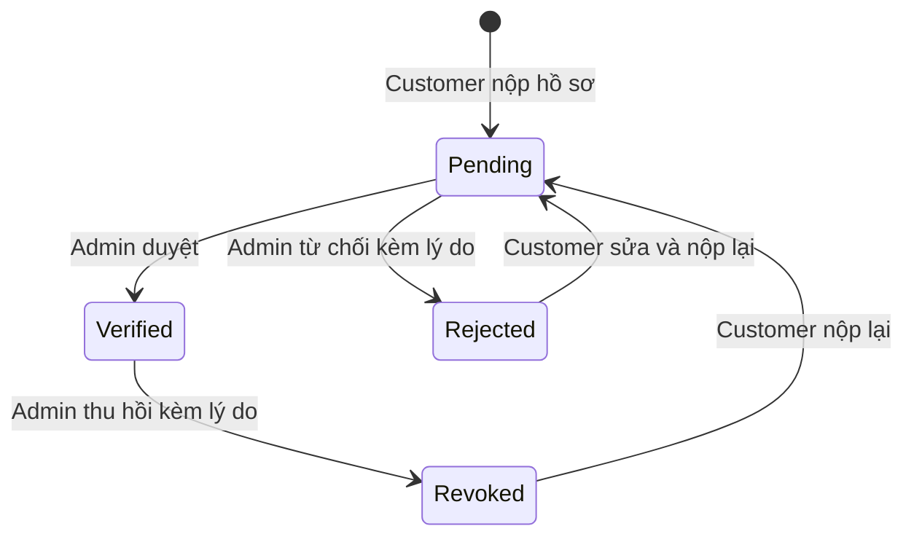

# SUPPLIER-VERIFICATION — Thiết kế chi tiết xác minh và duyệt nhà cung cấp

---

## I. Tên tài liệu, tính năng và tổng quan

- **Feature key:** `supplier-verification` (Tính năng #2 trong `mooncake-marketplace.md`)
- **Phiên bản:** 1.0.0 · **Ngày:** 2026-10-19 · **Trạng thái:** Implemented
- **Mục tiêu:** Customer nộp hồ sơ doanh nghiệp để trở thành Supplier. Chỉ Admin mới được duyệt, từ chối hoặc thu hồi. Supplier được duyệt mới dùng các API có quyền Supplier.
- **Phạm vi:** Hồ sơ doanh nghiệp, MST, email liên hệ, liên kết hai tài liệu pháp lý; theo dõi trạng thái; màn hình customer/supplier và admin; thông báo trong hệ thống, email SMTP; audit và workflow event; thu hồi quyền.
- **Ngoài phạm vi:** Upload file trực tiếp, xác thực MST với cơ quan thuế, OCR/kiểm định tài liệu tự động, chức năng gian hàng/RFQ riêng của các module khác và Notification Center (BE đã lưu notification; FE đọc trạng thái tại trang hồ sơ). Tài liệu phải được lưu ở địa chỉ HTTPS có thể mở được trước khi nộp.

## II. Flow chart toàn bộ luồng

### 2.1. Sequence diagram

```mermaid
sequenceDiagram
  actor C as Customer
  participant FE as mooncake-fe
  participant API as SuppliersController
  participant S as SupplierService
  participant DB as PostgreSQL
  actor A as Admin
  participant Mail as SMTP
  C->>FE: Điền thông tin và 2 tài liệu
  FE->>API: POST /api/v1/suppliers/me/apply (Bearer Customer)
  API->>S: Validate và tạo Pending
  S->>DB: Transaction: hồ sơ + tài liệu, giữ role Customer
  DB-->>FE: Pending
  A->>FE: Mở trang duyệt
  FE->>API: GET /pending và /verified
  A->>FE: Duyệt / Từ chối kèm lý do
  FE->>API: POST /{id}/review
  API->>S: Kiểm tra trạng thái Pending
  S->>DB: Transaction: trạng thái, role, tài liệu, audit, notification
  S->>Mail: Gửi email kết quả (best effort)
  C->>FE: Mở lại hồ sơ
  FE->>API: GET /me; khi Verified gọi refresh-token
  API-->>FE: Access token với role Supplier
  A->>API: POST /{id}/revoke (có lý do)
  API->>DB: Thu hồi role và refresh sessions, lưu audit/notification
```

### 2.2. State transition



Customer giữ `users.role=Customer` ở Pending/Rejected/Revoked. `users.requested_role=Supplier` ghi ý định đăng ký. Chỉ ở Verified mới gán `users.role=Supplier`. Khi thu hồi, refresh token/session đang hoạt động bị vô hiệu hóa; token Supplier cũ bị kiểm tra lại với trạng thái trong DB ở mỗi request.

## III. Chi tiết từng bước xử lý

### Bước 1 — Kiểm tra và chuẩn hóa đầu vào

- Tài khoản phải còn hoạt động; Admin không thể tự nộp hồ sơ.
- Tên doanh nghiệp tối đa 255, địa chỉ tối đa 500, mô tả tối đa 2000 ký tự; email hợp lệ, tối đa 255 ký tự, được trim và chuyển chữ thường.
- MST gồm 10 chữ số hoặc 10 chữ số, dấu gạch ngang và 3 chữ số chi nhánh. Ràng buộc unique trên `supplier_profiles.tax_code`.
- Cần 2 loại tài liệu: `BusinessLicense`, `FoodSafetyCertificate`. Tổng 2–10 tài liệu; URL tuyệt đối HTTPS, không chứa user-info, tối đa 1000 ký tự. FE kiểm tra cùng quy tắc trước khi gửi.
- Chặn nộp hồ sơ khi đang Pending hoặc đã Verified. Hồ sơ Rejected/Revoked được sửa và nộp lại; tài liệu cũ được soft-delete.

### Bước 2 — Giới hạn và lưu hồ sơ

- `POST /me/apply` dùng rate-limit policy `auth-otp` của WebApi.
- Repository lưu user, profile và documents trong một transaction. Xung đột MST trả 409. Customer chưa được cấp quyền Supplier khi chờ duyệt.

### Bước 3 — Admin xem và ra quyết định

- Admin xem danh sách Pending, Verified và chi tiết hồ sơ, đối chiếu tài liệu ở tab mới.
- Approve/Reject chỉ từ Pending; Revoke chỉ từ Verified. Từ chối và thu hồi phải có lý do 10–1000 ký tự.
- Repository cập nhật trạng thái có điều kiện (`WHERE verification_status = trạng_thái_cũ`) để hai Admin không cùng duyệt một hồ sơ. Một transaction cập nhật role, tài liệu, workflow event, in-app notification và audit log. Thu hồi đồng thời vô hiệu hóa refresh token/session.
- Sau commit, dịch vụ thử gửi email đến `contactEmail`. Lỗi SMTP được log; quyết định đã lưu vẫn có hiệu lực và thông báo trong hệ thống vẫn tồn tại. Gmail dùng `smtp.gmail.com`, cổng `587`, TLS bật và App Password trong `Smtp:Password`. Nếu `Smtp:Username` trống, hệ thống dùng `Smtp:FromEmail`. Có thể ghi đè bằng các biến `SMTP_HOST`, `SMTP_PORT`, `SMTP_USE_SSL`, `SMTP_FROM_EMAIL`, `SMTP_USERNAME`, `SMTP_PASSWORD`.

### Bước 4 — FE cập nhật quyền

- Trang `/nha-cung-cap/ho-so` hiển thị trạng thái, lý do, tài liệu và form nộp lại khi Rejected/Revoked.
- Sau duyệt, trang hồ sơ gọi refresh-token để lấy access token có role Supplier; nếu phiên không còn hợp lệ, yêu cầu đăng nhập lại.
- Trang `/admin/phe-duyet` có tab chờ duyệt/đã xác minh, duyệt, từ chối và thu hồi. Menu và route kiểm tra vai trò; BE vẫn là nơi thực thi phân quyền thật.
- Badge `Verified` của gian hàng cần đọc trạng thái từ dữ liệu gian hàng/supplier khi triển khai module Shop. Trang hồ sơ hiện thể hiện trạng thái xác minh; không gắn badge giả cho gian hàng mẫu.

## IV. Đặc tả kỹ thuật API

Tất cả endpoint dùng `Bearer` và trả envelope `ApiResponse<T>` gồm `status`, `message`, `data`, `path`, `traceId`, `time`. Đường dẫn gốc: `/api/v1/suppliers`.

| Method | Endpoint | Quyền | Kết quả |
| --- | --- | --- | --- |
| POST | `/me/apply` | Authenticated Customer | Tạo/nộp lại hồ sơ Pending; rate limit `auth-otp` |
| GET | `/me` | Authenticated | Hồ sơ và tài liệu của chính mình |
| GET | `/pending` | Admin | Danh sách hồ sơ chờ |
| GET | `/verified` | Admin | Danh sách đã xác minh |
| GET | `/{profileId}` | Admin | Chi tiết một hồ sơ |
| POST | `/{profileId}/review` | Admin | Duyệt hoặc từ chối Pending |
| POST | `/{profileId}/revoke` | Admin | Thu hồi Verified |

Ví dụ nộp hồ sơ:

```json
{
  "companyName": "Công ty Bánh Trăng",
  "taxCode": "0123456789",
  "address": "Hà Nội",
  "contactEmail": "contact@example.com",
  "description": "Sản xuất bánh trung thu",
  "documents": [
    { "documentType": "BusinessLicense", "fileUrl": "https://example.com/license.pdf" },
    { "documentType": "FoodSafetyCertificate", "fileUrl": "https://example.com/food.pdf" }
  ]
}
```

`POST /{id}/review` nhận `{ "approve": true }` hoặc `{ "approve": false, "rejectionReason": "Giấy phép kinh doanh không hợp lệ." }`. `POST /{id}/revoke` nhận `{ "reason": "Giấy phép kinh doanh đã hết hiệu lực." }`.

Phản hồi thành công có `data.verificationStatus` (`Pending`, `Verified`, `Rejected`, `Revoked`), `documents`, `rejectionReason`, `verifiedAt`, `reviewedAt`. Ví dụ:

```json
{
  "status": 200,
  "message": "Đã gửi hồ sơ nhà cung cấp. Vui lòng chờ quản trị viên duyệt.",
  "data": { "id": "uuid", "verificationStatus": "Pending", "documents": [] },
  "path": "/api/v1/suppliers/me/apply",
  "traceId": "...",
  "time": "2026-10-19T08:00:00Z"
}
```

| HTTP | Điều kiện | Message tiếng Việt |
| --- | --- | --- |
| 400 | Thiếu/sai thông tin | `Hồ sơ nhà cung cấp chưa đầy đủ hoặc không hợp lệ.` |
| 400 | MST sai | `Mã số thuế phải gồm 10 chữ số hoặc 10 chữ số kèm mã chi nhánh 3 chữ số.` |
| 400 | Thiếu tài liệu/URL không hợp lệ | `Cần cung cấp liên kết HTTPS cho giấy phép kinh doanh và giấy chứng nhận an toàn thực phẩm.` |
| 400 | Thiếu lý do hoặc dưới 10 ký tự | `Vui lòng nhập lý do từ chối hoặc thu hồi, tối thiểu 10 ký tự.` |
| 401 | Token thiếu/hết hạn | `Phiên làm việc đã hết hạn. Vui lòng thử lại.` |
| 403 | Sai quyền/tài khoản ngừng hoạt động | `Bạn không có quyền thực hiện thao tác này.` / `Tài khoản của bạn hiện không hoạt động.` |
| 404 | Không có hồ sơ | `Không tìm thấy hồ sơ nhà cung cấp.` |
| 409 | Đang chờ/đã xác minh | `Hồ sơ đang chờ duyệt. Bạn chưa thể nộp lại.` / `Nhà cung cấp đã được xác minh.` |
| 409 | MST trùng/trạng thái đã đổi | `Mã số thuế này đã được dùng trong hồ sơ khác.` / `Trạng thái hồ sơ đã thay đổi. Vui lòng tải lại danh sách.` |
| 429 | Quá nhiều lần nộp | Theo policy rate limiter của WebApi |

## V. Kiến trúc phân tầng và tổ chức mã nguồn

- **Domain:** `SupplierProfile`, `SupplierVerificationDocument`, `SupplierVerificationStatus`, `UserRole`.
- **Application:** `ISupplierService`/`SupplierService`, `ISupplierRepository`, DTO request/response, `MessageConstant`.
- **Infrastructure:** `SupplierRepository`, EF entity configuration, `SmtpEmailSender`; migration `20261019080009_AddSupplierContactEmail` thêm cột `supplier_profiles.contact_email varchar(255) NULL` để giữ tương thích hồ sơ cũ.
- **WebApi:** `SuppliersController`, xác thực JWT và kiểm tra trạng thái Supplier với DB.
- **Frontend:** `supplierVerificationService`, endpoint constants, `SupplierVerificationPage`, `SupplierReviewPage`, điều hướng/guard trong `App.jsx` và `Header.jsx`.

## VI. Bảo mật và kiểm thử

- [x] Admin endpoints dùng `[Authorize(Roles = "Admin")]`; customer chỉ xem hồ sơ của mình qua `/me`.
- [x] Không nâng role Supplier trước khi Verified; thu hồi kiểm tra token cũ và vô hiệu hóa refresh session.
- [x] Quyết định duyệt có điều kiện trạng thái và transaction; ghi audit/workflow/in-app notification.
- [x] URL tài liệu chỉ nhận HTTPS; FE mở bằng `noopener noreferrer`.
- [x] Kiểm thử service: 12 ca qua, gồm apply hợp lệ, MST/URL sai, thiếu tài liệu, nộp lại sau từ chối, approve, reject thiếu lý do, review trùng, revoke khi SMTP lỗi.
- [x] HTTP smoke trên DB đã migrate: Customer/Admin đăng nhập, kiểm tra 403/404/400, nộp, từ chối, nộp lại, duyệt, refresh lên Supplier, thu hồi, token cũ bị 401, đăng nhập lại về Customer. Dữ liệu thử đã xóa.
- [ ] Chưa gửi email thử ra ngoài. Cấu hình Gmail SMTP đã sẵn sàng; cần xác nhận bằng một quyết định duyệt thật hoặc email smoke test được chủ dự án cho phép. Quyết định duyệt và trạng thái trên trang hồ sơ không phụ thuộc việc gửi email thành công.

Lệnh kiểm thử: `dotnet test tests/Mooncake.EcommercePlatform.SupplierVerification.Tests/Mooncake.EcommercePlatform.SupplierVerification.Tests.csproj --no-restore`; `dotnet build src/Mooncake.EcommercePlatform.WebApi/Mooncake.EcommercePlatform.WebApi.csproj`; trong `mooncake-fe`: `npm run lint` và `npm run build`. Tất cả lệnh đều thành công. Migration `AddSupplierContactEmail` đã áp dụng lên DB cấu hình ngày 2026-10-19.
