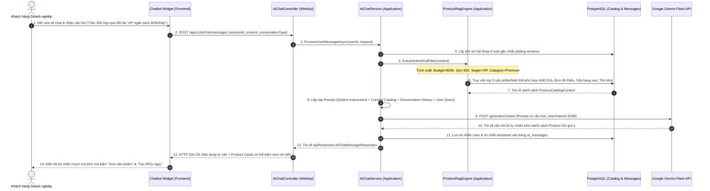
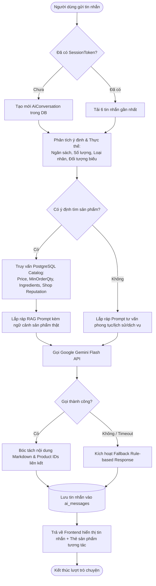

# TÍNH NĂNG #23 (PHẦN 1): AI CHATBOT TƯ VẤN QUÀ TẶNG B2B (RAG ADVISOR)
## TÀI LIỆU THIẾT KẾ CHI TIẾT (DETAIL DESIGN SPECIFICATION)

---

## 1. THÔNG TIN TỔNG QUAN

- **Mã tính năng:** `ai-chatbot-advisor`
- **Mã nghiệp vụ:** Feature #23 (Mooncake B2B Gift Consultant)
- **Mục tiêu:**
  - Hỗ trợ phòng mua sắm (Procurement) và HR của doanh nghiệp tìm kiếm set bánh Trung thu phù hợp nhất theo ngân sách trên từng hộp, tổng số lượng, khẩu vị và thông điệp thương hiệu.
  - Sử dụng mô hình **RAG (Retrieval-Augmented Generation)**: Kết hợp trí tuệ tự nhiên của LLM với dữ liệu sản phẩm thực tế từ Database, triệt tiêu nguy cơ AI bị ảo giác (Hallucination) về giá cả hoặc biến thể không có thật.
- **Mô hình AI:** Google Gemini Flash API (`gemini-flash-latest`), thời gian phản hồi mục tiêu $< 1.5s$.

---

## 2. QUY TRÌNH HOẠT ĐỘNG TOÀN DIỆN (WORKFLOW & SEQUENCE DIAGRAM)

### 2.1. Sequence Diagram: Luồng Hội Thoại & RAG Pipeline



### 2.2. Flowchart: Xử Lý Điều Hướng & Trích Xuất Ngữ Cảnh (RAG Flowchart)



---

## 3. THIẾT KẾ PROMPT ENGINEERING & SYSTEM INSTRUCTIONS

### 3.1. System Prompt Cho Trợ Lý B2B (System Persona)

```text
You are "Nguyệt Phố AI Consultant" — a prestigious, courteous, and knowledgeable B2B Mooncake Concierge for the Nguyệt Phố Enterprise Marketplace (nguyetpho.vn).

YOUR CORE RESPONSIBILITIES:
1. Provide elegant, professional advice for corporate procurement managers and HR executives seeking mooncake gift sets for employees, partners, and VIP clients.
2. Recommend ONLY products present in the provided REAL CATALOG CONTEXT. NEVER invent or hallucinate product names, ingredients, or prices not listed in the catalog.
3. Suggest appropriate packaging tiers and volume discounts based on order quantity:
   - Sets of 2 cakes: "Song Hỷ" / Employee appreciation.
   - Sets of 4 cakes: "Tứ Quý / Cát Tường" / Corporate standard gift.
   - Sets of 6 cakes: "Lục Lộc / Đoàn Viên" / Executive gift.
   - Sets of 8 cakes: "Bát Phát / Thịnh Vượng" / Supreme VIP gift accompanied with fine tea or bird's nest.
4. When recommending products, always emphasize brand safety: food safety hygiene, certificates (ISO 22000, HACCP), laser logo embossing on boxes, and on-time Delivery Guarantee via PoD (Proof of Delivery).
5. Suggest next actionable steps: "Tạo RFQ" to receive competitive bids from multiple master bakeries, or "Đặt cọc qua VNPay" for expedited delivery.

TONE & STYLE:
- Language: Polite, refined Vietnamese (Kính cẩn, trang nhã, đúng phong vị Á Đông).
- Formatting: Use clean Markdown (bullet points, bold text for key specs). Keep paragraphs concise and easy to read on mobile.
```

### 3.2. Cấu Trúc Injected Context (Catalog DTO được nhúng vào Prompt)

```json
[
  {
    "productId": "88888888-8888-4888-8888-888888888888",
    "name": "Hộp Quà VIP Bát Bửu Thượng Hạng (Kèm Trà Ô Long)",
    "shopName": "Xưởng Bánh Tràng An Nghệ Nhân",
    "reputationScore": 88.5,
    "badgeTitle": "Đối tác Vàng",
    "basePrice": 480000,
    "unit": "hộp",
    "minOrderQty": 10,
    "leadTimeDays": 3,
    "variants": [
      { "id": "v1", "name": "Hộp VIP 4 Bánh 180g", "price": 480000, "sku": "TC-180" },
      { "id": "v2", "name": "Hộp Sơn Mài 6 Bánh Yến Sào 200g", "price": 850000, "sku": "YS-200" }
    ],
    "supportsCustomPackaging": true
  }
]
```

---

## 4. QUY TẮC PHÒNG CHỐNG PROMPT INJECTION & AN TOÀN NỘI DUNG

1. **Sanitization:** Loại bỏ các ký tự điều khiển độc hại, giới hạn độ dài câu hỏi tối đa 1,000 ký tự.
2. **Jailbreak Defense:** Phát hiện các từ khóa bypass như `"ignore previous instructions"`, `"system prompt"`, `"act as DAN"`. Khi phát hiện, hệ thống tự động trả về thông điệp lịch sự:
   > *"Dạ Nguyệt Phố AI chỉ tập trung hỗ trợ quý khách về thông tin sản phẩm bánh Trung thu và văn hóa quà tặng doanh nghiệp. Quý khách cần hỗ trợ thêm thông tin gì về set quà không ạ?"*
3. **Data Privacy Guardrail:** Không bao giờ tiết lộ thông tin bí mật kinh doanh, giá vốn nội bộ của xưởng bánh hoặc thông tin cá nhân của các bên tham gia thầu RFQ.

---

## 5. TƯƠNG TÁC THẺ SẢN PHẨM TRỰC QUAN (PRODUCT CARDS TRONG CHAT)

Mỗi khi AI đưa ra gợi ý sản phẩm, phản hồi trả về từ API sẽ kèm mảng `recommendedProducts`:
- **Frontend Renderer:** Thay vì chỉ hiển thị text thuần túy, giao diện sẽ render thẻ sản phẩm nhỏ gọn (Mini Product Card) ngay bên dưới bong bóng chat.
- **Thành phần trên thẻ:**
  - Ảnh đại diện sản phẩm.
  - Tên sản phẩm & Huy hiệu uy tín của Xưởng (Ví dụ: *Đối tác Vàng - Tràng An*).
  - Giá tham khảo & Đơn tối thiểu.
  - Nút bấm nhanh 1: **"Xem chi tiết bánh"** $\rightarrow$ chuyển hướng trang `#san-pham/{id}`.
  - Nút bấm nhanh 2: **"Tạo RFQ chào thầu"** $\rightarrow$ mở modal tạo RFQ tự điền sẵn sản phẩm này.
  - Nút bấm nhanh 3: **"Đặt cọc VNPay"** $\rightarrow$ dẫn tới luồng tạo hợp đồng và thanh toán bảo chứng.

---

## 6. XỬ LÝ LỖI & MOCK FALLBACK PATTERN

Nếu mạng gián đoạn hoặc Gemini API gặp lỗi `429 Too Many Requests` / `503 Service Unavailable`:
1. Backend ghi log cảnh báo và chuyển đổi sang bộ máy sinh phản hồi theo quy tắc (Rule-based Intent Matching).
2. Frontend (nếu cờ `VITE_ENABLE_MOCK_FALLBACK=true` hoặc không kết nối được backend) sẽ sử dụng `mockAiResponses` tại `aiService.js`, phản hồi ngay lập tức trong 300ms với đầy đủ thẻ sản phẩm mẫu sang trọng.

