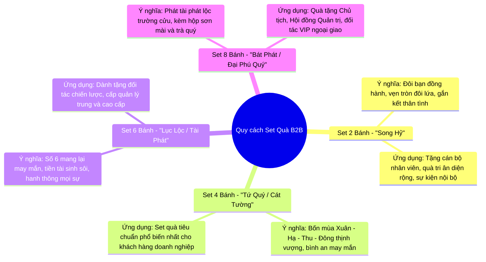

# TÍNH NĂNG #23 (PHẦN 2): CẨM NANG TRI THỨC VĂN HÓA BÁNH TRUNG THU & NGHỆ THUẬT QUÀ TẶNG B2B
## TÀI LIỆU THIẾT KẾ CHI TIẾT (CULTURAL KNOWLEDGE BASE SPECIFICATION)

---

## 1. MỤC TIÊU & TẦM NHÌN VĂN HÓA

- **Mã tính năng:** `mooncake-cultural-knowledge-base`
- **Tầm nhìn:**
  - Bánh Trung thu không chỉ là món ẩm thực mùa trăng mà còn là biểu tượng của **Văn hóa Đoàn viên**, sự tri ân thâm giao và uy tín thương hiệu trong giao thương B2B.
  - Khách hàng doanh nghiệp khi mua số lượng lớn luôn mong muốn set quà mang thông điệp chúc phúc ý nghĩa gửi tới đối tác chiến lược và nhân viên.
  - Tính năng cung cấp kho tri thức văn hóa chuyên sâu, giúp AI Chatbot trả lời thông tuệ, chuẩn xác về lịch sử, nghệ thuật làm bánh, phong tục tặng quà và nghệ thuật phối trà thượng hạng.

---

## 2. KHO TRI THỨC VĂN HÓA CỐT LÕI (CURATED CULTURAL KNOWLEDGE DOMAIN)

Kho tri thức được biên tập dưới dạng cấu trúc dữ liệu giàu ngữ cảnh (`CulturalKnowledgeEntity`) được nhúng trực tiếp vào Application Layer:

### 2.1. Lịch Sử & Ý Nghĩa Mùa Trăng
1. **Nguồn gốc Tết Trung Thu tại Việt Nam:**
   - Diễn ra vào ngày rằm tháng Tám âm lịch (trăng tròn và sáng nhất năm), gắn liền với văn minh lúa nước, lễ tạ ơn trời đất sau mùa thu hoạch bội thu và sum họp gia đình.
   - Hình ảnh mặt trăng tròn đầy tượng trưng cho sự trọn vẹn, viên mãn, gắn kết keo sơn giữa doanh nghiệp với đối tác và nhân sự.
2. **Hình dáng & Ý nghĩa tượng trưng:**
   - **Bánh nướng hình tròn:** Tượng trưng cho vầng trăng rằm, trời tròn đất vuông, khát vọng hòa hợp âm dương và sự thăng hoa bền vững.
   - **Bánh nướng hình vuông:** Tượng trưng cho Đất, sự vững chãi, uy tín và nền tảng kinh doanh trường tồn.

### 2.2. Phân Biệt Các Dòng Bánh & Kỹ Thuật Làm Bánh
| Dòng Bánh | Nét Đặc Trưng Ẩm Thực | Ý Nghĩa Văn Hóa & Phù Hợp Biếu Tặng |
| :--- | :--- | :--- |
| **Bánh Nướng Truyền Thống** | Vỏ bánh vàng ươm màu hổ phách, quét lòng đỏ trứng gà; nhân thập cẩm xá xíu, lạp xưởng, lá chanh non, hạt sen, mỡ đường, trứng muối bùi dẻo. | Biểu tượng của sự đậm đà, ấm áp, tri ân cội nguồn. Thích hợp tặng đối tác lâu năm, khách hàng truyền thống. |
| **Bánh Dẻo Truyền Thống** | Vỏ bột nếp cái hoa vàng thơm nức hương hoa bưởi thanh khiết, trắng ngần như vầng trăng sáng; nhân đậu xanh, hạt sen nhuyễn mịn. | Tượng trưng cho sự thanh cao, thuần khiết và an lành. Rất được ưa chuộng trong các tiệc trà thanh nhã. |
| **Bánh Tuyết Hoa (Snowskin)** | Nguồn gốc hiện đại, giữ lạnh mềm mát, vỏ không nướng nhiều màu sắc tự nhiên (matcha, phúc bồn tử, khoai môn); nhân kem custard hoặc trái cây. | Tươi trẻ, hiện đại, ít ngấy. Rất phù hợp tặng cho khối nhân viên công nghệ, startup hoặc người trẻ năng động. |
| **Bánh Lava Trứng Muối Chảy** | Nhân kem trứng muối béo ngậy tan chảy khi cắt bánh, vỏ bánh mềm mịn thơm bơ Pháp. | Mang ý nghĩa dòng tài lộc tuôn chảy dồi dào, thăng tiến thuận lợi trong kinh doanh. |
| **Bánh Cao Cấp Thực Dưỡng / Yến Sào Vi Cá** | Sử dụng nguyên liệu quý hiếm (Yến sào Khánh Hòa, Vi cá, Đông trùng hạ thảo, hạt Macca, hạt óc chó, đường Isomalt ăn kiêng). | Thể hiện sự tôn trọng tối thượng về sức khỏe, dành tặng lãnh đạo cấp cao, đối tác VIP ngoại giao. |

### 2.3. Ý Nghĩa Của Quy Cách Hộp Quà Doanh Nghiệp (Set Sizes)
AI Chatbot được đào tạo để tư vấn số lượng bánh trong mỗi hộp quà theo đúng quy chuẩn lễ nghi:



### 2.4. Nghệ Thuật Phối Trà Thượng Hạng (Tea Pairing Guide)
- **Bánh nướng thập cẩm nhiều đạm & trứng muối:** Phối cùng **Trà Ô Long Bảo Lộc** hoặc **Trà Cổ Thụ Shan Tuyết Hà Giang** vị chát đậm hậu ngọt sâu, giúp cân bằng vị giác, thanh nhiệt, kích thích tiêu hóa.
- **Bánh dẻo hạt sen / đậu xanh ngọt thanh:** Phối cùng **Trà Ướp Hoa Sen Tây Hồ** hoặc **Trà Nhài**, giữ hương thơm dịu mát lan tỏa nơi đầu lưỡi.
- **Bánh hiện đại / Lava / Matcha:** Phối cùng **Trà Xanh Thái Nguyên búp nõn** hoặc trà thảo mộc hoa cúc.

---

## 3. KIẾN TRÚC HYBRID RAG: KẾT HỢP VĂN HÓA & THƯƠNG MẠI

Khi khách hàng hỏi những câu hỏi có cả yếu tố văn hóa lẫn nhu cầu mua sắm thực tế:
> *Ví dụ: "Công ty tôi muốn tặng hộp 4 bánh cho đối tác tài chính, bạn giải thích ý nghĩa set 4 bánh và gợi ý 2 mẫu bánh nướng cao cấp nhất trên sàn nhé?"*

Quy trình xử lý Hybrid RAG:

```mermaid
sequenceDiagram
  autonumber
  participant User as Khách hàng
  participant Svc as AiChatService
  participant KB as CulturalKnowledgeStore (Static)
  participant Catalog as ProductRepository (Live DB)
  participant Gemini as Google Gemini API

  User->>Svc: Gửi câu hỏi phức hợp (Văn hóa + Mua sắm)
  par Truy vấn văn hóa
    Svc->>KB: Lấy tri thức về Set 4 Bánh (Tứ Quý) & đối tác tài chính
    KB-->>Svc: Trả về CulturalSnippets
  and Truy vấn sản phẩm
    Svc->>Catalog: Lấy top 2 sản phẩm 4 bánh cao cấp từ Xưởng uy tín
    Catalog-->>Svc: Trả về ProductCatalogDTOs
  end
  Svc->>Gemini: Gửi Prompt hỗn hợp (Ngữ cảnh văn hóa + Thẻ sản phẩm thật)
  Gemini-->>Svc: Sinh câu trả lời: Đoạn 1 tri thức văn hóa lịch thiệp; Đoạn 2 giới thiệu 2 set quà chuẩn xác
  Svc-->>User: Hiển thị câu trả lời trang nhã kèm 2 thẻ sản phẩm tương tác
```

---

## 4. BỘ CÂU HỎI MẪU (TEST CASES CHO TRI THỨC VĂN HÓA)

Hệ thống được thiết kế để vượt qua các bộ câu hỏi kiểm thử văn hóa khắt khe:

1. **Test Case CUL-01: Phân biệt bánh dẻo và bánh nướng**
   - *Kỳ vọng:* AI nêu rõ sự khác biệt về vỏ (bột nếp rang không qua nhiệt nướng vs bột mì nướng nhiệt độ cao), thời hạn bảo quản (bánh dẻo ngắn ngày hơn bánh nướng), và hương vị.
2. **Test Case CUL-02: Tư vấn quà cho người ăn kiêng / thuần chay**
   - *Kỳ vọng:* AI giải thích ý nghĩa thanh tịnh của bánh chay ngày rằm, gợi ý các vị hạt macca, hạt sen, đậu đỏ không trứng muối, dùng đường ăn kiêng Isomalt.
3. **Test Case CUL-03: Giải thích vì sao hộp quà Trung thu thường có trà hoặc rượu**
   - *Kỳ vọng:* Trả lời theo triết lý ẩm thực Á Đông: "Bánh ngọt - Trà thơm", sự đan xen giữa vị béo ngọt của bánh và vị chát nhẹ của trà tạo nên sự cân bằng hoàn hảo, thể hiện lời chúc trọn vẹn.

