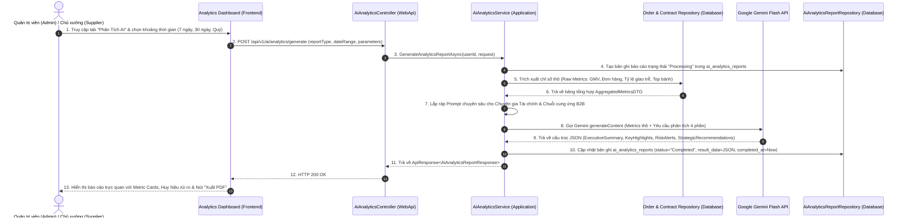

# TÍNH NĂNG #24: AI PHÂN TÍCH DỮ LIỆU BÁN HÀNG & THẤU CẢM THỊ TRƯỜNG (SALES ANALYTICS INTELLIGENCE)
## TÀI LIỆU THIẾT KẾ CHI TIẾT (ANALYTICS & INSIGHTS SPECIFICATION)

---

## 1. MỤC TIÊU NGHIỆP VỤ & PHÂN QUYỀN

- **Mã tính năng:** `sales-analytics-ai-insights`
- **Mã nghiệp vụ:** Feature #24 (Intelligent Sales & Marketplace Analytics)
- **Mục tiêu:**
  - Thay thế các biểu đồ số liệu khô khan bằng **Bản tóm tắt thấu cảm tự nhiên (Natural Language Insights)** do Google Gemini Flash tự động tổng hợp.
  - Giúp Ban điều hành (Admin) nắm bắt nhanh bức tranh thị trường toàn sàn mà không cần tự tính toán bảng tính phức tạp.
  - Giúp Nhà cung cấp (Supplier) tối ưu hóa dây chuyền sản xuất, điều chỉnh cơ cấu giá và nhận diện các cơ hội thầu RFQ tiềm năng.
- **Phân loại báo cáo:**
  1. `PlatformExecutiveReport`: Dành cho Quản trị viên (Admin) - Tổng quan toàn sàn.
  2. `ShopPerformanceReport`: Dành cho Nhà cung cấp (Supplier) - Báo cáo gian hàng riêng biệt.
  3. `DemandForecastReport`: Dự báo xu hướng tiêu thụ mùa Trung thu (theo danh mục & vùng miền).

---

## 2. QUY TRÌNH TẠO & PHỤC VỤ BÁO CÁO (ANALYTICS PIPELINE)



---

## 3. CẤU TRÚC CHỈ SỐ PHÂN TÍCH (ANALYTICS METRICS STRUCTURE)

### 3.1. Chỉ số Toàn Sàn dành cho Admin (Platform Metrics)
1. **Chỉ số Tài chính & Quy mô:**
   - **Tổng GMV (Gross Merchandise Value):** Tổng giá trị đơn hàng trực tiếp và hợp đồng đã xác nhận/ký kết.
   - **Tốc độ tăng trưởng:** Tỷ lệ phần trăm so với cùng kỳ tuần trước / tháng trước ($\Delta\%$).
   - **Tỷ lệ giải ngân thanh toán:** Tỷ lệ các milestone đã hoàn thành thanh toán qua VNPay/Chuyển khoản.
2. **Chỉ số Vận hành & Cung ứng:**
   - **Tỷ lệ hoàn thành đúng hạn (On-Time Delivery Rate):** Dựa trên dữ liệu xác minh PoD (Tính năng #20).
   - **Tỷ lệ chuyển đổi RFQ (RFQ Win Rate):** Số lượng RFQ được chốt hợp đồng / Tổng số RFQ ban hành.
   - **Top 5 Xưởng bánh B2B dẫn đầu:** Xếp hạng theo doanh số GMV, số hợp đồng và Điểm Uy Tín (Tính năng #22b).
3. **Phân bổ Thị phần:**
   - Theo danh mục bánh: Bánh nướng truyền thống (%), Bánh dẻo (%), Bánh Lava (%), Set quà VIP Yến sào (%).
   - Theo khu vực địa lý: Miền Bắc, Miền Trung, Miền Nam.

### 3.2. Chỉ số Gian Hàng dành cho Supplier (Shop Metrics)
1. **Doanh số & Đơn hàng:**
   - Doanh thu theo từng sản phẩm & từng biến thể (Variant SKU).
   - Giá trị trung bình trên một đơn hàng B2B (AOV - Average Order Value).
2. **Sức khỏe Vận hành & Tồn kho:**
   - Số đơn hàng đang sản xuất dở dang, số đơn chờ giao hàng.
   - Cảnh báo tồn kho biến thể: Các mẫu bánh đạt ngưỡng cảnh báo thiếu nguyên liệu hoặc quá tải công suất lò nướng.
   - Tỷ lệ khách hàng doanh nghiệp quay lại (Customer Retention Rate).

---

## 4. PROMPT SYSTEM DÀNH CHO BỘ MÁY PHÂN TÍCH (GEMINI ANALYTICS PROMPT)

```text
You are the Chief Market Analyst for "Nguyệt Phố B2B Marketplace".
Your duty is to transform raw quantitative operational metrics into high-value strategic executive intelligence.

INPUT DATA:
{
  "period": "Last 30 Days (Season Peak)",
  "totalGmv": 42500000000,
  "gmvGrowthPercentage": 18.4,
  "totalOrders": 128,
  "totalContracts": 46,
  "rfqSuccessRate": 74.2,
  "onTimeDeliveryRate": 97.1,
  "topCategories": [
    { "category": "Bánh Nướng Thượng Hạng", "percentage": 52.0 },
    { "category": "Hộp Sơn Mài Quà Tặng VIP", "percentage": 28.5 },
    { "category": "Bánh Tuyết Hoa & Lava", "percentage": 19.5 }
  ],
  "topRiskFactors": [
    { "type": "LateDeliveryWarning", "count": 2, "supplier": "Xưởng Bánh ABC" },
    { "type": "InventoryDepletion", "item": "Vỏ Hộp Sơn Mài 4 Bánh" }
  ]
}

OUTPUT REQUIREMENTS:
Generate a strictly valid JSON object matching the following structure:
{
  "executiveSummary": "Concise 2-3 sentence overview highlighting the main commercial achievement and health index.",
  "keyHighlights": [
    "Bullet 1 on strongest revenue driver",
    "Bullet 2 on conversion performance",
    "Bullet 3 on category trends"
  ],
  "riskAlerts": [
    { "severity": "High|Medium|Low", "description": "Specific operational risk detected", "impact": "Potential consequence" }
  ],
  "strategicRecommendations": [
    { "priority": "Urgent|High|Medium", "action": "Actionable directive for management", "expectedOutcome": "Anticipated financial or operational uplift" }
  ]
}

TONE:
Professional, authoritative, data-driven, business-oriented Vietnamese.
```

---

## 5. XUẤT BÁO CÁO PDF & ĐỊNH DẠNG IN ẤN CHUẨN A4

Báo cáo phân tích AI có tính năng xuất file chuyên nghiệp:
1. **Thiết kế bố cục A4:** Tương thích chuẩn in ấn với header Logo Nguyệt Phố B2B Luxury, con dấu số, ngày giờ sinh báo cáo, tên chuyên viên / quản trị viên yêu cầu.
2. **Khối tóm tắt chỉ số (KPI Scorecards):** 4 thẻ nổi bật với màu sắc Lucian Gold (`#8c1524`, `#d4af37`, `#f8f8fa`).
3. **Phần nội dung AI Insights:** Được định dạng đẹp mắt với các icon cảnh báo (`AlertOutlined`, `CheckCircleOutlined`, `ThunderboltOutlined`).
4. **Hỗ trợ định dạng in ấn:** Sử dụng CSS `@media print` giúp người dùng có thể bấm nút **"In Báo Cáo / Lưu PDF"** trực tiếp trên trình duyệt mà không bị vỡ layout, ẩn thanh điều hướng và menu hệ thống.

---

## 6. LƯU TRỮ VÀ TOÀN VẸN DỮ LIỆU (PERSISTENCE IN `ai_analytics_reports`)

Mỗi báo cáo được sinh ra đều được ghi nhận vào bảng `ai_analytics_reports`:
- `id`: UUID khóa chính.
- `requested_by`: UUID người yêu cầu.
- `report_type`: Enum `SalesTrend`, `SupplierPerformance`, `DemandForecast`, `RevenueSummary`.
- `parameters`: JSONB lưu các tham số lọc (Thời gian bắt đầu, kết thúc, ShopId, CategoryId).
- `result_data`: JSONB lưu toàn bộ cấu trúc kết quả phân tích của Gemini.
- `status`: Enum `Pending` $\rightarrow$ `Processing` $\rightarrow$ `Completed` hoặc `Failed`.
- `created_at` & `completed_at`: Đánh dấu thời điểm tạo và hoàn tất.

