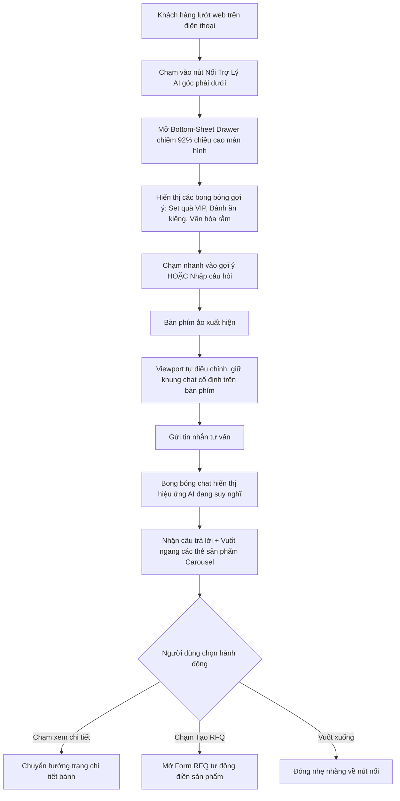
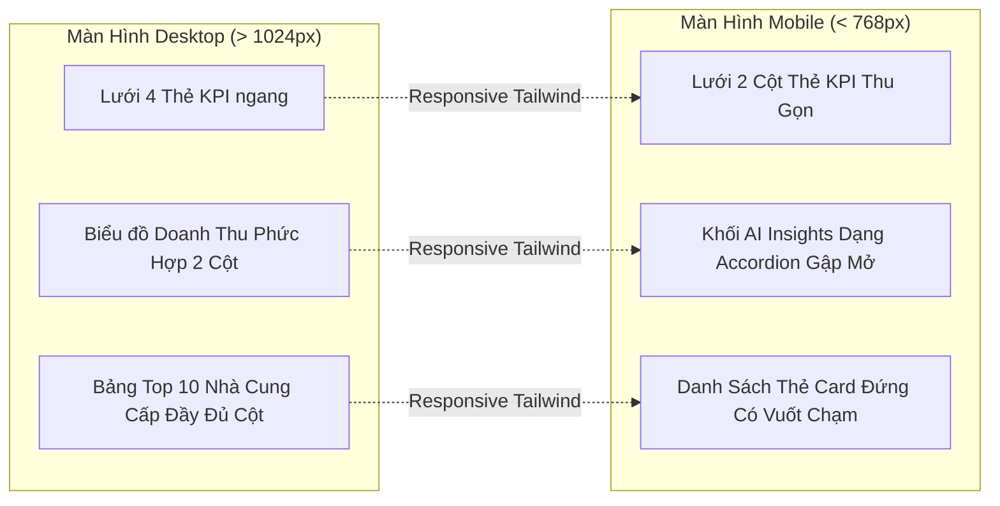

# TÍNH NĂNG #23 & #24: QUY TRÌNH MOBILE WORKFLOW & THIẾT KẾ RESPONSIVE WEB
## TÀI LIỆU THIẾT KẾ CHI TIẾT (MOBILE FIRST & RESPONSIVE WEB SPECIFICATION)

---

## 1. NGUYÊN TẮC THIẾT KẾ MOBILE & PHẠM VI TRIỂN KHAI

> [!IMPORTANT]
> **Yêu cầu chỉ đạo từ Ban Quản Trị Dự Án:**
> *"Chỗ nào đang yêu cầu mobile thì làm plan cho mobile, làm UI đó trên web và có responsive mobile luôn. Còn mobile native (React Native / Flutter) sẽ code sau."*

Theo đúng định hướng trên:
1. **Lập kế hoạch hoàn chỉnh cho Mobile Flow:** Thiết kế đầy đủ luồng người dùng trên thiết bị di động (User Journey, tương tác chạm vuốt, bàn phím ảo, xử lý safe-area trên iOS/Android).
2. **Hiện thực hóa 100% trên Web Responsive:** Toàn bộ tính năng AI Chatbot và Analytics Dashboard sẽ được xây dựng trên giao diện Web (`mooncake-fe`) với khả năng co giãn hoàn hảo (Responsive Grid, Bottom-Sheet Drawer, Flexbox/Tailwind) từ kích thước màn hình nhỏ 360px đến màn hình 4K.

---

## 2. MOBILE WORKFLOW CHO AI CHATBOT (TÍNH NĂNG #23)

### 2.1. Hành Trình Người Dùng Trên Thiết Bị Di Động



### 2.2. Chi Tiết Giao Diện Responsive Web Cho Chatbot

```text
┌──────────────────────────────────────────────┐
│  📱 MÀN HÌNH ĐIỆN THOẠI (Dưới 768px)          │
│                                              │
│  ┌────────────────────────────────────────┐  │
│  │ ═══ [Thanh Kéo Vuốt Xuống Để Đóng] ═══ │  │
│  │ 🌙 Nguyệt Phố AI - Trợ Lý Quà Tặng B2B  │  │
│  ├────────────────────────────────────────┤  │
│  │                                        │  │
│  │  🤖 Nguyệt Phố AI                      │  │
│  │  Kính chào quý khách! Tôi có thể giúp  │  │
│  │  gợi ý set bánh Trung thu theo ngân    │  │
│  │  sách và số lượng cho công ty mình ạ?  │  │
│  │                                        │  │
│  │  ┌──────────────────────────────────┐  │  │
│  │  │ 🥮 Hộp Quà VIP Bát Bửu (Tràng An)│  │  │
│  │  │ 480.000 đ | Tối thiểu 10 hộp     │  │  │
│  │  │ [Xem chi tiết] [Tạo RFQ Chào Giá]│  │  │
│  │  └──────────────────────────────────┘  │  │
│  │  (Vuốt ngang ➔ xem tiếp 2 set khác)    │  │
│  │                                        │  │
│  ├────────────────────────────────────────┤  │
│  │ [Set quà dưới 500k] [Bánh ít đường] ➔ │  │
│  ├────────────────────────────────────────┤  │
│  │ [Nhập câu hỏi cho AI...] [Gửi]         │  │
│  └────────────────────────────────────────┘  │
└──────────────────────────────────────────────┘
```

### 2.3. Các Giải Pháp Kỹ Thuật Responsive Cho Chatbot

1. **Thanh kéo Bottom-Sheet (`Touch Drag Handle`):**
   - Trên desktop: Hiển thị dạng Popup Modal hoặc Drawer trượt từ bên phải (`width: 440px`).
   - Trên mobile: Tự động chuyển đổi thành Bottom-Sheet trượt từ cạnh đáy lên với bo góc tròn sang trọng (`rounded-t-2xl`, `height: 92vh`).
2. **Chống lỗi đè nội dung của Bàn phím ảo (Virtual Keyboard Handling):**
   - Sử dụng `window.visualViewport` API để lắng nghe sự thay đổi chiều cao màn hình khi bàn phím ảo bật lên trên iOS Safari / Android Chrome.
   - Tự động bù trừ khoảng đệm đáy (`padding-bottom: visualViewport.height`), đảm bảo ô nhập văn bản và nút gửi luôn hiển thị ngay phía trên bàn phím ảo mà không bị che khuất.
3. **Thẻ sản phẩm cuộn ngang (Horizontal Swipeable Carousel):**
   - Danh sách sản phẩm gợi ý được bố trí dạng `flex overflow-x-auto snap-x scrollbar-none` giúp người dùng dùng ngón cái lướt qua các set quà nhanh chóng và tự nhiên.
   - Nút bấm có kích thước tối thiểu đạt chuẩn Accessibility ($44 \times 44\text{ px}$).

---

## 3. MOBILE WORKFLOW CHO BÁO CÁO PHÂN TÍCH BÁN HÀNG (TÍNH NĂNG #24)

### 3.1. Chuyển Đổi Layout Thống Kê Từ Desktop Sang Mobile



### 3.2. Bố Cục Responsive Chi Tiết Của Dashboard Trên Mobile

1. **Khối Thẻ Chỉ Số (KPI Metric Cards):**
   - Desktop: `Row gutter={[16, 16]}` với mỗi thẻ chiếm `Col span={6}` (4 cột).
   - Mobile: Chuyển thành `Col xs={12}` (2 cột) hoặc `Col xs={24}` (1 cột toàn màn hình) giúp các con số GMV và tỷ lệ % hiển thị rõ ràng, font chữ to không bị co cụm.
2. **Khối Phân Tích Thông Minh Của AI (AI Insight Accordion):**
   - Trên điện thoại, bản tóm tắt phân tích của Gemini được ưu tiên đặt lên đầu dưới dạng Card sang trọng viền vàng Lucian (`border-amber-300`).
   - Tích hợp tính năng Thu gọn / Mở rộng (`Expand/Collapse`) giúp quản lý cấp cao có thể đọc nhanh 3 gạch đầu dòng then chốt (Highlights) chỉ trong 10 giây lướt màn hình.
3. **Thao Tác Một Chạm (One-Tap Quick Actions):**
   - Nút bấm **"In Báo Cáo / Xuất PDF"** được neo cố định hoặc hiển thị dạng nút action nổi trên mobile, giúp tạo ngay bản in A4 sạch sẽ bất kỳ lúc nào.

---

## 4. MA TRẬN BREAKPOINTS & QUY CHUẨN TAILWIND CSS

| Điểm Ngắt (Breakpoint) | Kích Thước Màn Hình | Hành Vi Giao Diện Chatbot | Hành Vi Giao Diện Báo Cáo AI |
| :--- | :---: | :--- | :--- |
| **Mobile (`xs`)** | $< 576\text{ px}$ | Bottom Sheet toàn màn hình ($92\text{vh}$), vuốt ngang xem thẻ bánh | 1-2 cột Metric, danh sách dạng Card dọc, ẩn bớt cột phụ của bảng |
| **Phablet / Tablet Nhỏ (`sm`)** | $576\text{ px} - 768\text{ px}$ | Bottom Sheet rộng, phông chữ $14\text{ px}$ | 2 cột Metric, bảng có cuộn ngang an toàn (`scroll={{ x: 600 }}`) |
| **Tablet (`md`)** | $768\text{ px} - 1024\text{ px}$ | Drawer trượt từ mép phải màn hình ($420\text{ px}$) | 2-3 cột Metric, biểu đồ phân tích 1 cột |
| **Desktop (`lg`, `xl`)** | $> 1024\text{ px}$ | Drawer trượt mép phải ($480\text{ px}$) hoặc Modal nổi | 4 cột Metric chuẩn Enterprise, bảng đầy đủ các chỉ số GMV và PoD |

---

## 5. KẾ HOẠCH BÀN GIAO CHO MOBILE NATIVE (PHASE TIẾP THEO)

Toàn bộ logic nghiệp vụ (Service layer, DTOs, API endpoints) được tách rời hoàn toàn khỏi UI layer. Khi dự án bước sang giai đoạn code mobile native (React Native / Flutter):
1. **Tái sử dụng 100% Backend API:** Các endpoint `/api/v1/ai/chat/*` và `/api/v1/ai/analytics/*` đã chuẩn hóa RESTful `ApiResponse<T>`.
2. **Tái sử dụng Kiến trúc Session:** Cơ chế `sessionToken` lưu trong SQLite / SecureStorage của mobile app tương thích hoàn toàn với Web `localStorage`.

