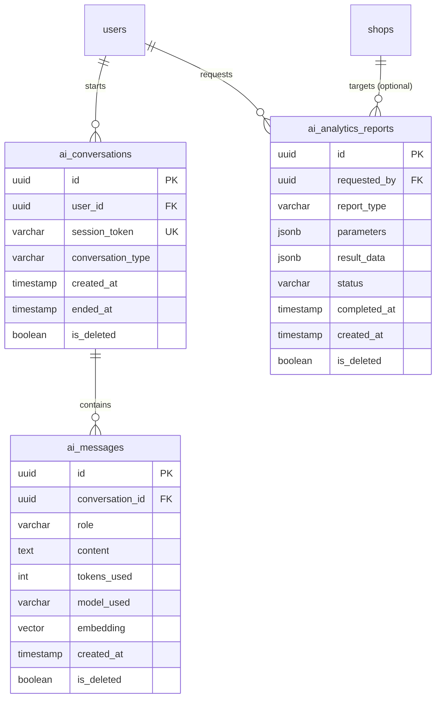
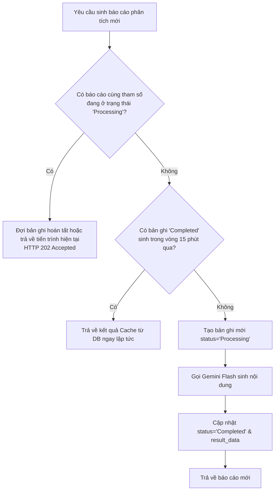

# TÍNH NĂNG #23 & #24: DỮ LIỆU, ĐỒNG THỜI, BẢO MẬT & CHI PHÍ TOKEN
## TÀI LIỆU THIẾT KẾ CHI TIẾT (PERSISTENCE, CONCURRENCY & SECURITY SPECIFICATION)

---

## 1. MÔ HÌNH DỮ LIỆU ENTITY-RELATIONSHIP (DATABASE SCHEMA)



---

## 2. CHÍNH SÁCH BẢO MẬT KHÓA API GEMINI (API KEY SECURITY)

1. **Bảo mật tuyệt đối ở phía Server:**
   - Khóa API Google Gemini (`GEMINI_API_KEY`) được lưu tại cấu hình bí mật của Backend (`appsettings.json` hoặc biến môi trường `GEMINI_API_KEY`).
   - **Tuyệt đối không bao giờ gửi khóa này về trình duyệt Client** hoặc đưa vào file JavaScript đóng gói.
   - Toàn bộ giao tiếp ra Google Generative Language API đều do `GeminiGateway` trong Infrastructure Layer thực hiện qua HTTPS POST.
2. **Cấu hình `GeminiOptions` trong Backend:**

```csharp
namespace Mooncake.EcommercePlatform.Infrastructure.Options;

public class GeminiOptions
{
    public const string SectionName = "Gemini";

    public string ApiKey { get; set; } = string.Empty;
    public string Model { get; set; } = "gemini-flash-latest";
    public string Endpoint { get; set; } = "https://generativelanguage.googleapis.com/v1beta/models/gemini-flash-latest:generateContent";
    public int TimeoutSeconds { get; set; } = 30;
    public int MaxTokens { get; set; } = 2048;
    public double Temperature { get; set; } = 0.7;
}
```

---

## 3. QUẢN TRỊ TÀI NGUYÊN TOKEN & TỐI ƯU CHI PHÍ (TOKEN BUDGETING)

Để kiểm soát chi phí gọi Google Cloud Gemini và duy trì tốc độ phản hồi chớp nhoáng ($< 1.5\text{s}$):

1. **Cửa Sổ Ngữ Cảnh Trượt (Sliding Window Context):**
   - Không nạp toàn bộ lịch sử trò chuyện hàng chục tin nhắn vào Prompt.
   - Chỉ lấy **6 tin nhắn gần nhất** (tương đương 3 lượt hỏi - đáp) để duy trì sự liền mạch ngữ cảnh, giới hạn ngữ cảnh lịch sử không vượt quá 1,200 tokens.
2. **Catalog Trimming (Rút gọn danh mục RAG):**
   - Chỉ truyền tối đa **top 5 sản phẩm/biến thể** phù hợp nhất với câu hỏi người dùng vào Prompt.
   - Định dạng catalog dưới dạng JSON tối giản (loại bỏ mô tả dài dòng và các trường không phục vụ tư vấn), giữ mức tiêu thụ context dưới 800 tokens.
3. **Cơ Chế Deduplication Cho Báo Cáo Phân Tích (Analytics Report Deduplication):**
   - Khi một Admin hoặc Supplier yêu cầu sinh báo cáo với cùng tham số (Ví dụ: `SalesTrend` trong vòng 30 ngày) đã tồn tại báo cáo tương tự được sinh trong vòng 15 phút qua, hệ thống sẽ trả về ngay kết quả đã lưu trong `ai_analytics_reports` mà **không gọi lại Gemini API**.
   - Tránh lãng phí token và tài nguyên tính toán của máy chủ.

---

## 4. QUẢN TRỊ ĐỒNG THỜI & CHỐNG RACE CONDITION (CONCURRENCY CONTROL)



---

## 5. BẢO MẬT DỮ LIỆU & QUYỀN RIÊNG TƯ (TENANT ISOLATION)

1. **Phân quyền báo cáo Supplier:**
   - Supplier chỉ có quyền truy xuất dữ liệu doanh thu thuộc quyền sở hữu của chính gian hàng mình (`ShopId`).
   - Câu truy vấn tổng hợp số liệu bắt buộc có điều kiện: `WHERE o.ShopId = currentSupplierShopId`.
2. **Ẩn danh hóa dữ liệu Khách hàng trong Chatbot:**
   - Các tin nhắn tư vấn công khai không chứa số thẻ ngân hàng, mật khẩu hoặc số CCCD.
   - Mọi tin nhắn nhạy cảm đều được làm sạch trước khi đưa vào ngữ cảnh LLM.

