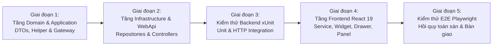

# TÍNH NĂNG #23 & #24: LỘ TRÌNH TRIỂN KHAI & KẾ HOẠCH KIỂM THỬ TOÀN DIỆN
## TÀI LIỆU THIẾT KẾ CHI TIẾT (IMPLEMENTATION, TESTING & ROLLOUT PLAN)

---

## 1. LỘ TRÌNH TRIỂN KHAI 5 GIAI ĐOẠN (5-PHASE IMPLEMENTATION ROADMAP)

### Chi Tiết Từng Giai Đoạn

1. **Giai đoạn 1: Application Layer & AI Gateway (Backend):**
   - Tạo DTOs trong `src/Mooncake.EcommercePlatform.Application/DTOs/Ai/`:
     - Requests: `StartAiSessionRequest.cs`, `SendAiMessageRequest.cs`, `GenerateAiAnalyticsReportRequest.cs`.
     - Responses: `AiSessionResponse.cs`, `AiMessageResponse.cs`, `AiAnalyticsReportResponse.cs`, `AiProductRecommendationDto.cs`.
   - Tạo `CulturalKnowledgeHelper.cs`: Đóng gói kho tri thức văn hóa, phong tục set 2/4/6/8 bánh và cẩm nang thưởng trà.
   - Định nghĩa Interfaces: `IAiChatService.cs`, `IAiAnalyticsService.cs`, `IAiConversationRepository.cs`, `IAiAnalyticsReportRepository.cs`, `IGeminiGateway.cs`.
2. **Giai đoạn 2: Infrastructure & WebApi (Backend):**
   - Hiện thực `GeminiGateway.cs`: Kết nối Google Gemini Flash API qua `HttpClient`, đọc cấu hình từ `GeminiOptions`, quản lý timeout 30s.
   - Hiện thực `AiConversationRepository.cs` và `AiAnalyticsReportRepository.cs`: Tối ưu hóa truy vấn EF Core, sliding window 6 tin nhắn, JSONB serialization.
   - Hiện thực `AiChatService.cs` và `AiAnalyticsService.cs`.
   - Tạo Controllers: `AiChatController.cs` và `AiAnalyticsController.cs` kế thừa `BaseApiController`.
   - Đăng ký DI trong `Application/DependencyInjection.cs` và `Infrastructure/DependencyInjection.cs`.
3. **Giai đoạn 3: Kiểm thử Đơn Vị & Tích Hợp Backend (xUnit):**
   - Xây dựng `AiChatManagementTests.cs` (Kiểm tra RAG catalog matching, prompt assembly, sliding window context, token budgeting).
   - Xây dựng `AiAnalyticsManagementTests.cs` (Kiểm tra tính toán GMV, tỷ lệ thầu RFQ, caching báo cáo 15 phút, fallback khi Gemini timeout).
   - Xây dựng `AiChatControllerHttpTests.cs` (Kiểm thử WebApi endpoints).
4. **Giai đoạn 4: Frontend Development (React 19 / Luxury UI):**
   - Bổ sung endpoints vào `src/constants/apiEndpoints.js`.
   - Hiện thực `src/services/aiService.js` với đầy đủ Mock Fallback Pattern.
   - Xây dựng các components:
     - `AiChatWidget.jsx`: Nút nổi Lucian Gold Pulse góc phải dưới.
     - `AiChatDrawer.jsx`: Giao diện chat sang trọng, responsive mobile bottom-sheet.
     - `AiProductCard.jsx`: Thẻ bánh gợi ý tương tác.
     - `AiAnalyticsPanel.jsx`: Tab báo cáo thông minh cho Admin & Supplier.
   - Tích hợp vào `App.jsx`, `DashBoard.jsx` và `ShopInformationPage.jsx`.
5. **Giai đoạn 5: Kiểm thử E2E Tự Động & Hồi Quy (Playwright):**
   - Viết kịch bản kiểm thử E2E: `tests/ai-assistant-analytics.spec.js` (4 scenarios).
   - Chạy kiểm thử hồi quy toàn bộ hệ sinh thái (16 tests hiện hữu + 4 tests AI mới = 20 tests).
   - Kiểm tra `npm run build` đạt 0 error, ESLint 0 warning.

---

## 2. MA TRẬN KIỂM THỬ BACKEND (UNIT & INTEGRATION TESTS)

| Mã Test Case | Tên Kiểm Thử | Tầng Kiểm Thử | Kết Quả Kỳ Vọng |
| :--- | :--- | :---: | :--- |
| `TC-AI-01` | `ProcessUserMessage_WithBudget_RetrievesMatchingCatalogProducts` | Unit Test | Trả về câu trả lời kèm đúng các sản phẩm có giá nằm trong ngân sách và số lượng tối thiểu. |
| `TC-AI-02` | `ProcessUserMessage_CulturalQuestion_ReturnsCulturalHeritageWisdom` | Unit Test | Trả về nội dung giải thích sâu sắc về văn hóa Tết Trung thu, ý nghĩa tròn đầy và phong tục tặng trà. |
| `TC-AI-03` | `ProcessUserMessage_SlidingWindow_RetainsOnlyLast6Messages` | Unit Test | Cắt tỉa lịch sử hội thoại, không bao giờ nạp quá 6 tin nhắn cũ vào Prompt của Gemini. |
| `TC-AI-04` | `ProcessUserMessage_GeminiTimeout_GracefullyFallsBackToRuleEngine` | Unit Test | Khi Gemini phản hồi quá 30s hoặc ngắt mạng, hệ thống trả về phản hồi dự phòng an toàn không ném lỗi 500. |
| `TC-AI-05` | `GenerateAnalyticsReport_PlatformWide_CalculatesAccurateGmvAndRates` | Unit Test | Tính toán chính xác tổng GMV, tỷ lệ hoàn thành đơn đúng hạn PoD và tỷ lệ chốt thầu RFQ từ DB thật. |
| `TC-AI-06` | `GenerateAnalyticsReport_DuplicateRequestWithin15Mins_ReturnsCachedReport` | Unit Test | Không gọi lại Gemini API nếu báo cáo cùng tham số vừa được tạo cách đó ít hơn 15 phút. |
| `TC-AI-07` | `AiChatController_AnonymousUser_PermitsChatSession` | Integration HTTP | Khách vãng lai chưa đăng nhập vẫn có thể bắt đầu phiên chat và nhận tư vấn set quà. |
| `TC-AI-08` | `AiAnalyticsController_UnauthorizedUser_RejectsWith401` | Integration HTTP | Người dùng chưa xác thực gọi endpoint phân tích kinh doanh bị chặn với mã HTTP 401 Unauthorized. |

---

## 3. KỊCH BẢN KIỂM THỬ E2E TỰ ĐỘNG (PLAYWRIGHT SPECIFICATION)

Tập tin kiểm thử: `mooncake-fe/tests/ai-assistant-analytics.spec.js` bao gồm 4 kịch bản trọng tâm:

### Kịch Bản 1: Khách Hàng Doanh Nghiệp Nhận Tư Vấn Set Quà & Thẻ Sản Phẩm Tương Tác
1. Khách hàng truy cập trang chủ `/#san-pham`.
2. Bấm vào nút nổi Trợ Lý AI (`AiChatWidget`).
3. Cửa sổ chat `AiChatDrawer` mở ra mượt mà.
4. Bấm vào chip gợi ý nhanh: *"Set quà đối tác VIP ngân sách 500k"*.
5. Kiểm tra tin nhắn của AI xuất hiện, chứa thông tin tư vấn trang nhã.
6. Kiểm tra thẻ sản phẩm `Hộp Quà VIP Bát Bửu` hiển thị với đầy đủ giá và huy hiệu "Đối tác Vàng".
7. Bấm nút **"Xem chi tiết bánh"** trên thẻ sản phẩm $\rightarrow$ Hệ thống điều hướng thành công đến trang `#san-pham/{productId}`.

### Kịch Bản 2: Khách Hàng Hỏi Tri Thức Văn Hóa & Phong Tục Thưởng Trà
1. Khách hàng mở Trợ Lý AI.
2. Nhập câu hỏi: *"Giải thích ý nghĩa set 4 bánh Tứ Quý và loại trà nào uống kèm ngon nhất?"*.
3. Bấm gửi tin nhắn.
4. Kiểm tra AI giải thích rõ ràng 4 mùa Xuân - Hạ - Thu - Đông, tượng trưng cho bình an và thịnh vượng.
5. Kiểm tra AI gợi ý phối cùng Trà Shan Tuyết Cổ Thụ hoặc Trà Ô Long để cân bằng vị bùi béo của nhân thập cẩm.

### Kịch Bản 3: Ban Quản Trị (Admin) Kích Hoạt Báo Cáo Phân Tích Toàn Sàn Bằng AI
1. Đăng nhập với quyền `Admin`.
2. Điều hướng đến `/#admin/dashboard`.
3. Chọn tab **"Phân Tích AI & Xu Hướng Thị Trường"**.
4. Bấm nút **"Cập Nhật Phân Tích Thông Minh"**.
5. Kiểm tra khối Tóm Tắt Điều Hành (Executive Summary) hiển thị bản dịch thuật tự nhiên của Gemini.
6. Kiểm tra các huy hiệu cảnh báo rủi ro (Risk Alerts) và kiến nghị chiến lược (Strategic Actions) hiển thị chuẩn mực.

### Kịch Bản 4: Nhà Cung Cấp (Supplier) Xem Phân Tích Gian Hàng & Cảnh Báo Tồn Kho
1. Đăng nhập với quyền `Supplier`.
2. Điều hướng đến trang quản trị gian hàng của xưởng bánh.
3. Mở tab Báo Cáo Phân Tích AI.
4. Kiểm tra hệ thống hiển thị top biến thể bán chạy nhất và cảnh báo tồn kho vỏ hộp sơn mài.
5. Bấm nút **"In Báo Cáo / Xuất PDF"** $\rightarrow$ Kích hoạt giao diện in ấn chuẩn A4 không lỗi vỡ khung.

---

## 4. TIÊU CHÍ BÀN GIAO & CAM KẾT CHẤT LƯỢNG (ZERO-ERROR GATE)

1. **Clean Code & Format:**
   - 100% tệp tin tuân thủ thụt lề 2 spaces, không dùng tab.
   - Backend 100% tiếng Anh cho định danh/comment; Frontend hiển thị tiếng Việt giao diện cao cấp.
2. **Build & Test:**
   - `dotnet test --no-restore` vượt qua 100% test cases (0 lỗi, 0 thất bại).
   - `npx playwright test` vượt qua 100% kịch bản E2E trên trình duyệt.
   - `npm run build` hoàn thành với 0 lỗi (Zero-error build).
   - ESLint không có bất kỳ cảnh báo hoặc lỗi cú pháp nào.
3. **Bảo mật tuyệt đối:**
   - Không commit code lên git (Tuân thủ triệt để chỉ đạo của User).
   - Khóa API Gemini được giữ kín trong cấu hình máy chủ, không bao giờ lộ ra frontend.

