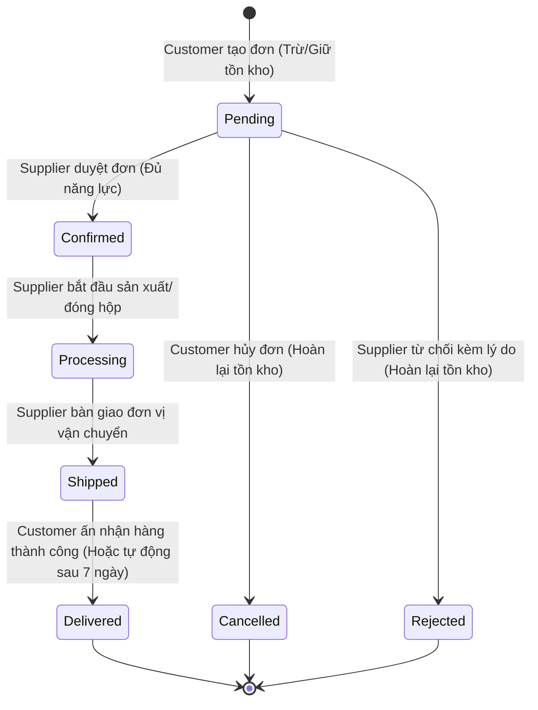

# [B2B-ORDER-07] - TÀI LIỆU THIẾT KẾ CHI TIẾT ĐẶT HÀNG SỐ LƯỢNG LỚN (BULK ORDER)

---

## I. TÊN TÀI LIỆU, TÍNH NĂNG & TỔNG QUAN

### 1.1. Thông tin tài liệu
- **Tên tài liệu:** Tài liệu thiết kế chi tiết tính năng Đặt hàng số lượng lớn (Bulk Order & Order Lifecycle)
- **Mã tính năng (Feature Key):** `b2b-order-bulk` (Module 4, Tính năng #7)
- **Độ ưu tiên:** 🔴 P0 Critical
- **Phiên bản:** `1.0.0` | **Ngày lập:** 2026-10-29
- **Tác nhân tham gia (Actors):**
  - **Customer:** Khách hàng doanh nghiệp tạo đơn số lượng lớn, chọn biến thể bánh, hủy đơn khi còn Pending, xác nhận nhận hàng.
  - **Supplier:** Nhà cung cấp xưởng bánh nhận đơn, thẩm định năng lực sản xuất, xác nhận hoặc từ chối đơn, cập nhật tiến độ sản xuất/giao vận.
  - **Admin:** Giám sát giao dịch nền tảng, can thiệp khi có tranh chấp.

### 1.2. Mục tiêu nghiệp vụ (Business Goals)
- Đáp ứng nhu cầu mua sắm B2B số lượng lớn phục vụ quà tặng Trung Thu của các cơ quan, tập đoàn, ngân hàng.
- Bắt buộc kiểm soát quy cách bánh chính xác theo từng biến thể (`ProductVariant`), triệt tiêu sai sót nhầm lẫn loại vỏ, nhân bánh hoặc trọng lượng khi đóng hộp.
- Kiểm soát tồn kho chính xác theo thời gian thực (Zero Overselling), tự động khóa và giữ hàng trong suốt chu kỳ đơn hàng.
- Quy trình rõ ràng, minh bạch với đầy đủ thông báo trạng thái tức thời cho cả hai bên mua và bán.

### 1.3. Phạm vi tính năng (Scope)
- **Bao gồm (In-scope):**
  - Đặt hàng nhiều sản phẩm/biến thể thuộc cùng 1 gian hàng (`Shop`).
  - Kiểm tra điều kiện `min_order_qty`, `max_order_qty` của từng dòng sản phẩm.
  - Tự động áp dụng chiết khấu bậc thang tối ưu (tích hợp Feature #8).
  - Khởi tạo yêu cầu đóng gói in logo tùy biến (tích hợp Feature #9).
  - Trừ kho tức thời hoặc hoàn kho tự động khi đơn bị hủy hoặc từ chối.
  - Vòng đời trạng thái đơn hàng: `Pending -> Confirmed -> Processing -> Shipped -> Delivered` (hoặc `Cancelled` / `Rejected`).
  - Hỗ trợ cơ chế Idempotency chống gửi trùng lặp đơn hàng.
- **Không bao gồm (Out-of-scope):**
  - Đặt hàng giỏ hỗn hợp từ nhiều Shop khác nhau trong cùng 1 đơn (nguyên tắc B2B mỗi đơn ứng với 1 xưởng cung cấp duy nhất).
  - Chức năng thanh toán ký quỹ qua cổng quốc tế hoặc Escrow theo hợp đồng lớn (thuộc Module 6 Hợp đồng & Module 10 Thanh toán).
  - Chụp ảnh tải lên biên lai giao hàng có tọa độ GPS (thuộc Module 7 PoD Logistics).

### 1.4. Ràng buộc & Điều kiện tiên quyết (Invariants & Prerequisites)
| Quy tắc | Ràng buộc kỹ thuật |
| :--- | :--- |
| **Quyền đặt hàng** | Người dùng đã đăng nhập với vai trò `Customer`, tài khoản không bị khóa (`IsDeleted = false`, `Status = Active`). |
| **Gian hàng hợp lệ** | Gian hàng tiếp nhận (`ShopId`) phải ở trạng thái `Active`, thuộc về một Supplier đã được Admin xác minh (`Verified`). |
| **Bắt buộc Variant** | Mọi dòng sản phẩm (`OrderItem`) bắt buộc phải có `VariantId`. Không cho phép đặt mua sản phẩm ở cấp độ `Product` tổng quát. |
| **Giới hạn số lượng** | Số lượng mỗi dòng sản phẩm: `min_order_qty <= Quantity <= max_order_qty`. |
| **Idempotency** | Request Header bắt buộc phải có `Idempotency-Key` (UUIDv4 hợp lệ). |
| **Thời gian giao dự kiến** | `DeliveryDateExpected >= Today + Shop.MinimumLeadDays` (tối thiểu sau ngày hiện tại). |

---

## II. FLOW CHART TOÀN BỘ LUỒNG (WORKFLOW DIAGRAM)

### 2.1. Sequence Diagram - Luồng đặt đơn hàng B2B (Order Creation)

```mermaid
sequenceDiagram
  autonumber
  actor C as Khách hàng Doanh nghiệp (Customer)
  participant FE as Frontend (mooncake-fe)
  participant API as OrdersController
  participant SVC as OrderService
  participant PROMO as PromotionPricingEngine
  participant REPO as OrderRepository
  participant DB as PostgreSQL (ACID)
  actor S as Xưởng bánh (Supplier)

  C->>FE: 1. Chọn biến thể bánh, số lượng, địa chỉ giao, ghi chú đóng gói
  FE->>API: 2. POST /api/v1/orders (Idempotency-Key: UUID)
  API->>SVC: 3. CreateAsync(customerId, idempotencyKey, request)
  SVC->>REPO: 4. Kiểm tra IdempotencyKey đã tồn tại?
  alt Idempotency Key đã tồn tại và hash trùng
    REPO-->>SVC: Trả về đơn hàng cũ
    SVC-->>API-->>FE: 200 OK (Đơn hàng đã tồn tại trước đó)
  else Tạo đơn mới
    SVC->>REPO: 5. Khóa dòng kiểm tra tồn kho (SELECT ... FOR UPDATE trên ProductVariant)
    SVC->>PROMO: 6. Tính toán đơn giá biến thể & áp dụng chiết khấu bậc thang tốt nhất
    SVC->>SVC: 7. Tính tổng tiền: Subtotal - DiscountAmount + PackagingFee
    SVC->>REPO: 8. Insert Order, OrderItems, CustomPackaging (nếu có) & Trừ tồn kho StockQty
    REPO->>DB: 9. Ghi nhận Transaction & Ledger (ProductInventoryMovement)
    DB-->>SVC: Commit Transaction thành công
    SVC-->>API: 10. Trả về OrderResponse (Status: Pending)
    API-->>FE: 11. HTTP 201 Created
    FE-->>C: 12. Hiển thị màn hình chi tiết đơn & mã vận đơn
    SVC-)S: 13. Kích hoạt thông báo đơn mới đến Supplier (Email / In-app)
  end
```

### 2.2. State Transition Diagram - Vòng đời trạng thái đơn hàng (Order State Machine)



---

## III. CHI TIẾT TỪNG BƯỚC XỬ LÝ (STEP-BY-STEP LOGIC)

### Bước 1: Tiếp nhận Request & Kiểm tra Idempotency
1. Đọc Header `Idempotency-Key`:
   - Nếu rỗng hoặc không đúng định dạng Regex `^[A-Za-z0-9._:-]{8,128}$` -> Ném `HttpException(400, "Idempotency-Key header is required.")`.
2. Tạo mã băm SHA-256 từ nội dung Request Body (`IdempotencyRequestHash`).
3. Truy vấn DB kiểm tra xem `CustomerId` và `IdempotencyKey` đã có trong hệ thống chưa:
   - Nếu đã có và Hash khớp -> Trả về kết quả `OrderResponse` của đơn cũ (HTTP 200 OK).
   - Nếu đã có nhưng Hash khác -> Ném `HttpException(409, "This Idempotency-Key was already used with a different order request.")`.

### Bước 2: Kiểm tra tính hợp lệ của Gian hàng và Biến thể
1. Truy vấn `Shop` theo `ShopId`:
   - Nếu không tìm thấy -> `HttpException(404, "Shop was not found.")`.
   - Nếu `Shop.Status != Active` -> `HttpException(409, "The shop is currently not accepting new orders.")`.
2. Kiểm tra danh sách các dòng sản phẩm (`Items`):
   - Đảm bảo không có 2 dòng trùng lặp cùng một `VariantId`. Nếu trùng -> `HttpException(400, "Each product variant can appear only once in an order.")`.
3. Khóa dòng kiểm tra thông tin biến thể (`ProductVariant`) và sản phẩm cha (`Product`):
   - Sản phẩm cha phải thuộc đúng `ShopId`, đang `Active` và chưa bị xóa mềm (`IsDeleted = false`).
   - Kiểm tra `min_order_qty`: Nếu `item.Quantity < product.MinOrderQty` -> `HttpException(400, $"Quantity for '{product.Name}' must be at least {product.MinOrderQty}.")`.
   - Kiểm tra `max_order_qty`: Nếu `product.MaxOrderQty.HasValue` và `item.Quantity > product.MaxOrderQty.Value` -> `HttpException(400, $"Quantity for '{product.Name}' exceeds maximum allowed.")`.
   - Kiểm tra tồn kho: Nếu `variant.StockQty < item.Quantity` -> `HttpException(409, $"Insufficient stock for variant '{variant.Sku}'. Available: {variant.StockQty}.")`.

### Bước 3: Tính toán giá & Tích hợp Khuyến mãi / Đóng gói
1. Đơn giá cơ sở của biến thể: `unitPrice = product.BasePrice + variant.PriceAdjustment`.
2. Gọi công cụ tính toán chiết khấu (Promotion Engine):
   - Quét toàn bộ `PromotionRule` đang có hiệu lực (`IsActive = true`, trong khoảng thời gian `StartDate <= now < EndDate`).
   - Lựa chọn quy tắc chiết khấu có lợi nhất cho khách hàng theo số lượng `Quantity` đặt mua.
   - Tính toán `discountAmount` cho từng dòng.
3. Nếu đơn hàng có kèm yêu cầu đóng gói tùy biến (`CustomPackaging`):
   - Tính phí đóng gói dự kiến: `packagingFee = feePerUnit * totalQuantity`.
4. Tổng giá trị đơn hàng được tính toán:
   - `Subtotal = sum(unitPrice * quantity)`
   - `DiscountAmount = sum(lineDiscount)`
   - `PackagingFee = sum(itemPackagingFee)`
   - `TotalAmount = Subtotal - DiscountAmount + PackagingFee + ShippingFee`

### Bước 4: Thực thi Transaction Database nguyên tử
1. Mở Transaction cơ sở dữ liệu (`IDbContextTransaction`):
   - Tạo bản ghi `Order` với trạng thái `Status = OrderStatus.Pending`. Mã đơn hàng sinh tự động chuẩn: `MC-YYYYMMDDHHmmss-XXXXXX`.
   - Tạo danh sách bản ghi `OrderItem` lưu snapshot: `ProductNameSnapshot`, `VariantNameSnapshot`, `VariantSkuSnapshot`, `UnitPrice`, `DiscountAmount`.
   - Trừ tồn kho biến thể: `variant.StockQty = variant.StockQty - item.Quantity`.
   - Ghi nhật ký biến động kho `ProductInventoryMovement` với lý do `OrderReserved` và `ReferenceId = order.Id`.
   - Nếu có yêu cầu đóng gói, tạo bản ghi `CustomPackaging` với trạng thái `Pending`.
2. Commit Transaction. Nếu gặp xung đột đồng thời (Concurrency Exception) -> Rollback và ném `HttpException(409, "Inventory was modified concurrently. Please refresh and try again.")`.

### Bước 5: Vòng đời xử lý của Nhà cung cấp (Supplier Actions)
1. **Xác nhận đơn (`POST /orders/{id}/confirm`):**
   - Chỉ được thực hiện khi đơn ở trạng thái `Pending`.
   - Chuyển trạng thái đơn thành `Confirmed`. Gửi thông báo đến Customer.
2. **Từ chối đơn (`POST /orders/{id}/reject`):**
   - Chỉ được thực hiện khi đơn ở trạng thái `Pending`. Yêu cầu có `reason`.
   - Chuyển trạng thái thành `Cancelled` (hoặc `Rejected`).
   - Mở Transaction: Hoàn trả lại số lượng tồn kho `variant.StockQty += item.Quantity` và ghi nhận `ProductInventoryMovement` với loại `OrderCancelledRestock`.
3. **Bắt đầu sản xuất (`POST /orders/{id}/processing`):**
   - Chỉ thực hiện khi đơn đang là `Confirmed`. Chuyển thành `Processing`.
4. **Bàn giao vận chuyển (`POST /orders/{id}/ship`):**
   - Chỉ thực hiện khi đơn đang là `Processing`. Chuyển thành `Shipped`.

### Bước 6: Khách hàng hủy đơn hoặc Xác nhận nhận hàng (Customer Actions)
1. **Hủy đơn (`POST /orders/{id}/cancel`):**
   - Chỉ cho phép khi đơn vẫn ở trạng thái `Pending`.
   - Tự động hoàn tồn kho cho toàn bộ biến thể có trong đơn và chuyển trạng thái sang `Cancelled`.
2. **Xác nhận nhận hàng (`POST /orders/{id}/delivery/confirm`):**
   - Chỉ cho phép khi đơn ở trạng thái `Shipped`.
   - Chuyển trạng thái thành `Delivered`. Kích hoạt thông báo gợi ý viết đánh giá xưởng và sản phẩm.

---

## IV. ĐẶC TẢ KỸ THUẬT API (API CONTRACT SPECIFICATION)

### 4.1. Tạo đơn đặt hàng số lượng lớn (Place Bulk Order)
- **Endpoint:** `POST /api/v1/orders`
- **Quyền truy cập:** `Authorized (Role: Customer)`
- **Header bắt buộc:** `Idempotency-Key: <UUIDv4>`
- **Request Body:**
```json
{
  "shopId": "3fa85f64-5717-4562-b3fc-2c963f66afa6",
  "items": [
    {
      "productId": "4fa85f64-5717-4562-b3fc-2c963f66afa7",
      "variantId": "5fa85f64-5717-4562-b3fc-2c963f66afa8",
      "quantity": 250
    }
  ],
  "deliveryAddress": "Tòa nhà Keangnam Landmark 72, Phạm Hùng, Nam Từ Liêm, Hà Nội",
  "recipientName": "Nguyễn Văn Doanh Nghiệp",
  "recipientPhone": "0912345678",
  "deliveryDateExpected": "2026-09-15",
  "notes": "Giao giờ hành chính, liên hệ trước khi đến 1 tiếng."
}
```

- **Response Body (HTTP 201 Created):**
```json
{
  "status": 201,
  "message": "Order placed successfully.",
  "data": {
    "id": "7fa85f64-5717-4562-b3fc-2c963f66afb0",
    "orderNumber": "MC-20260901103000-A1B2C3",
    "customerId": "1fa85f64-5717-4562-b3fc-2c963f66afa4",
    "shopId": "3fa85f64-5717-4562-b3fc-2c963f66afa6",
    "status": "Pending",
    "subtotal": 27500000.00,
    "discountAmount": 2750000.00,
    "taxAmount": 0.00,
    "shippingFee": 0.00,
    "totalAmount": 24750000.00,
    "deliveryAddress": "Tòa nhà Keangnam Landmark 72, Phạm Hùng, Nam Từ Liêm, Hà Nội",
    "recipientName": "Nguyễn Văn Doanh Nghiệp",
    "recipientPhone": "0912345678",
    "deliveryDateExpected": "2026-09-15",
    "notes": "Giao giờ hành chính, liên hệ trước khi đến 1 tiếng.",
    "createdAtUtc": "2026-09-01T10:30:00Z",
    "items": [
      {
        "productId": "4fa85f64-5717-4562-b3fc-2c963f66afa7",
        "variantId": "5fa85f64-5717-4562-b3fc-2c963f66afa8",
        "productName": "Bánh Nướng Thập Cẩm Bát Bửu",
        "variantName": "2 Trứng (200g)",
        "sku": "SKU-TC-200",
        "quantity": 250,
        "unitPrice": 110000.00,
        "discountAmount": 2750000.00,
        "subtotal": 24750000.00
      }
    ]
  },
  "path": "/api/v1/orders",
  "traceId": "trace-99a88b77c6",
  "time": "2026-09-01T10:30:00Z"
}
```

### 4.2. Danh sách các Endpoints bổ trợ quản lý đơn
| Phương thức | Đường dẫn | Quyền | Mục đích |
| :--- | :--- | :--- | :--- |
| `GET` | `/api/v1/orders/mine` | Customer | Lấy danh sách đơn do khách hàng hiện tại đặt |
| `GET` | `/api/v1/orders/supplier` | Supplier | Lấy danh sách đơn mà xưởng bánh nhận được |
| `GET` | `/api/v1/orders/{orderId}` | Customer/Supplier/Admin | Lấy chi tiết đơn hàng (có kiểm tra quyền sở hữu) |
| `POST` | `/api/v1/orders/{orderId}/cancel` | Customer | Hủy đơn đang Pending kèm lý do |
| `POST` | `/api/v1/orders/{orderId}/confirm` | Supplier | Duyệt đơn hàng sang Confirmed |
| `POST` | `/api/v1/orders/{orderId}/reject` | Supplier | Từ chối đơn và hoàn trả tồn kho kho bánh |
| `POST` | `/api/v1/orders/{orderId}/processing` | Supplier | Chuyển đơn sang giai đoạn sản xuất |
| `POST` | `/api/v1/orders/{orderId}/ship` | Supplier | Chuyển đơn sang giai đoạn vận chuyển |
| `POST` | `/api/v1/orders/{orderId}/delivery/confirm` | Customer | Khách hàng bấm nhận hàng thành công |

---

## V. KIẾN TRÚC PHÂN TẦNG VÀ TỔ CHỨC MÃ NGUỒN (LAYER MAPPING)

```text
src/
├── Mooncake.EcommercePlatform.Domain/
│   ├── Entities/Order.cs                     # Entity Order kế thừa BaseEntity
│   ├── Entities/OrderItem.cs                 # Entity OrderItem lưu snapshot SKU/giá
│   ├── Entities/ProductInventoryMovement.cs   # Lưu vết biến động xuất/nhập/giữ kho
│   └── Enums/OrderStatus.cs                  # Pending, Confirmed, Processing, Shipped, Delivered, Cancelled
│
├── Mooncake.EcommercePlatform.Application/
│   ├── DTOs/Orders/Requests/
│   │   ├── CreateOrderRequest.cs             # Validate ShopId, Items, DeliveryAddress...
│   │   └── CancelOrderRequest.cs             # Lý do hủy/từ chối đơn
│   ├── DTOs/Orders/Responses/
│   │   └── OrderResponse.cs                  # Snapshot đầy đủ các dòng, địa chỉ, trạng thái
│   ├── Services/Interfaces/IOrderService.cs  # Hợp đồng nghiệp vụ
│   ├── Services/Implementations/OrderService.cs # Hiện thực luồng xử lý chính
│   └── Common/Interfaces/IOrderRepository.cs # Hợp đồng tương tác DB nguyên tử
│
├── Mooncake.EcommercePlatform.Infrastructure/
│   ├── Persistence/Configurations/OrderConfiguration.cs # Fluent API & Indexing
│   ├── Persistence/Configurations/OrderItemConfiguration.cs
│   └── Repositories/OrderRepository.cs       # Transaction, Lock hàng tồn kho
│
└── Mooncake.EcommercePlatform.WebApi/
    └── Controllers/OrdersController.cs       # RESTful API Endpoints kế thừa BaseApiController
```

---

## VI. BẢO MẬT & KIỂM THỬ (SECURITY & TESTING PLAN)

### 6.1. Checklist An toàn & Bảo mật
- [x] **Chống giả mạo giá:** Không chấp nhận giá tiền từ Client gửi lên. Đơn giá, chiết khấu và phụ phí được truy vấn và tính toán 100% tại Backend.
- [x] **Kiểm soát phân quyền:** Customer chỉ được xem và hủy đơn của chính mình; Supplier chỉ được xem và duyệt đơn của Shop mình quản lý.
- [x] **Chống Race Condition:** Sử dụng khóa dòng hàng tồn kho trong Transaction, đảm bảo tính nhất quán kể cả khi có 100 khách hàng cùng đặt hàng 1 biến thể tại cùng 1 giây.
- [x] **Chống Replay Attack / Thao tác lặp:** Yêu cầu bắt buộc `Idempotency-Key` với cơ chế băm hash payload để chặn tạo 2 đơn giống hệt nhau khi mạng chập chờn.

### 6.2. Kịch bản kiểm thử (Test Cases)
1. **Happy Path:** Đặt đơn 200 hộp bánh thỏa mãn tồn kho -> Đơn tạo thành công trạng thái `Pending` -> Supplier Confirm -> Processing -> Shipped -> Customer Confirm Delivery.
2. **Negative - Hết hàng (Out of Stock):** Biến thể còn 50 hộp, khách đặt 100 hộp -> Trả về HTTP 409 Conflict với thông báo số lượng không đủ.
3. **Negative - Dưới mức tối thiểu:** Sản phẩm yêu cầu `MinOrderQty = 50`, khách đặt 30 -> Trả về HTTP 400 Bad Request.
4. **Negative - Sai Shop:** Đặt 2 biến thể thuộc 2 Shop khác nhau trong 1 request -> Trả về HTTP 400 Bad Request.
5. **Idempotency Verification:** Gọi API tạo đơn 2 lần liên tiếp với cùng một `Idempotency-Key` -> Lần 2 trả lại kết quả đơn lần 1, không tạo thêm đơn mới và không trừ trùng tồn kho.
6. **Cancellation Restock:** Khách hoặc xưởng hủy đơn -> Kiểm tra tồn kho của `ProductVariant` được hoàn trả chính xác số lượng đã đặt.

