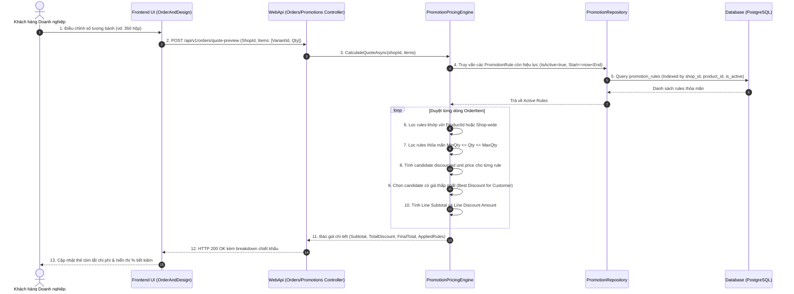

# [B2B-ORDER-08] - TÀI LIỆU THIẾT KẾ CHI TIẾT CHIẾT KHẤU BẬC THANG THEO SỐ LƯỢNG (TIERED PRICING & VOLUME PROMOTIONS)

---

## I. TÊN TÀI LIỆU, TÍNH NĂNG & TỔNG QUAN

### 1.1. Thông tin tài liệu
- **Tên tài liệu:** Tài liệu thiết kế chi tiết tính năng Khuyến mãi & Chiết khấu bậc thang theo số lượng (Tiered Pricing & Volume Promotion)
- **Mã tính năng (Feature Key):** `b2b-order-promotion` (Module 4, Tính năng #8)
- **Độ ưu tiên:** 🔴 P0 Critical
- **Phiên bản:** `1.0.0` | **Ngày lập:** 2026-10-29
- **Tác nhân tham gia (Actors):**
  - **Supplier:** Thiết lập các bậc chiết khấu (min_qty, max_qty, loại chiết khấu, giá trị giảm, hạn áp dụng) cho từng sản phẩm hoặc toàn gian hàng.
  - **Customer:** Nhận được mức chiết khấu tự động tốt nhất theo số lượng đặt mua, xem bảng giá bậc thang công khai.
  - **System (Engine):** Tự động chọn quy tắc chiết khấu có lợi nhất và áp dụng vào đơn hàng.

### 1.2. Mục tiêu nghiệp vụ (Business Goals)
- Khuyến khích khách hàng doanh nghiệp đặt mua số lượng lớn (Bulk Order) để tối ưu chi phí đơn vị.
- Đem lại sự linh hoạt tối đa cho xưởng bánh: có thể giảm theo tỷ lệ phần trăm (`Percentage`), giảm số tiền cố định (`FixedAmount`), hoặc ấn định mức giá trần cho mỗi hộp bánh (`FixedPrice`).
- Loại bỏ hoàn toàn sự can thiệp thủ công: hệ thống tự động tính toán chính xác, khách hàng đặt càng nhiều thì chiết khấu càng sâu.
- Cung cấp API tính toán trước chiết khấu (Pricing Quote Preview) giúp khách hàng nhìn thấy ngay số tiền tiết kiệm được trước khi ấn nút gửi đơn.

### 1.3. Phạm vi tính năng (Scope)
- **Bao gồm (In-scope):**
  - CRUD các quy tắc chiết khấu bậc thang của Supplier (`PromotionRule`).
  - Hỗ trợ 3 loại chiết khấu: `Percentage` (%), `FixedAmount` (VNĐ/đơn vị), `FixedPrice` (VNĐ/đơn vị).
  - Phạm vi áp dụng (Scope): Áp dụng cho một sản phẩm cụ thể (`ProductId != null`) hoặc áp dụng chung cho toàn gian hàng (`ProductId == null`).
  - Quản lý khoảng số lượng: `MinQty` đến `MaxQty` (hỗ trợ `MaxQty = null` cho bậc cao nhất, ví dụ: "từ 500 hộp trở lên").
  - Quản lý thời hạn hiệu lực: `StartDate` đến `EndDate` và cờ kích hoạt `IsActive`.
  - Thuật toán lựa chọn chiết khấu tốt nhất (**Best-Discount Engine**).
  - API tính toán trước chiết khấu (`Quote Preview API`) phục vụ giao diện thời gian thực của Frontend.
- **Không bao gồm (Out-of-scope):**
  - Mã giảm giá dạng Voucher/Coupon nhập tay (thuộc module Campaign Marketing).
  - Chiết khấu cộng dồn tích điểm thành viên (Loyalty points).

### 1.4. Ràng buộc & Điều kiện tiên quyết (Invariants & Prerequisites)
| Quy tắc | Ràng buộc kỹ thuật |
| :--- | :--- |
| **Quyền quản trị** | Chỉ Supplier đã được xác minh (`Verified`) và sở hữu gian hàng đang `Active` mới được tạo/sửa bảng giá bậc thang. |
| **Ràng buộc khoảng số lượng** | `MinQty >= 1`; Nếu có `MaxQty` thì bắt buộc `MaxQty >= MinQty`. |
| **Giá trị chiết khấu hợp lệ** | - Nếu `Percentage`: `0 < DiscountValue <= 100`.<br>- Nếu `FixedAmount` hoặc `FixedPrice`: `DiscountValue > 0`. |
| **Thời hạn áp dụng** | Nếu cung cấp cả `StartDate` và `EndDate` thì `EndDate > StartDate`. |
| **Không trùng lặp bậc** | Không cho phép tạo 2 rule đang active bị trùng lặp khoảng `[MinQty, MaxQty]` trên cùng một đối tượng (sản phẩm hoặc gian hàng). |

---

## II. FLOW CHART TOÀN BỘ LUỒNG (WORKFLOW DIAGRAM)

### 2.1. Sequence Diagram - Luồng tính toán chiết khấu (Pricing Evaluation Workflow)



### 2.2. Logic giải thuật lựa chọn chiết khấu tốt nhất (Best-Discount Algorithm)

```mermaid
flowchart TD
  Start([Bắt đầu tính giá cho dòng sản phẩm]) --> FetchRules[Lấy toàn bộ rule của Shop đang Active & trong hạn]
  FetchRules --> FilterScope{Khớp ProductId cụ thể hay Shop-wide?}
  FilterScope --> ScopeMatched[Chọn các rule khớp sản phẩm hoặc áp dụng toàn Shop]
  ScopeMatched --> FilterQty{Số lượng đặt nằm trong [MinQty, MaxQty]?}
  FilterQty -- Không khớp --> SkipRule[Bỏ qua rule này]
  FilterQty -- Thỏa mãn --> CalcCandidate[Tính giá sau giảm của từng rule]
  
  CalcCandidate --> EvalTypes{Loại chiết khấu?}
  EvalTypes -- Percentage --> FormPct["Giá mới = Đơn giá * (1 - Giảm% / 100)"]
  EvalTypes -- FixedAmount --> FormAmt["Giá mới = Đơn giá - Số tiền giảm"]
  EvalTypes -- FixedPrice --> FormFixed["Giá mới = Giá cố định mới"]
  
  FormPct --> Compare[So sánh tất cả các giá mới thỏa mãn]
  FormAmt --> Compare
  FormFixed --> Compare
  
  Compare --> PickMin[Chọn mức Giá mới THẤP NHẤT cho khách hàng]
  PickMin --> ClampPrice[Đảm bảo Giá mới >= 0 và <= Đơn giá gốc]
  ClampPrice --> Output([Xuất kết quả: Đơn giá thực tế, Tiền giảm mỗi hộp])
```

---

## III. CHI TIẾT TỪNG BƯỚC XỬ LÝ (STEP-BY-STEP LOGIC)

### Bước 1: Tiếp nhận và Validate Thiết lập Bảng giá của Supplier
1. Khi Supplier gọi `POST /api/v1/supplier/promotions`:
   - Xác thực quyền sở hữu: Shop của Supplier phải đang `Active`.
   - Nếu có `ProductId`: Sản phẩm phải thuộc về Shop này và chưa bị xóa mềm.
   - Kiểm tra `MinQty`: Phải là số nguyên dương `>= 1`.
   - Kiểm tra `MaxQty`: Nếu có, phải `>= MinQty`.
   - Kiểm tra loại chiết khấu (`DiscountType`):
     - `Percentage`: Giá trị `DiscountValue` phải từ `0.01` đến `100.00`.
     - `FixedAmount` / `FixedPrice`: `DiscountValue` phải lớn hơn 0.
   - Kiểm tra thời gian: Nếu cung cấp `StartDate` và `EndDate`, `EndDate` phải lớn hơn `StartDate`.
2. Kiểm tra chồng lấn khoảng số lượng (Overlapping Interval Check):
   - Truy vấn các rule đang active của cùng đối tượng (Shop hoặc Product).
   - Nếu khoảng `[MinQty, MaxQty]` của rule mới giao nhau với rule cũ cùng loại đối tượng -> Ném `HttpException(400, "The quantity range overlaps with an existing active promotion rule.")`.

### Bước 2: Lưu trữ và Cập nhật Rule trong Database
1. Ghi nhận bản ghi `PromotionRule` vào bảng `promotion_rules`.
2. Ghi nhận `AuditLog` lưu lại hành động tạo/cập nhật bảng giá bậc thang của Supplier.
3. Trả về `PromotionResponse` với HTTP 201 Created.

### Bước 3: Đánh giá chiết khấu khi tính báo giá hoặc đặt hàng (Evaluation Engine)
1. Xác định thời điểm hiện tại `now = DateTimeProvider.UtcNow`.
2. Với mỗi sản phẩm trong danh sách đặt:
   - Xác định đơn giá gốc: `originalUnitPrice = product.BasePrice + variant.PriceAdjustment`.
   - Khởi tạo giá sau giảm: `bestPrice = originalUnitPrice`, `appliedRuleId = null`.
   - Quét qua danh sách các `PromotionRule` thỏa mãn:
     ```csharp
     var candidatePrice = rule.DiscountType switch
     {
         DiscountType.Percentage => originalUnitPrice * (1 - Math.Clamp(rule.DiscountValue, 0, 100) / 100m),
         DiscountType.FixedAmount => Math.Max(0, originalUnitPrice - rule.DiscountValue),
         DiscountType.FixedPrice => rule.DiscountValue,
         _ => originalUnitPrice
     };
     if (candidatePrice < bestPrice)
     {
         bestPrice = candidatePrice;
         appliedRuleId = rule.Id;
     }
     ```
   - Làm tròn tiền tệ theo chuẩn 2 chữ số thập phân (`MidpointRounding.AwayFromZero`).
   - `lineDiscount = (originalUnitPrice - bestPrice) * quantity`.
3. Gắn `PromotionRuleId` tương ứng vào bản ghi `OrderItem` để làm bằng chứng snapshot khi lưu đơn hàng.

---

## IV. ĐẶC TẢ KỸ THUẬT API (API CONTRACT SPECIFICATION)

### 4.1. Tạo quy tắc chiết khấu bậc thang (Create Promotion Rule)
- **Endpoint:** `POST /api/v1/supplier/promotions`
- **Quyền truy cập:** `Authorized (Role: Supplier)`
- **Request Body:**
```json
{
  "productId": "4fa85f64-5717-4562-b3fc-2c963f66afa7",
  "name": "Chiết khấu doanh nghiệp Trung Thu 2026 - Bậc 2",
  "description": "Giảm 10% cho đơn từ 100 đến 499 hộp",
  "minQty": 100,
  "maxQty": 499,
  "discountType": "Percentage",
  "discountValue": 10.00,
  "startDate": "2026-08-01T00:00:00Z",
  "endDate": "2026-09-30T23:59:59Z",
  "isActive": true
}
```

- **Response Body (HTTP 201 Created):**
```json
{
  "status": 201,
  "message": "Promotion created successfully.",
  "data": {
    "id": "8fa85f64-5717-4562-b3fc-2c963f66afc1",
    "shopId": "3fa85f64-5717-4562-b3fc-2c963f66afa6",
    "productId": "4fa85f64-5717-4562-b3fc-2c963f66afa7",
    "name": "Chiết khấu doanh nghiệp Trung Thu 2026 - Bậc 2",
    "description": "Giảm 10% cho đơn từ 100 đến 499 hộp",
    "minQty": 100,
    "maxQty": 499,
    "discountType": "Percentage",
    "discountValue": 10.00,
    "startDate": "2026-08-01T00:00:00Z",
    "endDate": "2026-09-30T23:59:59Z",
    "isActive": true,
    "createdAtUtc": "2026-08-01T08:00:00Z"
  },
  "path": "/api/v1/supplier/promotions",
  "traceId": "trace-pr-01234",
  "time": "2026-08-01T08:00:00Z"
}
```

### 4.2. Tính toán trước báo giá chiết khấu (Quote Preview API)
- **Endpoint:** `POST /api/v1/orders/quote-preview`
- **Quyền truy cập:** `Anonymous / Authorized`
- **Request Body:**
```json
{
  "shopId": "3fa85f64-5717-4562-b3fc-2c963f66afa6",
  "items": [
    {
      "productId": "4fa85f64-5717-4562-b3fc-2c963f66afa7",
      "variantId": "5fa85f64-5717-4562-b3fc-2c963f66afa8",
      "quantity": 300
    }
  ]
}
```

- **Response Body (HTTP 200 OK):**
```json
{
  "status": 200,
  "message": "Quote preview calculated successfully.",
  "data": {
    "subtotal": 33000000.00,
    "totalDiscount": 3300000.00,
    "finalTotal": 29700000.00,
    "effectiveDiscountRate": 10.0,
    "lineBreakdown": [
      {
        "productId": "4fa85f64-5717-4562-b3fc-2c963f66afa7",
        "variantId": "5fa85f64-5717-4562-b3fc-2c963f66afa8",
        "quantity": 300,
        "originalUnitPrice": 110000.00,
        "discountedUnitPrice": 99000.00,
        "lineSubtotal": 33000000.00,
        "lineDiscount": 3300000.00,
        "lineTotal": 29700000.00,
        "appliedPromotion": {
          "id": "8fa85f64-5717-4562-b3fc-2c963f66afc1",
          "name": "Chiết khấu doanh nghiệp Trung Thu 2026 - Bậc 2",
          "discountType": "Percentage",
          "discountValue": 10.00
        }
      }
    ]
  },
  "path": "/api/v1/orders/quote-preview",
  "traceId": "trace-prev-5678",
  "time": "2026-08-01T08:05:00Z"
}
```

---

## V. KIẾN TRÚC PHÂN TẦNG VÀ TỔ CHỨC MÃ NGUỒN (LAYER MAPPING)

```text
src/
├── Mooncake.EcommercePlatform.Domain/
│   ├── Entities/PromotionRule.cs              # Entity PromotionRule
│   └── Enums/DiscountType.cs                  # Percentage, FixedAmount, FixedPrice
│
├── Mooncake.EcommercePlatform.Application/
│   ├── DTOs/Promotions/Requests/SavePromotionRequest.cs
│   ├── DTOs/Promotions/Responses/PromotionResponse.cs
│   ├── DTOs/Orders/Requests/OrderQuotePreviewRequest.cs
│   ├── DTOs/Orders/Responses/OrderQuotePreviewResponse.cs
│   ├── Services/Interfaces/IPromotionService.cs
│   ├── Services/Implementations/PromotionService.cs
│   └── Common/Helpers/PromotionPricingEngine.cs # Giải thuật tính Best Discount
│
├── Mooncake.EcommercePlatform.Infrastructure/
│   ├── Persistence/Configurations/PromotionRuleConfiguration.cs
│   └── Repositories/PromotionRepository.cs
│
└── Mooncake.EcommercePlatform.WebApi/
    ├── Controllers/SupplierPromotionsController.cs # CRUD cho Supplier
    └── Controllers/OrdersController.cs             # Quote preview endpoint
```

---

## VI. BẢO MẬT & KIỂM THỬ (SECURITY & TESTING PLAN)

### 6.1. Tiêu chuẩn bảo mật
- [x] Không thể khai thác lỗ hổng giảm giá âm: Giá sau chiết khấu luôn được kẹp (`Math.Clamp`) trong khoảng `[0, originalUnitPrice]`.
- [x] Kiểm soát chặt chẽ đối tượng sở hữu: Supplier tuyệt đối không thể tạo hay chỉnh sửa rule trên Shop của đối thủ cạnh tranh.
- [x] Bảo toàn snapshot: Khi một đơn hàng đã tạo, ID của rule và số tiền chiết khấu được chụp lại cố định trong `OrderItem`, việc Supplier thay đổi hoặc xóa rule sau đó không ảnh hưởng tới các đơn hàng trong quá khứ.

### 6.2. Kịch bản kiểm thử (Test Cases)
1. **Happy Path - Bậc thang Percentage:** Đặt 50 hộp được -5%, đặt 150 hộp được -10%, đặt 600 hộp được -15%.
2. **FixedPrice Tier:** Đặt >= 1000 hộp, đơn giá giảm từ 110.000đ xuống giá cố định 85.000đ/hộp.
3. **So sánh ưu đãi tối ưu:** Cùng lúc có 1 rule giảm 10% và 1 rule giảm 15.000đ/hộp. Với đơn giá 110.000đ, 10% là 11.000đ < 15.000đ -> Hệ thống tự động chọn rule giảm 15.000đ.
4. **Hết hạn hiệu lực:** Rule có `EndDate = Hôm qua` -> Hệ thống tự động bỏ qua và tính giá gốc.
5. **Kiểm tra chồng lấn bậc:** Tạo bậc 1 [50 - 100], cố gắng tạo bậc 2 [80 - 200] trên cùng sản phẩm -> Bị chặn với HTTP 400 Bad Request.

