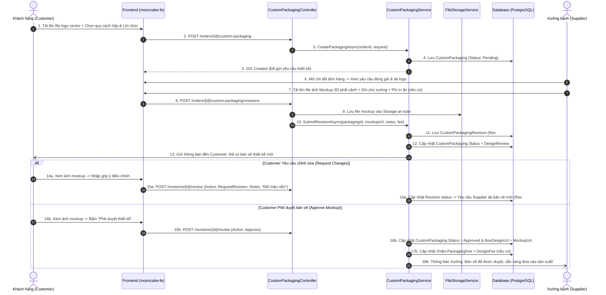
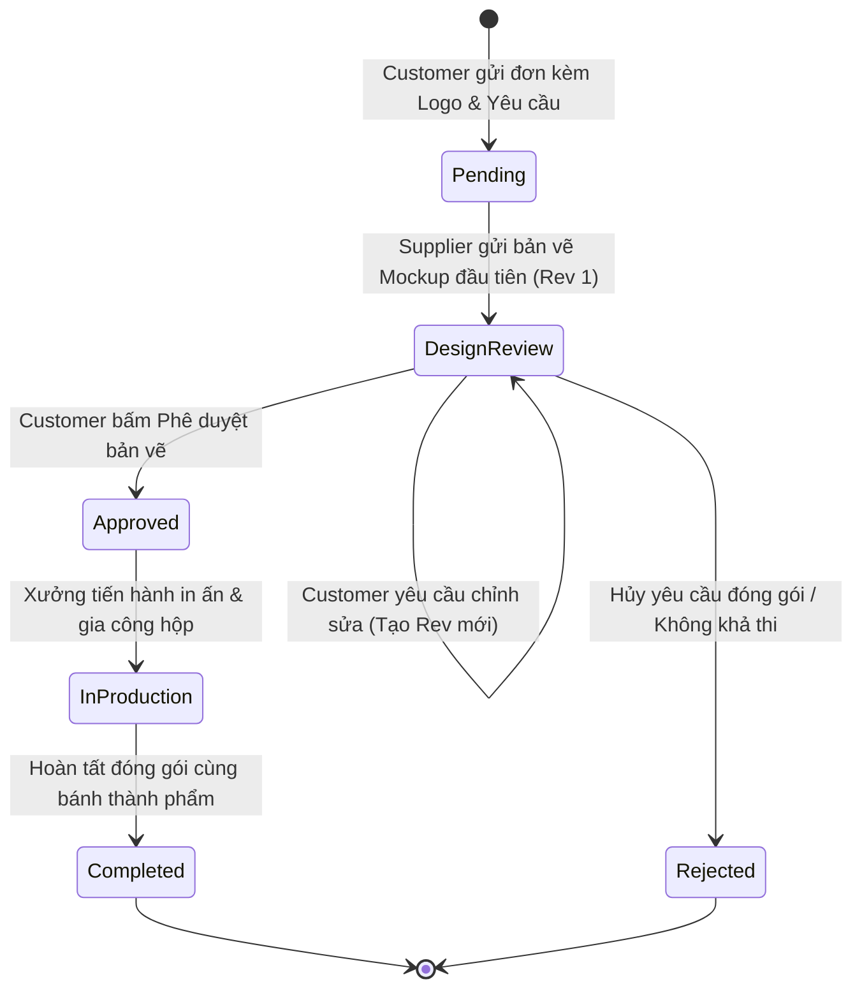

# [B2B-ORDER-09] - TÀI LIỆU THIẾT KẾ CHI TIẾT ĐÓNG GÓI & IN LOGO DOANH NGHIỆP (CUSTOM PACKAGING & BRANDING)

---

## I. TÊN TÀI LIỆU, TÍNH NĂNG & TỔNG QUAN

### 1.1. Thông tin tài liệu
- **Tên tài liệu:** Tài liệu thiết kế chi tiết tính năng Tùy biến đóng gói & In logo doanh nghiệp (Custom Packaging & Enterprise Branding)
- **Mã tính năng (Feature Key):** `b2b-order-packaging` (Module 4, Tính năng #9)
- **Độ ưu tiên:** 🟠 P1 High
- **Phiên bản:** `1.0.0` | **Ngày lập:** 2026-10-29
- **Tác nhân tham gia (Actors):**
  - **Customer:** Khách hàng doanh nghiệp gửi yêu cầu thiết kế hộp, tải lên logo vector công ty, lựa chọn màu sắc, nhập lời chúc Tết, xem và duyệt bản vẽ phối cảnh (mockup 3D).
  - **Supplier:** Xưởng sản xuất tiếp nhận yêu cầu, tải lên bản vẽ thiết kế (Mockup), báo phí thiết kế/in ấn phát sinh (nếu có), tiếp nhận yêu cầu chỉnh sửa và tiến hành sản xuất khi được duyệt.
  - **Admin:** Giám sát nội dung in ấn để ngăn chặn các hình ảnh vi phạm thuần phong mỹ tục hoặc nhãn hiệu bản quyền.

### 1.2. Mục tiêu nghiệp vụ (Business Goals)
- Đáp ứng nhu cầu quà tặng nhận diện thương hiệu cao cấp của các tập đoàn, doanh nghiệp (ép kim logo vàng/bạc, khắc laser, hộp sơn mài mỹ thuật).
- Thiết lập một quy trình làm việc chuẩn hóa (**Design Approval Workflow**) giữa bộ phận Marketing của khách hàng và đội ngũ thiết kế của xưởng bánh, xóa bỏ việc trao đổi file rời rạc qua Zalo hay Email cá nhân.
- Lưu trữ lịch sử tất cả các phiên bản chỉnh sửa (**Versioned Revisions**) làm căn cứ pháp lý nghiệm thu khi giao nhận hàng hoặc thanh toán hợp đồng.

### 1.3. Phạm vi tính năng (Scope)
- **Bao gồm (In-scope):**
  - Đăng ký yêu cầu đóng gói tùy biến gắn liền với đơn hàng (`Order`) hoặc hồ sơ yêu cầu báo giá (`RFQ`).
  - Tải lên tệp logo thương hiệu (Định dạng vector SVG, AI, PDF hoặc ảnh chất lượng cao PNG <= 5MB).
  - Cấu hình thông số hộp: Quy cách (`lacquer-4`, `luxury-6`, `bamboo-4`), bảng màu phối (`ColorScheme` JSON), kỹ thuật in (Ép kim, Khắc laser, In UV), thông điệp tri ân.
  - Vòng lặp duyệt thiết kế nhiều vòng (`CustomPackagingRevision`): Supplier upload mockup -> Customer ấn Duyệt (`Approved`) hoặc Yêu cầu chỉnh sửa (`DesignReview`).
  - Tự động cộng phụ phí thiết kế / in ấn vào tổng giá trị đơn hàng khi được thỏa thuận.
  - Đồng bộ trạng thái: `Pending -> DesignReview -> Approved -> InProduction -> Completed` (hoặc `Rejected`).
- **Không bao gồm (Out-of-scope):**
  - Công cụ biên tập 3D trực tuyến dạng Canvas/WebGL phức tạp (Customer và Supplier làm việc qua file xuất đồ họa mockup tiêu chuẩn).
  - Xưởng tự ý in ấn khi khách hàng chưa ấn "Phê duyệt" trên hệ thống.

### 1.4. Ràng buộc & Điều kiện tiên quyết (Invariants & Prerequisites)
| Quy tắc | Ràng buộc kỹ thuật |
| :--- | :--- |
| **Hỗ trợ sản phẩm** | Sản phẩm trong đơn hàng phải có cờ `Product.SupportsCustomPackaging = true`. |
| **Định dạng Logo** | Bắt buộc định dạng ảnh/vector an toàn: `image/png`, `image/svg+xml`, `application/pdf`. Dung lượng tối đa: 5MB. |
| **Phê duyệt trước sản xuất** | Đơn hàng chỉ được phép chuyển trạng thái `Processing/InProduction` khi trạng thái bao bì là `Approved` (hoặc nếu đơn không có đóng gói tùy biến). |
| **Đánh số Revision** | Mỗi vòng chỉnh sửa thiết kế tự động tăng `RevisionNumber` bắt đầu từ 1. |
| **Bảo lưu bản vẽ** | Bản vẽ mockup được Customer phê duyệt cuối cùng trở thành tài liệu bất biến (`Immutable`), không thể bị ghi đè hay xóa bỏ. |

---

## II. FLOW CHART TOÀN BỘ LUỒNG (WORKFLOW DIAGRAM)

### 2.1. Sequence Diagram - Vòng lặp duyệt thiết kế bao bì (Design Revision Loop)



### 2.2. State Transition Diagram - Vòng đời trạng thái đóng gói tùy biến



---

## III. CHI TIẾT TỪNG BƯỚC XỬ LÝ (STEP-BY-STEP LOGIC)

### Bước 1: Tiếp nhận yêu cầu Custom Packaging từ Khách hàng
1. Kiểm tra đơn hàng (`OrderId`):
   - Đơn hàng phải thuộc quyền sở hữu của Customer hiện tại và đang ở trạng thái `Pending` hoặc `Confirmed`.
   - Đơn hàng chưa từng tạo `CustomPackaging` trước đó (ràng buộc 1-1). Nếu đã có -> ném `HttpException(409, "Custom packaging already registered for this order.")`.
2. Kiểm tra tính hợp lệ của Logo công ty:
   - File URL phải là đường dẫn nội bộ an toàn sinh ra từ hệ thống lưu trữ file (`storageService`).
   - Tên công ty không được để trống, độ dài tối đa 255 ký tự.
3. Validate cấu trúc `ColorScheme`:
   - Chuỗi JSON hợp lệ chứa các mã màu HEX tiêu chuẩn (ví dụ: `{"primary":"#D4AF37","secondary":"#8B0000","accent":"#FFD700"}`).
4. Lưu bản ghi `CustomPackaging` vào Database với `Status = CustomPackagingStatus.Pending`.

### Bước 2: Xưởng sản xuất tải lên bản vẽ Mockup (Submit Revision)
1. Xác thực quyền:
   - Supplier phải là chủ sở hữu của gian hàng nhận đơn hàng này.
2. Kiểm tra trạng thái hiện tại của `CustomPackaging`:
   - Phải ở trạng thái `Pending` hoặc `DesignReview`.
   - Nếu đã là `Approved` hoặc `InProduction` -> ném `HttpException(409, "Cannot submit revisions to an already approved design.")`.
3. Xác định số thứ tự phiên bản (`RevisionNumber`):
   - Đếm số lượng revision hiện có: `nextRevisionNumber = currentRevisionsCount + 1`.
4. Tạo bản ghi `CustomPackagingRevision`:
   - `MockupUrl`: Đường dẫn ảnh hoặc file PDF phối cảnh.
   - `SupplierNotes`: Ghi chú về chất liệu, kỹ thuật gia công.
   - `DesignFee`: Phí thiết kế/bản kẽm in ấn phát sinh (nếu có, `>= 0`).
   - `Status = CustomPackagingStatus.DesignReview`.
5. Cập nhật `CustomPackaging.Status = CustomPackagingStatus.DesignReview`.
6. Kích hoạt Notification gửi đến Customer.

### Bước 3: Khách hàng đánh giá bản vẽ (Review Revision)
1. Xác thực quyền: Chỉ Customer sở hữu đơn hàng mới được đánh giá revision.
2. Kiểm tra trạng thái revision: Revision phải đang ở trạng thái `DesignReview`.
3. Nếu hành động là `Approve`:
   - Cập nhật `CustomPackagingRevision.Status = CustomPackagingStatus.Approved`.
   - Cập nhật `CustomPackaging.Status = CustomPackagingStatus.Approved`.
   - Ghi nhận `CustomPackaging.BoxDesignUrl = revision.MockupUrl` làm thiết kế chính thức.
   - Cập nhật phụ phí vào đơn hàng nếu có: `order.PackagingFee += revision.DesignFee` và điều chỉnh lại `order.TotalAmount`.
4. Nếu hành động là `RequestRevision`:
   - Khách hàng bắt buộc cung cấp `CustomerNotes` (tối thiểu 10 ký tự) nêu rõ các điểm cần chỉnh sửa.
   - Cập nhật trạng thái revision hiện tại thành `RevisionRequested` và gửi thông báo về cho Supplier.

### Bước 4: Chuyển sang giai đoạn sản xuất (In-Production)
1. Khi xưởng bánh bấm bắt đầu sản xuất đơn hàng (`POST /orders/{id}/processing`):
   - Nếu đơn hàng có `CustomPackaging`, hệ thống kiểm tra `CustomPackaging.Status == Approved`.
   - Nếu chưa được duyệt -> Chặn chuyển trạng thái và ném `HttpException(400, "Cannot start production until custom packaging design is approved by customer.")`.
   - Nếu đã duyệt -> Tự động chuyển `CustomPackaging.Status = CustomPackagingStatus.InProduction`.

---

## IV. ĐẶC TẢ KỸ THUẬT API (API CONTRACT SPECIFICATION)

### 4.1. Khởi tạo yêu cầu đóng gói in logo
- **Endpoint:** `POST /api/v1/orders/{orderId}/custom-packaging`
- **Quyền:** `Authorized (Role: Customer)`
- **Request Body:**
```json
{
  "companyName": "Tập đoàn Công nghệ SunTech",
  "companyLogoUrl": "https://storage.mooncake.vn/logos/suntech_logo_vector.svg",
  "packagingType": "lacquer-4",
  "colorScheme": "{\"primary\":\"#800020\",\"foil\":\"#D4AF37\",\"lining\":\"#FFF8DC\"}",
  "specialMessage": "SunTech Kính Chúc Quý Khách Vạn Sự Như Ý - Trung Thu 2026",
  "notes": "Ép kim logo vàng mờ trên nền đỏ đô, khắc laser số thứ tự hộp."
}
```

- **Response Body (HTTP 201 Created):**
```json
{
  "status": 201,
  "message": "Custom packaging request created successfully.",
  "data": {
    "id": "9fa85f64-5717-4562-b3fc-2c963f66afd1",
    "orderId": "7fa85f64-5717-4562-b3fc-2c963f66afb0",
    "companyName": "Tập đoàn Công nghệ SunTech",
    "companyLogoUrl": "https://storage.mooncake.vn/logos/suntech_logo_vector.svg",
    "packagingType": "lacquer-4",
    "status": "Pending",
    "createdAtUtc": "2026-09-01T10:35:00Z",
    "revisions": []
  },
  "path": "/api/v1/orders/7fa85f64-5717-4562-b3fc-2c963f66afb0/custom-packaging",
  "traceId": "trace-pkg-001",
  "time": "2026-09-01T10:35:00Z"
}
```

### 4.2. Xưởng tải lên bản vẽ Mockup (Submit Revision)
- **Endpoint:** `POST /api/v1/orders/{orderId}/custom-packaging/revisions`
- **Quyền:** `Authorized (Role: Supplier)`
- **Request Body:**
```json
{
  "mockupUrl": "https://storage.mooncake.vn/mockups/mockup_suntech_v1_3d.png",
  "supplierNotes": "Bản vẽ 3D hộp sơn mài 4 bánh kèm mẫu ép kim logo vàng 24k. Vui lòng kiểm tra chính tả lời chúc.",
  "designFee": 500000.00
}
```

- **Response Body (HTTP 201 Created):**
```json
{
  "status": 201,
  "message": "Packaging mockup revision submitted.",
  "data": {
    "id": "1ea85f64-5717-4562-b3fc-2c963f66afe2",
    "customPackagingId": "9fa85f64-5717-4562-b3fc-2c963f66afd1",
    "revisionNumber": 1,
    "mockupUrl": "https://storage.mooncake.vn/mockups/mockup_suntech_v1_3d.png",
    "supplierNotes": "Bản vẽ 3D hộp sơn mài 4 bánh kèm mẫu ép kim logo vàng 24k. Vui lòng kiểm tra chính tả lời chúc.",
    "designFee": 500000.00,
    "status": "DesignReview",
    "submittedAt": "2026-09-01T14:20:00Z"
  },
  "path": "/api/v1/orders/7fa85f64-5717-4562-b3fc-2c963f66afb0/custom-packaging/revisions",
  "traceId": "trace-pkg-002",
  "time": "2026-09-01T14:20:00Z"
}
```

### 4.3. Khách hàng đánh giá bản vẽ (Review Revision)
- **Endpoint:** `POST /api/v1/orders/{orderId}/custom-packaging/revisions/{revisionId}/review`
- **Quyền:** `Authorized (Role: Customer)`
- **Request Body:**
```json
{
  "action": "Approve",
  "notes": "Bản vẽ phối cảnh rất đẹp, màu sắc chuẩn nhận diện thương hiệu công ty."
}
```

- **Response Body (HTTP 200 OK):**
```json
{
  "status": 200,
  "message": "Packaging design approved successfully.",
  "data": {
    "packagingStatus": "Approved",
    "approvedMockupUrl": "https://storage.mooncake.vn/mockups/mockup_suntech_v1_3d.png",
    "reviewedAt": "2026-09-01T16:00:00Z"
  },
  "path": "/api/v1/orders/7fa85f64-5717-4562-b3fc-2c963f66afb0/custom-packaging/revisions/1ea85f64-5717-4562-b3fc-2c963f66afe2/review",
  "traceId": "trace-pkg-003",
  "time": "2026-09-01T16:00:00Z"
}
```

---

## V. KIẾN TRÚC PHÂN TẦNG VÀ TỔ CHỨC MÃ NGUỒN (LAYER MAPPING)

```text
src/
├── Mooncake.EcommercePlatform.Domain/
│   ├── Entities/CustomPackaging.cs            # Entity CustomPackaging
│   ├── Entities/CustomPackagingRevision.cs    # Entity lưu lịch sử từng vòng chỉnh sửa
│   └── Enums/CustomPackagingStatus.cs         # Pending, DesignReview, Approved, InProduction, Completed, Rejected
│
├── Mooncake.EcommercePlatform.Application/
│   ├── DTOs/Packaging/Requests/
│   │   ├── CreateCustomPackagingRequest.cs    # Logo, thông số hộp, thông điệp
│   │   ├── SubmitPackagingRevisionRequest.cs  # Mockup file, ghi chú xưởng, phí
│   │   └── ReviewPackagingRevisionRequest.cs  # Duyệt / Yêu cầu sửa
│   ├── DTOs/Packaging/Responses/
│   │   ├── CustomPackagingResponse.cs
│   │   └── CustomPackagingRevisionResponse.cs
│   ├── Services/Interfaces/ICustomPackagingService.cs
│   ├── Services/Implementations/CustomPackagingService.cs
│   └── Common/Interfaces/ICustomPackagingRepository.cs
│
├── Mooncake.EcommercePlatform.Infrastructure/
│   ├── Persistence/Configurations/CustomPackagingConfiguration.cs
│   ├── Persistence/Configurations/CustomPackagingRevisionConfiguration.cs
│   └── Repositories/CustomPackagingRepository.cs
│
└── Mooncake.EcommercePlatform.WebApi/
    └── Controllers/CustomPackagingController.cs # Quản lý quy trình duyệt thiết kế
```

---

## VI. BẢO MẬT & KIỂM THỬ (SECURITY & TESTING PLAN)

### 6.1. Checklist An toàn & Bảo mật
- [x] **Xác thực định dạng tệp:** Kiểm tra magic bytes của các tệp logo và mockup để loại trừ các mã độc ngụy trang (`.exe`, `.php`, `.js`).
- [x] **Kiểm soát quyền truy cập tài liệu:** Chỉ có chủ sở hữu đơn hàng và xưởng nhận đơn mới có quyền truy cập xem các file logo và bản vẽ thiết kế độc quyền.
- [x] **Khóa trạng thái bất biến:** Không cho phép Supplier tự ý thay đổi mockup khi Customer đã bấm phê duyệt. Mọi thay đổi sau khi duyệt bắt buộc phải tạo revision mới kèm xác nhận lại từ khách hàng.

### 6.2. Kịch bản kiểm thử (Test Cases)
1. **Happy Path:** Khách tạo đơn kèm yêu cầu in logo -> Xưởng gửi mockup 3D -> Khách bấm Approve -> Xưởng chuyển đơn sang sản xuất InProduction -> Hoàn tất.
2. **Revision Loop:** Xưởng gửi mockup v1 -> Khách yêu cầu chỉnh kích thước logo (Rev 1 -> RevisionRequested) -> Xưởng gửi mockup v2 -> Khách Approve.
3. **Chặn sản xuất trái phép:** Xưởng cố gắng gọi API `POST /orders/{id}/processing` khi bao bì chưa ở trạng thái `Approved` -> Bị chặn với HTTP 400 Bad Request.
4. **Phí thiết kế phát sinh:** Xưởng gửi mockup kèm phí khuôn in 500.000đ -> Khách bấm duyệt -> Kiểm tra `Order.TotalAmount` được cộng thêm chính xác 500.000đ.

