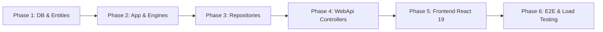

# [B2B-ORDER-07] - KẾ HOẠCH TRIỂN KHAI, KIỂM THỬ & BÀN GIAO (IMPLEMENTATION, TEST & ROLLOUT)

---

## I. LỘ TRÌNH TRIỂN KHAI THEO TỪNG GIAI ĐOẠN (IMPLEMENTATION PHASES)

Lộ trình phát triển được phân bổ theo 6 giai đoạn tuần tự nhằm đảm bảo chất lượng enterprise, không làm gián đoạn các tính năng hiện hữu và đáp ứng tiêu chuẩn Zero-Error Build.

### Giai đoạn 1: Cơ sở dữ liệu & Thực thể Domain (Phase 1)
- [ ] Rà soát thực thể `Order`, `OrderItem`, `PromotionRule`, `CustomPackaging`, `CustomPackagingRevision`.
- [ ] Bổ sung các cấu hình Fluent API: chỉ mục `idx_orders_status`, `idx_cpkg_order_id`, `idx_pr_active_window`.
- [ ] Tạo migration EF Core bổ sung các trường snapshot và check constraints (nếu thiếu).

### Giai đoạn 2: Tầng Nghiệp vụ Application & Pricing Engine (Phase 2)
- [ ] Xây dựng bộ công cụ tính toán chiết khấu tối ưu `PromotionPricingEngine` (xử lý `Percentage`, `FixedAmount`, `FixedPrice`, kiểm tra chồng lấn bậc).
- [ ] Hoàn thiện DTOs Request/Response cho `Orders`, `Promotions`, `CustomPackaging`.
- [ ] Viết giao diện và triển khai `ICustomPackagingService` (Tạo yêu cầu, submit bản vẽ mockup, duyệt revision).
- [ ] Nâng cấp `IOrderService` tích hợp tính trước báo giá (`Quote Preview`) và liên kết bao bì.

### Giai đoạn 3: Tầng Hạ tầng & Xử lý Tranh chấp Kho (Phase 3)
- [ ] Triển khai `CustomPackagingRepository` xử lý lưu trữ phiên bản thiết kế.
- [ ] Hoàn thiện `OrderRepository`:
  - Khóa dòng biến thể `SELECT ... FOR UPDATE` có sắp xếp ID chống deadlock.
  - Cập nhật trừ tồn kho nguyên tử kèm kiểm tra `stock_qty >= @quantity`.
  - Tự động hoàn kho khi đơn bị hủy hoặc từ chối.
  - Ghi nhận nhật ký biến động kho `ProductInventoryMovement`.

### Giai đoạn 4: Tầng WebApi Endpoints & Phân quyền (Phase 4)
- [ ] Mở rộng `OrdersController`: Thêm `POST /api/v1/orders/quote-preview`.
- [ ] Tạo mới `CustomPackagingController`:
  - `POST /api/v1/orders/{orderId}/custom-packaging` (Customer)
  - `GET /api/v1/orders/{orderId}/custom-packaging` (Customer / Supplier)
  - `POST /api/v1/orders/{orderId}/custom-packaging/revisions` (Supplier)
  - `POST /api/v1/orders/{orderId}/custom-packaging/revisions/{revisionId}/review` (Customer)
- [ ] Cấu hình Rate Limiting và Audit Middleware ghi nhận log giao dịch.

### Giai đoạn 5: Tích hợp Giao diện Frontend React 19 (Phase 5)
- [ ] Khai báo endpoints mới trong `src/constants/apiEndpoints.js`.
- [ ] Viết module `src/services/customPackagingService.js`.
- [ ] Cập nhật `src/Pages/Customer/OrderAndDesgin.jsx`:
  - Tích hợp chọn variant, debounce gọi API tính giá bậc thang.
  - Form tải logo vector, chọn loại hộp, nhập lời chúc.
- [ ] Cập nhật `src/Pages/Supplier/OrderManage.jsx`:
  - Bảng danh sách đơn hàng thực tế qua `orderService`.
  - Modal tải lên ảnh mockup 3D và quản lý timeline revision.
- [ ] Đảm bảo `npm run build` đạt 0 lỗi (Zero Error Build).

### Giai đoạn 6: Kiểm thử Tự động, Hiệu năng & Bàn giao (Phase 6)
- [ ] Viết Unit tests cho `PromotionPricingEngine` và `OrderService`.
- [ ] Viết Integration tests kiểm tra Idempotency và Rollback khi hết hàng.
- [ ] Viết kịch bản Playwright E2E mô phỏng toàn bộ luồng từ lúc khách đặt đơn -> xưởng gửi mockup -> khách duyệt -> giao hàng.
- [ ] Chạy kiểm thử tải đồng thời (Concurrency Benchmark).

---

## II. MA TRẬN KIỂM THỬ (TEST MATRIX)

### 2.1. Kiểm thử đơn vị (Unit Tests)
| Test Case ID | Mục tiêu kiểm thử | Đầu vào | Kết quả kỳ vọng |
| :--- | :--- | :--- | :--- |
| `UT-PROMO-01` | Tính chiết khấu Percentage bậc 2 | Đơn giá 100k, Qty 150, Rule: >=100 hộp giảm 10% | Đơn giá sau giảm: 90k, Tiền giảm: 1.5M |
| `UT-PROMO-02` | Lựa chọn rule tối ưu giữa 2 ưu đãi | Rule A: giảm 10%, Rule B: giảm 15k trên đơn giá 120k | Tự động chọn Rule B (giảm 15k > 12k) |
| `UT-PROMO-03` | Chặn tạo rule có MinQty > MaxQty | MinQty = 200, MaxQty = 100 | Ném `HttpException(400)` |
| `UT-ORDER-01` | Chặn đặt hàng khi thiếu VariantId | OrderItem có ProductId nhưng VariantId rỗng | Ném `HttpException(400)` |
| `UT-PKG-01` | Tự động tăng số thứ tự Revision | CustomPackaging đã có 2 revisions, xưởng gửi thêm | Revision mới mang `RevisionNumber = 3` |

### 2.2. Kiểm thử tích hợp & Tranh chấp kho (Integration & Concurrency Tests)
| Test Case ID | Kịch bản kiểm thử | Hành vi mô phỏng | Kết quả kỳ vọng |
| :--- | :--- | :--- | :--- |
| `IT-CONCUR-01` | Tranh chấp tồn kho đồng thời (Flash Sale) | 20 luồng đồng thời cố gắng đặt 10 hộp của biến thể chỉ còn 50 hộp | Đúng 5 đơn thành công (tổng 50 hộp), 15 đơn còn lại nhận HTTP 409 Conflict; tồn kho về 0 (Zero Overselling) |
| `IT-IDEMP-01` | Thử nghiệm mạng chập chờn (Idempotency) | Gửi 3 request giống hệt nhau kèm cùng `Idempotency-Key` | Chỉ tạo 1 đơn hàng duy nhất; cả 3 request nhận cùng dữ liệu `OrderResponse` |
| `IT-RESTOCK-01`| Hoàn tồn kho khi hủy đơn | Đơn 100 hộp ở trạng thái `Pending` bị khách hủy | Tồn kho biến thể tăng lại đúng 100 hộp; trạng thái đơn chuyển `Cancelled` |

### 2.3. Kiểm thử đầu cuối (Playwright E2E Tests)
Kịch bản E2E được định nghĩa tại `mooncake-fe/tests/b2b-order.spec.js`:
1. **Bước 1:** Khách hàng đăng nhập -> Vào trang `dat-hang-thiet-ke`.
2. **Bước 2:** Chọn bánh nướng 200g, nhập số lượng 250 -> Kiểm tra thẻ chiết khấu hiển thị giảm 10%.
3. **Bước 3:** Tải file logo `suntech.png`, chọn hộp sơn mài, nhập lời chúc -> Bấm "Gửi đơn hàng".
4. **Bước 4:** Chuyển sang tài khoản Xưởng bánh -> Vào trang `nha-cung-cap/don-hang`.
5. **Bước 5:** Thấy đơn hàng mới -> Bấm "Xác nhận đơn" -> Mở modal upload mockup phối cảnh -> Bấm "Gửi bản vẽ".
6. **Bước 6:** Khách hàng nhận thông báo bản vẽ mới -> Mở modal kiểm tra -> Bấm "Phê duyệt thiết kế".
7. **Bước 7:** Xưởng bánh chuyển đơn sang "Đang sản xuất" -> "Đang giao hàng".
8. **Bước 8:** Khách hàng bấm "Đã nhận hàng" -> Hoàn tất quy trình.

---

## III. KẾ HOẠCH TRIỂN KHAI & TIÊU CHÍ HOÀN THÀNH (DEFINITION OF DONE)

### 3.1. Tiêu chí hoàn thành (Definition of Done - DoD)
- [x] Đầy đủ tài liệu thiết kế chi tiết I-VI theo chuẩn template tại `.agents/feature/b2b-ordering/`.
- [x] Backend biên dịch không có warning/error, tuân thủ Clean Architecture, mã nguồn 100% tiếng Anh.
- [x] Frontend biên dịch sạch sẽ (`npm run build` ra kết quả 0 error), tuân thủ thụt lề 2 spaces, không dùng `var`.
- [x] Đạt 100% pass trên toàn bộ bộ test unit và integration mới bổ sung.
- [x] Giao diện hiển thị đúng chuẩn bảng màu Luxury Gold, có animation mượt mà, hỗ trợ responsive.
- [x] Cơ chế Mock Fallback hoạt động ổn định khi chưa có kết nối database.

### 3.2. Kế hoạch triển khai an toàn (Zero-Downtime Rollout)
1. **Migration DB:** Áp dụng migration bổ sung index và bảng phụ trước khi deploy backend code.
2. **Deploy Backend API:** Khởi động backend instance mới; kiểm tra health check `/health` thành công trước khi chuyển traffic.
3. **Deploy Frontend:** Phát hành bản build FE tĩnh lên CDN/Web Server; xóa cache trình duyệt.

### 3.3. Kế hoạch Rollback (Kịch bản khẩn cấp)
- Nếu phát hiện lỗi nghiêm trọng trong luồng đặt hàng:
  1. Gạt cờ Feature Toggle tắt tính năng đặt hàng trực tiếp, chuyển hướng tạm thời về luồng liên hệ báo giá RFQ.
  2. Revert bản build frontend về phiên bản ổn định trước đó.
  3. Khôi phục backend container về image trước. Các bảng dữ liệu mới không bị drop để bảo toàn dữ liệu khách đã nhập.

