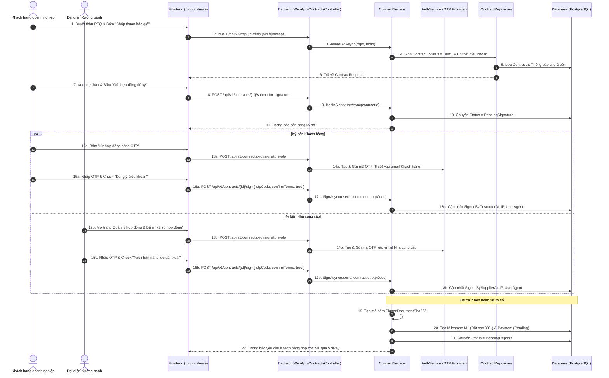
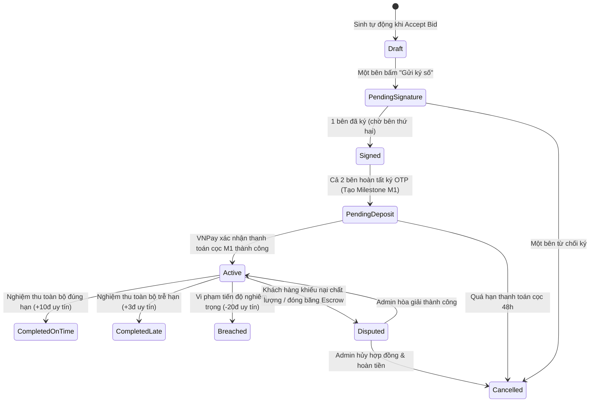

# [CONTRACT-01] - THIẾT KẾ TẠO & KÝ KẾT HỢP ĐỒNG ĐIỆN TỬ (FEATURE #15)

---

## I. TỔNG QUAN TÍNH NĂNG & MỤC TIÊU NGHIỆP VỤ

### 1.1. Thông tin tính năng
- **Tên tính năng:** Tạo & Ký kết hợp đồng điện tử (E-Contract Creation & OTP Digital Signature)
- **Mã tính năng:** `contract-signature` (Feature #15)
- **Độ ưu tiên:** 🔴 P0 Critical
- **Đối tượng sử dụng (Actors):** Khách hàng doanh nghiệp (Customer), Nhà cung cấp / Xưởng bánh (Supplier), Hệ thống (System)
- **Trạng thái tài liệu:** Approved / Ready for Implementation

### 1.2. Mục tiêu nghiệp vụ
- Tự động chuyển đổi hồ sơ báo giá đã trúng thầu (`Awarded Bid`) thành Dự thảo Hợp đồng kinh tế điện tử mà không cần nhập liệu thủ công.
- Ràng buộc pháp lý chặt chẽ giữa hai bên: Tích hợp đầy đủ thông tin pháp nhân (MST, Người đại diện, Địa chỉ xuất hóa đơn), danh mục mặt hàng, đơn giá, điều khoản chất lượng vệ sinh an toàn thực phẩm, và chế tài vi phạm tiến độ.
- Ký số an toàn với xác thực hai yếu tố (2FA qua mã OTP gửi về email/SMS đã xác minh của đại diện pháp luật).
- Ghi nhận dấu vết kiểm toán (Audit Trail) bất biến: Địa chỉ IP, User-Agent trình duyệt, thời gian ký chuẩn UTC, và chuỗi mã băm SHA-256 bảo vệ toàn vẹn tài liệu hợp đồng.

---

## II. WORKFLOW & FLOWCHART CHI TIẾT

### 2.1. Sequence Diagram: Luồng Tạo bản thảo & Ký kết số 2 bên



### 2.2. Biểu đồ chuyển đổi trạng thái Hợp đồng (State Machine)



---

## III. CHI TIẾT TỪNG BƯỚC XỬ LÝ (STEP-BY-STEP LOGIC)

### Bước 1: Khởi tạo Hợp đồng từ Báo giá thắng cuộc (Auto-Generation)
1. **Dữ liệu nguồn:**
   - Thông tin RFQ: Tiêu đề, Mã RFQ, Địa chỉ giao hàng, Thời hạn cần hàng (`DeliveryDateRequired`).
   - Thông tin Bid được duyệt: Tổng giá trị hợp đồng (`TotalValue`), số ngày cam kết giao hàng (`EstimatedDeliveryDays`), danh mục từng loại bánh và đơn giá chi tiết.
   - Thông tin Pháp nhân Bên A (Khách hàng) & Bên B (Xưởng bánh): Tên doanh nghiệp, MST, Địa chỉ trụ sở, Email, Số điện thoại.
2. **Quy tắc sinh Mã Hợp đồng:**
   - Mã hợp đồng định dạng chuẩn: `HD-YYYY-XXXXXXXX` (Ví dụ: `HD-2026-A1B2C3D4`).
   - Đảm bảo tính duy nhất tuyệt đối trên cơ sở dữ liệu (`UNIQUE index`).
3. **Cấu trúc JSON Điều khoản (`TermsAndConditions`):**
   ```json
   {
     "contractNumber": "HD-2026-A1B2C3D4",
     "title": "Hợp đồng Cung cấp Bánh Trung Thu Doanh Nghiệp",
     "buyer": {
       "companyName": "Công ty Cổ phần Công nghệ SunTech",
       "taxCode": "0312345678",
       "representative": "Nguyễn Văn Doanh Nghiệp",
       "address": "65 Lê Lợi, Quận 1, TP. HCM"
     },
     "supplier": {
       "companyName": "Xưởng Bánh Trung Thu Hoàng Triều",
       "taxCode": "0109876543",
       "representative": "Trần Thị Hoàng Kim",
       "address": "128 Nguyễn Trãi, Thanh Xuân, Hà Nội"
     },
     "items": [
       {
         "productName": "Bánh Thập Cẩm Bát Bửu 200g (2 Trứng)",
         "quantity": 500,
         "unit": "Hộp",
         "unitPrice": 330000,
         "subtotal": 165000000,
         "packaging": "Hộp sơn mài dập kim logo SunTech"
       }
     ],
     "delivery": {
       "address": "Tòa nhà Bitexco, Quận 1, TP. HCM",
       "deadline": "2026-09-10"
     },
     "paymentTerms": {
       "m1DepositPercent": 30,
       "m2ProgressPercent": 50,
       "m3AcceptancePercent": 20
     },
     "penaltyTerms": {
       "lateDeliveryFeePerDayPercent": 0.5,
       "maxPenaltyPercent": 8.0,
       "breachThresholdDays": 5
     }
   }
   ```

### Bước 2: Xem xét điều khoản & Chuyển sang Chờ ký (`BeginSignatureAsync`)
1. Khách hàng hoặc Nhà cung cấp mở màn hình chi tiết hợp đồng, kiểm tra các điều khoản và thông tin sản phẩm.
2. Người dùng bấm "Gửi ký hợp đồng":
   - Kiểm tra trạng thái hiện tại phải là `Draft`.
   - Chuyển trạng thái sang `PendingSignature`.
   - Bắn thông báo (`Notification`) tới cả 2 bên: "Hợp đồng kinh tế đã sẵn sàng để ký số".

### Bước 3: Yêu cầu mã OTP Ký số (`RequestSignatureOtpAsync`)
1. Người dùng bấm nút "Ký số hợp đồng" trên giao diện.
2. Hệ thống kiểm tra:
   - Người gọi phải là Bên A (Khách hàng) hoặc Bên B (Đại diện pháp luật của Xưởng bánh).
   - Hợp đồng đang ở trạng thái `PendingSignature`.
   - Người gọi chưa từng ký hợp đồng này (`SignedByCustomerAt` hoặc `SignedBySupplierAt` đang `null`).
3. Sinh mã OTP ngẫu nhiên gồm 6 chữ số, thời gian sống 5 phút, lưu trữ mã băm an toàn trong bộ nhớ đệm / DB.
4. Gửi email thông báo chứa mã OTP kèm cảnh báo pháp lý về giá trị của chữ ký điện tử.

### Bước 4: Xác thực chữ ký số & Khóa tài liệu bất biến (`SignAsync`)
1. **Kiểm tra đầu vào:**
   - `confirmTerms == true` (Bắt buộc tích chọn cam kết đọc và đồng ý mọi điều khoản).
   - Mã OTP đúng và chưa hết hạn.
2. **Ghi nhận chữ ký:**
   - Lưu thời điểm ký UTC (`SignedByCustomerAt` hoặc `SignedBySupplierAt`).
   - Lưu địa chỉ IP công khai (`CustomerSignatureIp` / `SupplierSignatureIp`).
   - Lưu thông tin trình duyệt (`UserAgent`).
3. **Xử lý khi cả hai bên đã ký xong:**
   - Hệ thống tạo chuỗi tóm tắt đại diện (Snapshot) của toàn bộ hợp đồng.
   - Tính toán mã băm SHA-256:
     $$\text{SignedDocumentSha256} = \text{SHA256}(\text{ContractNumber} + \text{Title} + \text{TotalValue} + \text{DeliveryDeadline} + \text{TermsAndConditions})$$
   - Lưu trữ `SignedDocumentSha256` vào DB làm chứng cứ pháp lý đối soát vĩnh viễn.
   - Tự động tạo mốc **Milestone M1 (Đặt cọc bắt buộc 30%)** ở trạng thái `AwaitingPayment`.
   - Tạo bản ghi `Payment` tương ứng ở trạng thái `Pending`.
   - Chuyển trạng thái hợp đồng sang `PendingDeposit`.
   - Gửi thông báo đến Khách hàng yêu cầu nộp tiền cọc qua cổng thanh toán VNPay Sandbox.

