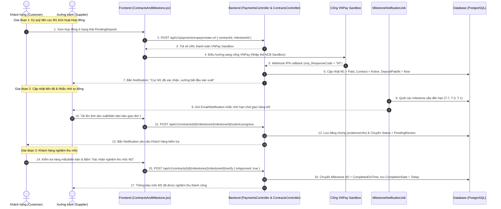
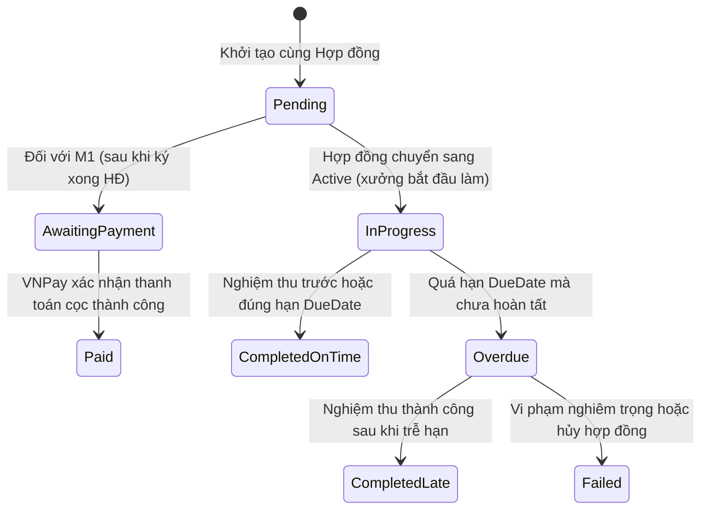

# [CONTRACT-02] - THIẾT KẾ THEO DÕI TIẾN ĐỘ & MILESTONES HỢP ĐỒNG (FEATURE #16)

---

## I. TỔNG QUAN TÍNH NĂNG & MỤC TIÊU NGHIỆP VỤ

### 1.1. Thông tin tính năng
- **Tên tính năng:** Theo dõi tiến độ & Milestone hợp đồng (Milestone Tracking, Escrow Deposit & Progress Verification)
- **Mã tính năng:** `milestone-tracking` (Feature #16)
- **Độ ưu tiên:** 🟠 P1 High
- **Đối tượng sử dụng (Actors):** Khách hàng (Customer), Xưởng bánh (Supplier), Hệ thống tự động (Background Jobs)
- **Cổng thanh toán tích hợp:** Cổng thanh toán điện tử VNPay Sandbox ([keyvnpay.text](../../../keyvnpay.text))

### 1.2. Mục tiêu nghiệp vụ
- Phân tách giá trị hợp đồng B2B thành nhiều mốc nghiệm thu minh bạch, giảm thiểu rủi ro cho cả người mua và xưởng sản xuất:
  - **Mốc M1 (Đặt cọc bắt buộc 30%):** Tiền đề kích hoạt sản xuất. Thanh toán ký quỹ (Escrow) an toàn qua VNPay Sandbox.
  - **Mốc M2 (Sản xuất & Giao hàng đợt 1 - 50%):** Báo cáo tiến độ làm khuôn, đóng hộp, hoàn thiện lô hàng đầu tiên.
  - **Mốc M3 (Nghiệm thu toàn bộ & Quyết toán 20%):** Giao hàng đủ số lượng, kiểm tra chất lượng tại kho khách hàng.
- Cho phép Nhà cung cấp nộp tài liệu chứng minh thực tế (ảnh chụp dây chuyền, phiếu cân hàng, biên bản giao nhận có chữ ký).
- Hệ thống thông báo cảnh báo tự động thông minh (Automated Due Date Reminders) nhắc nhở trước ngày đến hạn $T-7$, $T-3$, $T-1$ và kích hoạt cờ cảnh báo khi quá hạn (`Overdue`).

---

## II. WORKFLOW & FLOWCHART CHI TIẾT

### 2.1. Sequence Diagram: Luồng Quản lý Tiến độ Milestone & Cọc VNPay

---

## III. QUY TẮC CÁC MỐC TIẾN ĐỘ (MILESTONE DEFINITION)

### 3.1. Cấu hình phân bổ mặc định

| Mốc | Tên mốc | Tỷ lệ (%) | Ngày đến hạn (`DueDate`) | Tính chất | Điều kiện hoàn thành |
| :--- | :--- | :--- | :--- | :--- | :--- |
| **M1** | Đặt cọc kích hoạt hợp đồng | **30%** | Ký HĐ $+ 48$ giờ | Bắt buộc (Deposit) | Thanh toán thành công qua VNPay Sandbox hoặc Ủy nhiệm chi ngân hàng. |
| **M2** | Sản xuất & Giao hàng đợt 1 | **50%** | Ký HĐ $+ \frac{1}{2}$ thời gian giao | Thực hiện (Execution) | Xưởng giao ít nhất 50% sản lượng; Khách hàng ký biên bản bàn giao đợt 1. |
| **M3** | Nghiệm thu & Quyết toán dứt điểm | **20%** | Theo `DeliveryDeadline` RFQ | Nghiệm thu (Settlement) | Giao đủ 100% số lượng bánh đạt chuẩn chất lượng; Ký biên bản nghiệm thu tổng thể. |

### 3.2. Vòng đời trạng thái của Milestone (`MilestoneStatus`)

---

## IV. BẰNG CHỨNG TIẾN ĐỘ & BẢO ĐẢM MINH BẠCH (EVIDENCE VERIFICATION)

1. **Nhà cung cấp cập nhật tiến độ (`SubmitMilestoneProgressAsync`):**
   - Nhà cung cấp chọn mốc tương ứng, nhập ghi chú tiến độ (Ví dụ: "Đã hoàn thành nướng 500 bánh thập cẩm, đang đóng gói vào hộp sơn mài").
   - Đính kèm tối thiểu 1 hình ảnh hoặc tài liệu bằng chứng (`EvidenceUrls`):
     - Ảnh chụp dây chuyền sản xuất / bánh thành phẩm.
     - Ảnh phiếu cân hoặc biên bản kiểm tra vi sinh ATTP.
     - Phiếu giao nhận có chữ ký thủ kho khách hàng (đối với mốc giao hàng).
2. **Khách hàng đối soát & Xác nhận (`VerifyMilestoneAsync`):**
   - Khách hàng xem ảnh chụp thực tế và đối chiếu số lượng.
   - Nếu đạt: Bấm "Phê duyệt mốc" $\to$ Milestone chuyển sang `CompletedOnTime` (hoặc `CompletedLate` nếu đã quá hạn).
   - Nếu không đạt: Nhập lý do yêu cầu sửa đổi/bổ sung $\to$ Gửi lại thông báo cho xưởng kèm yêu cầu khắc phục trong vòng 24 giờ.

---

## V. CƠ CHẾ CẢNH BÁO TỰ ĐỘNG (BACKGROUND REMINDER JOBS)

Hệ thống cấu hình Background Job định kỳ chạy mỗi giờ `ContractMilestoneReminderJob`:
1. **Cảnh báo trước hạn ($T-7, T-3, T-1$ ngày):**
   - Lọc các mốc tiến độ đang ở trạng thái `InProgress` hoặc `Pending` có:
     $$\text{DueDate} - \text{CurrentDate} \in \{7, 3, 1\}$$
   - Gửi Notification và Email nhắc nhở đại diện xưởng tập trung tiến độ sản xuất.
2. **Quét quá hạn ($T+0$ ngày):**
   - Nếu $\text{CurrentDate} > \text{DueDate}$ mà trạng thái vẫn là `InProgress`:
     - Tự động cập nhật `Milestone.Status = Overdue`.
     - Gửi cảnh báo khẩn cấp (Cờ đỏ) đến cả Khách hàng và Xưởng bánh.
     - Cho phép Khách hàng kích hoạt quy trình xử lý vi phạm hoặc cho phép Xưởng xin gia hạn thời gian.

