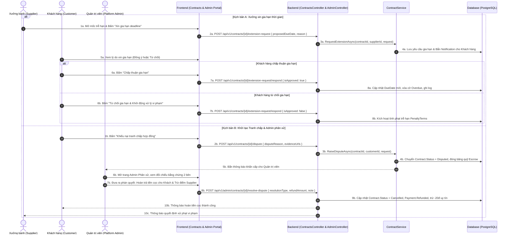

# [CONTRACT-03] - THIẾT KẾ XỬ LÝ VI PHẠM HỢP ĐỒNG & TRANH CHẤP (FEATURE #17)

---

## I. TỔNG QUAN TÍNH NĂNG & MỤC TIÊU NGHIỆP VỤ

### 1.1. Thông tin tính năng
- **Tên tính năng:** Xử lý vi phạm hợp đồng & Giải quyết tranh chấp (Contract Breach Handling & Dispute Resolution)
- **Mã tính năng:** `contract-breach-dispute` (Feature #17)
- **Độ ưu tiên:** 🟠 P1 High
- **Đối tượng sử dụng (Actors):** Khách hàng (Customer), Xưởng bánh (Supplier), Quản trị viên nền tảng (Admin), Hệ thống tự động (System Job)
- **Trạng thái tài liệu:** Approved / Ready for Implementation

### 1.2. Mục tiêu nghiệp vụ
- Tự động phát hiện và cảnh báo các mốc tiến độ hoặc hợp đồng bị trễ hạn (`Overdue`).
- Thiết lập quy trình chuẩn hóa cho phép Nhà cung cấp xin gia hạn thời gian (`Request Extension`) khi gặp sự cố khách quan (thiên tai, mất điện diện rộng, biến động nguồn cung cấp nguyên liệu đạt chuẩn ATTP).
- Phân loại rõ ràng mức độ vi phạm để áp dụng chế tài công bằng:
  - **Vi phạm trễ hạn (`Late`):** Vẫn tiếp tục thực hiện, phạt tiền theo tỷ lệ phần trăm mỗi ngày trễ theo điều khoản `PenaltyTerms` đã ký.
  - **Vi phạm nghiêm trọng (`Breach`):** Hủy bỏ nghĩa vụ hợp đồng, trừ **-20 điểm uy tín** của xưởng, thu hồi tiền cọc ký quỹ để bồi thường cho khách hàng.
- Quy trình khiếu nại tranh chấp (`Disputed`) minh bạch: Tự động đóng băng quỹ ký quỹ Escrow và đưa hồ sơ lên Hội đồng quản trị nền tảng (Admin) phân xử độc lập.

---

## II. WORKFLOW & FLOWCHART CHI TIẾT

### 2.1. Sequence Diagram: Luồng Xin gia hạn & Khởi tạo Tranh chấp

---

## III. QUY TẮC PHÂN LOẠI & CHẾ TÀI VI PHẠM (PENALTY & BREACH MATRIX)

### 3.1. Phân loại vi phạm

| Mức độ vi phạm | Tiêu chí kích hoạt | Chế tài xử lý | Điểm uy tín (`reputation_logs`) |
| :--- | :--- | :--- | :--- |
| **Gia hạn hợp lệ (Approved Extension)** | Xưởng xin gia hạn trước hạn chót $\ge 48$h, được Khách hàng đồng ý bằng văn bản điện tử. | Cập nhật ngày đến hạn mới; Không áp dụng phạt tiền. | Không bị trừ điểm ($0đ$). |
| **Trễ hạn giao hàng (`Late Delivery`)** | Quá hạn $1 \div 5$ ngày mà không được gia hạn, nhưng xưởng vẫn hoàn thành giao bánh đạt chuẩn. | Phạt **$0.5\%$ giá trị hợp đồng / mỗi ngày trễ** (tối đa không quá $8\%$). Số tiền phạt được cấn trừ vào đợt thanh toán M3. | Trừ **-5 điểm uy tín**. |
| **Vi phạm nghiêm trọng (`Breach`)** | Quá hạn $> 5$ ngày mà không thể giao hàng, hoặc tự ý hủy đơn, hoặc sản phẩm không đạt ATTP bị đình chỉ. | Hợp đồng bị chấm dứt (`Status = Breached`); Thu hồi toàn bộ $100\%$ tiền cọc ký quỹ Escrow hoàn trả Khách hàng; Xưởng bồi thường thiệt hại. | Trừ **-20 điểm uy tín** (Hạ cấp huy hiệu xưởng). |

### 3.2. Công thức tính tiền phạt trễ hạn (`Penalty Calculation`)

$$\text{PenaltyAmount} = \min\left(\text{TotalValue} \times \text{DaysLate} \times \text{LateRatePerDay}, \text{TotalValue} \times \text{MaxPenaltyRate}\right)$$

*Trong đó:*
- $\text{LateRatePerDay} = 0.005$ ($0.5\%$/ngày theo quy định Bộ luật Thương mại & thỏa thuận HĐ).
- $\text{MaxPenaltyRate} = 0.08$ (Tối đa $8\%$ giá trị phần nghĩa vụ hợp đồng bị vi phạm).
- $\text{DaysLate} = \text{ActualCompletionDate} - \text{DeliveryDeadline}$.

---

## IV. CƠ CHẾ GIẢI QUYẾT TRANH CHẤP QUA ADMIN (ADMIN ARBITRATION)

1. **Điều kiện mở tranh chấp:**
   - Hợp đồng đang ở trạng thái `Active` hoặc `Overdue`.
   - Một trong hai bên nộp đơn khiếu nại kèm tối thiểu 2 tài liệu minh chứng (ảnh PoD giao hàng sai quy cách, biên bản kiểm định chất lượng, bản tin nhắn thỏa thuận bất thành).
2. **Đóng băng tài chính ký quỹ (Escrow Freeze):**
   - Ngay khi tranh chấp được mở, toàn bộ các lệnh giải ngân cho xưởng đều bị khóa tạm thời trên cơ sở dữ liệu (`Pessimistic Lock`).
3. **Thẩm quyền của Admin:**
   - **Hoàn trả toàn bộ (`Full Refund`):** Chuyển tiền cọc M1 từ quỹ ký quỹ trả về tài khoản ngân hàng của Khách hàng. Hợp đồng chuyển thành `Cancelled`.
   - **Giải ngân một phần (`Partial Payout`):** Nếu một phần sản lượng đã được giao đạt chuẩn và khách hàng đã đưa vào sử dụng, Admin chia tỷ lệ tiền thanh toán công bằng cho xưởng.
   - **Bác bỏ khiếu nại (`Dismiss Dispute`):** Nếu khách hàng khiếu nại sai sự thật nhằm chiếm dụng cọc, Admin mở lại trạng thái `Active` cho hợp đồng để xưởng tiếp tục thực hiện.

