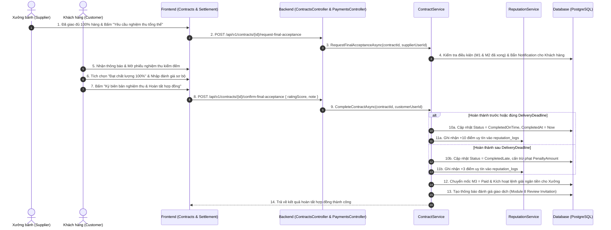

# [CONTRACT-04] - THIẾT KẾ HOÀN THÀNH HỢP ĐỒNG & CHỐT KẾT QUẢ (FEATURE #18)

---

## I. TỔNG QUAN TÍNH NĂNG & MỤC TIÊU NGHIỆP VỤ

### 1.1. Thông tin tính năng
- **Tên tính năng:** Hoàn thành hợp đồng & Chốt kết quả giao dịch (Contract Completion, Final Acceptance & Reputation Settlement)
- **Mã tính năng:** `contract-completion` (Feature #18)
- **Độ ưu tiên:** 🟠 P1 High
- **Đối tượng sử dụng (Actors):** Xưởng bánh (Supplier), Khách hàng (Customer), Hệ thống tính điểm uy tín (Reputation Engine)
- **Trạng thái tài liệu:** Approved / Ready for Implementation

### 1.2. Mục tiêu nghiệp vụ
- Khép lại toàn bộ vòng đời của Hợp đồng kinh tế B2B một cách chặt chẽ, đầy đủ tính pháp lý và thanh quyết toán tài chính rõ ràng.
- Xây dựng Biên bản nghiệm thu & bàn giao điện tử (Electronic Final Acceptance Protocol) giữa Khách hàng và Xưởng bánh.
- Tự động phân loại kết quả hoàn thành:
  - **Hoàn thành đúng hạn (`CompletedOnTime`):** Tặng thưởng **+10 điểm uy tín** cho xưởng sản xuất, nâng cao thứ hạng tìm kiếm và cơ hội trúng thầu RFQ tiếp theo.
  - **Hoàn thành trễ hạn (`CompletedLate`):** Ghi nhận hoàn thành kèm cấn trừ tiền phạt trễ hạn, cộng khuyến khích **+3 điểm uy tín**.
- Giải phóng đợt thanh toán cuối cùng (Milestone M3 Final Payout) từ tài khoản ký quỹ Escrow cho xưởng.
- Tự động kích hoạt lời nhắc đánh giá đối tác (Review Request Trigger) sang Module 8.

---

## II. WORKFLOW & FLOWCHART CHI TIẾT

### 2.1. Sequence Diagram: Luồng Nghiệm thu tổng thể & Quyết toán Hợp đồng



---

## III. CHI TIẾT NGHIỆP VỤ NGHIỆM THU & QUYẾT TOÁN (ACCEPTANCE & SETTLEMENT)

### 3.1. Điều kiện tiên quyết để Yêu cầu Nghiệm thu
1. Hợp đồng đang ở trạng thái `Active`.
2. Mốc cọc **M1 đã thanh toán (`Status = Paid`)**.
3. Mốc giao hàng **M2 đã được xác nhận hoàn thành (`CompletedOnTime` hoặc `CompletedLate`)**.
4. Các chuyến giao hàng (Delivery PoD) đều có trạng thái `Delivered` kèm ảnh ký nhận.

### 3.2. Nội dung Biên bản Nghiệm thu Tổng thể (`Acceptance Protocol`)
Biên bản nghiệm thu được hệ thống tự động sinh và đóng dấu thời gian (Timestamped):
- **Bên giao (Nhà cung cấp):** Đã bàn giao đủ số lượng bánh, đúng chủng loại, bao bì nguyên vẹn theo đúng cam kết trong RFQ và Hợp đồng.
- **Bên nhận (Khách hàng):** Đã kiểm tra số lượng thực tế, cảm quan chất lượng, hạn sử dụng còn trên $85\%$ thời gian sử dụng ghi trên nhãn.
- **Quyết toán tài chính:**
  - Tổng giá trị hợp đồng: $V_{\text{total}}$.
  - Tiền cọc M1 đã thanh toán: $V_{\text{M1}}$.
  - Tiền M2 đã thanh toán: $V_{\text{M2}}$.
  - Tiền phạt trễ hạn (nếu có): $V_{\text{penalty}}$.
  - Số tiền thanh toán đợt cuối (M3):
    $$V_{\text{M3\_final}} = V_{\text{total}} - V_{\text{M1}} - V_{\text{M2}} - V_{\text{penalty}}$$

---

## IV. CẬP NHẬT ĐIỂM UY TÍN & LỊCH SỬ GIAO DỊCH (REPUTATION AUDIT)

Sau khi hợp đồng hoàn tất, hệ thống tự động ghi nhận vào bảng `reputation_logs`:

```json
{
  "supplierId": "22222222-2222-4222-8222-222222222222",
  "eventType": "ContractCompletedOnTime",
  "scoreDelta": 10,
  "reason": "Hoàn thành đúng hạn Hợp đồng HD-2026-A1B2C3D4",
  "referenceType": "Contract",
  "referenceId": "eeeeeeee-eeee-4eee-8eee-eeeeeeeeeeee",
  "createdAt": "2026-09-08T15:30:00Z"
}
```

- **Huy hiệu đối tác tự động thăng hạng:**
  - Điểm mới: $\text{CurrentScore} + \text{ScoreDelta}$.
  - Nếu điểm $\ge 81$: Tự động cấp huy hiệu **"Đối tác Vàng" (Gold Partner)**, ưu tiên hiển thị đầu trang tìm kiếm và được hệ thống AI tự động đề xuất trong tính năng Smart Matching của RFQ.
- **Chuyển tiếp luồng Đánh giá:**
  - Bắn sự kiện `ContractCompletedEvent`.
  - Module 8 tự động kích hoạt tạo form đánh giá chất lượng 4 tiêu chí cho khách hàng.

