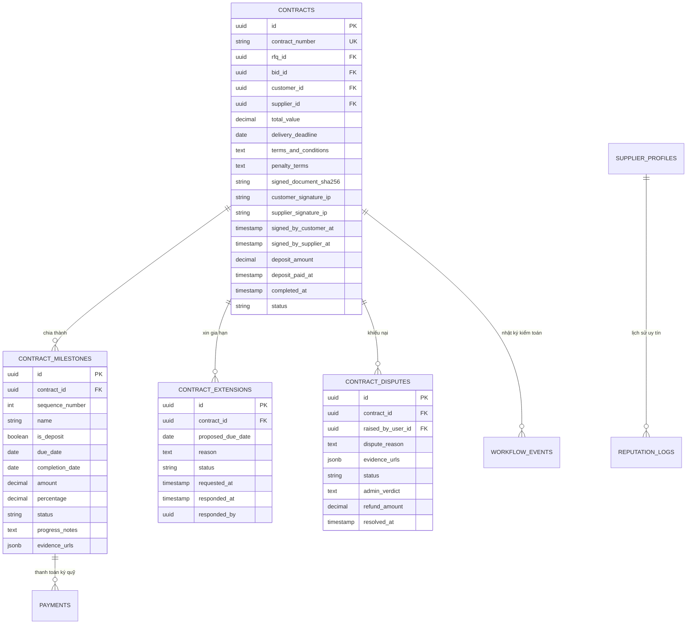

# [CONTRACT-06] - CƠ SỞ DỮ LIỆU, XỬ LÝ ĐỒNG THỜI & BẢO MẬT (DATA, CONCURRENCY & SECURITY)

---

## I. MÔ HÌNH DỮ LIỆU QUAN HỆ (POSTGRESQL RELATIONAL SCHEMA)



---

## II. LƯỢC ĐỒ SQL VÀ CHỈ MỤC TỐI ƯU TRUY VẤN (DDL & INDEXES)

```sql
-- 1. Bảng quản lý Hợp đồng kinh tế
CREATE TABLE IF NOT EXISTS contracts (
    id UUID PRIMARY KEY DEFAULT gen_random_uuid(),
    contract_number VARCHAR(32) NOT NULL UNIQUE,
    rfq_id UUID REFERENCES request_for_quotations(id),
    bid_id UUID REFERENCES bids(id),
    order_id UUID REFERENCES orders(id),
    customer_id UUID NOT NULL REFERENCES users(id),
    supplier_id UUID NOT NULL REFERENCES supplier_profiles(id),
    deposit_rule_id UUID REFERENCES contract_deposit_rules(id),
    title VARCHAR(256),
    total_value NUMERIC(18, 2) CHECK (total_value >= 0),
    delivery_deadline DATE NOT NULL,
    terms_and_conditions TEXT NOT NULL,
    penalty_terms TEXT,
    signed_document_url VARCHAR(2048),
    signed_document_sha256 CHAR(64),
    customer_signature_ip VARCHAR(45),
    customer_signature_user_agent VARCHAR(512),
    supplier_signature_ip VARCHAR(45),
    supplier_signature_user_agent VARCHAR(512),
    deposit_amount NUMERIC(18, 2) CHECK (deposit_amount >= 0),
    deposit_paid_at TIMESTAMPTZ,
    signed_by_customer_at TIMESTAMPTZ,
    signed_by_supplier_at TIMESTAMPTZ,
    completed_at TIMESTAMPTZ,
    status VARCHAR(32) NOT NULL DEFAULT 'Draft',
    created_at TIMESTAMPTZ NOT NULL DEFAULT CURRENT_TIMESTAMP,
    created_by UUID,
    updated_at TIMESTAMPTZ,
    updated_by UUID,
    is_deleted BOOLEAN NOT NULL DEFAULT FALSE
);

CREATE INDEX idx_contracts_customer ON contracts(customer_id, status) WHERE is_deleted = FALSE;
CREATE INDEX idx_contracts_supplier ON contracts(supplier_id, status) WHERE is_deleted = FALSE;
CREATE INDEX idx_contracts_deadline ON contracts(delivery_deadline) WHERE status = 'Active' AND is_deleted = FALSE;

-- 2. Bảng quản lý Mốc tiến độ hợp đồng
CREATE TABLE IF NOT EXISTS contract_milestones (
    id UUID PRIMARY KEY DEFAULT gen_random_uuid(),
    contract_id UUID NOT NULL REFERENCES contracts(id) ON DELETE CASCADE,
    sequence_number INT NOT NULL,
    name VARCHAR(256) NOT NULL,
    description TEXT,
    is_deposit BOOLEAN NOT NULL DEFAULT FALSE,
    due_date DATE,
    completion_date DATE,
    amount NUMERIC(18, 2) CHECK (amount >= 0),
    percentage NUMERIC(5, 2) CHECK (percentage > 0 AND percentage <= 100),
    status VARCHAR(32) NOT NULL DEFAULT 'Pending',
    progress_notes TEXT,
    evidence_urls JSONB,
    created_at TIMESTAMPTZ NOT NULL DEFAULT CURRENT_TIMESTAMP,
    created_by UUID,
    updated_at TIMESTAMPTZ,
    updated_by UUID,
    is_deleted BOOLEAN NOT NULL DEFAULT FALSE,
    CONSTRAINT uq_contract_milestone_seq UNIQUE (contract_id, sequence_number)
);

CREATE INDEX idx_milestones_contract ON contract_milestones(contract_id, sequence_number) WHERE is_deleted = FALSE;
CREATE INDEX idx_milestones_due_date ON contract_milestones(due_date, status) WHERE is_deleted = FALSE;

-- 3. Bảng yêu cầu xin gia hạn tiến độ
CREATE TABLE IF NOT EXISTS contract_extensions (
    id UUID PRIMARY KEY DEFAULT gen_random_uuid(),
    contract_id UUID NOT NULL REFERENCES contracts(id) ON DELETE CASCADE,
    proposed_due_date DATE NOT NULL,
    reason TEXT NOT NULL,
    status VARCHAR(32) NOT NULL DEFAULT 'Pending', -- Pending, Approved, Rejected
    requested_at TIMESTAMPTZ NOT NULL DEFAULT CURRENT_TIMESTAMP,
    responded_at TIMESTAMPTZ,
    responded_by UUID REFERENCES users(id),
    response_note TEXT
);

-- 4. Bảng khiếu nại và giải quyết tranh chấp
CREATE TABLE IF NOT EXISTS contract_disputes (
    id UUID PRIMARY KEY DEFAULT gen_random_uuid(),
    contract_id UUID NOT NULL REFERENCES contracts(id) ON DELETE CASCADE,
    raised_by_user_id UUID NOT NULL REFERENCES users(id),
    dispute_reason TEXT NOT NULL,
    evidence_urls JSONB,
    status VARCHAR(32) NOT NULL DEFAULT 'Pending', -- Pending, Resolved
    admin_verdict TEXT,
    resolution_type VARCHAR(32), -- FullRefund, PartialPayout, Dismiss
    refund_amount NUMERIC(18, 2) DEFAULT 0,
    created_at TIMESTAMPTZ NOT NULL DEFAULT CURRENT_TIMESTAMP,
    resolved_at TIMESTAMPTZ,
    resolved_by UUID REFERENCES users(id)
);
```

---

## III. XỬ LÝ ĐỒNG THỜI & CHỐNG RACE CONDITION (CONCURRENCY LOCKING)

### 3.1. Khóa bi quan khi Ký số OTP (`SignAsync`)
- Khi một bên gửi request xác thực OTP ký số, hệ thống sử dụng cú pháp khóa dòng `FOR UPDATE`:
  ```sql
  SELECT * FROM contracts WHERE id = @contractId FOR UPDATE;
  ```
- **Mục đích:**
  - Ngăn ngừa tình trạng người dùng mở 2 tab trình duyệt và bấm ký liên tục (Double Click Attack).
  - Đảm bảo khi cả 2 bên cùng ký vào cùng một mili-giây, giao dịch chỉ tính toán mã hash SHA-256 một lần duy nhất, tránh việc sinh đúp 2 mốc cọc M1 hoặc 2 mã thanh toán Payment.

### 3.2. Khóa dòng khi Thanh toán Cọc VNPay & Kích hoạt Hợp đồng
- Khi Webhook IPN từ máy chủ VNPay phản hồi thanh toán thành công, phương thức `ConfirmVnPayPaymentAsync` thực hiện khóa đồng thời dòng `contracts`, `contract_milestones` và `payments`:
  ```sql
  SELECT * FROM payments WHERE payment_number = @paymentNumber FOR UPDATE;
  SELECT * FROM contract_milestones WHERE id = @milestoneId FOR UPDATE;
  SELECT * FROM contracts WHERE id = @contractId FOR UPDATE;
  ```
- **Bảo toàn tính toàn vẹn:**
  - Nếu VNPay vô tình gửi 2 request IPN song song (Idempotency Retries), chỉ có thread đầu tiên chuyển trạng thái sang `Active` và sinh nhật ký `WorkflowEvent`. Thread thứ hai đọc được `Status == Completed` và trả về ngay kết quả `"02", "Order already confirmed"`.

---

## IV. BẢO MẬT & TÍNH TOÀN VẸN DỮ LIỆU (SECURITY ARCHITECTURE)

1. **Bảo toàn tính bất biến của Hợp đồng điện tử (`SignedDocumentSha256`):**
   - Trước khi đưa vào ký, nội dung tóm tắt được serialize chuẩn hóa.
   - Sau khi cả hai bên ký số, chuỗi băm 64 ký tự Hexadecimal được ghi nhận.
   - Nếu có bất kỳ sự cố sửa đổi trái phép nào trong cơ sở dữ liệu, việc tính toán lại mã băm sẽ không khớp với `SignedDocumentSha256`, giúp phát hiện gian lận ngay lập tức.
2. **Bảo vệ tiền ký quỹ Escrow:**
   - Tiền cọc được quản lý qua số tham chiếu `PaymentNumber` độc lập.
   - Khi hợp đồng bị khiếu nại (`Disputed`), toàn bộ các API giải ngân cho Supplier lập tức bị chặn bằng kiểm tra điều kiện trạng thái `Contract.Status == Active`.
3. **Phân quyền đa tầng (Tenant & Role Isolation):**
   - Khách hàng chỉ truy cập được hợp đồng có `CustomerId == CurrentUserId`.
   - Nhà cung cấp chỉ truy cập được hợp đồng mà `SupplierProfile.UserId == CurrentUserId`.
   - Chỉ có tài khoản mang Role `Admin` mới có quyền gọi các endpoint `/api/v1/admin/contracts/{id}/resolve-dispute`.

