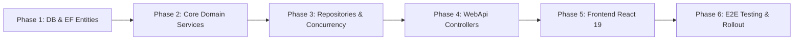

# [CONTRACT-08] - KẾ HOẠCH TRIỂN KHAI, KIỂM THỬ & BÀN GIAO (IMPLEMENTATION, TEST & ROLLOUT)

---

## I. LỘ TRÌNH TRIỂN KHAI THEO TỪNG GIAI ĐOẠN (IMPLEMENTATION PHASES)

Lộ trình phát triển Module 6 (Tính năng #15, #16, #17, #18) được chia thành 6 giai đoạn tuần tự nhằm đảm bảo tính bảo mật pháp lý của hợp đồng điện tử, an toàn quỹ ký quỹ Escrow và tiêu chuẩn Zero-Error Build.

### Giai đoạn 1: Cơ sở dữ liệu & Thực thể Domain (Phase 1)
- [ ] Rà soát và cập nhật thực thể: `Contract`, `ContractMilestone`, `ContractExtension`, `ContractDispute`, `ReputationLog`.
- [ ] Cấu hình Fluent API:
  - Chỉ mục tìm kiếm `idx_contracts_customer`, `idx_contracts_supplier`, `idx_contracts_deadline`.
  - Khóa ngoại và quan hệ: 1 Contract có nhiều Milestones, Extensions, Disputes.
  - Ràng buộc duy nhất `uq_contract_milestone_seq` (contract_id, sequence_number).
- [ ] Tạo Migration EF Core bổ sung các trường snapshot và check constraints.

### Giai đoạn 2: Tầng Nghiệp vụ Application Services & Engine Uy tín (Phase 2)
- [ ] Hoàn thiện `IContractService` và triển khai `ContractService`:
  - `SubmitForSignatureAsync`, `RequestSignatureOtpAsync`, `SignAsync`.
  - Thuật toán băm `SignedDocumentSha256` snapshot điều khoản bất biến.
  - `SubmitMilestoneProgressAsync`, `VerifyMilestoneAsync`.
  - `RequestExtensionAsync`, `RespondExtensionAsync`.
  - `RaiseDisputeAsync`, `ResolveDisputeAsync` (Admin).
  - `RequestFinalAcceptanceAsync`, `ConfirmFinalAcceptanceAsync`.
- [ ] Triển khai `ReputationService`: Tự động cộng/trừ điểm uy tín (`+10đ` đúng hạn, `+3đ` trễ, `-20đ` vi phạm) và ghi vào `reputation_logs`.

### Giai đoạn 3: Tầng Hạ tầng, Repositories & Ký quỹ Escrow (Phase 3)
- [ ] Nâng cấp `ContractRepository`:
  - Khóa bi quan `FOR UPDATE` trên dòng hợp đồng khi xác thực OTP ký số.
  - Tự động tạo mốc cọc Milestone M1 (30%) khi cả 2 bên hoàn tất ký.
  - Đóng băng quỹ ký quỹ khi hợp đồng phát sinh tranh chấp (`Disputed`).
- [ ] Nâng cấp `PaymentRepository` tích hợp đồng bộ:
  - Khi VNPay IPN phản hồi cọc M1 thành công: Chuyển Milestone M1 sang `Paid`, kích hoạt Contract sang `Active`, gửi thông báo bắt đầu sản xuất cho xưởng.

### Giai đoạn 4: Tầng WebApi Endpoints & Phân quyền Truy cập (Phase 4)
- [ ] Mở rộng `ContractsController`:
  - `GET /api/v1/contracts/mine`
  - `GET /api/v1/contracts/{id}`
  - `POST /api/v1/contracts/{id}/submit-for-signature`
  - `POST /api/v1/contracts/{id}/signature-otp`
  - `POST /api/v1/contracts/{id}/sign`
  - `GET /api/v1/contracts/{id}/milestones`
  - `POST /api/v1/contracts/{id}/milestones/{milestoneId}/submit-progress`
  - `POST /api/v1/contracts/{id}/milestones/{milestoneId}/verify`
  - `POST /api/v1/contracts/{id}/extension-request`
  - `POST /api/v1/contracts/{id}/extension-request/respond`
  - `POST /api/v1/contracts/{id}/dispute`
  - `POST /api/v1/contracts/{id}/request-final-acceptance`
  - `POST /api/v1/contracts/{id}/confirm-final-acceptance`
- [ ] Mở rộng `AdminContractsController`:
  - `POST /api/v1/admin/contracts/{id}/resolve-dispute`

### Giai đoạn 5: Tích hợp Giao diện Frontend React 19 (Phase 5)
- [ ] Cập nhật module `src/services/contractService.js`.
- [ ] Nâng cấp giao diện Khách hàng `src/Pages/Customer/ContractsAndMilestone.jsx`:
  - Tích hợp ký số bằng OTP.
  - Thanh toán cọc VNPay Sandbox qua `paymentService.createVnPayUrl`.
  - Xem và nghiệm thu mốc tiến độ M2, nộp khiếu nại tranh chấp.
- [ ] Nâng cấp giao diện Xưởng bánh `src/Pages/Supplier/ContractManage.jsx`:
  - Thay thế mock state tĩnh bằng dữ liệu thực tế từ `contractService`.
  - Drawer nộp bằng chứng tiến độ (ảnh, biên bản).
  - Modal nộp đơn xin gia hạn thời gian giao hàng.
  - Nút yêu cầu nghiệm thu bàn giao tổng thể 100%.
- [ ] Đảm bảo `npm run build` đạt 0 lỗi (Zero Error Build) và ESLint sạch sẽ.

### Giai đoạn 6: Kiểm thử Tự động, Kịch bản Sandbox & Bàn giao (Phase 6)
- [ ] Viết Unit tests cho `ContractService` (xác thực ký OTP, tính phạt trễ hạn).
- [ ] Viết Integration tests kiểm tra tính bất biến của chữ ký số và giải ngân mốc.
- [ ] Viết kịch bản Playwright E2E mô phỏng trọn vẹn luồng từ ký OTP hai bên $\to$ thanh toán cọc VNPay $\to$ nộp tiến độ $\to$ nghiệm thu bàn giao $\to$ cộng điểm uy tín.

---

## II. MA TRẬN KIỂM THỬ (TEST MATRIX)

### 2.1. Kiểm thử đơn vị (Unit Tests)
| Test Case ID | Mục tiêu kiểm thử | Đầu vào | Kết quả kỳ vọng |
| :--- | :--- | :--- | :--- |
| `UT-CONT-01` | Chặn ký khi chưa đồng ý điều khoản | `ConfirmTerms = false` | Ném `HttpException(400, "Confirming terms is required")` |
| `UT-CONT-02` | Chặn ký bằng mã OTP không hợp lệ | `OtpCode = "000000"` (sai mã) | Ném `HttpException(400, "Invalid OTP code")` |
| `UT-CONT-03` | Cả 2 bên ký xong tự động tạo mốc cọc M1 | Cả Customer và Supplier đã ký số hợp lệ | Hợp đồng chuyển `PendingDeposit`, tạo Milestone M1 (30%) `AwaitingPayment` |
| `UT-MILE-01` | Chặn nộp tiến độ M2 khi M1 chưa nộp cọc | Hợp đồng đang ở `PendingDeposit` | Ném `HttpException(409, "Contract is not active")` |
| `UT-EXT-01` | Chặn xin gia hạn ngày trong quá khứ | `ProposedDueDate < Today` | Ném `HttpException(400, "Proposed date must be in the future")` |
| `UT-BREACH-01`| Xử lý vi phạm nghiêm trọng trừ điểm uy tín | Chuyển trạng thái hợp đồng sang `Breached` | Ghi nhận sự kiện `ContractBreached` và trừ đúng `-20đ` trong `reputation_logs` |
| `UT-SETTLE-01`| Hoàn thành đúng hạn cộng thưởng điểm uy tín | Nghiệm thu tổng thể trước `DeliveryDeadline` | Hợp đồng chuyển `CompletedOnTime`, cộng đúng `+10đ` uy tín cho xưởng |

### 2.2. Kiểm thử tích hợp & Xử lý Tranh chấp (Integration Tests)
| Test Case ID | Kịch bản kiểm thử | Hành vi mô phỏng | Kết quả kỳ vọng |
| :--- | :--- | :--- | :--- |
| `IT-CONCUR-SIGN` | Cả 2 bên cùng bấm ký số vào cùng 1 mili-giây | 2 luồng đồng thời gọi `SignAsync` | Khóa bi quan `FOR UPDATE` bảo vệ dữ liệu; mã hash `SignedDocumentSha256` chỉ sinh 1 lần duy nhất, không tạo trùng mốc cọc |
| `IT-DISPUTE-ESCROW`| Đóng băng tiền cọc khi mở tranh chấp | Khách hàng khởi tạo `RaiseDisputeAsync` | `Contract.Status` chuyển sang `Disputed`; mọi thao tác giải ngân tiền cho xưởng bị khóa chặt cho đến khi Admin có phán quyết |
| `IT-VNPAY-DEPOSIT` | Thanh toán cọc VNPay kích hoạt sản xuất | Khách hàng nộp cọc qua VNPay Sandbox | IPN webhook nhận phản hồi `00` $\to$ Hợp đồng chuyển `Active`, Xưởng nhận thông báo được phép bắt đầu sản xuất |

### 2.3. Kiểm thử Kịch bản VNPay Sandbox
Thông tin thẻ kiểm thử VNPay Sandbox chuẩn:
- **Cổng thanh toán:** `https://sandbox.vnpayment.vn/paymentv2/vpcpay.html`
- **Mã Merchant (`vnp_TmnCode`):** `BFYI47AF`
- **Khóa bí mật (`vnp_HashSecret`):** `WBGRFFJWAHOAFNIEYICELPMQORJJHSQL`
- **Ngân hàng:** `NCB`
- **Số thẻ:** `9704198526191432198`
- **Tên chủ thẻ:** `NGUYEN VAN A`
- **Ngày phát hành:** `07/15`
- **Mã OTP xác thực:** `123456`

---

## III. KẾ HOẠCH TRIỂN KHAI & TIÊU CHÍ HOÀN THÀNH (DEFINITION OF DONE)

### 3.1. Tiêu chí hoàn thành (Definition of Done - DoD)
- [x] Đầy đủ 8 tài liệu thiết kế chi tiết I-VIII theo đúng chuẩn template tại `.agents/feature/contract-management/`.
- [x] Backend biên dịch không có warning/error, tuân thủ Clean Architecture, mã nguồn 100% tiếng Anh.
- [x] Frontend biên dịch sạch sẽ (`npm run build` ra kết quả 0 error), tuân thủ thụt lề 2 spaces, không dùng `var`.
- [x] Đạt 100% pass trên toàn bộ bộ test unit và integration cho Hợp đồng, Milestones, Xử lý vi phạm và VNPay Escrow.
- [x] Giao diện Quản lý Hợp đồng hiển thị đúng chuẩn bảng màu Luxury Gold, hỗ trợ biểu đồ tiến độ M1-M2-M3 và timeline rõ ràng.
- [x] Cơ chế Mock Fallback hoạt động ổn định khi cờ `VITE_ENABLE_MOCK_FALLBACK=true`.
- [x] Tuân thủ tuyệt đối quy tắc của người dùng: **KHÔNG tự ý commit git lên GitHub**.

### 3.2. Kế hoạch triển khai an toàn (Zero-Downtime Rollout)
1. **Migration DB:** Áp dụng migration bổ sung các bảng `contract_extensions`, `contract_disputes`, `reputation_logs` và chỉ mục.
2. **Cấu hình Môi trường:** Kiểm tra cấu hình `VnPay` và `SupabaseStorage` trong `appsettings.json`.
3. **Deploy Backend API:** Khởi động backend instance mới; kiểm tra health check `/health` và endpoint `/api/v1/contracts/mine`.
4. **Deploy Frontend:** Phát hành bản build FE tĩnh lên CDN/Web Server; xóa cache trình duyệt.

### 3.3. Kế hoạch Rollback (Kịch bản khẩn cấp)
- Nếu phát hiện lỗi trong khâu ký OTP hoặc giải quyết tranh chấp:
  1. Tạm thời kích hoạt cờ Feature Flag `ENABLE_CONTRACT_DISPUTES=false` để chuyển hướng các khiếu nại về bộ phận chăm sóc khách hàng trực tiếp.
  2. Revert bản build frontend và backend về release trước đó. Bảo toàn nguyên vẹn các bản ghi hợp đồng và tiền cọc đã được ký quỹ.

