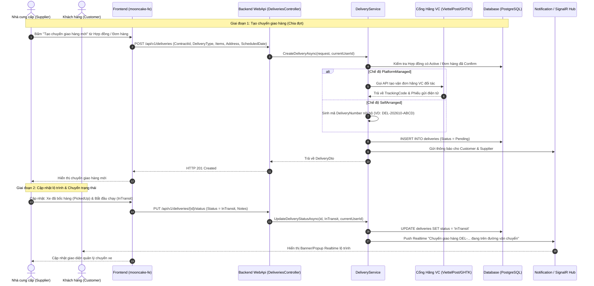
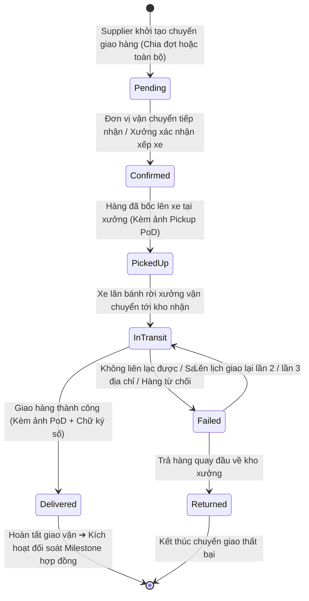

# FEATURE 19: QUẢN LÝ ĐƠN GIAO HÀNG (DELIVERY SHIPMENT MANAGEMENT) - TÀI LIỆU THIẾT KẾ CHI TIẾT

---

## I. TÊN TÀI LIỆU, TÍNH NĂNG & TỔNG QUAN

### 1.1. Thông tin tài liệu
- **Tên tài liệu:** Thiết kế chi tiết Hệ thống Quản lý Chuyến Giao hàng B2B đa phương thức
- **Mã tính năng (Feature Key):** `delivery-management` (Tính năng #19)
- **Phiên bản tài liệu:** `1.0.0`
- **Người thiết kế:** Solution Architect & Backend/Frontend Lead
- **Ngày lập:** 2026-10-29
- **Trạng thái:** 🟢 Approved / Ready for Implementation

### 1.2. Mục tiêu nghiệp vụ (Business Goals)
- **Hỗ trợ 2 mô hình vận tải linh hoạt:**
  1. `SelfArranged`: Nhà cung cấp (xưởng bánh) tự điều phối xe tải nội bộ hoặc thuê đơn vị vận tải ngoài quen thuộc, chủ động cập nhật mã vận đơn, tài xế và tiến độ.
  2. `PlatformManaged`: Nền tảng B2B điều phối và tích hợp API với các đơn vị vận chuyển đối tác lớn (ViettelPost, GHTK, GHN), tự động sinh vận đơn và cập nhật trạng thái qua Webhook.
- **Hỗ trợ chia nhiều đợt giao (Split Shipments):** Đối với đơn hàng doanh nghiệp/hợp đồng B2B số lượng lớn (VD: 5.000 hộp bánh), cho phép tạo nhiều chuyến giao hàng tương ứng với các mốc tiến độ (Milestone M2, M3) hoặc giao đến nhiều chi nhánh kho khác nhau của doanh nghiệp.
- **Minh bạch lộ trình & Giảm tranh chấp:** Theo dõi trạng thái thời gian thực từ lúc bốc hàng tại xưởng, đang vận chuyển, đến khi bàn giao.
- **Tự động hóa thông báo:** Tự động gửi thông báo Real-time (SignalR) và Notification In-App cho cả Customer và Supplier tại từng chặng chuyển trạng thái.

### 1.3. Phạm vi tính năng (Scope)
- **Bao gồm (In-scope):**
  - Tạo chuyến giao hàng gắn với `ContractId` (Hợp đồng) hoặc `OrderId` (Đơn hàng mua trực tiếp).
  - Chọn chế độ vận chuyển: `SelfArranged` hoặc `PlatformManaged`.
  - Cập nhật thông tin vận chuyển: Mã vận đơn (Tracking Code), tên tài xế, SĐT tài xế, biển số xe, ngày dự kiến (`ScheduledDate`), ngày thực tế (`ActualDeliveryDate`).
  - Quản lý vòng đời trạng thái: `Pending` ➔ `Confirmed` ➔ `PickedUp` ➔ `InTransit` ➔ `Delivered` / `Failed` ➔ `Returned`.
  - Tích hợp cổng nhận Webhook cập nhật từ Hãng vận chuyển (`PlatformManaged`).
  - Giao diện tra cứu và quản lý đơn giao dành cho Customer và Supplier.
- **Không bao gồm (Out-of-scope):**
  - Chụp ảnh bằng chứng và ký số PoD (được đặc tả chuyên sâu tại tài liệu `02_PROOF_OF_DELIVERY_POD_DESIGN.md`).
  - Tính cước vận chuyển động theo khoảng cách Google Maps (hệ thống sử dụng bảng cước cố định hoặc thỏa thuận theo hợp đồng).

---

## II. QUY TRÌNH & BIỂU ĐỒ LUỒNG (WORKFLOW DIAGRAMS)

### 2.1. Sequence Diagram: Tạo và Quản lý Chuyến giao hàng



### 2.2. State Transition: Vòng đời Chuyến giao hàng (Delivery Lifecycle)



---

## III. CHI TIẾT TỪNG BƯỚC XỬ LÝ NGHIỆP VỤ (STEP-BY-STEP LOGIC)

### Bước 1: Khởi tạo Chuyến giao hàng (Create Delivery)
1. **Kiểm tra quyền:** Người thực hiện bắt buộc phải là Supplier sở hữu Hợp đồng/Đơn hàng hoặc Admin.
2. **Kiểm tra trạng thái nguồn:**
   - Nếu là Contract: Hợp đồng phải ở trạng thái `Active`.
   - Nếu là Order: Đơn hàng phải ở trạng thái `Confirmed` hoặc `Processing`.
3. **Phân chia số lượng & Lô hàng (Split Shipment Check):**
   - Kiểm tra ngày dự kiến giao (`ScheduledDate`) không được nhỏ hơn ngày hiện tại.
   - Cho phép ghi chú chi tiết đợt hàng (VD: "Đợt 1 - 2.000 hộp Trăng Vàng Hoàng Kim giao trụ sở chính").
4. **Xử lý theo Chế độ vận tải:**
   - `SelfArranged`: Bắt buộc nhập hoặc để trống (bổ sung sau) biển số xe, thông tin tài xế nội bộ (`RecipientName`, `RecipientPhone`, `TrackingCode`).
   - `PlatformManaged`: Kiểm tra địa chỉ xuất hàng (`FromAddress`) và địa chỉ nhận hàng (`ToAddress`) đầy đủ Tỉnh/Thành, Quận/Huyện, Phường/Xã. Tạo mã Tracking qua Gateway Hãng.
5. **Lưu trữ:** Tạo bản ghi mới vào bảng `deliveries` với `status = 'Pending'`.

### Bước 2: Xác nhận & Bốc hàng (Confirm & Pick Up)
1. Nhà xe nội bộ hoặc Hãng vận chuyển xác nhận tiếp nhận kiện hàng ➔ Chuyển `Confirmed`.
2. Tài xế đến kho xưởng nhận bánh, kiểm đếm số lượng thùng/hộp nguyên vẹn niêm phong.
3. Chụp ảnh bốc hàng (`ProofType.Pickup`) ➔ Hệ thống lưu bằng chứng PoD và tự động chuyển trạng thái chuyến giao sang `PickedUp`.

### Bước 3: Vận chuyển trên đường (In-Transit)
1. Xe rời kho xưởng. Tài xế hoặc Supplier bấm "Bắt đầu vận chuyển".
2. Hệ thống cập nhật `status = 'InTransit'`.
3. Nếu là `PlatformManaged`, dịch vụ ngầm (Background Job / Webhook) định kỳ 15 phút đồng bộ tọa độ và trạng thái chi tiết của hãng vận chuyển.

### Bước 4: Hoàn tất giao hàng hoặc Xử lý sự cố (Delivered / Failed / Returned)
1. **Trường hợp Giao thành công (Delivered):**
   - Tài xế nộp bằng chứng PoD gồm ảnh chụp kiện hàng tại nơi nhận + chữ ký cảm ứng của người nhận (xem chi tiết tại Module PoD #20).
   - Hệ thống tự động ghi nhận `ActualDeliveryDate = DateOnly.FromDateTime(DateTime.UtcNow)`.
   - Cập nhật trạng thái sang `Delivered`.
   - Bắn sự kiện Notification đến Customer để mời kiểm tra hàng & kích hoạt nghiệm thu Milestone hợp đồng liên quan.
2. **Trường hợp Giao thất bại (Failed):**
   - Tài xế chụp ảnh lý do (đóng cửa, số điện thoại không nghe máy, khách từ chối do móp méo).
   - Chuyển trạng thái sang `Failed`.
   - Supplier có thể chọn "Giao lại" (chuyển về `InTransit` với ngày giao hẹn mới) hoặc "Thu hồi về xưởng" (chuyển sang `Returned`).

---

## IV. ĐẶC TẢ KỸ THUẬT API (API CONTRACT SPECIFICATION)

### 4.1. Danh sách Endpoints

| Method | Endpoint | Quyền (Role) | Mô tả nghiệp vụ |
| :--- | :--- | :--- | :--- |
| `POST` | `/api/v1/deliveries` | Supplier, Admin | Tạo mới chuyến giao hàng cho Contract / Order |
| `GET` | `/api/v1/deliveries` | Authenticated | Lấy danh sách chuyến giao hàng (phân trang, lọc status, type) |
| `GET` | `/api/v1/deliveries/{id}` | Authenticated | Chi tiết chuyến giao hàng kèm danh sách bằng chứng PoD |
| `GET` | `/api/v1/deliveries/contract/{contractId}` | Authenticated | Danh sách các đợt giao của một hợp đồng cụ thể |
| `GET` | `/api/v1/deliveries/order/{orderId}` | Authenticated | Danh sách các đợt giao của một đơn hàng cụ thể |
| `PUT` | `/api/v1/deliveries/{id}/status` | Supplier, Driver, Admin | Cập nhật trạng thái chuyến giao hàng |
| `PUT` | `/api/v1/deliveries/{id}/carrier-info` | Supplier, Admin | Cập nhật mã vận đơn, thông tin tài xế & xe |
| `POST` | `/api/v1/deliveries/webhook/carrier` | Anonymous (HMAC) | Webhook nhận cập nhật tự động từ Hãng vận chuyển đối tác |

### 4.2. Request Payload: Tạo chuyến giao hàng

```json
{
  "contractId": "3fa85f64-5717-4562-b3fc-2c963f66afa6",
  "orderId": null,
  "deliveryType": "SelfArranged",
  "scheduledDate": "2026-09-15",
  "fromAddress": "Kho Xưởng Tràng An, Lô B4 Cụm CN Bát Tràng, Gia Lâm, Hà Nội",
  "toAddress": "Tòa nhà Keangnam Landmark 72, Mễ Trì, Nam Từ Liêm, Hà Nội",
  "recipientName": "Nguyễn Văn Hùng (Thủ kho Vingroup)",
  "recipientPhone": "0912345678",
  "trackingCode": "TA-EXP-2026-088",
  "notes": "Giao đợt 1: 1.500 hộp Trăng Vàng Bích Ngọc. Yêu cầu xe thùng lạnh bảo quản dưới 25 độ C."
}
```

### 4.3. Response Payload: Chi tiết chuyến giao hàng (`ApiResponse<DeliveryResponse>`)

```json
{
  "status": 200,
  "message": "Lấy thông tin chuyến giao hàng thành công.",
  "data": {
    "id": "7c9e6679-7425-40de-944b-e07fc1f90ae7",
    "deliveryNumber": "DEL-202609-0012",
    "contractId": "3fa85f64-5717-4562-b3fc-2c963f66afa6",
    "orderId": null,
    "deliveryType": "SelfArranged",
    "status": "InTransit",
    "scheduledDate": "2026-09-15",
    "actualDeliveryDate": null,
    "fromAddress": "Kho Xưởng Tràng An, Lô B4 Cụm CN Bát Tràng, Gia Lâm, Hà Nội",
    "toAddress": "Tòa nhà Keangnam Landmark 72, Mễ Trì, Nam Từ Liêm, Hà Nội",
    "recipientName": "Nguyễn Văn Hùng (Thủ kho Vingroup)",
    "recipientPhone": "0912345678",
    "trackingCode": "TA-EXP-2026-088",
    "notes": "Giao đợt 1: 1.500 hộp Trăng Vàng Bích Ngọc.",
    "proofCount": 1,
    "createdAt": "2026-09-14T08:30:00Z",
    "updatedAt": "2026-09-15T02:15:00Z"
  },
  "path": "/api/v1/deliveries/7c9e6679-7425-40de-944b-e07fc1f90ae7",
  "traceId": "deliv-trace-8899",
  "time": "2026-09-15T02:15:30Z"
}
```

---

## V. KIẾN TRÚC PHÂN TẦNG VÀ ÁNH XẠ MÃ NGUỒN (LAYER MAPPING)

### 5.1. Backend (.NET 8 / C# 12)
- **Domain:**
  - `Delivery.cs`: Entity chính kế thừa `BaseEntity`.
  - `DeliveryType.cs`: `PlatformManaged`, `SelfArranged`.
  - `DeliveryStatus.cs`: `Pending`, `Confirmed`, `PickedUp`, `InTransit`, `Delivered`, `Failed`, `Returned`.
- **Application:**
  - `Interfaces/IDeliveryService.cs`: Hợp đồng dịch vụ quản lý chuyến giao.
  - `Interfaces/IDeliveryRepository.cs`: Repository truy vấn và cập nhật Entity.
  - `DTOs/Requests/CreateDeliveryRequest.cs`, `UpdateDeliveryStatusRequest.cs`.
  - `DTOs/Responses/DeliveryResponse.cs`.
  - `Validators/CreateDeliveryRequestValidator.cs`: Kiểm tra dữ liệu địa chỉ, SĐT, ngày giao.
- **Infrastructure:**
  - `Persistence/Repositories/DeliveryRepository.cs`: Xử lý phân trang, eager loading proofs.
  - `ExternalServices/ViettelPostMockGateway.cs`: Tích hợp giả lập hãng vận chuyển.
- **WebApi:**
  - `Controllers/DeliveriesController.cs`: Endpoints chuẩn RESTful có Authorize roles.

### 5.2. Frontend (React 19)
- **Constants:** `API_ENDPOINTS.DELIVERIES` trong `src/constants/apiEndpoints.js`.
- **Services:** `src/services/deliveryService.js` tương tác qua `apiClient`.
- **Screens:**
  - `src/Pages/Supplier/DeliverManage.jsx`: Màn hình quản lý toàn bộ các chuyến giao của xưởng.
  - `src/Pages/Customer/DeliveryPoD.jsx`: Màn hình khách hàng theo dõi lộ trình và xác nhận hàng.

---

## VI. BẢO MẬT & KIỂM THỬ (SECURITY & TESTING PLAN)

### 6.1. Bảo mật và Kiểm soát truy cập
- **Tenant Isolation:** Supplier chỉ được xem và tạo chuyến giao hàng cho Hợp đồng/Đơn hàng mà mình là người bán. Khách hàng chỉ xem được chuyến giao hàng gửi tới mình.
- **State Machine Guard:** Ngăn chặn việc nhảy cóc trạng thái (VD: từ `Pending` không được nhảy thẳng lên `Delivered` khi chưa có ảnh PoD).
- **Anti-tamper Webhook:** Xác thực chữ ký số HMAC-SHA256 trên HTTP Header của Webhook đối tác vận chuyển.

### 6.2. Ma trận Kịch bản Kiểm thử (Test Cases)
1. **TC-DEL-01 (Happy Path - SelfArranged):** Supplier tạo chuyến giao hàng đợt 1 ➔ Cập nhật mã tracking xưởng ➔ PickedUp ➔ InTransit ➔ Delivered thành công.
2. **TC-DEL-02 (Split Shipments):** Hợp đồng 5.000 hộp được chia thành 3 chuyến giao với các ngày `ScheduledDate` khác nhau, kiểm tra tổng số lượng khớp với hợp đồng.
3. **TC-DEL-03 (State Machine Validation):** Cố gắng chuyển từ `InTransit` sang `Delivered` mà không có bản ghi `DeliveryProof` hợp lệ ➔ Hệ thống ném lỗi HTTP 400.
4. **TC-DEL-04 (Cross-tenant Authorization):** Customer A cố tình gọi API cập nhật trạng thái chuyến giao của Supplier B ➔ Ném HTTP 403 Forbidden.
5. **TC-DEL-05 (Webhook Verification):** Gửi payload Webhook với chữ ký sai ➔ Ném HTTP 401 Unauthorized.

