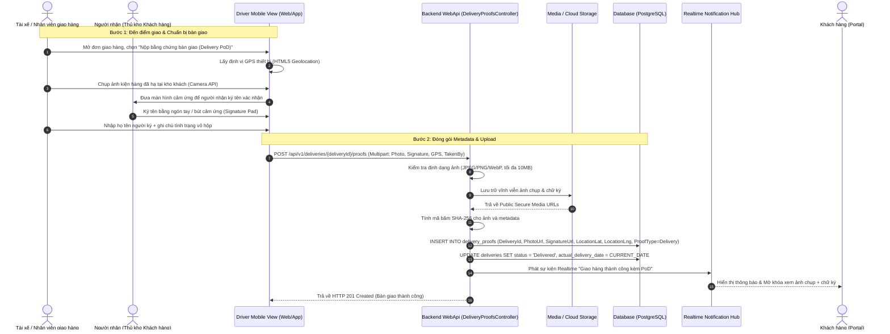
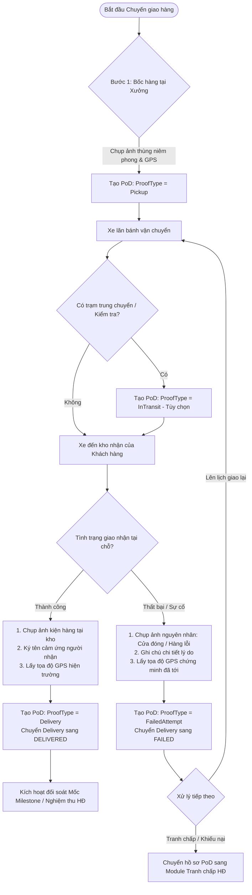

# FEATURE 20: XÁC MINH GIAO NHẬN BẰNG ẢNH & CHỮ KÝ SỐ (PROOF OF DELIVERY - PoD) - TÀI LIỆU THIẾT KẾ CHI TIẾT

---

## I. TÊN TÀI LIỆU, TÍNH NĂNG & TỔNG QUAN

### 1.1. Thông tin tài liệu
- **Tên tài liệu:** Thiết kế chi tiết Hệ thống Bằng chứng Giao nhận Điện tử B2B (Digital Proof of Delivery - PoD)
- **Mã tính năng (Feature Key):** `proof-of-delivery-pod` (Tính năng #20)
- **Phiên bản tài liệu:** `1.0.0`
- **Người thiết kế:** Solution Architect & Backend/Frontend Lead
- **Ngày lập:** 2026-10-29
- **Trạng thái:** 🟢 Approved / Ready for Implementation

### 1.2. Mục tiêu nghiệp vụ (Business Goals)
- **Minh bạch hóa & Số hóa 100% bằng chứng bàn giao:** Loại bỏ hoàn toàn biên bản giấy dễ thất lạc, thay thế bằng ảnh chụp hiện trường tại từng chặng kèm chữ ký điện tử trên màn hình cảm ứng của người nhận.
- **Giá trị pháp lý trong tranh chấp B2B:** Khi xảy ra hư hỏng bánh, móp hộp sơn mài, thiếu số lượng hoặc khiếu nại trễ hạn (Feature #17 - Contract Dispute), hệ thống PoD cung cấp bằng chứng bất biến (Tamper-proof evidence) có timestamp và tọa độ GPS xác thực.
- **Kích hoạt tự động nghiệm thu Milestone (Feature #16):** Bản ghi PoD loại `Delivery` thành công là điều kiện tiên quyết để hệ thống mở khóa chuyển giao và giải ngân thanh toán đợt hàng (Milestone M2/M3).
- **Cả hai bên cùng giám sát (Shared Single Source of Truth):** Cả đại diện khách hàng (Thủ kho/Thu mua) và nhà cung cấp (Giám đốc kinh doanh/Điều phối kho) đều xem được tức thời ảnh PoD, chữ ký và thông tin định vị.

### 1.3. Phạm vi tính năng (Scope)
- **Bao gồm (In-scope):**
  - Quản lý 4 loại bằng chứng giao nhận:
    1. `Pickup`: Ảnh bốc hàng tại xưởng (nguyên tem niêm phong, đai thùng).
    2. `InTransit`: Ảnh kiểm tra nhiệt độ khoang lạnh hoặc trạm trung chuyển (tùy chọn).
    3. `Delivery`: Ảnh kiện hàng bàn giao tại kho người nhận + Chữ ký số/cảm ứng người nhận.
    4. `FailedAttempt`: Ảnh bằng chứng lý do không giao được hàng (cửa kho đóng, từ chối nhận).
  - Thu thập Metadata tự động: Thời gian chụp (`TakenAt`), Tọa độ GPS (`LocationLat`, `LocationLng`), Tên người thực hiện (`TakenBy`), Thiết bị ghi nhận.
  - Chữ ký cảm ứng (Touch / Stylus Signature Pad) xuất ra định dạng Vector SVG / PNG Base64 có mã hóa.
  - Cơ chế băm SHA-256 bảo vệ tính toàn vẹn (Tamper-evident Hash).
  - API upload ảnh an toàn và lưu trữ vĩnh viễn trên Media Storage.
- **Không bao gồm (Out-of-scope):**
  - Nhận diện khuôn mặt AI của người nhận hàng (hệ thống xác thực qua chữ ký và số điện thoại nhận mã xác nhận).

---

## II. QUY TRÌNH & BIỂU ĐỒ LUỒNG (WORKFLOW DIAGRAMS)

### 2.1. Sequence Diagram: Thu thập & Xác minh Bằng chứng PoD tại Điểm Giao



### 2.2. Chi tiết 4 Loại Bằng chứng Giao nhận (Proof Types Flow)



---

## III. CHI TIẾT TỪNG BƯỚC XỬ LÝ KỸ THUẬT & DỮ LIỆU (STEP-BY-STEP LOGIC)

### Bước 1: Tiếp nhận Upload & Kiểm tra File (Image Ingestion & Sanitization)
1. **Kiểm tra loại file (MIME type):** Chỉ chấp nhận `image/jpeg`, `image/png`, `image/webp`. Từ chối các định dạng executable hoặc script.
2. **Kích thước tối đa:** Ảnh chụp kiện hàng tối đa 10 MB, ảnh chữ ký tối đa 2 MB.
3. **Chống giả mạo chữ ký:**
   - Ảnh chữ ký phải có kích thước tối thiểu 200x100px và không được là ảnh trắng hoàn toàn (Blank canvas check trên Client và Server).
   - Tên người ký (`TakenBy` hoặc `RecipientName`) bắt buộc có độ dài từ 3 đến 100 ký tự.

### Bước 2: Xác thực Tọa độ GPS & Thời gian thực (Geolocation & Timestamp Validation)
1. **Kiểm tra tọa độ:** `LocationLat` nằm trong khoảng `[-90, 90]`, `LocationLng` nằm trong khoảng `[-180, 180]`.
2. **So khớp bán kính (Geofencing Soft-check):**
   - Nếu địa chỉ giao nhận có tọa độ chuẩn (từ Geocoding), hệ thống tính khoảng cách Haversine giữa tọa độ PoD và tọa độ đích.
   - Nếu lệch > 500m, hệ thống vẫn cho phép nộp nhưng gắn cờ cảnh báo `gps_anomaly = true` để phục vụ hậu kiểm đối soát.
3. **Thời gian ghi nhận:** `TakenAt` được máy chủ lấy theo `DateTime.UtcNow` tại thời điểm nhận request để tránh client chỉnh sửa đồng hồ thiết bị.

### Bước 3: Tính toán Mã băm Toàn vẹn (SHA-256 Tamper-Proof Signature)
1. Máy chủ băm nội dung file ảnh: `ImageHash = SHA256(PhotoBytes)`.
2. Tạo chuỗi ký hiệu Metadata:
   `MetadataString = $"{DeliveryId}|{ProofType}|{LocationLat}|{LocationLng}|{TakenAt:O}|{ImageHash}"`.
3. Băm toàn bộ metadata: `ProofSignatureHash = SHA256(MetadataString)`.
4. Mã băm này được lưu trữ cùng bản ghi để đảm bảo không một ai (kể cả quản trị viên DB) có thể thay đổi ảnh hoặc tọa độ mà không bị phát hiện sai lệch băm.

### Bước 4: Lưu trữ Bền vững & Đồng bộ Trạng thái Chuyến giao
1. Tải file ảnh lên kho lưu trữ Media (Cloud Storage / MinIO / Persistent Local Directory).
2. Tạo thực thể `DeliveryProof`:
   - `DeliveryId`: ID chuyến giao hàng.
   - `ProofType`: `Pickup` / `InTransit` / `Delivery` / `FailedAttempt`.
   - `PhotoUrl`: URL ảnh chụp hiện trường.
   - `SignatureUrl`: URL chữ ký số (bắt buộc với `Delivery`).
   - `LocationLat`, `LocationLng`: Tọa độ thực địa.
   - `TakenBy`: Họ tên người nộp/người ký.
   - `TakenAt`: Thời điểm nộp.
   - `Notes`: Ghi chú hiện trường.
3. Nếu `ProofType == ProofType.Delivery`:
   - Tự động chuyển `Delivery.Status = DeliveryStatus.Delivered`.
   - Ghi nhận `Delivery.ActualDeliveryDate = DateOnly.FromDateTime(DateTime.UtcNow)`.
4. Nếu `ProofType == ProofType.Pickup`:
   - Tự động chuyển `Delivery.Status = DeliveryStatus.PickedUp`.
5. Nếu `ProofType == ProofType.FailedAttempt`:
   - Tự động chuyển `Delivery.Status = DeliveryStatus.Failed`.

---

## IV. ĐẶC TẢ KỸ THUẬT API (API CONTRACT SPECIFICATION)

### 4.1. Danh sách Endpoints PoD

| Method | Endpoint | Quyền (Role) | Mô tả nghiệp vụ |
| :--- | :--- | :--- | :--- |
| `POST` | `/api/v1/deliveries/{deliveryId}/proofs` | Supplier, Driver, Admin | Nộp bằng chứng PoD (Multipart form-data: ảnh, chữ ký, GPS) |
| `GET` | `/api/v1/deliveries/{deliveryId}/proofs` | Authenticated | Lấy toàn bộ danh sách bằng chứng PoD của một chuyến giao |
| `GET` | `/api/v1/deliveries/proofs/{proofId}` | Authenticated | Xem chi tiết một bản ghi bằng chứng kèm mã kiểm định SHA-256 |
| `GET` | `/api/v1/deliveries/proofs/{proofId}/verify` | Authenticated | Kiểm tra tính toàn vẹn của bằng chứng (Đối soát mã băm) |

### 4.2. Request Payload: Nộp bằng chứng PoD (Multipart Form-Data)

```text
POST /api/v1/deliveries/7c9e6679-7425-40de-944b-e07fc1f90ae7/proofs
Content-Type: multipart/form-data

- Form Field: proofType = "Delivery"
- Form Field: takenBy = "Nguyễn Văn Hùng - Đại diện nhận hàng"
- Form Field: locationLat = 21.0168
- Form Field: locationLng = 105.7838
- Form Field: notes = "Đã nhận đủ 1.500 hộp sơn mài. Hộp nguyên vẹn không trầy xước."
- Form File: photo = [Binary Data - JPEG 2.4MB]
- Form File: signature = [Binary Data - PNG 120KB] (Chữ ký cảm ứng)
```

### 4.3. Response Payload: Bằng chứng được tạo thành công (`ApiResponse<DeliveryProofResponse>`)

```json
{
  "status": 201,
  "message": "Nộp bằng chứng giao nhận (PoD) thành công.",
  "data": {
    "id": "9d8e7766-5544-3322-1100-abcdefabcdef",
    "deliveryId": "7c9e6679-7425-40de-944b-e07fc1f90ae7",
    "proofType": "Delivery",
    "photoUrl": "https://storage.mooncake.vn/pod/2026/09/photo_deliv_7c9e_deliv.jpg",
    "signatureUrl": "https://storage.mooncake.vn/pod/2026/09/sig_deliv_7c9e_signed.png",
    "takenBy": "Nguyễn Văn Hùng - Đại diện nhận hàng",
    "takenAt": "2026-09-15T09:45:12Z",
    "locationLat": 21.0168,
    "locationLng": 105.7838,
    "notes": "Đã nhận đủ 1.500 hộp sơn mài. Hộp nguyên vẹn không trầy xước.",
    "tamperProofHash": "e3b0c44298fc1c149afbf4c8996fb92427ae41e4649b934ca495991b7852b855",
    "isVerified": true
  },
  "path": "/api/v1/deliveries/7c9e6679-7425-40de-944b-e07fc1f90ae7/proofs",
  "traceId": "pod-trace-1029",
  "time": "2026-09-15T09:45:15Z"
}
```

---

## V. KIẾN TRÚC PHÂN TẦNG VÀ TỔ CHỨC MÃ NGUỒN (LAYER MAPPING)

### 5.1. Backend (.NET 8 / C# 12)
- **Domain:**
  - `Entities/DeliveryProof.cs`: Bản ghi bằng chứng với các thuộc tính định danh, ảnh, chữ ký, GPS, loại proof.
  - `Enums/ProofType.cs`: `Pickup`, `InTransit`, `Delivery`, `FailedAttempt`.
- **Application:**
  - `Interfaces/IDeliveryProofService.cs`: Nghiệp vụ lưu trữ, thẩm định file và mã hóa băm.
  - `Interfaces/IDeliveryProofRepository.cs`: Truy vấn lịch sử proofs của delivery.
  - `DTOs/Requests/CreateDeliveryProofRequest.cs`: Record nhận multipart form data.
  - `DTOs/Responses/DeliveryProofResponse.cs`: DTO trả về thông tin bằng chứng kèm hash verification.
  - `Validators/CreateDeliveryProofRequestValidator.cs`: Kiểm tra kích thước file, định dạng mime, GPS bounds.
- **Infrastructure:**
  - `Services/FileStorageService.cs`: Lưu trữ file vật lý hoặc cloud, sinh URL an toàn.
  - `Persistence/Repositories/DeliveryProofRepository.cs`: Triển khai truy vấn EF Core.
- **WebApi:**
  - `Controllers/DeliveryProofsController.cs`: Controller chuyên biệt xử lý nộp và tra cứu PoD.

### 5.2. Frontend (React 19)
- **Services:** `src/services/deliveryService.js` bổ sung các hàm `submitDeliveryProof`, `getDeliveryProofs`, `verifyProofHash`.
- **UI Components:**
  - `SignaturePadCanvas.jsx`: Thành phần cảm ứng hỗ trợ ký tên bằng tay trên smartphone/tablet hoặc chuột trên máy tính.
  - `PoDPhotoCapture.jsx`: Bộ chọn ảnh thông minh với camera HTML5 trực tiếp (`capture="environment"`).
  - `PoDProofViewerModal.jsx`: Modal phóng to xem ảnh bằng chứng, đối soát chữ ký, hiển thị bản đồ vị trí GPS và mã băm toàn vẹn.

---

## VI. BẢO MẬT & KIỂM THỬ (SECURITY & TESTING PLAN)

### 6.1. Bảo mật & Tính toàn vẹn (Security Controls)
1. **Chống giả mạo vị trí (GPS Spoofing Mitigation):**
   - Thu thập đồng thời Geolocation API từ trình duyệt và IP Location phía máy chủ để phát hiện sự sai lệch bất thường.
2. **Chống can thiệp file (Tamper Prevention):**
   - File ảnh sau khi upload được gán quyền Read-only trên storage, không thể ghi đè hay cập nhật lại.
   - Bản ghi `delivery_proofs` không cung cấp API `DELETE` hay `UPDATE` cho người dùng thông thường (Append-only Audit Log).
3. **Bảo vệ quyền riêng tư (Privacy Controls):**
   - Ảnh chụp chữ ký và số điện thoại người nhận chỉ hiển thị cho các bên liên quan trực tiếp đến Hợp đồng/Đơn hàng (Supplier sở hữu, Customer đại diện, Admin).

### 6.2. Ma trận Kịch bản Kiểm thử (Test Cases)
1. **TC-POD-01 (Happy Path - Delivery PoD):** Nộp đủ ảnh kiện hàng + chữ ký cảm ứng + GPS hợp lệ ➔ Tạo bản ghi PoD thành công, `Delivery.Status` tự động cập nhật sang `Delivered`.
2. **TC-POD-02 (Pickup PoD):** Nộp ảnh bốc hàng tại xưởng không cần chữ ký ➔ Tạo PoD thành công, `Delivery.Status` chuyển sang `PickedUp`.
3. **TC-POD-03 (Missing Signature on Delivery):** Nộp `ProofType.Delivery` nhưng thiếu file chữ ký ➔ Bị FluentValidation chặn với lỗi HTTP 400 `"Chữ ký người nhận là bắt buộc khi giao hàng thành công."`.
4. **TC-POD-04 (Invalid GPS Bounds):** Nộp tọa độ `LocationLat = 105.0` (vượt quá giới hạn [-90, 90]) ➔ Ném HTTP 400.
5. **TC-POD-05 (File Size Limit Exceeded):** Upload file ảnh kích thước 15MB ➔ Bị chặn ngay lập tức với HTTP 400 `"Kích thước ảnh không được vượt quá 10MB."`.
6. **TC-POD-06 (Tamper Verification):** Gọi API verify với bản ghi PoD hợp lệ ➔ Trả về `isVerified = true`.

