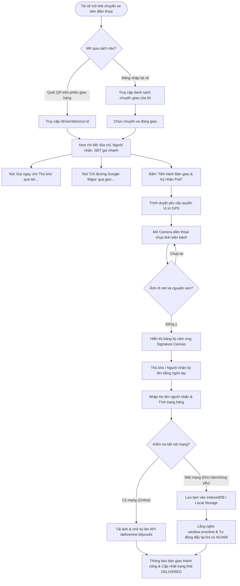

# MOBILE WORKFLOW & RESPONSIVE WEB VIEW DESIGN (GIAO DIỆN TÀI XẾ TRÊN DI ĐỘNG & WEB RESPONSIVE)

---

## I. TỔNG QUAN YÊU CẦU & CHIẾN LƯỢC KIẾN TRÚC

### 1.1. Bối cảnh & Yêu cầu từ Khách hàng
- **Yêu cầu nghiệp vụ:** Tài xế (Driver / Shipper) hoặc Nhân viên giao vận hiện trường cần một công cụ linh hoạt để chụp ảnh kiện hàng, lấy chữ ký người nhận và tọa độ GPS ngay tại điểm giao (Kho bãi, bến dốc, sảnh tòa nhà doanh nghiệp).
- **Chiến lược triển khai 2 giai đoạn (Dual-phase Strategy):**
  1. **Giai đoạn Hiện tại (Web Mobile-First Responsive View):** Xây dựng một giao diện Web tối ưu hóa 100% cho màn hình điện thoại thông minh (Smartphone Responsive Web View) trên nền tảng `mooncake-fe`. Tài xế chỉ cần mở trình duyệt di động (Safari / Chrome) thông qua đường link hoặc mã QR của chuyến giao mà không cần cài app phức tạp.
  2. **Giai đoạn Tương lai (Native Mobile App):** Chuẩn bị sẵn kiến trúc API, DTOs và luồng đồng bộ ngoại tuyến (Offline Sync Queue) để tái sử dụng hoàn toàn khi đội ngũ phát triển Native Mobile App (React Native / Flutter) sau này.

---

## II. LUỒNG NGHIỆP VỤ TÀI XẾ HIỆN TRƯỜNG (DRIVER WORKFLOW)



---

## III. THIẾT KẾ GIAO DIỆN WEB MOBILE-FIRST (SMARTPHONE RESPONSIVE VIEW)

### 3.1. Đặc tính UX/UI Mobile-First
- **Vùng thao tác thuận tay cái (Thumb-zone Optimized):** Toàn bộ các nút hành động chính (`Gọi điện`, `Chụp ảnh`, `Ký tên`, `Xác nhận bàn giao`) được đặt cố định ở thanh đáy màn hình (Bottom Fixed Action Bar), hỗ trợ `pb-safe` cho iPhone có thanh Home Indicator.
- **Kích thước nút cảm ứng lớn:** Chiều cao tối thiểu 48px, khoảng cách giữa các phần tử tối thiểu 12px để tránh chạm nhầm khi tài xế đeo găng tay hoặc thao tác ngoài trời.
- **Tích hợp phần cứng Web hiện đại (Web Device APIs):**
  - **HTML5 Camera:** `<input type="file" accept="image/*" capture="environment" />` ➔ Tự động kích hoạt Camera sau của điện thoại thay vì mở thư viện ảnh.
  - **HTML5 Geolocation API:** `navigator.geolocation.getCurrentPosition()` với cờ `enableHighAccuracy: true`, `timeout: 10000`.
  - **HTML5 Touch Events Signature Canvas:** Xử lý các sự kiện `touchstart`, `touchmove`, `touchend`, kèm `touch-action: none` để ngăn trang bị cuộn trong khi thủ kho đang ký tên.

### 3.2. Cấu trúc Giao diện Di động (Mobile Layout Wireframe)

```
┌───────────────────────────────────────────────┐
│ [← Quay lại]       CHUYẾN GIAO DEL-2026-001   │  <-- Header di động gọn nhẹ
├───────────────────────────────────────────────┤
│ 🏷️ Trạng thái: [ ĐANG GIAO HÀNG (IN TRANSIT) ] │
│ 📦 Hợp đồng: HĐ-VIN-2026-08 (1.500 hộp)       │
│                                               │
│ 📍 ĐIỂM GIAO:                                 │
│ Cổng số 3, Tổng kho Vingroup, KCN Quang Minh  │
│ 👤 Thủ kho: Bác Nguyễn Văn Hùng               │
│ 📞 SĐT: 0912.345.678                          │
│                                               │
│ [ 📞 GỌI ĐIỆN ]         [ 🗺️ CHỈ ĐƯỜNG MAPS ] │  <-- Thao tác nhanh tại chỗ
├───────────────────────────────────────────────┤
│ 📸 BẰNG CHỨNG BÀN GIAO (PROOF OF DELIVERY)    │
│                                               │
│  ┌─────────────────────────────────────────┐  │
│  │     [ ICON CAMERA: BẤM ĐỂ CHỤP ẢNH ]    │  │  <-- Viewfinder chụp ảnh
│  │         (Kiện hàng nguyên niêm phong)   │  │
│  └─────────────────────────────────────────┘  │
│                                               │
│ ✍️ CHỮ KÝ XÁC NHẬN CỦA NGƯỜI NHẬN:             │
│  ┌─────────────────────────────────────────┐  │
│  │                                         │  │  <-- Canvas cảm ứng ký tên
│  │             [ Ký tại đây ]              │  │      Hỗ trợ xóa ký lại
│  │                                         │  │
│  └─────────────────────────────────────────┘  │
│  [ 🔄 Xóa chữ ký ]  Họ tên: [Nguyễn Văn Hùng] │
│                                               │
│ 🌐 Vị trí GPS: 21.0168° N, 105.7838° E (Chuẩn)│
├───────────────────────────────────────────────┤
│ [ ✅ XÁC NHẬN BÀN GIAO & NỘP BẰNG CHỨNG ]     │  <-- Nút vàng Luxury ở đáy
└───────────────────────────────────────────────┘
```

---

## IV. THIẾT KẾ COMPONENT VÀ KỸ THUẬT CLIENT (FRONTEND ARCHITECTURE)

### 4.1. Component `SignaturePadCanvas.jsx`
- **Mục đích:** Thành phần cảm ứng hiển thị vùng ký mượt mà trên điện thoại và máy tính.
- **Kỹ thuật xử lý cảm ứng:**
  ```javascript
  // Lắng nghe touch events với tính năng chặn scroll trang
  const handleTouchMove = (e) => {
    e.preventDefault(); // Ngăn trình duyệt di chuyển trang khi ngón tay vẽ
    const touch = e.touches[0];
    const rect = canvasRef.current.getBoundingClientRect();
    const x = touch.clientX - rect.left;
    const y = touch.clientY - rect.top;
    drawLine(x, y);
  };
  ```
- **Kiểm tra tính hợp lệ:** Đếm số điểm ảnh khác màu nền (pixel count) để đảm bảo người nhận thực sự ký chữ ký, không chấp nhận nộp canvas trống.
- **Xuất dữ liệu:** Xuất ra Blob PNG hoặc Base64 sẵn sàng đóng gói vào `FormData`.

### 4.2. Component `DriverPodMobileView.jsx`
- **Tuyến đường (Route):** `/#driver-delivery-view?id=:deliveryId` hoặc modal toàn màn hình kích hoạt từ danh sách đơn giao.
- **Responsive Breakpoints:**
  - Màn hình điện thoại (`max-width: 640px`): Chiếm 100% chiều rộng, full màn hình, padding 16px, nút bấm lớn.
  - Màn hình máy tính bảng / Desktop (`min-width: 641px`): Hiển thị dưới dạng khung smartphone trung tâm (Mobile Frame Simulator 420px max-width) kèm bóng đổ sang trọng, cho phép nhân viên vận hành test hoặc nhập liệu tại văn phòng.

### 4.3. Cơ chế Kháng lỗi Mất mạng (Offline Resilience Queue)
- **Vấn đề:** Kho hàng doanh nghiệp thường nằm ở tầng hầm hoặc vùng khu công nghiệp có sóng 4G/Wifi chập chờn.
- **Giải pháp:**
  1. Khi người dùng bấm "Xác nhận bàn giao", nếu gọi API lỗi mạng (`ERR_INTERNET_DISCONNECTED` hoặc Timeout):
  2. Toàn bộ thông tin gồm Base64 ảnh, Base64 chữ ký, GPS và Timestamp được lưu vào `IndexedDB` dưới khóa `offline_pod_queue`.
  3. Giao diện hiển thị Alert màu vàng: `"Đang lưu ngoại tuyến do mất mạng. Hệ thống sẽ tự động đồng bộ ngay khi có kết nối trở lại"`.
  4. Lắng nghe sự kiện toàn cục:
     ```javascript
     window.addEventListener('online', async () => {
       await syncPendingPoDQueue();
     });
     ```

---

## V. ĐẶC TẢ KIẾN TRÚC CHO NATIVE MOBILE APP (TƯƠNG LAI)

Khi bắt đầu triển khai dự án Native Mobile App (React Native / Flutter) cho đội ngũ tài xế chuyên nghiệp:

1. **Giao tiếp API:** Tái sử dụng 100% các endpoint RESTful đã xây dựng:
   - `GET /api/v1/deliveries/driver/active` (Danh sách chuyến cần giao trong ngày).
   - `POST /api/v1/deliveries/{id}/proofs` (Upload ảnh PoD + chữ ký).
2. **Background Geolocation Tracking:** Ứng dụng Native sẽ kích hoạt dịch vụ chạy ngầm định kỳ 5 phút đẩy tọa độ về `/api/v1/deliveries/{id}/location` để vẽ bản đồ hành trình trực tiếp.
3. **Local Database:** Sử dụng SQLite hoặc WatermelonDB để lưu toàn bộ danh sách đơn và hình ảnh ngoại tuyến trước khi xuất phát.

