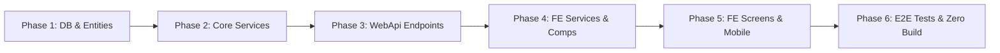

# MODULE 7: KẾ HOẠCH TRIỂN KHAI, KIỂM THỬ & BÀN GIAO (IMPLEMENTATION ROADMAP & TEST MATRIX)

---

## I. LỘ TRÌNH TRIỂN KHAI 6 GIAI ĐOẠN (6-PHASE IMPLEMENTATION ROADMAP)

Để đảm bảo chất lượng cấp doanh nghiệp (Enterprise Grade) và tránh phát sinh lỗi hồi quy trên toàn bộ hệ thống, quá trình hiện thực Module 7 được chia thành 6 giai đoạn tuần tự:

### Phase 1: Cơ sở Dữ liệu & Domain Entities
- Kiểm tra các Entity `Delivery.cs`, `DeliveryProof.cs`, `DeliveryStatus.cs`, `DeliveryType.cs`, `ProofType.cs` đã tồn tại trong `Mooncake.EcommercePlatform.Domain`.
- Bổ sung trường `TamperProofHash` vào `DeliveryProof.cs` và cấu hình EF Core Fluent API trong `DeliveryProofConfiguration.cs`.
- Đảm bảo cơ chế tự động migration và seeding dữ liệu kiểm thử mẫu cho Hợp đồng và Chuyến giao hàng.

### Phase 2: Tầng Application & Nghiệp vụ Cốt lõi
- Xây dựng các Interface: `IDeliveryService.cs`, `IDeliveryProofService.cs`, `IDeliveryRepository.cs`, `IDeliveryProofRepository.cs`.
- Hiện thực DTOs chuẩn C# 12 records và các bộ kiểm tra `CreateDeliveryRequestValidator`, `CreateDeliveryProofRequestValidator`.
- Hiện thực thuật toán mã băm bất biến SHA-256 trong `DeliveryProofService.cs` để niêm phong bằng chứng.
- Tích hợp lưu trữ file an toàn (hỗ trợ lưu local media hoặc S3).

### Phase 3: Tầng WebApi & Bộ điều khiển
- Xây dựng `DeliveriesController.cs` và `DeliveryProofsController.cs` kế thừa `BaseApiController`.
- Cấu hình phân quyền Role chặt chẽ (`[Authorize(Roles = "Supplier,Admin")]`, `[Authorize]`).
- Đăng ký Dependency Injection trong `InfrastructureServiceCollectionExtensions.cs` và `ApplicationServiceCollectionExtensions.cs`.
- Chạy kiểm thử tự động `dotnet test` đảm bảo 100% test cases backend vượt qua.

### Phase 4: Frontend Network & Thành phần Tái sử dụng
- Cập nhật `src/constants/apiEndpoints.js` bổ sung danh mục `DELIVERIES`.
- Hiện thực `src/services/deliveryService.js` với đầy đủ Mock fallback khi `VITE_ENABLE_MOCK_FALLBACK=true`.
- Xây dựng component cảm ứng `src/components/delivery/SignatureCanvas.jsx`.
- Xây dựng modal xem bằng chứng `src/components/delivery/PoDViewerModal.jsx`.

### Phase 5: Hoàn thiện Màn hình UI & Responsive Mobile View
- Nâng cấp màn hình Khách hàng `src/Pages/Customer/DeliveryPoD.jsx`.
- Nâng cấp màn hình Nhà cung cấp `src/Pages/Supplier/DeliverManage.jsx`.
- Hiện thực màn hình Web Mobile-first chuyên dụng cho Tài xế `src/Pages/Delivery/DriverMobileView.jsx` (hỗ trợ Touch Signature, HTML5 Camera, GPS).
- Cập nhật định tuyến `shopRoutes.js` và thanh điều hướng.

### Phase 6: Kiểm thử Tích hợp & Kiểm tra Tính toàn vẹn Build
- Viết bộ kiểm thử Backend Unit & Integration Tests (xUnit + Moq).
- Viết kịch bản kiểm thử tự động đầu cuối (Playwright E2E) mô phỏng trọn vẹn luồng giao nhận và nộp PoD.
- Chạy lệnh kiểm tra tính toàn vẹn: `npm run build` và `dotnet build` đạt 0 lỗi, 0 cảnh báo.

---

## II. MA TRẬN KIỂM THỬ BACKEND (BACKEND TEST MATRIX)

### 2.1. Kiểm thử Nghiệp vụ Chuyến giao (`DeliveryServiceTests.cs`)
1. **UT-DEL-01:** Tạo chuyến giao thành công khi Hợp đồng ở trạng thái `Active`.
2. **UT-DEL-02:** Ném `ValidationException` khi tạo chuyến giao không có cả `ContractId` và `OrderId`.
3. **UT-DEL-03:** Ném `ForbiddenException` khi Supplier cố tạo chuyến giao cho Hợp đồng của Supplier khác.
4. **UT-DEL-04:** Chuyển trạng thái từ `Pending` ➔ `Confirmed` ➔ `InTransit` thành công.
5. **UT-DEL-05:** Ngăn chặn chuyển sang `Delivered` nếu chưa có bằng chứng PoD loại `Delivery`.

### 2.2. Kiểm thử Nghiệp vụ Bằng chứng PoD (`DeliveryProofServiceTests.cs`)
1. **UT-POD-01:** Nộp bằng chứng `ProofType.Delivery` có ảnh + chữ ký ➔ Tạo PoD thành công, `Delivery.Status` tự động chuyển sang `Delivered`.
2. **UT-POD-02:** Ném `ValidationException` khi nộp bằng chứng `Delivery` nhưng không có file chữ ký.
3. **UT-POD-03:** Kiểm tra mã băm SHA-256 sinh ra khớp 100% với dữ liệu ảnh và metadata.
4. **UT-POD-04:** Ném `ValidationException` khi tọa độ `LocationLat` hoặc `LocationLng` vượt ngoài phạm vi địa lý hợp lệ.
5. **UT-POD-05:** Nộp ảnh loại `FailedAttempt` ➔ Chuyến giao tự động chuyển trạng thái `Failed`.

### 2.3. Kiểm thử Tầng WebApi (`DeliveriesControllerHttpTests.cs`)
1. **IT-HTTP-01:** `POST /api/v1/deliveries` trả về `201 Created` và cấu trúc `ApiResponse<DeliveryResponse>`.
2. **IT-HTTP-02:** `GET /api/v1/deliveries/{id}` trả về `200 OK` với đầy đủ danh sách proofs.
3. **IT-HTTP-03:** `POST /api/v1/deliveries/{id}/proofs` với file không hợp lệ trả về `400 Bad Request`.

---

## III. MA TRẬN KIỂM THỬ TỰ ĐỘNG ĐẦU CUỐI PLAYWRIGHT (E2E TEST MATRIX)

File kịch bản: `tests/e2e/logistics-delivery-pod.spec.js`

| STT | Tên kịch bản kiểm thử | Luồng thực hiện chi tiết | Kết quả mong đợi |
| :---: | :--- | :--- | :--- |
| 1 | **E2E-POD-01: Tạo chuyến chia đợt (Split Shipment)** | 1. Supplier vào trang Quản lý Vận Chuyển (`#van-chuyen-pod`). 2. Bấm "Tạo chuyến giao hàng mới". 3. Chọn Hợp đồng đang Active, nhập địa chỉ, ngày dự kiến. 4. Bấm Lưu chuyến giao. | Chuyến giao mới xuất hiện trong bảng ở trạng thái `Chờ xác nhận` (`Pending`). |
| 2 | **E2E-POD-02: Cập nhật lộ trình In-Transit** | 1. Supplier bấm "Bốc hàng lên xe" ➔ Chuyển `PickedUp`. 2. Supplier bấm "Xuất bến vận chuyển" ➔ Chuyển `InTransit`. | Badge trạng thái đổi thành màu xanh `Đang vận chuyển`, thông báo realtime xuất hiện. |
| 3 | **E2E-POD-03: Tài xế nộp PoD trên Web Mobile View** | 1. Mở màn hình Driver Mobile View (`#driver-delivery-view?id=...`). 2. Giả lập chọn ảnh kiện hàng tại kho. 3. Vẽ chữ ký trên bảng cảm ứng `SignatureCanvas`. 4. Bấm "Xác nhận bàn giao & Nộp bằng chứng". | Upload thành công, chuyến giao chuyển sang `Đã giao hàng` (`Delivered`). |
| 4 | **E2E-POD-04: Khách hàng xem và đối soát PoD** | 1. Khách hàng vào trang Giao nhận (`#giao-hang-pod`). 2. Chuyến hàng hiển thị trạng thái `Đã bàn giao`. 3. Bấm "Xem Bằng Chứng PoD". | Modal hiển thị ảnh kiện hàng rõ nét, chữ ký của thủ kho, tọa độ GPS và dấu kiểm định SHA-256. |

---

## IV. TIÊU CHÍ NGHIỆM THU & BÀN GIAO (ACCEPTANCE CRITERIA)

Một tính năng được coi là hoàn thành khi thỏa mãn đầy đủ các điều kiện khắt khe sau:
- [ ] Toàn bộ tài liệu thiết kế đã được Review và Thống nhất phương án.
- [ ] Backend C# .NET 8 build sạch 0 lỗi (`dotnet build Mooncake.EcommercePlatform.sln`).
- [ ] Toàn bộ Unit & Integration tests Backend đều PASS (`dotnet test`).
- [ ] Frontend React 19 build sạch 0 lỗi (`npm run build` trong `mooncake-fe`).
- [ ] Tuân thủ tuyệt đối quy tắc format: 2 spaces, không dùng `var`, dấu chấm phẩy `;`, nháy đơn cho JS, nháy kép cho JSX attributes.
- [ ] Kịch bản Playwright E2E chạy thông suốt từ đầu đến cuối (PASS 100%).
- [ ] **TUYỆT ĐỐI KHÔNG commit git** (Tuân thủ chỉ thị của người dùng).

