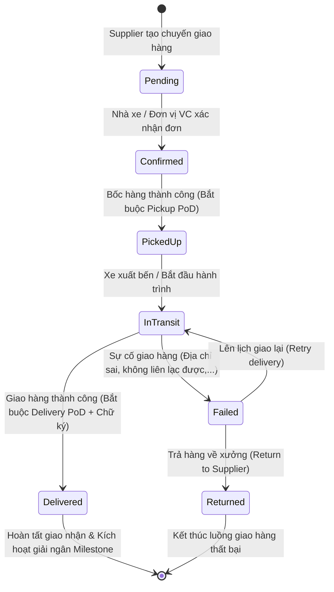

# MODULE 7: QUẢN LÝ GIAO NHẬN & XÁC MINH BẰNG CHỨNG GIAO HÀNG (LOGISTICS & PROOF OF DELIVERY - PoD)

> **Tài liệu đặc tả kiến trúc và thiết kế chi tiết cấp Enterprise (Enterprise Architecture & Detail Design)**  
> **Dự án:** Nền tảng Thương mại Điện tử B2B Bánh Trung Thu (Mooncake B2B Marketplace Platform)  
> **Phạm vi:** Module 7 – Tính năng #19 (Quản lý đơn giao hàng) & Tính năng #20 (Xác minh giao nhận bằng ảnh & chữ ký số PoD)  
> **Ngày lập:** 2026-10-29  
> **Trạng thái:** 🟢 Approved / Ready for Implementation

---

## I. TỔNG QUAN HỆ THỐNG VẬN TẢI & GIAO NHẬN B2B

Trong mô hình thương mại B2B dành cho bánh trung thu cao cấp và quà tặng doanh nghiệp số lượng lớn, khâu logistics và bàn giao đóng vai trò then chốt:
- **Tính chất hàng hóa:** Hàng tươi có hạn sử dụng ngắn (30–60 ngày), vỏ bánh dễ móp méo, hộp sơn mài/hộp gỗ cao cấp dễ trầy xước.
- **Quy mô đơn hàng:** Từ vài trăm đến hàng chục nghìn hộp, thường chia thành nhiều đợt giao (Split Shipments) đến nhiều kho chi nhánh hoặc trụ sở công ty của khách hàng.
- **Giá trị pháp lý của PoD (Proof of Delivery):** Bằng chứng giao nhận kèm ảnh chụp hiện trường, định vị GPS và chữ ký số của thủ kho là căn cứ quyết định để giải ngân tiền bảo chứng Escrow (Mốc M2/M3) hoặc giải quyết tranh chấp (Dispute - Feature #17).

```
┌─────────────────────────────────────────────────────────────────────────────────────────────────┐
│                                   LUỒNG TỔNG QUAN MODULE 7                                      │
└─────────────────────────────────────────────────────────────────────────────────────────────────┘
      Hợp đồng Active / Đơn hàng Confirmed
                      │
                      ▼
        [1] Tạo chuyến giao hàng (Delivery) ─── Chia đợt (Split Shipments: Đợt 1, Đợt 2,...)
                      │
                      ├───────────────────────────────┬───────────────────────────────┐
                      ▼                               ▼                               ▼
            Self-Arranged Mode             Platform-Managed Mode               Gán Tài xế/Shipper
       (Xưởng tự chở / Xe nội bộ)         (ViettelPost, GHTK, GHN)             (Mobile / Web App)
                      │                               │                               │
                      └───────────────────────────────┼───────────────────────────────┘
                                                      │
                                                      ▼
                       [2] Bốc hàng tại Xưởng (Pickup PoD) ── Ảnh thùng/kiện + GPS
                                                      │
                                                      ▼
                       [3] Vận chuyển trên đường (In-Transit Tracking)
                                                      │
                                                      ▼
                       [4] Bàn giao tại Kho Khách hàng (Delivery PoD)
                                  ├─ Ảnh kiện hàng tại điểm giao
                                  ├─ Chữ ký cảm ứng thủ kho (Canvas Signature)
                                  └─ Tọa độ GPS + Timestamp chống gian lận
                                                      │
                                                      ▼
                       [5] Khách hàng đối soát & Xác nhận Nghiệm thu mốc
```

---

## II. DANH MỤC TÀI LIỆU THIẾT KẾ CHI TIẾT

| STT | Mã tài liệu | Tên tài liệu thiết kế | Nội dung chính |
| :---: | :--- | :--- | :--- |
| 1 | `01_DELIVERY_MANAGEMENT_DESIGN.md` | Thiết kế Quản lý Chuyến Giao Hàng (Feature #19) | 2 chế độ (Self-Arranged & Platform-Managed), chia đợt, mã tracking, lifecycle chuyển trạng thái, đồng bộ realtime. |
| 2 | `02_PROOF_OF_DELIVERY_POD_DESIGN.md` | Thiết kế Bằng chứng Giao nhận PoD (Feature #20) | Chụp ảnh hiện trường 4 giai đoạn, định vị GPS, chữ ký số điện tử, mã hóa chống sửa đổi, giá trị pháp lý trong tranh chấp. |
| 3 | `03_MOBILE_WORKFLOW_RESPONSIVE_WEB_DESIGN.md` | Thiết kế Luồng Mobile & Giao diện Web Responsive | Luồng thao tác tài xế/shipper, Web Mobile-first View trên smartphone, Touch SignaturePad, HTML5 Camera & Geolocation. |
| 4 | `04_API_DTO_VALIDATION.md` | Đặc tả RESTful API, DTOs & Validation | 12 REST endpoints, C# 12 records, FluentValidation, bảng mã lỗi HTTP chuẩn hóa. |
| 5 | `05_DATA_SQL_CONCURRENCY_SECURITY.md` | Thiết kế Cơ sở Dữ liệu & Bảo mật | PostgreSQL DDL, Indexing chiến lược, Khóa bi quan `FOR UPDATE`, bảo vệ tọa độ GPS, lưu trữ ảnh cloud. |
| 6 | `06_FRONTEND_INTEGRATION.md` | Tích hợp Giao diện Frontend | React 19, Nâng cấp `DeliveryPoD.jsx` (Customer), `DeliverManage.jsx` (Supplier), và tạo màn hình Driver Mobile View. |
| 7 | `07_IMPLEMENTATION_TEST_ROLLOUT.md` | Kế hoạch Hiện thực & Kiểm thử Rollout | Lộ trình 6 phase, Unit Test matrix, Playwright E2E matrix, tiêu chí bàn giao 0 lỗi. |

---

## III. BẢNG MA TRẬN PHÂN QUYỀN ACTORS & CHỨC NĂNG

| Chức năng | Khách hàng (Customer) | Nhà cung cấp (Supplier) | Tài xế / Shipper (Driver) | Quản trị viên (Admin) | Hệ thống (Background Job) |
| :--- | :---: | :---: | :---: | :---: | :---: |
| Tạo chuyến giao hàng mới | ❌ | ✅ | ❌ | ✅ | ❌ |
| Chọn chế độ vận chuyển (Self/Platform) | ❌ | ✅ | ❌ | ✅ | ❌ |
| Bốc hàng & Nộp ảnh Pickup PoD | ❌ | ✅ | ✅ | ❌ | ❌ |
| Cập nhật lộ trình In-Transit | ❌ | ✅ | ✅ | ❌ | 🔄 (Webhook HVC) |
| Nộp ảnh Delivery PoD + Chữ ký số | ❌ | ❌ | ✅ | ❌ | ❌ |
| Báo cáo giao hàng thất bại (Failed) | ❌ | ❌ | ✅ | ❌ | ❌ |
| Xem trực tiếp ảnh PoD & Đối chiếu GPS | ✅ | ✅ | ✅ | ✅ | ❌ |
| Xác nhận đã nhận hàng đủ & đạt chuẩn | ✅ | ❌ | ❌ | ❌ | ❌ |
| Can thiệp điều phối / Cưỡng chế cập nhật | ❌ | ❌ | ❌ | ✅ | ❌ |

---

## IV. TỔNG QUAN STATE MACHINE CỦA CHUYẾN GIAO HÀNG (DELIVERY LIFECYCLE)



