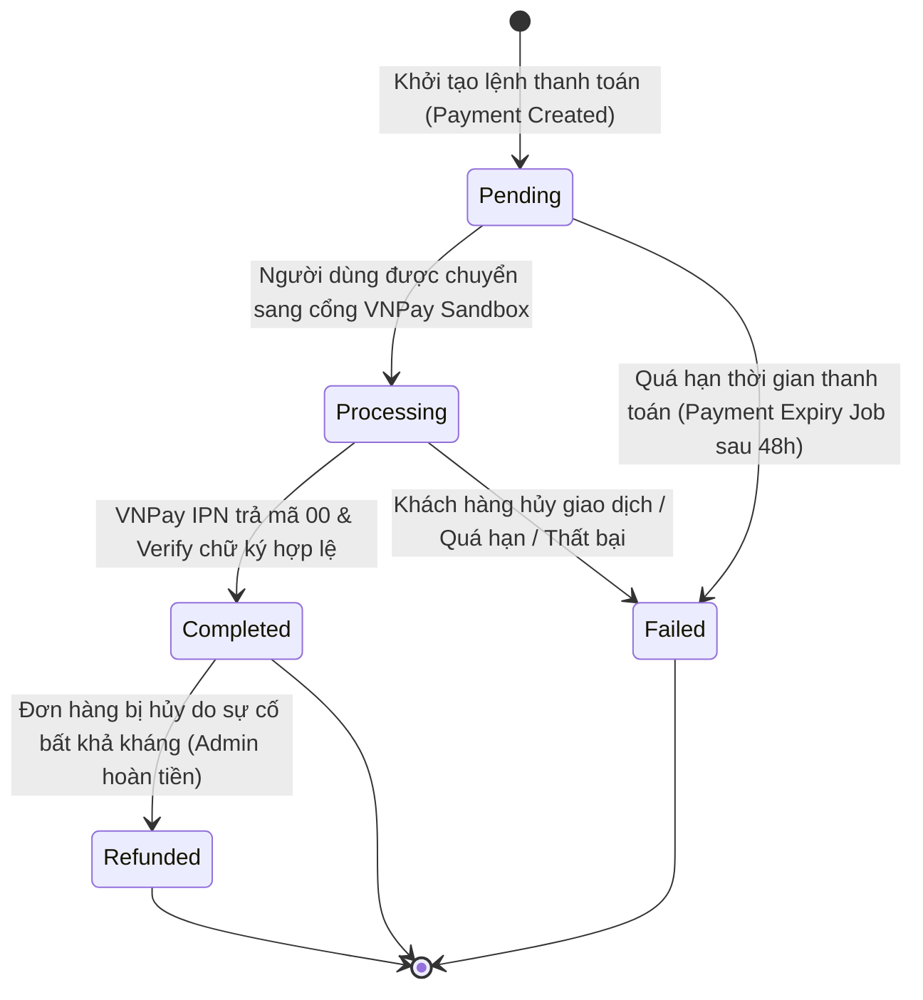

# [M10-F25.1] THIẾT KẾ CHI TIẾT: THANH TOÁN ĐƠN HÀNG TRỰC TIẾP & CỔNG VNPAY SANDBOX

---

## I. TỔNG QUAN TÍNH NĂNG & MỤC TIÊU NGHIỆP VỤ

### 1.1. Thông tin tài liệu
- **Tên tài liệu:** Tài liệu thiết kế chi tiết tính năng Thanh toán đơn hàng trực tiếp & Tích hợp VNPay Sandbox
- **Mã tính năng (Feature Key):** `order-payment-vnpay`
- **Phiên bản tài liệu:** `1.0.0`
- **Thuộc Module:** `Module 10: Thanh toán` (Tính năng #25: Thanh toán đơn hàng & Hợp đồng)
- **Người thiết kế:** Solution Architect & Backend/Frontend Lead
- **Trạng thái:** `Approved for Implementation`

### 1.2. Mục tiêu nghiệp vụ (Business Goals)
1. Cung cấp trải nghiệm thanh toán không tiền mặt mượt mà, tức thời cho các đơn hàng mua sỉ / số lượng lớn bánh Trung thu trên sàn Nguyệt Phố B2B.
2. Tích hợp cổng thanh toán **VNPay Sandbox 2.1.0** với chuẩn bảo mật HMAC-SHA512, đảm bảo 100% giao dịch có chữ ký số xác thực và đối soát qua Webhook IPN.
3. Hỗ trợ phương thức COD (Thanh toán khi nhận hàng) có kiểm soát chặt chẽ theo hạn mức rủi ro sàn (chỉ áp dụng đơn $\le$ 10.000.000 ₫ và không yêu cầu in ấn logo tùy chỉnh).
4. Đồng bộ tức thời trạng thái đơn hàng (từ `PendingPayment` $\rightarrow$ `Processing` $\rightarrow$ phân bổ đơn hàng cho xưởng bánh xuất kho).

### 1.3. Phạm vi tính năng (Scope)
- **Bao gồm (In-scope):**
  - Khởi tạo giao dịch thanh toán cho đơn hàng đã xác nhận (`OrderId`).
  - Sinh URL thanh toán VNPay Sandbox với mã giao dịch duy nhất `PaymentNumber`.
  - Xử lý phản hồi từ VNPay (Return URL client và Webhook IPN Server-to-Server).
  - Kiểm tra điều kiện hợp lệ cho phương thức COD.
  - Biên lai thanh toán điện tử (E-Receipt) và thông báo biến động giao dịch.
- **Không bao gồm (Out-of-scope):**
  - Thanh toán bằng thẻ tín dụng quốc tế trực tiếp không qua VNPay (được xử lý thông qua cổng VNPay).
  - Ví điện tử MoMo/ZaloPay trực tiếp (Sandbox của dự án tập trung chuẩn hóa qua VNPay Sandbox theo yêu cầu).

---

## II. FLOW CHART & WORKFLOW CHI TIẾT

### 2.1. Sequence Diagram: Luồng Thanh Toán Đơn Hàng Qua VNPay Sandbox

```mermaid
sequenceDiagram
  autonumber
  actor Customer as Doanh nghiệp (Customer)
  participant FE as Frontend (OrderAndDesgin / PaymentModal)
  participant API as Backend (PaymentsController)
  participant SVC as PaymentService
  participant GATEWAY as VnPayGateway
  participant REPO as PaymentRepository
  participant DB as Database (PostgreSQL)
  participant VNP as VNPay Sandbox Portal

  Customer->>FE: 1. Xem đơn hàng đã xác nhận, bấm "Thanh toán ngay"
  FE->>FE: 2. Mở Modal chọn phương thức: VNPay Sandbox / COD / VietQR
  Customer->>FE: 3. Chọn "VNPay Sandbox" và bấm "Tiến hành thanh toán"
  FE->>API: 4. POST /api/v1/payments/orders/vnpay-url (orderId, returnUrl)
  API->>SVC: 5. CreateOrderVnPayUrlAsync(customerId, orderId, returnUrl, clientIp)
  SVC->>REPO: 6. Kiểm tra đơn hàng: tồn tại, thuộc customer, trạng thái hợp lệ, chưa thanh toán
  REPO->>DB: 7. Query Order & Check existing Payments
  DB-->>REPO: 8. Order hợp lệ (TotalAmount > 0)
  SVC->>REPO: 9. Tạo/Cập nhật bản ghi Payment (Status: Pending, Method: VNPay)
  REPO->>DB: 10. Lưu Payment (PaymentNumber: PAY-YYYYMMDD-XXXX)
  SVC->>GATEWAY: 11. CreatePaymentUrl(payment, returnUrl, clientIp, now)
  GATEWAY->>GATEWAY: 12. Sắp xếp tham số alpha-b & băm HMAC-SHA512 với vnp_HashSecret
  GATEWAY-->>SVC: 13. URL: https://sandbox.vnpayment.vn/paymentv2/vpcpay.html?...&vnp_SecureHash=...
  SVC-->>API: 14. VnPayUrlResponse(paymentId, paymentNumber, amount, paymentUrl)
  API-->>FE: 15. Trả về HTTP 200 OK kèm paymentUrl
  FE->>VNP: 16. Chuyển hướng trình duyệt sang cổng VNPay Sandbox
  Customer->>VNP: 17. Thực hiện thanh toán thử nghiệm (Nhập OTP Sandbox 123456)
  VNP-->>Customer: 18. Thông báo kết quả giao dịch trên cổng VNPay

  par Return URL về Client
    VNP->>FE: 19a. Redirect về returnUrl?vnp_Amount=...&vnp_ResponseCode=00&vnp_SecureHash=...
    FE->>API: 20a. GET /api/v1/payments/vnpay/return-callback?...
    API->>SVC: 21a. Validate checksum & lấy thông tin giao dịch
    API-->>FE: 22a. Trả về kết quả: Giao dịch thành công
    FE-->>Customer: 23a. Hiển thị màn hình Biên lai xác nhận thanh toán thành công
  and IPN Webhook Server-to-Server
    VNP->>API: 19b. GET /api/v1/payments/vnpay/ipn?... (Asynchronous)
    API->>SVC: 20b. ProcessVnPayIpnAsync(queryParams)
    SVC->>GATEWAY: 21b. IsValidSignature(queryParams) -> True
    SVC->>REPO: 22b. ConfirmVnPayPaymentAsync(paymentNumber)
    REPO->>DB: 23b. BEGIN TRANSACTION; Payment.Status = Completed; Order.Status = Processing; COMMIT;
    SVC-->>VNP: 24b. {"RspCode": "00", "Message": "Confirm Success"}
  end
```

### 2.2. State Transition: Vòng Đời Trạng Thái Thanh Toán Đơn Hàng



---

## III. CHI TIẾT TỪNG BƯỚC XỬ LÝ (STEP-BY-STEP LOGIC)

### Bước 1: Tiếp nhận yêu cầu thanh toán & Xác thực quyền sở hữu
- **Mục đích:** Đảm bảo chỉ khách hàng sở hữu đơn hàng mới có quyền thanh toán và đơn hàng đủ điều kiện thanh toán.
- **Dữ liệu đầu vào:** `orderId` (UUID), `returnUrl` (String URI hợp lệ), `customerId` (từ JWT Claims).
- **Quy tắc kiểm tra (Validation):**
  1. `orderId` phải tồn tại trong CSDL và có `CustomerId == CurrentUserId`.
  2. Trạng thái đơn hàng phải là `Confirmed` hoặc `PendingPayment`. Nếu đơn ở trạng thái `Cancelled` $\rightarrow$ Ném `HttpException(409, "Không thể thanh toán cho đơn hàng đã bị hủy.")`.
  3. Nếu đơn hàng đã có bản ghi `Payment` với trạng thái `Completed` $\rightarrow$ Ném `HttpException(409, "Đơn hàng này đã được thanh toán hoàn tất.")`.
  4. Số tiền phải thanh toán `TotalAmount` phải $> 0$.

### Bước 2: Chuẩn bị giao dịch & Cơ chế chống trùng lặp (Idempotency)
- **Mục đích:** Tránh tạo nhiều giao dịch rác khi người dùng click liên tục nút thanh toán.
- **Xử lý:**
  1. Kiểm tra xem có giao dịch `Payment` ở trạng thái `Pending` trong vòng 15 phút gần nhất cho đơn hàng này chưa.
  2. Nếu đã có và chưa hết hạn $\rightarrow$ Tái sử dụng `PaymentNumber` hiện hữu để cập nhật tham số VNPay.
  3. Nếu chưa có $\rightarrow$ Sinh mã giao dịch mới theo định dạng chuẩn: `PAY-YYYYMMDD-XXXXXXXX` (ví dụ: `PAY-20261029-E7A912F4`).

### Bước 3: Tạo URL thanh toán VNPay Sandbox & Ký HMAC-SHA512
- **Cấu hình Sandbox (từ `keyvnpay.text`):**
  - `vnp_TmnCode`: `BFYI47AF`
  - `vnp_HashSecret`: `WBGRFFJWAHOAFNIEYICELPMQORJJHSQL`
  - `vnp_Url`: `https://sandbox.vnpayment.vn/paymentv2/vpcpay.html`
- **Bộ tham số truyền sang VNPay:**
  | Tên tham số | Giá trị | Ý nghĩa |
  | :--- | :--- | :--- |
  | `vnp_Version` | `2.1.0` | Phiên bản API VNPay |
  | `vnp_Command` | `pay` | Lệnh tạo thanh toán |
  | `vnp_TmnCode` | `BFYI47AF` | Mã định danh website merchant trên Sandbox |
  | `vnp_Amount` | `Amount * 100` (đơn vị xu/hào) | Số tiền (VD: 5.000.000 ₫ $\rightarrow$ `500000000`) |
  | `vnp_CreateDate` | `yyyyMMddHHmmss` (giờ VN GMT+7) | Thời điểm khởi tạo giao dịch |
  | `vnp_CurrCode` | `VND` | Đơn vị tiền tệ |
  | `vnp_IpAddr` | IP khách hàng (`RemoteIpAddress`) | IP người thực hiện giao dịch |
  | `vnp_Locale` | `vn` | Ngôn ngữ giao diện thanh toán |
  | `vnp_OrderInfo` | `Thanh toan don hang {OrderNumber}` | Nội dung thanh toán |
  | `vnp_OrderType` | `other` | Loại hàng hóa |
  | `vnp_ReturnUrl` | `returnUrl` từ request | Địa chỉ redirect sau khi khách hàng hoàn tất |
  | `vnp_TxnRef` | `PaymentNumber` | Mã tham chiếu giao dịch độc nhất của sàn |
  | `vnp_SecureHash` | Chuỗi băm HMAC-SHA512 | Chữ ký số kiểm tra tính toàn vẹn |

### Bước 4: Kiểm tra điều kiện thanh toán COD (Nếu chọn COD)
- **Quy tắc:**
  1. Chỉ áp dụng cho đơn hàng không có yêu cầu `CustomPackaging` (in logo thương hiệu riêng).
  2. Tổng giá trị đơn hàng $\le$ hạn mức `payments.cod_limit_vnd` (cấu hình trong `system_configs`, mặc định 10.000.000 ₫).
  3. Nếu vi phạm $\rightarrow$ Trả về mã `422 Unprocessable Entity` kèm thông báo: `"Phương thức thanh toán khi nhận hàng (COD) chỉ áp dụng cho đơn hàng dưới 10.000.000 ₫ và không yêu cầu in ấn bao bì riêng."`

### Bước 5: Tiếp nhận Webhook IPN từ VNPay & Cập nhật trạng thái
- **Mục đích:** Xử lý cập nhật CSDL bất đồng bộ và an toàn tuyệt đối.
- **Xử lý:**
  1. Kiểm tra chữ ký `vnp_SecureHash`: So sánh hmac tính từ toàn bộ query params với giá trị gửi kèm bằng thuật toán so sánh chuỗi thời gian cố định `CryptographicOperations.FixedTimeEquals`.
  2. Nếu sai chữ ký $\rightarrow$ Trả về `{"RspCode": "97", "Message": "Invalid Checksum"}`.
  3. Tìm `Payment` theo `vnp_TxnRef`. Nếu không tìm thấy $\rightarrow$ Trả về `{"RspCode": "01", "Message": "Order not found"}`.
  4. Nếu `Payment.Status == Completed` $\rightarrow$ Trả về `{"RspCode": "02", "Message": "Order already confirmed"}` (Xử lý trường hợp IPN gửi retry lặp lại).
  5. Nếu `vnp_ResponseCode == "00"` (Giao dịch thành công):
     - Cập nhật `Payment.Status = Completed`, `Payment.PaidAt = DateTime.UtcNow`, `Payment.TransactionId = vnp_TransactionNo`.
     - Cập nhật `Order.Status = Processing` (Đơn hàng sẵn sàng xuất xưởng).
     - Gửi thông báo real-time cho Khách hàng và Nhà cung cấp.
     - Trả về `{"RspCode": "00", "Message": "Confirm Success"}`.
  6. Nếu `vnp_ResponseCode != "00"` (Thất bại/Hủy):
     - Đánh dấu `Payment.Status = Failed`.
     - Trả về `{"RspCode": "00", "Message": "Confirm Success"}` để báo nhận kết quả.

---

## IV. ĐẶC TẢ KỸ THUẬT API

### 4.1. `POST /api/v1/payments/orders/vnpay-url`
- **Mô tả:** Khởi tạo giao dịch thanh toán cho đơn hàng và nhận về URL dẫn sang cổng VNPay Sandbox.
- **Yêu cầu xác thực:** `Bearer Token (Role: Customer)`
- **Request Headers:**
  ```http
  Authorization: Bearer <jwt-token>
  Content-Type: application/json
  ```
- **Request Body:**
  ```json
  {
    "orderId": "3fa85f64-5717-4562-b3fc-2c963f66afa6",
    "returnUrl": "http://localhost:5186/#/thanh-toan/ket-qua"
  }
  ```
- **Response Payload (HTTP 200 OK):**
  ```json
  {
    "status": 200,
    "message": "Đã khởi tạo liên kết thanh toán VNPay Sandbox thành công.",
    "data": {
      "paymentId": "7c9e6679-7425-40de-944b-e07fc1f90ae7",
      "paymentNumber": "PAY-20261029-A78F21B3",
      "amount": 12500000.0,
      "paymentUrl": "https://sandbox.vnpayment.vn/paymentv2/vpcpay.html?vnp_Amount=1250000000&vnp_Command=pay&vnp_CreateDate=20261029153000&vnp_CurrCode=VND&vnp_IpAddr=127.0.0.1&vnp_Locale=vn&vnp_OrderInfo=Thanh+toan+don+hang+ORD-202610-001&vnp_OrderType=other&vnp_ReturnUrl=http%3A%2F%2Flocalhost%3A5186%2F%23%2Fthanh-toan%2Fket-qua&vnp_TmnCode=BFYI47AF&vnp_TxnRef=PAY-20261029-A78F21B3&vnp_Version=2.1.0&vnp_SecureHash=59a84a..."
    },
    "path": "/api/v1/payments/orders/vnpay-url",
    "time": "2026-10-29T08:30:00Z"
  }
  ```

### 4.2. `GET /api/v1/payments/vnpay/return-callback`
- **Mô tả:** Xác thực chữ ký và kiểm tra trạng thái giao dịch khi khách hàng được VNPay chuyển hướng về sàn.
- **Yêu cầu xác thực:** `Anonymous` / `Authorized`
- **Query Parameters:** Các tham số `vnp_*` do VNPay trả về trên URL.
- **Response Payload (HTTP 200 OK):**
  ```json
  {
    "status": 200,
    "message": "Xác thực giao dịch thanh toán thành công.",
    "data": {
      "paymentNumber": "PAY-20261029-A78F21B3",
      "orderId": "3fa85f64-5717-4562-b3fc-2c963f66afa6",
      "amount": 12500000.0,
      "isSuccess": true,
      "responseCode": "00",
      "bankCode": "NCB",
      "transactionNo": "14567890",
      "paidAt": "2026-10-29T08:35:12Z"
    }
  }
  ```

