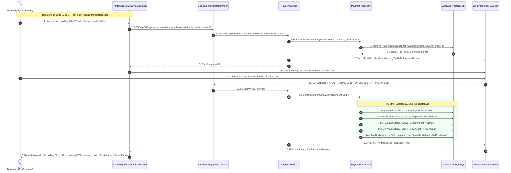
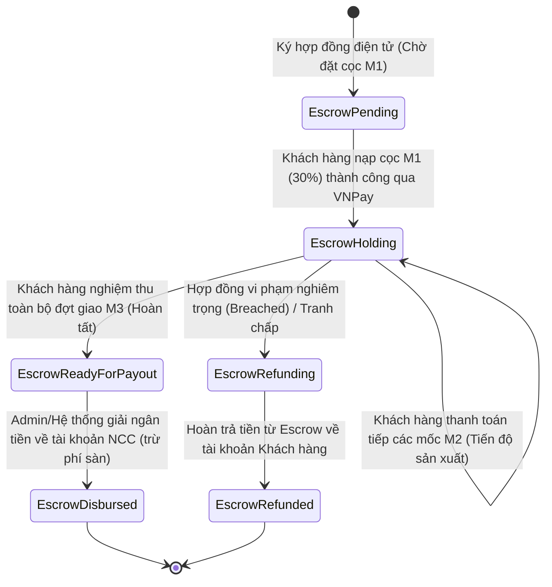

# [M10-F25.2] THIẾT KẾ CHI TIẾT: THANH TOÁN HỢP ĐỒNG THEO MILESTONE & KÝ QUỸ ESCROW

---

## I. TỔNG QUAN TÍNH NĂNG & MỤC TIÊU NGHIỆP VỤ

### 1.1. Thông tin tài liệu
- **Tên tài liệu:** Tài liệu thiết kế chi tiết Thanh toán Hợp đồng điện tử theo Milestone & Cơ chế Ký quỹ Escrow
- **Mã tính năng (Feature Key):** `contract-milestone-escrow-payment`
- **Phiên bản tài liệu:** `1.0.0`
- **Thuộc Module:** `Module 10: Thanh toán` (Tính năng #25: Thanh toán đơn hàng & Hợp đồng)
- **Người thiết kế:** Solution Architect & Security Specialist
- **Trạng thái:** `Approved for Implementation`

### 1.2. Mục tiêu nghiệp vụ (Business Goals)
1. **Bảo vệ quyền lợi 2 chiều (B2B SafeTrade Escrow):**
   - Đảm bảo Khách hàng không bị mất tiền cọc nếu Xưởng bánh không thực hiện đúng tiến độ/chất lượng.
   - Đảm bảo Xưởng bánh an tâm sản xuất các mẻ bánh lớn vì tiền đã được nạp và phong tỏa trong tài khoản Ký quỹ Escrow của Sàn.
2. **Kích hoạt hợp đồng tự động (Milestone M1 Deposit Rule):**
   - Hợp đồng sau khi được 2 bên ký điện tử bằng OTP sẽ ở trạng thái `PendingDeposit`.
   - Ngay khi mốc M1 được thanh toán thành công qua VNPay Sandbox $\rightarrow$ Kích hoạt Hợp đồng sang `Active`, giải phóng kế hoạch sản xuất cho Nhà cung cấp.
3. **Thanh toán theo các mốc thực tế (Milestone Progress Payouts):**
   - **Mốc M2 (Tiến độ / Giao hàng đợt 1):** Kích hoạt thanh toán sau khi Nhà cung cấp tải lên biên bản giao vận và ảnh PoD được khách hàng phê duyệt.
   - **Mốc M3 (Nghiệm thu toàn bộ & Quyết toán):** Sau khi ký nghiệm thu cuối cùng, toàn bộ số dư ký quỹ Escrow được chuyển sang trạng thái sẵn sàng giải ngân (Disbursement) cho Nhà cung cấp sau khi trừ phí hoa hồng sàn.

---

## II. FLOW CHART & WORKFLOW CHI TIẾT

### 2.1. Sequence Diagram: Luồng Thanh Toán Mốc Đặt Cọc M1 & Kích Hoạt Hợp Đồng



### 2.2. State Transition: Vòng Đời Trạng Thái Ký Quỹ Escrow Theo Hợp Đồng



---

## III. CHI TIẾT TỪNG BƯỚC XỬ LÝ (STEP-BY-STEP LOGIC)

### Bước 1: Kiểm tra tính sẵn sàng thanh toán của Mốc Hợp Đồng
1. Truy vấn hợp đồng theo `contractId` và kiểm tra quyền sở hữu `customerId == CurrentUserId`.
2. Hợp đồng phải ở một trong hai trạng thái:
   - `PendingDeposit`: Nếu thanh toán mốc M1 (đặt cọc kích hoạt hợp đồng).
   - `Active`: Nếu thanh toán các mốc tiếp theo (M2, M3).
3. Mốc thanh toán `milestoneId` phải thuộc về hợp đồng và có trạng thái là:
   - `AwaitingPayment` (Chờ nạp cọc ban đầu), hoặc
   - `CompletedOnTime` / `CompletedLate` (Sau khi nghiệm thu công việc tương ứng).
4. Ngoại lệ: Nếu mốc đã ở trạng thái `Paid` $\rightarrow$ Ném `HttpException(409, "Mốc hợp đồng này đã được thanh toán.")`.

### Bước 2: Chuẩn bị thông tin thanh toán VNPay Sandbox
1. Lấy thông tin cấu hình VNPay từ `keyvnpay.text`:
   - `TmnCode`: `BFYI47AF`
   - `HashSecret`: `WBGRFFJWAHOAFNIEYICELPMQORJJHSQL`
   - `BaseUrl`: `https://sandbox.vnpayment.vn/paymentv2/vpcpay.html`
2. Số tiền thanh toán lấy từ `Milestone.Amount` (quy đổi sang VNĐ $\times 100$ khi truyền vào `vnp_Amount`).
3. Nội dung thanh toán `vnp_OrderInfo` định dạng chuẩn:
   - Mốc M1: `"Thanh toan dat coc M1 hop dong {ContractNumber}"`
   - Mốc M2/M3: `"Thanh toan tien do {MilestoneName} hop dong {ContractNumber}"`
4. Sinh URL thanh toán có gắn chữ ký HMAC-SHA512.

### Bước 3: Đối soát Webhook IPN & Cập nhật nguyên tử (Atomic Database Transaction)
Khi nhận Webhook IPN từ VNPay Sandbox:
1. Xác minh chữ ký `vnp_SecureHash` bằng hàm `VnPayGateway.IsValidSignature()`.
2. Sử dụng Database Transaction với mức cô lập `ReadCommitted` / Row-lock `FOR UPDATE` trên bản ghi `Payment`:
   - Cập nhật `payments`: `Status = Completed`, `PaidAt = UtcNow`.
   - Cập nhật `contract_milestones`: `Status = Paid`, `CompletionDate = UtcNow`.
   - Nếu là mốc M1:
     - Cập nhật `contracts`: `Status = Active`, `DepositPaidAt = UtcNow`.
     - Cập nhật `deposit_amount` trong hợp đồng.
3. Gửi thông báo WebSocket / Database Notification cho Nhà cung cấp và Khách hàng.

### Bước 4: Sổ Giám Sát Ký Quỹ Escrow (Escrow Ledger)
1. Mọi khoản thanh toán thành công của Milestone đều được ghi nhận vào dòng tiền ký quỹ của Hợp đồng.
2. Thông tin thể hiện trên Bảng điều khiển Quản trị (Admin Colony Dashboard):
   - **Tổng tiền ký quỹ hiện tại:** Tổng số tiền các milestone đã `Paid` nhưng chưa giải ngân.
   - **Tình trạng giải ngân:** `Pending` (Đang giữ), `ReadyForDisbursement` (Đã nghiệm thu M3), `Disbursed` (Đã chuyển khoản NCC), `Disputed` (Đang tranh chấp).
   - **Quy tắc giải ngân:** Tiền chỉ rời khỏi Escrow của Sàn khi có biên bản nghiệm thu điện tử hợp lệ của Khách hàng.

---

## IV. ĐẶC TẢ KỸ THUẬT API

### 4.1. `POST /api/v1/payments/contracts/vnpay-url`
- **Mô tả:** Tạo URL thanh toán VNPay Sandbox cho một mốc tiến độ cụ thể của hợp đồng (M1/M2/M3).
- **Yêu cầu xác thực:** `Bearer Token (Role: Customer)`
- **Request Body:**
  ```json
  {
    "contractId": "eeeeeeee-eeee-4eee-8eee-eeeeeeeeeeee",
    "milestoneId": "11111111-2222-3333-4444-555555555551",
    "returnUrl": "http://localhost:5186/#/hop-dong-tien-do"
  }
  ```
- **Response Payload (HTTP 200 OK):**
  ```json
  {
    "status": 200,
    "message": "Đã khởi tạo liên kết thanh toán đặt cọc VNPay Sandbox thành công.",
    "data": {
      "paymentId": "91ab64c2-5717-4562-b3fc-2c963f66afb9",
      "paymentNumber": "PAY-20261029-C81B92D1",
      "amount": 45000000.0,
      "paymentUrl": "https://sandbox.vnpayment.vn/paymentv2/vpcpay.html?vnp_Amount=4500000000&vnp_Command=pay&vnp_CreateDate=20261029154000&vnp_CurrCode=VND&vnp_IpAddr=127.0.0.1&vnp_Locale=vn&vnp_OrderInfo=Thanh+toan+dat+coc+M1+hop+dong+HD-2026-TEST01&vnp_OrderType=other&vnp_ReturnUrl=http%3A%2F%2Flocalhost%3A5186%2F%23%2Fhop-dong-tien-do&vnp_TmnCode=BFYI47AF&vnp_TxnRef=PAY-20261029-C81B92D1&vnp_Version=2.1.0&vnp_SecureHash=7f8a9b..."
    }
  }
  ```

### 4.2. `GET /api/v1/payments/escrow/summary`
- **Mô tả:** Lấy báo cáo tổng hợp dòng tiền ký quỹ Escrow của toàn sàn (Admin) hoặc theo gian hàng (Supplier).
- **Yêu cầu xác thực:** `Bearer Token (Role: Admin, Supplier)`
- **Response Payload (HTTP 200 OK):**
  ```json
  {
    "status": 200,
    "message": "Lấy thông tin sổ ký quỹ Escrow thành công.",
    "data": {
      "totalEscrowBalance": 1285000000.0,
      "totalActiveContracts": 24,
      "pendingDisbursementAmount": 340000000.0,
      "disputedEscrowAmount": 45000000.0,
      "escrowLedgerItems": [
        {
          "contractId": "eeeeeeee-eeee-4eee-8eee-eeeeeeeeeeee",
          "contractNumber": "HD-2026-TEST01",
          "customerName": "Tập đoàn Vingroup Corp",
          "supplierName": "Xưởng Bánh Tràng An Nghệ Nhân",
          "contractTotalValue": 150000000.0,
          "heldEscrowAmount": 45000000.0,
          "paidMilestonesCount": 1,
          "totalMilestonesCount": 3,
          "escrowStatus": "Holding",
          "lastDepositDate": "2026-10-29T08:35:00Z"
        }
      ]
    }
  }
  ```

