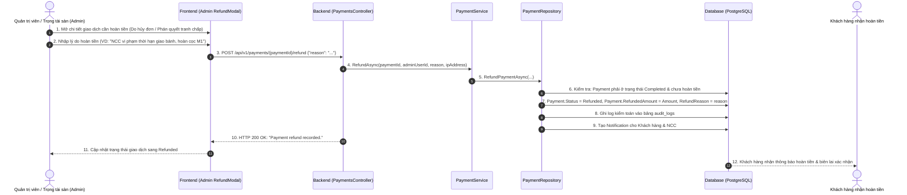

# [M10-F25.3] THIẾT KẾ CHI TIẾT: CHUYỂN KHOẢN VIETQR, ĐÍNH KÈM CHỨNG TỪ & HOÀN TIỀN

---

## I. TỔNG QUAN TÍNH NĂNG & MỤC TIÊU NGHIỆP VỤ

### 1.1. Thông tin tài liệu
- **Tên tài liệu:** Tài liệu thiết kế chi tiết Thanh toán chuyển khoản VietQR, Đính kèm Ủy nhiệm chi & Xử lý Hoàn tiền
- **Mã tính năng (Feature Key):** `bank-transfer-vietqr-refund`
- **Phiên bản tài liệu:** `1.0.0`
- **Thuộc Module:** `Module 10: Thanh toán` (Tính năng #25: Thanh toán đơn hàng & Hợp đồng)
- **Người thiết kế:** Financial Tech Architect & Operations Lead
- **Trạng thái:** `Approved for Implementation`

### 1.2. Mục tiêu nghiệp vụ (Business Goals)
1. **Phục vụ thanh toán B2B doanh nghiệp lớn:**
   - Các tập đoàn, tổng công ty lớn thường thanh toán qua kênh Ngân hàng doanh nghiệp (Corporate Internet Banking) có phê duyệt nhiều cấp (Maker - Checker), cần thông tin tài khoản ký quỹ chính xác và cú pháp chuyển khoản chuẩn xác.
2. **Chuẩn hóa VietQR tự động (Dynamic VietQR Generation):**
   - Sinh mã QR động chuẩn Napas 247 / VietQR, tự động nhúng số tiền chính xác và cú pháp tham chiếu `PAY {PaymentNumber}`. Khách hàng chỉ cần quét bằng app ngân hàng (Vietcombank, Techcombank, MB Bank, VietinBank...) là hoàn tất, không cần gõ tay.
3. **Đính kèm Ủy nhiệm chi (UNC) / Biên lai chuyển khoản:**
   - Khách hàng tải lên ảnh biên lai hoặc file scan UNC (PDF/PNG) làm căn cứ đối soát tức thời.
   - Ban Quản trị Sàn (Admin/Kế toán) đối chiếu sao kê và phê duyệt giao dịch kích hoạt hợp đồng/đơn hàng.
4. **Quy trình Hoàn tiền minh bạch (Refund Workflow):**
   - Xử lý hoàn tiền khi đơn hàng bị hủy hợp lệ hoặc hợp đồng bị vi phạm (Breached) theo quyết định phân xử tranh chấp của Admin.
   - Ghi vết kiểm toán (Audit Trail) bất biến phục vụ báo cáo tài chính và đối soát thuế.

---

## II. FLOW CHART & WORKFLOW CHI TIẾT

### 2.1. Sequence Diagram: Luồng Thanh Toán Chuyển Khoản VietQR & Duyệt UNC

```mermaid
sequenceDiagram
  autonumber
  actor Customer as Doanh nghiệp (Customer)
  participant FE as Frontend (VietQrModal / Upload)
  participant API as Backend (PaymentsController)
  participant SVC as PaymentService
  participant REPO as PaymentRepository
  participant DB as Database (PostgreSQL)
  actor Admin as Kế toán Sàn (Admin)

  Customer->>FE: 1. Chọn phương thức "Chuyển khoản Ngân hàng (VietQR)"
  FE->>API: 2. POST /api/v1/payments/bank-transfer (orderId / contractId + milestoneId)
  API->>SVC: 3. CreateBankTransferPaymentAsync(...)
  SVC->>REPO: 4. Tạo Payment (Method: BankTransfer, Status: Pending, PaymentNumber)
  REPO->>DB: 5. Ghi nhận Payment & thời hạn hiệu lực (ExpiresAt: +48h)
  SVC-->>FE: 6. Trả về thông tin VietQR (QR Data URL, BankName, AccountNo, Amount, Memo)
  
  FE-->>Customer: 7. Hiển thị mã VietQR kèm nút 1-chạm sao chép STK, Số tiền, Nội dung
  Customer->>Customer: 8. Quét mã QR trên App Ngân hàng và thực hiện chuyển khoản
  Customer->>FE: 9. Upload ảnh/file PDF Ủy nhiệm chi (UNC)
  FE->>API: 10. POST /api/v1/payments/{paymentId}/evidence (File upload)
  API->>DB: 11. Lưu URL chứng từ vào Payment.EvidenceUrl; Payment.Status = Processing
  API-->>FE: 12. Thông báo: "Đã ghi nhận chứng từ thanh toán, đang chờ kế toán xác nhận"

  Admin->>FE: 13. Truy cập Admin Dashboard > Sổ giao dịch Ký quỹ & Chuyển khoản
  FE->>API: 14. GET /api/v1/payments/pending-verification
  API-->>FE: 15. Danh sách giao dịch chờ duyệt kèm link xem ảnh UNC
  Admin->>Admin: 16. Đối chiếu giao dịch với sao kê tài khoản ngân hàng thực tế
  Admin->>FE: 17. Bấm "Xác nhận đã nhận tiền" kèm lý do đối soát
  FE->>API: 18. POST /api/v1/payments/{paymentId}/confirm {"reason": "Khớp số dư sao kê MB Bank"}
  API->>SVC: 19. ConfirmAsync(paymentId, adminId, reason, ipAddress)
  SVC->>REPO: 20. ConfirmPaymentAsync()
  REPO->>DB: 21. Payment.Status = Completed; Order/Milestone = Paid/Active; AuditLog ghi nhận
  API-->>FE: 22. Thông báo thành công & Bắn Notification cho Khách hàng
```

### 2.2. Sequence Diagram: Luồng Xử Lý Hoàn Tiền (Refund)



---

## III. THIẾT KẾ CHI TIẾT VIETQR & TÀI KHOẢN KÝ QUỸ

### 3.1. Thông Tin Tài Khoản Ký Quỹ Sàn (SafeTrade Escrow Account)
- **Tên ngân hàng:** Ngân hàng Quân Đội (MB Bank)
- **Mã ngân hàng (Bank BIN):** `970422` (MB)
- **Tên chủ tài khoản:** `CONG TY CP NGUYET PHO B2B`
- **Số tài khoản ký quỹ:** `0988668899`
- **Chi nhánh:** Hội Sở Chính - TP. Hà Nội

### 3.2. Cấu Trúc Mã VietQR & Cú Pháp Tham Chiếu
- **Định dạng URL sinh ảnh VietQR:**
  ```text
  https://img.vietqr.io/image/MB-0988668899-compact2.png?amount={AMOUNT}&addInfo={PAYMENT_NUMBER}&accountName=CONG%20TY%20CP%20NGUYET%20PHO%20B2B
  ```
- **Cú pháp nội dung chuyển khoản (`addInfo`):**
  `PAY {PaymentNumber}` (Ví dụ: `PAY PAY-20261029-C81B92D1`)
- **Nguyên tắc đối soát tự động:**
  Hệ thống chuẩn hóa xóa bỏ các ký tự đặc biệt, so khớp `PaymentNumber` độc nhất vô nhị để định danh chính xác đơn hàng/hợp đồng cần thanh toán.

---

## IV. ĐẶC TẢ KỸ THUẬT API

### 4.1. `POST /api/v1/payments/bank-transfer`
- **Mô tả:** Khởi tạo giao dịch chuyển khoản ngân hàng và trả về thông tin VietQR.
- **Yêu cầu xác thực:** `Bearer Token (Role: Customer)`
- **Request Body:**
  ```json
  {
    "orderId": "3fa85f64-5717-4562-b3fc-2c963f66afa6",
    "contractId": null,
    "milestoneId": null
  }
  ```
- **Response Payload (HTTP 200 OK):**
  ```json
  {
    "status": 200,
    "message": "Đã tạo thông tin chuyển khoản VietQR thành công.",
    "data": {
      "paymentId": "7c9e6679-7425-40de-944b-e07fc1f90ae7",
      "paymentNumber": "PAY-20261029-A78F21B3",
      "amount": 12500000.0,
      "bankName": "Ngân hàng Quân Đội (MB Bank)",
      "bankBin": "970422",
      "accountNumber": "0988668899",
      "accountName": "CONG TY CP NGUYET PHO B2B",
      "transferMemo": "PAY PAY-20261029-A78F21B3",
      "qrCodeUrl": "https://img.vietqr.io/image/MB-0988668899-compact2.png?amount=12500000&addInfo=PAY%20PAY-20261029-A78F21B3&accountName=CONG%20TY%20CP%20NGUYET%20PHO%20B2B",
      "expiresAt": "2026-10-31T08:30:00Z"
    }
  }
  ```

### 4.2. `POST /api/v1/payments/{paymentId}/confirm`
- **Mô tả:** Kế toán sàn xác nhận đã nhận tiền chuyển khoản và kích hoạt đơn/hợp đồng.
- **Yêu cầu xác thực:** `Bearer Token (Role: Admin)`
- **Request Body:**
  ```json
  {
    "reason": "Khớp số dư giao dịch sao kê MB Bank ngày 29/10"
  }
  ```
- **Response Payload (HTTP 200 OK):**
  ```json
  {
    "status": 200,
    "message": "Đã xác nhận thanh toán thành công.",
    "data": {
      "paymentId": "7c9e6679-7425-40de-944b-e07fc1f90ae7",
      "paymentNumber": "PAY-20261029-A78F21B3",
      "status": "Completed",
      "paidAt": "2026-10-29T08:45:00Z"
    }
  }
  ```

### 4.3. `POST /api/v1/payments/{paymentId}/refund`
- **Mô tả:** Thực hiện hoàn tiền cho khách hàng khi hủy đơn hoặc phân xử tranh chấp.
- **Yêu cầu xác thực:** `Bearer Token (Role: Admin)`
- **Request Body:**
  ```json
  {
    "reason": "Hủy hợp đồng do NCC quá hạn sản xuất, hoàn trả cọc M1"
  }
  ```
- **Response Payload (HTTP 200 OK):**
  ```json
  {
    "status": 200,
    "message": "Đã ghi nhận hoàn tiền giao dịch thành công.",
    "data": {
      "paymentId": "7c9e6679-7425-40de-944b-e07fc1f90ae7",
      "paymentNumber": "PAY-20261029-A78F21B3",
      "status": "Refunded",
      "refundedAmount": 12500000.0,
      "refundReason": "Hủy hợp đồng do NCC quá hạn sản xuất, hoàn trả cọc M1"
    }
  }
  ```

