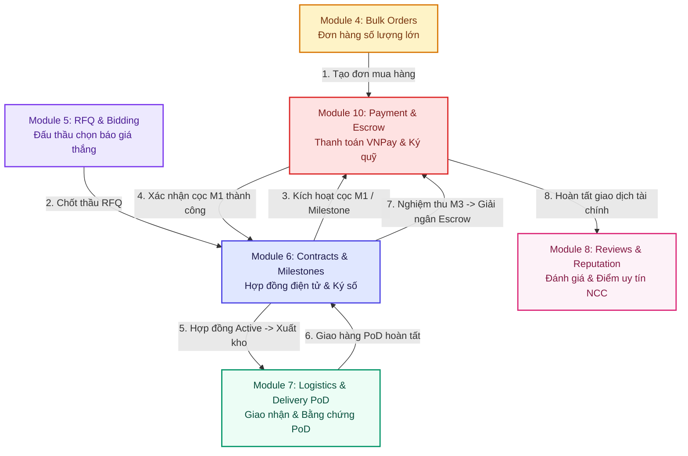
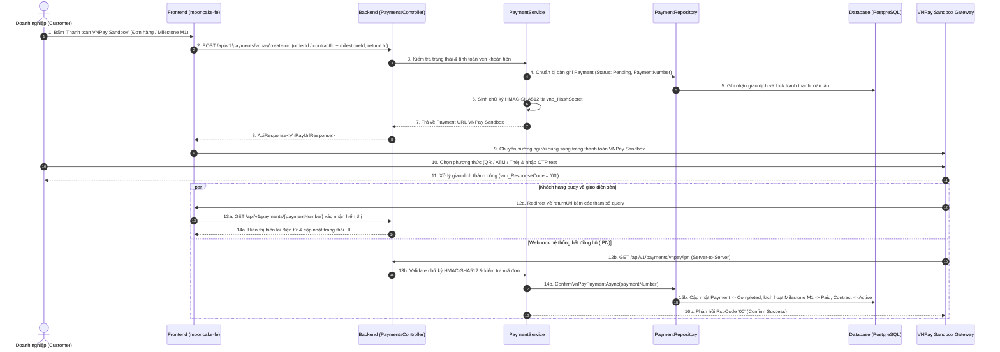

# Module 10: Thanh Toán Đơn Hàng & Hợp Đồng (Feature #25) - Enterprise Design Plan

---

## 1. Tổng Quan & Mục Tiêu Nghiệp Vụ (Executive Summary)

Tài liệu này đặc tả kiến trúc, luồng xử lý và kế hoạch triển khai chi tiết cho **Module 10: Thanh Toán (Tính năng #25: Thanh toán đơn hàng & Hợp đồng)** của Sàn Giao Dịch Bánh Trung Thu Doanh Nghiệp B2B (**Nguyệt Phố**), tuân thủ nghiêm ngặt các nguyên tắc Enterprise Layered Architecture, Clean Architecture (.NET 8 C# 12) và Frontend React 19 (Tailwind Luxury Gold/Amber UI).

### 1.1. Bối cảnh & Nghiệp vụ cốt lõi
Trong giao dịch B2B bánh Trung thu với giá trị hợp đồng từ hàng chục triệu đến hàng tỷ đồng, hệ thống thanh toán cần đáp ứng các nghiệp vụ đặc thù:
1. **Thanh toán Đơn hàng mua trực tiếp (Direct/Bulk Order):**
   - Hỗ trợ thanh toán toàn bộ qua **Cổng VNPay Sandbox** (Thẻ nội địa, Internet Banking, QR Code, Thẻ quốc tế).
   - Hỗ trợ **Chuyển khoản Ngân hàng (VietQR)** tự động điền mã tham chiếu đơn hàng.
   - Hỗ trợ **COD (Thanh toán khi nhận hàng)** cho đơn hàng thông thường có giá trị $\le$ hạn mức cấu hình sàn (mặc định 10.000.000 ₫). Không áp dụng COD cho đơn hàng yêu cầu thiết kế bao bì thương hiệu riêng (`CustomPackaging`) hoặc hợp đồng sản xuất.
2. **Thanh toán Hợp đồng điện tử theo Milestone & Ký quỹ Escrow (Contract Milestone Escrow):**
   - **M1 - Đặt cọc kích hoạt hợp đồng (30% - 50%):** Khách hàng bắt buộc thanh toán đặt cọc vào tài khoản Ký quỹ (Escrow) của Sàn trước khi Hợp đồng chuyển sang trạng thái `Active` để Xưởng bánh bắt đầu sản xuất.
   - **M2 - Tiến độ sản xuất & Giao hàng đợt 1:** Thanh toán theo tiến độ sau khi xưởng cung cấp bằng chứng giao vận / hình ảnh PoD.
   - **M3 - Nghiệm thu hoàn tất & Thanh toán quyết toán (20% - 40%):** Khách hàng nghiệm thu toàn bộ lô bánh $\rightarrow$ kích hoạt giải ngân Escrow cho Nhà cung cấp.
3. **Cơ chế Bảo mật & Đối soát giao dịch (Security & Reconciliation):**
   - Tích hợp **VNPay Sandbox 2.1.0** với chuẩn mã hóa HMAC-SHA512 chống giả mạo thông tin.
   - Xử lý **IPN Webhook (Instant Payment Notification)** bất đồng bộ đảm bảo tính nhất quán dữ liệu ngay cả khi khách hàng đóng trình duyệt trước khi redirect.
   - Cơ chế **Idempotency-Key** chống thanh toán kép (Double-spending) và giao dịch đồng thời (Concurrency Lock).
   - Quy trình **Hoàn tiền (Refund) & Xử lý tranh chấp:** Admin phân xử và thực hiện hoàn tiền theo điều khoản bảo vệ người mua SafeTrade.

---

## 2. Thông Tin Cấu Hình & Cổng Thanh Toán Tích Hợp

Theo tài liệu bàn giao tại [keyvnpay.text](file:///Users/admin/Desktop/PRN232/keyvnpay.text), hệ thống sử dụng môi trường Sandbox chuẩn của VNPay:

```text
Terminal ID / Mã Website (vnp_TmnCode): BFYI47AF
Secret Key / Chuỗi bí mật tạo checksum (vnp_HashSecret): WBGRFFJWAHOAFNIEYICELPMQORJJHSQL
Url thanh toán môi trường TEST (vnp_Url): https://sandbox.vnpayment.vn/paymentv2/vpcpay.html
Cổng thanh toán: VNPay Sandbox (Chỉ sử dụng môi trường Sandbox theo yêu cầu)
```

Tích hợp AI Trợ lý & Phân tích rủi ro tài chính tại [gemini-key.text](file:///Users/admin/Desktop/PRN232/gemini-key.text):
- **Model:** `gemini-flash-latest`
- **Mục đích:** Hỗ trợ kiểm tra bất thường trong giao dịch, tự động trích xuất thông tin ủy nhiệm chi (UNC) và tư vấn phương thức thanh toán tối ưu cho doanh nghiệp.

---

## 3. Bản Đồ Liên Kết Giữa Các Module (System Integration Map)



---

## 4. Sequence Diagram: Luồng Thanh Toán VNPay Sandbox & IPN



---

## 5. Ma Trận Truy Vết Nghiệp Vụ & Thiết Kế (Traceability Matrix)

| ID Yêu Cầu | Tên Nghiệp Vụ | Tài Liệu Thiết Kế Chi Tiết | Backend API / Service | Frontend View / Component | Kịch Bản Kiểm Thử |
| :--- | :--- | :--- | :--- | :--- | :--- |
| **REQ-25.1** | Thanh toán đơn hàng trực tiếp VNPay & COD | `01_ORDER_PAYMENT_VNPAY_DESIGN.md` | `POST /api/v1/payments/orders/vnpay-url`<br>`POST /api/v1/payments` | `PaymentCheckoutModal.jsx`<br>`OrderAndDesgin.jsx` | Test Case 1: Bulk order VNPay checkout & COD limit check |
| **REQ-25.2** | Thanh toán hợp đồng theo Milestone & Escrow | `02_CONTRACT_MILESTONE_ESCROW_PAYMENT_DESIGN.md` | `POST /api/v1/payments/contracts/vnpay-url`<br>`GET /api/v1/payments/escrow/summary` | `ContractsAndMilestone.jsx`<br>`AdminEscrowLedger.jsx` | Test Case 2: Milestone M1 deposit & Escrow status release |
| **REQ-25.3** | Chuyển khoản VietQR & Ủy nhiệm chi (UNC) | `03_BANK_TRANSFER_VIETQR_REFUND_DESIGN.md` | `POST /api/v1/payments/bank-transfer`<br>`POST /api/v1/payments/{id}/evidence` | `VietQrModal.jsx`<br>`PaymentProofUpload.jsx` | Test Case 3: VietQR memo matching & Admin slip confirmation |
| **REQ-25.4** | Xử lý Hoàn tiền (Refund) & Hủy giao dịch | `03_BANK_TRANSFER_VIETQR_REFUND_DESIGN.md` | `POST /api/v1/payments/{id}/refund` | `RefundModal.jsx`<br>`PaymentHistoryTable.jsx` | Test Case 4: Admin refund processing with audit logs |
| **REQ-25.5** | Trải nghiệm thanh toán Mobile & Responsive | `04_MOBILE_WORKFLOW_RESPONSIVE_WEB_DESIGN.md` | Đóng gói API Client tối ưu mạng di động | Mobile Payment Bottom Sheet<br>Responsive Return Receipt | Test Case 5: Mobile viewport checkout & 1-tap copy QR |
| **REQ-25.6** | Xác thực Checksum & Đối soát bảo mật IPN | `06_DATA_SQL_CONCURRENCY_SECURITY.md` | `VnPayGateway.cs`<br>`GET /api/v1/payments/vnpay/ipn` | N/A (Server-to-Server Webhook) | Test Case 6: IPN checksum validation & anti-replay lock |

---

## 6. Danh Mục Các File Thiết Kế Chi Tiết Trong Thư Mục Này

1. [01_ORDER_PAYMENT_VNPAY_DESIGN.md](file:///Users/admin/Desktop/PRN232/mooncake-ecommerce-platform/.agents/feature/order-contract-payment/01_ORDER_PAYMENT_VNPAY_DESIGN.md): Đặc tả luồng thanh toán đơn mua trực tiếp, cổng VNPay Sandbox và giới hạn COD.
2. [02_CONTRACT_MILESTONE_ESCROW_PAYMENT_DESIGN.md](file:///Users/admin/Desktop/PRN232/mooncake-ecommerce-platform/.agents/feature/order-contract-payment/02_CONTRACT_MILESTONE_ESCROW_PAYMENT_DESIGN.md): Đặc tả luồng thanh toán mốc hợp đồng (M1/M2/M3), ký quỹ Escrow và giải ngân cho NCC.
3. [03_BANK_TRANSFER_VIETQR_REFUND_DESIGN.md](file:///Users/admin/Desktop/PRN232/mooncake-ecommerce-platform/.agents/feature/order-contract-payment/03_BANK_TRANSFER_VIETQR_REFUND_DESIGN.md): Đặc tả thanh toán chuyển khoản VietQR, đính kèm chứng từ và quy trình hoàn tiền Admin.
4. [04_MOBILE_WORKFLOW_RESPONSIVE_WEB_DESIGN.md](file:///Users/admin/Desktop/PRN232/mooncake-ecommerce-platform/.agents/feature/order-contract-payment/04_MOBILE_WORKFLOW_RESPONSIVE_WEB_DESIGN.md): Thiết kế màn hình thanh toán di động, bottom-sheet và biên lai phản hồi responsive.
5. [05_API_DTO_VALIDATION.md](file:///Users/admin/Desktop/PRN232/mooncake-ecommerce-platform/.agents/feature/order-contract-payment/05_API_DTO_VALIDATION.md): Đặc tả chi tiết từng Endpoint, Request/Response DTO, FluentValidation rules và mã lỗi.
6. [06_DATA_SQL_CONCURRENCY_SECURITY.md](file:///Users/admin/Desktop/PRN232/mooncake-ecommerce-platform/.agents/feature/order-contract-payment/06_DATA_SQL_CONCURRENCY_SECURITY.md): Lược đồ CSDL PostgreSQL, Indexes, Idempotency lock, HMAC-SHA512, Audit logs.
7. [07_FRONTEND_INTEGRATION.md](file:///Users/admin/Desktop/PRN232/mooncake-ecommerce-platform/.agents/feature/order-contract-payment/07_FRONTEND_INTEGRATION.md): Cấu trúc React components, Modal/Drawer, Services, Mock Fallback, tích hợp vào các trang hiện hữu.
8. [08_IMPLEMENTATION_TEST_ROLLOUT.md](file:///Users/admin/Desktop/PRN232/mooncake-ecommerce-platform/.agents/feature/order-contract-payment/08_IMPLEMENTATION_TEST_ROLLOUT.md): Kế hoạch kiểm thử xUnit Backend, Playwright E2E Frontend, checklist nghiệm thu không lỗi.

