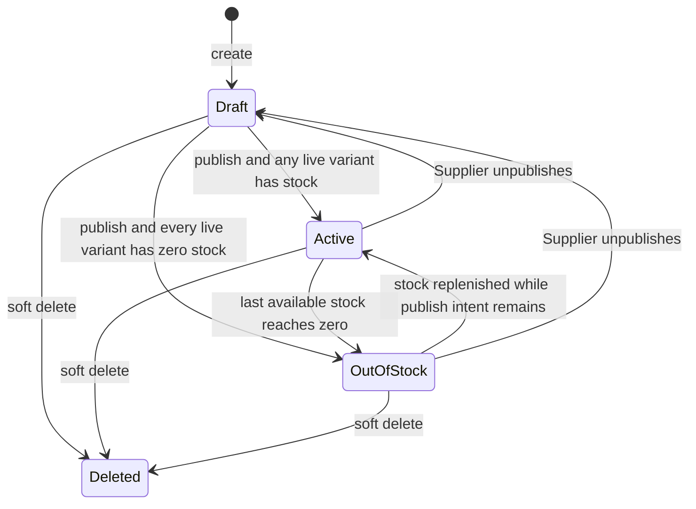
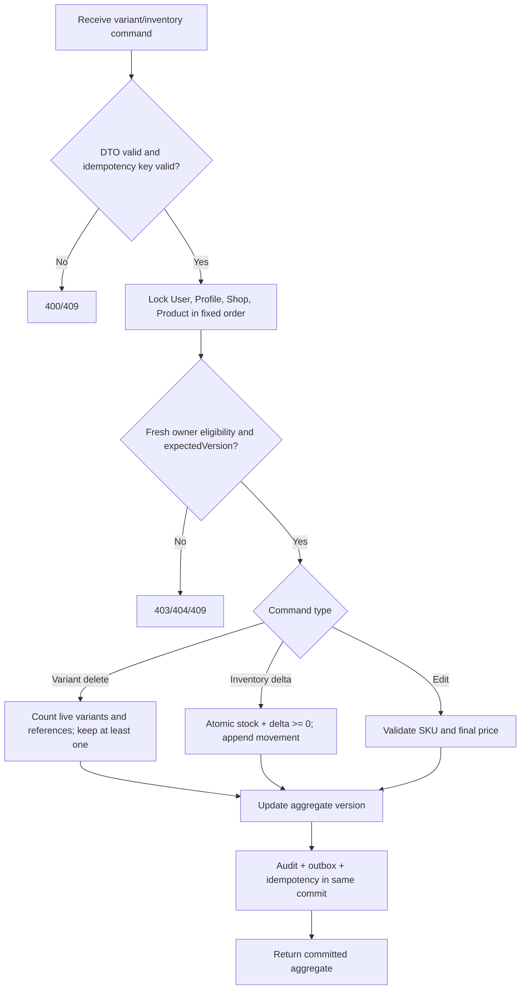

# [PRODUCT-CATALOG-05] — Product and variant management

## I. FEATURE OVERVIEW

### 1.1 Document information

- Module 3, feature #5; priority P0 Critical; feature key `product-catalog`.
- Version 1.0.0; date 2026-10-28; status Draft / Plan only.
- Actors: verified Supplier as owner; Customer/anonymous as public reader; Admin only through existing moderation/platform capabilities.

### 1.2 Business goals

Provide a durable catalog workflow in which an eligible Supplier can create and maintain a mooncake product, one or more concrete variants, gallery media and independent stock. Public clients see only products from an active shop owned by a currently verified/active Supplier. Every orderable selection resolves to one live variant with a server-calculated price and current stock.

Expected outcomes:

- no mock product mutation or fake success in production FE;
- aggregate invariants survive concurrent tabs, order reservations and retries;
- product/order history is preserved after unpublish or soft delete;
- list/detail queries have bounded query counts and payload sizes;
- all persistence input/output crosses the Application–Infrastructure boundary as DTOs, never EF entities or `IQueryable`.

### 1.3 Scope

In scope: Supplier list/detail/create/edit, variants, gallery order/primary image, publication, soft deletion, independent variant stock, public detail and compatibility with shop public products/order validation.

Out of scope: bulk pricing rules, order placement, reviews authoring, category administration, multi-warehouse/lot/expiry tracking, product import CSV, product approval moderation and hard deletion.

### 1.4 Authorization and invariants

`CanManageCatalog = active non-deleted User with Supplier role + non-deleted Verified SupplierProfile + non-deleted owned Shop`. Publication additionally requires the Shop to be Active and not suspended. Every mutation refreshes this capability inside its transaction; a JWT role or FE menu is not authority.

| Rule | Enforcement |
| --- | --- |
| Ownership | Product belongs to the actor's single shop; owner IDs come only from server state |
| Variants | At least one non-deleted variant at commit; each order uses a `variantId` belonging to that product |
| SKU | Canonical normalized SKU unique within a shop; case/Unicode variants cannot bypass uniqueness |
| Price | `basePrice >= 0`; `basePrice + priceAdjustment > 0` for every live variant |
| Quantity | `minOrderQty >= 1`; `maxOrderQty` is null or `>= minOrderQty`; order still checks selected variant stock |
| Stock | Never negative; post-create changes are atomic deltas with idempotency/audit, not last-write-wins absolute values |
| Gallery | 1–10 live images for publication; exactly one primary; stable distinct sort order |
| Status | Supplier intent is Draft/Published internally; public effective status maps to Inactive/Active/OutOfStock |
| Delete | Soft delete only; blocks new discovery/order while preserving referenced order/review history |
| Concurrency | Every aggregate mutation carries `expectedVersion`; database constraints remain final protection |

## II. END-TO-END WORKFLOW

### 2.1 Create and publish sequence

```mermaid
sequenceDiagram
  autonumber
  actor S as Verified Supplier
  participant FE as Supplier Product UI
  participant API as SupplierProductsController
  participant SVC as ProductCatalogService
  participant MEDIA as ProductMediaGateway
  participant REPO as IProductCatalogRepository (DTO transaction)
  participant DB as PostgreSQL
  S->>FE: Enter core data, at least one variant and gallery
  FE->>API: POST product-media (one request per image)
  API->>MEDIA: Validate/decode/re-encode bounded image
  MEDIA-->>FE: Ready mediaAssetId, dimensions, preview URL
  FE->>API: POST /suppliers/me/products + Idempotency-Key
  API->>API: Validate request shape and limits
  API->>SVC: actorId + CreateProductRequest
  SVC->>REPO: Begin transaction; lock User -> Profile -> Shop
  REPO->>DB: Read capability/category/media proofs and SKU conflicts
  SVC->>SVC: Apply business rules; build persistence DTOs
  REPO->>DB: Insert product + variants + images + audit + outbox + idempotency
  REPO-->>SVC: ProductAggregateDto version 1 (Draft)
  SVC-->>FE: 201 ProductOwnerResponse
  S->>FE: Select Publish
  FE->>API: PATCH /{id}/publication with expectedVersion
  SVC->>REPO: Lock capability -> shop -> product; revalidate aggregate
  REPO->>DB: Set Published intent + outbox + audit; commit
  API-->>FE: 200 effectiveStatus Active/OutOfStock
```

External media upload occurs before the short database transaction. Binding rechecks owner, purpose, Ready status, expiry and unused/compatible state under lock. Provider calls are not executed while holding product/shop rows.

### 2.2 Lifecycle



`Draft` is returned publicly as `Inactive` to match the business vocabulary. Shop suspension/revoke does not rewrite every product row; the public gate makes all products unavailable. Restoring the shop exposes only products whose publication intent remains Published.

### 2.3 Variant and inventory race flow



## III. STEP-BY-STEP LOGIC

| Step | Input -> output | Validation and business behavior | Failure behavior |
| --- | --- | --- | --- |
| 1. Open owner catalog | Actor + bounded query -> owner cards | DB-backed eligibility; owner shop only; projection includes primary image, variant count, effective status/version | 401/403; empty list is valid |
| 2. Prepare media | Multipart image + purpose -> media asset proof | 1–5 MiB proposed, JPG/PNG/WebP, bounded dimensions/pixels, decoded and re-encoded; owner quota; no arbitrary URL | 400/413/415/429/503; no product row created |
| 3. Create draft | Core + variants + images + key -> aggregate v1 | Normalize NFKC/trim; live category; 1–100 variants; 1–10 images; exactly one primary; SKU/price/quantity rules | 400 fields; 403 eligibility; 409 duplicate/replayed-mismatch; transaction rollback |
| 4. Edit core | Update request + expectedVersion -> v+1 | Name/description/category/base price/quantity/unit/packaging only; recalculates every final variant price | 409 stale or new invalid final price; FE keeps draft |
| 5. Add/edit variant | Variant DTO + expectedVersion -> v+1 | Normalized SKU scoped to shop; price/attributes valid; initial stock allowed only on create | 409 SKU/version; 400 invalid final price |
| 6. Remove variant | Variant ID + expectedVersion -> v+1 | Lock product; cannot remove last live variant; soft-delete even if history references it | 409 last variant/stale; 404 cross-owner/nonexistent |
| 7. Adjust inventory | Delta/reason/reference + key -> stock and movement | Delta range bounded; result nonnegative; idempotent reference; same transaction as stock; effective status recalculated | 409 insufficient stock/key mismatch; retry returns same result |
| 8. Manage gallery | Media bindings/order/primary + expectedVersion -> v+1 | Same owner/product purpose, no duplicate asset, 1–10 for published product, exactly one primary | 409 leased/foreign/stale; no orphan binding |
| 9. Publish/unpublish | Boolean intent + expectedVersion -> v+1 | Publish requires active shop, complete core, live category, variant and gallery invariants; unpublish always allowed to owner unless capability revoked | 409 incomplete/suspended/stale; product not partially public |
| 10. Soft delete | expectedVersion + key -> tombstoned aggregate | Unpublish and soft-delete aggregate children for public/write paths; preserve rows/history/media retention policy | 409 stale; repeat same key idempotent |
| 11. Public detail | productId -> public DTO | Product published, effective status Active/OutOfStock, active Shop, verified active owner; batch variants/images/stats | Uniform 404 for unavailable; no private SKU/stock policy leaks beyond approved DTO |

### 3.1 Product completeness

A product can be saved as Draft with valid core data, at least one variant and one image. Publication requires:

- category exists and is not deleted;
- name, unit and description comply with limits;
- at least one live variant with a positive final price;
- at least one gallery image and exactly one primary image;
- every bound asset is Ready, owned by the Supplier and of product-image purpose;
- active non-suspended shop and current verified owner.

Zero stock does not block publication; it yields effective `OutOfStock`. Inactive/deleted variants are not orderable. Public details may show stock availability/bands but do not need to expose exact inventory counts if business has not approved that disclosure.

### 3.2 Stock contract shared with Order

- Supplier correction uses signed delta, reason and idempotency key. The request never writes `StockQty = clientValue` after initial creation.
- Order reservation/decrement, cancellation release and Supplier correction use one repository port or database command contract and append `ProductVariantInventoryMovement` in the same transaction.
- Movement source `(sourceType, sourceId, variantId)` is unique. Retrying an order or adjustment cannot decrement twice.
- Conditional SQL (`stock_qty + delta >= 0`) is final protection. Application checks improve messages but are not the race barrier.
- Product publication intent is independent. Effective status is derived after committed inventory changes so restocking a published item returns it to Active without publishing a Supplier draft.

### 3.3 Deletion and compatibility

Hard delete is forbidden once created. Soft-deleted products/variants disappear from Supplier default lists, search and new orders but remain joinable for historical order/review records and snapshots. Existing `OrderItem` snapshots remain the customer-facing historical truth.

The current shop product feed must call the new public query port or use the same projection/read model and gate. Existing OrderService must consume the shared inventory/eligibility contract before the old direct stock writer is removed; parallel writers are not allowed after rollout.

## IV. API CONTRACT SUMMARY

Detailed fields and examples are in [03_API_DTO_VALIDATION.md](./03_API_DTO_VALIDATION.md).

| Method and path | Auth | Purpose |
| --- | --- | --- |
| `GET /api/v1/suppliers/me/products` | Verified Supplier | Bounded owner list/filter |
| `POST /api/v1/suppliers/me/products` | Verified Supplier | Create Draft aggregate; idempotent |
| `GET /api/v1/suppliers/me/products/{productId}` | Verified owner | Owner detail |
| `PUT /api/v1/suppliers/me/products/{productId}` | Verified owner | Update core with version |
| `POST /api/v1/suppliers/me/products/{productId}/variants` | Verified owner | Add variant |
| `PUT /api/v1/suppliers/me/products/{productId}/variants/{variantId}` | Verified owner | Edit attributes, not stock |
| `DELETE /api/v1/suppliers/me/products/{productId}/variants/{variantId}` | Verified owner | Soft-delete non-last variant |
| `POST /api/v1/suppliers/me/products/{productId}/variants/{variantId}/inventory-adjustments` | Verified owner | Atomic delta; idempotent |
| `PUT /api/v1/suppliers/me/products/{productId}/gallery` | Verified owner | Bind/reorder/set primary |
| `PATCH /api/v1/suppliers/me/products/{productId}/publication` | Verified owner | Publish/unpublish |
| `DELETE /api/v1/suppliers/me/products/{productId}` | Verified owner | Soft-delete; idempotent |
| `POST /api/v1/suppliers/me/product-media` | Verified Supplier | Prepare product/variant image |
| `GET /api/v1/products/{productId}` | Public | Public product detail |
| `GET /api/v1/categories` | Public | Bounded active category tree/list |

All successful responses use the existing `ApiResponse<T>` envelope and UTC timestamps. Mutations require a valid `Idempotency-Key` where retry can duplicate side effects and `expectedVersion` for lost-update protection. Owner/cross-tenant misses return 404 rather than disclosing resource existence.

## V. LAYER MAPPING

### 5.1 Backend

- Domain: extend Product with aggregate/publication version semantics; introduce `ProductVariantInventoryMovement`, `ProductMediaAsset`, enums for movement source/media purpose. Keep entities persistence-agnostic.
- Application DTOs: `DTOs/Products/{Requests,Responses,Persistence}`. Request DTOs perform shape/range/format validation; persistence DTOs are the only repository boundary types.
- Application ports: `IProductCatalogService`, `IProductPublicQueryService`, `IProductCatalogRepository`, `IProductCatalogTransaction`, `IProductMediaGateway`, `IProductSearchOutboxWriter`.
- Application implementation: service owns eligibility, ownership, lifecycle, aggregate invariants, idempotency and orchestration. Pure normalization/price/status mappings live in `ProductPolicyHelper`, `ProductSkuHelper`, `ProductResponseHelper`; strings in `ProductConstants`.
- Infrastructure: EF configurations, DTO projections/mappings, fixed transaction/lock order, conditional stock SQL, Cloudinary adapter reuse, outbox persistence. Repositories do not decide business policy.
- WebApi: thin `SupplierProductsController`, `ProductsController`, `CategoriesController`; authorization/rate-limit/ModelState/actor extraction only. No controller accepts EF entities.
- Integration: refactor Order stock writer to the shared inventory port; shop product route delegates to public catalog query rules.

### 5.2 Frontend

- `src/constants/product.js` and `apiEndpoints.js`: statuses, limits, error labels and endpoints.
- `src/services/productService.js`: real calls through `apiClient`; no mock fallback.
- `src/hooks/useSupplierProducts.js`, `useProductEditor.js`, `useProductDetail.js`: abort, loading, version, idempotency, cache invalidation.
- `src/components/product/`: core form, variant table/editor, inventory drawer, gallery uploader, publication checklist, product cards.
- `src/Pages/Supplier/ProductManage.jsx` becomes the real list; add editor/detail route under Supplier layout. Public detail stays in Customer layout and reads route product ID.

## VI. SECURITY AND TESTING

Security baseline:

- Reject unknown JSON members and overposting authority/metrics/status fields.
- Normalize and encode plain text on render; no Supplier HTML/script. Media is decoded/re-encoded public image data, not arbitrary SVG/HTML.
- Do not log request bodies, image bytes, provider credentials or sensitive headers. Log trace ID, actor/resource IDs, operation, version and result.
- Use parameterized EF/Npgsql commands. SKU/search/sort fields never become SQL identifiers or fragments.
- Enforce ownership and current verification inside the write transaction. FE route guards are convenience only.
- Rate limit media, mutations and inventory adjustment separately. Audit product publication, deletion and inventory corrections atomically.

Mandatory tests include DTO/MVC validation, ownership/cross-tenant access, create replay/mismatch, two-tab stale edit, duplicate SKU casing, final-price checks, simultaneous last-variant deletion, primary-image race, stock correction versus order reservation, insufficient stock, shop suspension/revoke versus publish, public gates, soft-delete history, provider failure/orphan cleanup, bounded query counts and PostgreSQL constraints. The complete matrix is in [06_IMPLEMENTATION_TEST_ROLLOUT.md](./06_IMPLEMENTATION_TEST_ROLLOUT.md).
