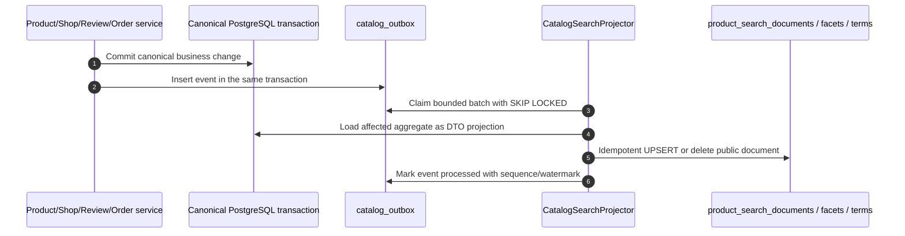
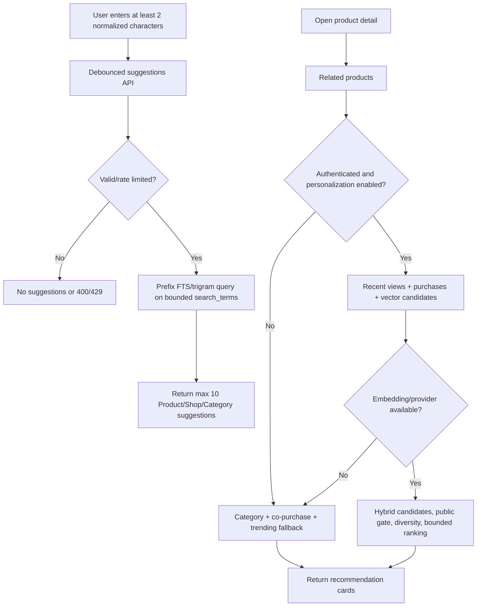

# [PRODUCT-CATALOG-06] — Marketplace search and product discovery

## I. FEATURE OVERVIEW

### 1.1 Document information

- Module 3, feature #6; priority P1 High; feature key `product-catalog`.
- Version 1.0.0; date 2026-10-28; status Draft / Plan only.
- Actors: Customer, Supplier and anonymous visitor for public discovery; authenticated users may receive personalized recommendations.

### 1.2 Business goals

Deliver fast, predictable marketplace-wide discovery across product name, shop name and description with multi-select facets, stable sorting, autocomplete and related/personalized recommendations. Search must expose only currently public catalog entries and remain operational if the recommendation/embedding component is unavailable.

Key outcomes:

- one canonical public-eligibility rule across search, autocomplete, related products, product detail and shop feed;
- PostgreSQL search performance measured before adding Elasticsearch operational complexity;
- bounded queries and payloads with no row-by-row lookups;
- ranking/filter behavior is deterministic and testable;
- customer search state is shareable in the URL and never replaced by hard-coded data.

### 1.3 Scope

In scope: full-text query, product/shop/description matching, category multi-select, variant price range, maximum minimum-order quantity, custom packaging, Supplier reputation, region, in-stock filter, price/reputation/rating/newest/best-selling/relevance sorts, facets, autocomplete, related products, authenticated recommendations and view events.

Out of scope: Elasticsearch cluster, sponsored placements, paid ranking, generative chat search, image search, typo correction beyond trigram suggestions, cross-language translation and recommendation model training infrastructure.

### 1.4 Public eligibility and ranking policy

A candidate is searchable only when all are true: non-deleted product with Published intent; non-deleted active Shop; non-deleted active Supplier User with Supplier role; Verified SupplierProfile; live category; at least one live variant with positive final price. Effective OutOfStock items are included unless `inStockOnly=true`, and ranked below available items when all higher-priority scores tie.

Ranking is not client-defined SQL. Supported sort keys map to fixed server expressions:

| Sort | Primary expression | Stable tie-breakers |
| --- | --- | --- |
| `relevance` | weighted FTS rank + bounded trigram fallback + business-quality boost | score desc, productId asc |
| `priceAsc` / `priceDesc` | minimum matching-variant price | productId asc |
| `reputation` | verified Supplier reputation | rating desc, productId asc |
| `rating` | public product rating with minimum evidence rule | reviewCount desc, productId asc |
| `newest` | published/created UTC | productId asc |
| `bestSelling` | delivered units in configured trailing window | reputation desc, productId asc |

Exact weights/windows are versioned server configuration and benchmarked; they are not accepted from the request.

## II. END-TO-END WORKFLOW

### 2.1 Search request sequence

```mermaid
sequenceDiagram
  autonumber
  actor U as Customer/Supplier
  participant FE as SearchPage
  participant API as ProductsController
  participant SVC as ProductDiscoveryService
  participant CUR as CursorProtector
  participant REPO as IProductDiscoveryRepository
  participant DB as PostgreSQL search read model
  U->>FE: Type query and select filters
  FE->>FE: Normalize URL state; debounce 300 ms; cancel old request
  FE->>API: GET /products?q=...&categoryIds=...&sort=...
  API->>API: Validate bounded query and allowlisted sort
  API->>SVC: ProductSearchQuery DTO
  SVC->>CUR: Verify cursor bound to normalized query/sort/filter
  SVC->>REPO: SearchProductsAsync(ProductSearchPersistenceQueryDto)
  REPO->>DB: Parameterized FTS/filter query, pageSize + 1
  REPO->>DB: Bounded facet aggregation for the same candidate scope
  DB-->>REPO: Cards + facets + projection watermark
  SVC->>CUR: Protect next cursor with scope and TTL
  SVC-->>API: ProductSearchResponse
  API-->>FE: 200 ApiResponse<T>
  FE-->>U: Results, selected filter chips, counts or explicit empty state
```

Late responses cannot replace newer state because each FE request is aborted and associated with a normalized query key. Changing any filter/sort resets the cursor.

### 2.2 Canonical-write to search-read-model flow



The projector is at-least-once and idempotent. Each document stores the latest source sequence/version; an older retry cannot overwrite newer data. Metrics alert when the oldest pending event exceeds the five-second target or dead letters accumulate.

### 2.3 Autocomplete and recommendation flow



## III. STEP-BY-STEP LOGIC

| Step | Input -> output | Validation/business behavior | Failure behavior |
| --- | --- | --- | --- |
| 1. Parse query | Query string -> normalized query DTO | NFKC, trim/collapse whitespace; `q` 0–100 chars; bounded repeated UUID filters; decimal/int ranges | 400 field errors; repository not called |
| 2. Resolve cursor | Query + cursor -> keyset position | Token authenticated, <=15 min proposed, bound to normalized query/filter/sort/schema version | 400 invalid/expired/mismatched cursor |
| 3. Candidate eligibility | Search DTO -> public document scope | Enforce public gate in projection and defensive query predicate; stale invalid documents are excluded/reconciled | Empty result, never leak suspension/revoke reason |
| 4. Text match | q -> rank | Weighted product name A, variant terms/shop name B, description/category C; `websearch_to_tsquery` parameter; trigram only for bounded fallback | Special characters treated as input, not SQL |
| 5. Multi-filter | selected facets -> matching product IDs | Category OR within category list; different facet groups AND; price must match one live variant; exact region code; reputation/quantity bounds | 400 invalid combinations; no cross-variant false match |
| 6. Sort/page | fixed sort + candidate -> cards | Keyset pagination for result lists; total count optional/estimated; page size <=50 | Stable page; no unbounded OFFSET for deep results |
| 7. Facets | same candidate scope -> counts/ranges | Counts ignore their own selected group only if UX chooses disjunctive facets; policy fixed and documented; top-N bounded | Facets may be omitted with explicit partial flag if timeout budget exceeded |
| 8. Autocomplete | normalized prefix -> <=10 suggestions | Minimum 2 chars, no empty global dump; type + label + target ID only; popularity is bounded/decayed | 429 returns quiet FE fallback; search still works |
| 9. Public detail | product ID -> detail | Reads canonical/projection data under public gate; variants/images sorted; no N+1 | 404 unavailable |
| 10. View event | product/session -> accepted | Auth user or pseudonymous session; dedupe burst; no blocking dependency for page view | 202/204; failure does not break detail |
| 11. Related/recommended | seed/user -> cards | Candidate generation then fresh public gate; exclude seed/deleted; cap per shop/category for diversity | Deterministic fallback; empty is valid |

### 3.1 Search semantics

- Text query is optional. An empty query shows curated/default discovery ordered by relevance/trending policy, never a full unbounded table scan.
- `categoryIds` is multi-select OR; category, price, min-order, packaging, reputation, region and availability groups combine with AND.
- `maxMinOrderQty=100` means products whose minimum order is at most 100. Naming avoids ambiguous `minQty` semantics.
- Price filters operate on `basePrice + priceAdjustment` of the same live variant. Displayed min/max prices use variants matching the active variant-level price/availability constraints.
- Region comes from a structured shop `regionCode`, not free-text address matching. A migration/backfill/review is required before enabling this filter.
- Best-selling counts delivered, non-cancelled order quantities within a configured trailing window. Pending/cancelled orders do not inflate rank.
- Rating uses public, non-hidden verified-purchase reviews. Items below the configured minimum evidence do not outrank mature products solely from one five-star review.

### 3.2 PostgreSQL FTS baseline

The first implementation uses PostgreSQL because the repository already uses PostgreSQL, `pgvector` and `pg_trgm`, and current scale has no measured requirement for Elasticsearch.

- Enable/review `unaccent` through migration after environment preflight.
- Store a normalized `tsvector` on `product_search_documents`, built by the projector from product, live variant terms, shop and category text with A/B/C weights.
- GIN index the vector; trigram-index normalized suggestion terms/product names; B-tree/partial indexes cover eligibility, category, region, packaging, reputation, published time and sort values.
- Search read models hold only public projection data and aggregate metrics, not legal verification documents or private contacts.
- Repository SQL is static/parameterized. Dynamic sort is a C# allowlist selecting one known query branch, never a request string appended to `ORDER BY`.

Elasticsearch evaluation is triggered only after benchmark evidence shows PostgreSQL cannot meet agreed SLO at projected volume or required language/relevance features are impossible. A future engine implements the same Application port and cursor/version contract; PostgreSQL canonical writes remain source of truth.

### 3.3 Recommendations and privacy

Recommendation tiers:

1. Anonymous/no consent: same-category, co-purchase aggregate and marketplace trending/new products.
2. Authenticated with history: recent view/category affinity plus delivered purchase history.
3. Semantic enhancement: product `Embedding` candidates through `IProductEmbeddingProvider`/pgvector, blended with tier 2.

Raw view events use a pseudonymous session ID and authenticated user ID only when available, are deduplicated, and have a proposed 90-day retention before deletion/aggregation. Do not log full search URLs if they may contain personal free text. The FE does not claim “AI personalized” when only fallback ranking is active.

## IV. API CONTRACT SUMMARY

Detailed fields are in [03_API_DTO_VALIDATION.md](./03_API_DTO_VALIDATION.md).

| Method and path | Auth | Purpose |
| --- | --- | --- |
| `GET /api/v1/products` | Public | Global search, filters, sort, cursor and facets |
| `GET /api/v1/products/autocomplete` | Public | Max 10 Product/Shop/Category suggestions |
| `GET /api/v1/products/{productId}` | Public | Public product detail |
| `GET /api/v1/products/{productId}/related` | Public | Deterministic/hybrid related products |
| `GET /api/v1/products/recommendations` | Optional auth | Personalized or deterministic fallback feed |
| `POST /api/v1/products/{productId}/views` | Optional auth | Non-blocking deduplicated view signal |
| `GET /api/v1/categories` | Public | Category filter metadata/tree |
| `GET /api/v1/regions` | Public | Supported structured region codes/labels |

Public read rate limits use IP + authenticated actor where available. Autocomplete has a stricter burst policy. Search response includes `items`, `facets`, `hasMore`, `nextCursor`, `appliedSort`, and a projection watermark/freshness indicator for diagnostics without leaking internal queue data.

## V. LAYER MAPPING

### 5.1 Backend

- Application: `IProductDiscoveryService`, `IProductDiscoveryRepository`, `IProductRecommendationService`, `IProductViewEventWriter`, `IProductEmbeddingProvider`, cursor protector port; search request/response/persistence DTOs.
- Infrastructure: `ProductDiscoveryRepository` over PostgreSQL read models; `CatalogSearchProjector`; outbox claim/retry/dead-letter; fixed query branches; optional pgvector adapter. The repository returns projected DTOs, not EF entities.
- WebApi: public `ProductsController`, `CategoriesController`, `RegionsController` with validation/rate policies/cache headers. Product owner controller remains separate to avoid public/owner DTO confusion.
- Background: bounded projector batch, embedding refresh worker and retention cleanup. All use cancellation, UTC clock abstraction, retry/backoff and health/lag metrics.
- Compatibility: ShopService product listing delegates to discovery/public catalog port scoped by shop ID or is migrated to the same read model and eligibility predicate.

### 5.2 Frontend

- `SearchPage.jsx`: URL-backed search/filter/sort, responsive filter drawer/sidebar, selected chips, autocomplete, skeleton/empty/error states and cursor paging.
- `ProductInformation.jsx`: route-based product ID, gallery, required variant selection, price/availability, shop/reputation, related products; no hard-coded object.
- `productService.js`: typed-shaped real responses, optional cancellation signal, no catch-to-mock behavior.
- Hooks: `useProductSearch`, `useProductAutocomplete`, `useProductDetail`, `useProductRecommendations`; debounce/abort/stale-response guard.
- Reusable components: `ProductSearchBar`, `ProductFilterPanel`, `ProductCard`, `ProductGallery`, `VariantSelector`, `RecommendationRail`.

## VI. SECURITY AND TESTING

Security checklist:

- Parameterize FTS text, UUID arrays, ranges and cursor values. Allowlist sort keys and suggestion types.
- Validate repeated query counts and URI length; reject pathological filter arrays, oversized cursors and numeric overflow.
- Protect cursors with Data Protection/HMAC, scope hash and TTL; never expose raw rank/internal sequence as trusted state.
- Apply public eligibility both when projecting and when serving; projector lag must not expose a newly suspended/revoked shop.
- Do not cache personalized responses publicly. Use `Vary`/private/no-store policy as appropriate; anonymous cache keys contain normalized filters, not authorization.
- HTML is never generated from product/shop text. React renders text; media URLs come from owned provider assets.
- View/search telemetry excludes tokens, raw IP persistence beyond approved operational need, legal Supplier data and free-text bodies from logs.

Tests cover FTS Vietnamese accent/no-accent behavior, special tsquery characters, SQL injection payloads, category multi-select logic, same-variant price semantics, all sorts/ties/cursors, invalid cursor reuse, eligibility changes during projection lag, no N+1, autocomplete rate/minimum length, recommendation fallback, stale projector ordering, outbox replay/dead-letter, cache isolation, accessibility/keyboard autocomplete and browser back/forward URL restoration. Performance gates are defined in [06_IMPLEMENTATION_TEST_ROLLOUT.md](./06_IMPLEMENTATION_TEST_ROLLOUT.md).
