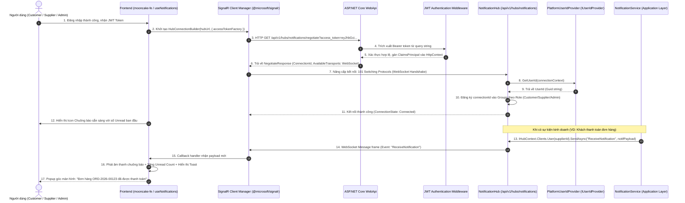
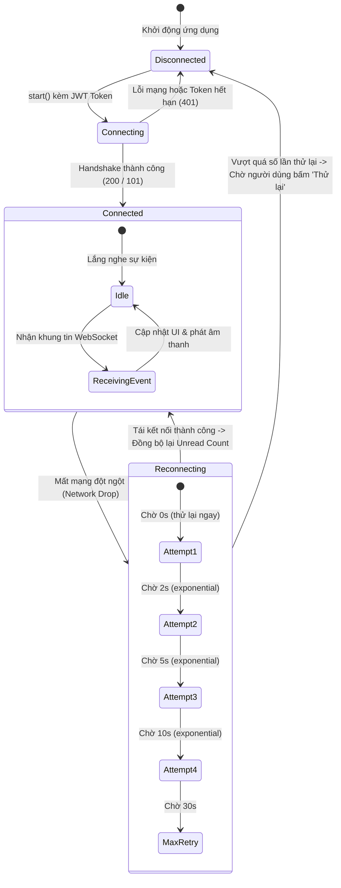

# [FEATURE-26] THIẾT KẾ KIẾN TRÚC SIGNALR & WEBSOCKET REAL-TIME NOTIFICATIONS
## Tài Liệu Thiết Kế Chi Tiết (Detail Design Document - Part 01)

---

## I. TỔNG QUAN TÍNH NĂNG & MỤC TIÊU NGHIỆP VỤ

### 1.1. Thông tin tài liệu
- **Tên tính năng:** Hệ thống Thông báo Thời Gian Thực qua WebSocket / SignalR Hub (Real-Time Push Notifications)
- **Mã tính năng (Feature Key):** `realtime-notifications-signalr` (Feature #26)
- **Phân hệ thuộc về:** Module 11 – Hệ thống & Vận hành
- **Người thiết kế:** Team Kỹ thuật / Solution Architect
- **Phiên bản:** `1.0.0`
- **Trạng thái:** `Approved`

### 1.2. Mục tiêu nghiệp vụ (Business Goals)
1. **Truyền tải thông điệp tức thì (Zero Latency Push):** Mọi sự kiện phát sinh từ phía người dùng (tạo đơn, gửi báo giá, ký hợp đồng, tải ảnh giao hàng PoD) hoặc phía hệ thống (thanh toán VNPay thành công, cọc Escrow được giải ngân, quá hạn mốc hợp đồng) phải được đẩy trực tiếp đến trình duyệt của các bên liên quan trong thời gian $< 200\text{ ms}$.
2. **Loại bỏ cơ chế Polling lãng phí tài nguyên:** Thay thế hoàn toàn cơ chế gọi API định kỳ (`setInterval` polling) gây nghẽn mạng và quá tải máy chủ cơ sở dữ liệu.
3. **Đồng bộ hóa đa tab & đa thiết bị (Multi-tab & Multi-device Sync):** Khi người dùng mở nhiều tab hoặc truy cập cùng lúc trên máy tính và điện thoại, việc đọc một thông báo ở một tab sẽ tự động cập nhật số đếm badge chưa đọc (Unread Count) ở tất cả các tab khác ngay lập tức.
4. **Tự phục hồi kết nối thông minh (Resilient Auto-reconnect):** Khi gặp sự cố mạng chập chờn, client tự động kết nối lại theo giải thuật Exponential Backoff kèm Jitter, tự động tải lại các thông báo bị lỡ trong lúc ngắt kết nối.

### 1.3. Phạm vi tính năng (Scope)
- **Bao gồm (In-Scope):**
  - Cấu hình `NotificationHub` trên ASP.NET Core SignalR tại endpoint `/api/v1/hubs/notifications`.
  - Cơ chế trích xuất và xác thực JWT Bearer token qua QueryString (`access_token`) khi thiết lập WebSocket handshake.
  - Custom `IUserIdProvider` đảm bảo ánh xạ chuẩn xác `ClaimTypes.NameIdentifier` thành User ID cho từng kết nối.
  - Quản lý nhóm theo vai trò (`AdminGroup`, `SupplierGroup`, `CustomerGroup`) và nhóm theo phiên hợp đồng / đơn hàng (`ContractGroup_{id}`, `OrderGroup_{id}`).
  - Client SignalR service trên React 19 sử dụng thư viện `@microsoft/signalr`.
  - Phát âm thanh chuông báo (Chime audio) và cập nhật badge đếm số lượng chưa đọc.
- **Không bao gồm (Out-of-Scope):**
  - Native Push Notifications trên iOS/Android (APNs/FCM) – nằm ở Phase mobile app tiếp theo.

---

## II. FLOW CHART & SEQUENCE DIAGRAM

### 2.1. Sequence Diagram: Thiết Lập Kết Nối WebSocket & Đẩy Thông Báo Real-time



### 2.2. State Diagram: Vòng Đời Kết Nối WebSocket & Xử Lý Sự Cố Mạng



---

## III. CHI TIẾT TỪNG BƯỚC XỬ LÝ (STEP-BY-STEP LOGIC)

### Bước 1: Trích Xuất JWT Token & Bắt Tay WebSocket (Handshake & Authentication)
1. **Thách thức:** Do giao thức WebSocket của trình duyệt không hỗ trợ gửi custom headers (`Authorization: Bearer ...`) trong yêu cầu nâng cấp kết nối ban đầu, client bắt buộc phải truyền token qua tham số query `access_token`.
2. **Cấu hình WebApi Middleware:**
   - Trong `Program.cs` / `JwtBearerOptions`, bổ sung event `OnMessageReceived`:
     ```csharp
     options.Events = new JwtBearerEvents
     {
         OnMessageReceived = context =>
         {
             var accessToken = context.Request.Query["access_token"];
             var path = context.HttpContext.Request.Path;
             if (!string.IsNullOrEmpty(accessToken) && path.StartsWithSegments("/api/v1/hubs/notifications"))
             {
                 context.Token = accessToken;
             }
             return Task.CompletedTask;
         }
     };
     ```
3. **Quy tắc kiểm tra:** Token phải chưa hết hạn, có chữ ký số hợp lệ và chứa claim `ClaimTypes.NameIdentifier` (`sub`).
4. **Xử lý ngoại lệ:** Nếu token không hợp lệ hoặc hết hạn, SignalR trả về HTTP 401 Unauthorized và ngắt kết nối.

### Bước 2: Định Danh Người Dùng Tập Trung (`PlatformUserIdProvider`)
1. Hiện thực giao diện `IUserIdProvider` của SignalR:
   ```csharp
   public sealed class PlatformUserIdProvider : IUserIdProvider
   {
       public string? GetUserId(HubConnectionContext connection)
       {
           return connection.User?.FindFirst(ClaimTypes.NameIdentifier)?.Value;
       }
   }
   ```
2. Đăng ký service trong DI Container: `services.AddSingleton<IUserIdProvider, PlatformUserIdProvider>();`.
3. Nhờ đó, bất kỳ Application Service nào cũng có thể gửi thông báo trực tiếp qua User ID bằng lệnh:
   `await _hubContext.Clients.User(targetUserId.ToString()).SendAsync("ReceiveNotification", dto);` mà không cần quản lý bảng ánh xạ `ConnectionId <-> UserId` thủ công.

### Bước 3: Phân Phối Nhóm Tự Động (Group Management)
Khi kết nối được thiết lập (`OnConnectedAsync`):
1. Đọc claim `ClaimTypes.Role` của người dùng.
2. Tự động đưa connection vào group tương ứng:
   - Role `Admin`: Thêm vào group `"Admins"`.
   - Role `Supplier`: Thêm vào group `"Suppliers"`.
   - Role `Customer`: Thêm vào group `"Customers"`.
3. Cho phép người dùng tham gia các kênh theo ngữ cảnh (Contextual Channels) khi đang mở chi tiết một Hợp đồng hoặc Đơn hàng:
   - Hub Method: `JoinContractGroup(Guid contractId)` $\rightarrow$ Nhận các cập nhật tiến độ real-time của hợp đồng đó.
   - Hub Method: `LeaveContractGroup(Guid contractId)`.

### Bước 4: Đồng Bộ Hóa Đa Tab Khi Đánh Dấu Đã Đọc (Multi-tab Synchronization)
1. Khi người dùng bấm "Đánh dấu đã đọc" hoặc "Đọc tất cả" tại Tab A:
2. Tab A gửi yêu cầu HTTP PATCH/POST lên API.
3. API cập nhật Database thành công, sau đó kích hoạt phát sự kiện SignalR:
   `await _hubContext.Clients.User(userId.ToString()).SendAsync("NotificationsMarkedAsRead", new { ReadIds = ids, UnreadCount = newCount });`
4. Cả Tab A, Tab B, và Tab C đều nhận được sự kiện này qua WebSocket $\rightarrow$ Tất cả các tab tự động giảm số đếm badge đồng bộ tức thì, không bị sai lệch dữ liệu.

---

## IV. ĐẶC TẢ KỸ THUẬT SIGNALR CONTRACT & HUB SPECIFICATION

### 4.1. Thông tin Hub Endpoint
- **URL Endpoint:** `/api/v1/hubs/notifications`
- **Giao thức truyền tải ưu tiên:** `WebSockets` (Fallback sang `Server-Sent Events` hoặc `Long Polling` nếu proxy cản trở).
- **Yêu cầu bảo mật:** `[Authorize]` bắt buộc đối với tất cả các thao tác.

### 4.2. Danh sách Sự kiện Server gửi Client (Server-to-Client Events)

| Tên sự kiện | Payload DTO | Mục đích & Ý nghĩa |
| :--- | :--- | :--- |
| `ReceiveNotification` | `NotificationItemDto` | Bắn 1 thông báo mới tức thì kèm âm thanh và toast |
| `UnreadCountUpdated` | `{ unreadCount: number }` | Cập nhật số đếm badge khi có thay đổi |
| `NotificationsMarkedAsRead` | `{ ids: string[], unreadCount: number }` | Đồng bộ trạng thái đã đọc trên tất cả các tab đang mở |
| `AllNotificationsRead` | `{ unreadCount: 0 }` | Đồng bộ khi người dùng bấm "Đọc tất cả" |
| `NotificationDeleted` | `{ id: string, unreadCount: number }` | Xóa thông báo khỏi danh sách trên giao diện |

### 4.3. Cấu trúc Payload Sự Kiện `ReceiveNotification`
```json
{
  "id": "7b8d4e12-9c3a-4f5d-8e6b-123456789abc",
  "userId": "3fa85f64-5717-4562-b3fc-2c963f66afa6",
  "type": "payment_completed",
  "category": "payment",
  "title": "Thanh toán cọc M1 thành công",
  "content": "Khách hàng Doanh Nghiệp Hoa Mai đã thanh toán cọc 120.000.000 ₫ qua VNPay Sandbox cho Hợp đồng CTR-2026-00045.",
  "referenceId": "9b1deb4d-3b7d-4bad-9bdd-2b0d7b3dcb6d",
  "referenceType": "contract",
  "actionUrl": "/#/hop-dong-tien-do?id=9b1deb4d-3b7d-4bad-9bdd-2b0d7b3dcb6d",
  "isRead": false,
  "createdAt": "2026-10-29T10:15:30Z",
  "priority": "high",
  "icon": "vnpay-gold"
}
```

---

## V. KIẾN TRÚC PHÂN TẦNG VÀ TỔ CHỨC MÃ NGUỒN (LAYER MAPPING)

### 5.1. Backend (.NET 8 Clean Architecture)
- **Domain:**
  - Thực thể `Notification.cs` (Kế thừa `BaseEntity`, ánh xạ bảng `notifications`).
  - Enum `NotificationType`, `NotificationPriority`, `NotificationCategory`.
- **Application Layer:**
  - Interfaces:
    - `INotificationService.cs` (Nghiệp vụ truy vấn hộp thư, đánh dấu đã đọc, tạo thông báo).
    - `IRealtimeNotificationPublisher.cs` (Abstraction gửi SignalR, tách biệt SignalR khỏi core domain).
  - DTOs:
    - `NotificationResponseDto.cs`, `UnreadCountDto.cs`, `NotificationQueryFilter.cs`.
- **Infrastructure Layer:**
  - `NotificationRepository.cs` (Truy vấn tối ưu hóa qua chỉ mục PostgreSQL).
- **WebApi Layer:**
  - `NotificationHub.cs` (Kế thừa `Hub`, quản lý kết nối và group).
  - `PlatformUserIdProvider.cs` (Hiện thực `IUserIdProvider`).
  - `SignalRNotificationPublisher.cs` (Hiện thực `IRealtimeNotificationPublisher` inject `IHubContext<NotificationHub>`).
  - `NotificationsController.cs` (REST API cho danh sách thông báo và preferences).

### 5.2. Frontend (React 19 / Layered Architecture)
- **Services:**
  - `src/services/signalrService.js`: Quản lý singleton `HubConnection`, auto-reconnect, đăng ký event listeners.
  - `src/services/notificationService.js`: Gọi API lấy inbox phân trang, đánh dấu đã đọc qua `apiClient`.
- **Hooks:**
  - `src/hooks/useNotifications.js`: Cung cấp state toàn cục: `notifications`, `unreadCount`, `isConnected`, `markAsRead`, `markAllAsRead`.
- **Components:**
  - `src/components/notification/NotificationBell.jsx`: Icon chuông gắn trên Top Navbar kèm badge động.
  - `src/components/notification/NotificationDrawer.jsx`: Drawer trượt hiển thị danh sách thông báo sang trọng.
  - `src/components/notification/NotificationItem.jsx`: Từng dòng thông báo với icon loại sự kiện và định dạng thời gian thân thiện.

---

## VI. BẢO MẬT & ĐỘ TIN CẬY (SECURITY & RESILIENCE)

1. **Bảo mật kết nối WebSocket:**
   - Bắt buộc kiểm tra JWT Token trước khi cho phép nâng cấp kết nối.
   - Không cho phép người dùng tự gửi thông điệp kinh doanh qua Hub (Hub chỉ đóng vai trò kênh nhận dữ liệu từ Server, Client không thể giả mạo thông báo gửi cho người khác).
2. **Chống rò rỉ bộ nhớ (Memory Leak Prevention):**
   - Hủy đăng ký listener (`connection.off(...)`) khi React component unmount.
   - Quản lý vòng đời `HubConnection` qua React Context hoặc Singleton để tránh mở hàng chục kết nối trùng lặp khi người dùng chuyển trang.
3. **Heartbeat & Giữ kết nối (Keep-Alive):**
   - Cấu hình server Keep-Alive: `ClientTimeoutInterval = TimeSpan.FromSeconds(30)`, `KeepAliveInterval = TimeSpan.FromSeconds(15)`.
   - Giúp phát hiện sớm tình trạng mạng bị đứt ngầm (Half-open connections) và kích hoạt cơ chế reconnect tức thì.

