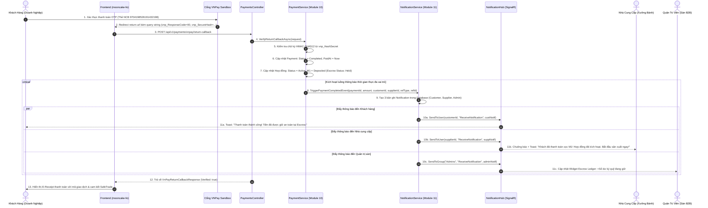
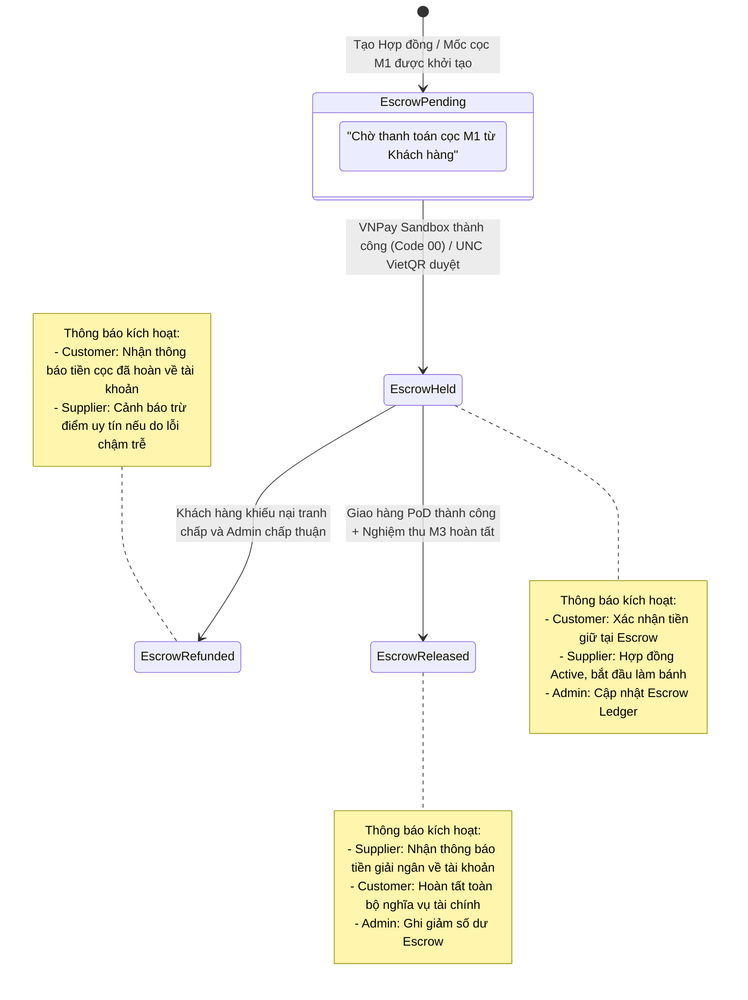

# [FEATURE-25 & 26] ĐIỀU PHỐI SỰ KIỆN THANH TOÁN & KÝ QUỸ ESCROW THỜI GIAN THỰC
## Tài Liệu Thiết Kế Chi Tiết (Detail Design Document - Part 02)

---

## I. TỔNG QUAN TÍNH NĂNG & MỤC TIÊU NGHIỆP VỤ

### 1.1. Thông tin tài liệu
- **Tên tính năng:** Cầu Nối Sự Kiện Thanh Toán Cổng VNPay Sandbox & Ký Quỹ Escrow Với Hệ Thống Thông Báo Thời Gian Thực (Payment & Escrow Real-Time Event Dispatcher)
- **Mã tính năng (Feature Key):** `payment-escrow-realtime-dispatch` (Features #25 & #26)
- **Phân hệ thuộc về:** Module 11 – Hệ thống & Vận hành (kết nối trực tiếp Module 10: Thanh toán)
- **Người thiết kế:** Team Kỹ thuật / Solution Architect
- **Phiên bản:** `1.0.0`
- **Trạng thái:** `Approved`

### 1.2. Mục tiêu nghiệp vụ (Business Goals)
1. **Thông báo giao dịch thanh toán VNPay Sandbox tức thì:** Ngay khi khách hàng hoàn tất xác thực OTP trên cổng VNPay Sandbox và cổng trả kết quả về qua IPN/Callback, hệ thống lập tức cập nhật trạng thái đơn hàng/hợp đồng và đồng thời phát thông báo thời gian thực đến:
   - **Khách hàng (Payer):** Nhận biên lai điện tử (E-Receipt), xác nhận khoản thanh toán đã được ghi nhận an toàn vào tài khoản Ký quỹ Escrow.
   - **Nhà cung cấp (Payee):** Nhận thông báo kích hoạt hợp đồng (Contract Active) hoặc đơn hàng được chuyển sang trạng thái chuẩn bị sản xuất/giao hàng.
   - **Admin (Sàn):** Cập nhật số dư bảng sao kê Ký quỹ Escrow (Escrow Ledger) trên Admin Dashboard trong thời gian thực.
2. **Cảnh báo chuyển khoản VietQR & Ủy nhiệm chi (UNC):** Khi khách hàng chọn phương thức Chuyển khoản VietQR (MB Bank `0988668899`) và tải lên ảnh chứng từ ủy nhiệm chi, hệ thống tự động thông báo cho Nhà cung cấp và Kế toán sàn để đối soát và xác thực chứng từ.
3. **Minh bạch hóa dòng tiền Ký quỹ (Escrow Transparency):** Mỗi biến động của quỹ Escrow (Ký gửi cọc M1, Giải ngân nghiệm thu M3, Hoàn trả tranh chấp Refund) đều tự động sinh bản ghi kiểm toán tài chính và gửi thông báo đa kênh, chống tranh chấp và nâng cao uy tín nền tảng B2B.

---

## II. FLOW CHART & SEQUENCE DIAGRAM

### 2.1. Sequence Diagram: Luồng Điều Phối Sự Kiện Thanh Toán VNPay Sandbox Sang SignalR



### 2.2. State Transition: Vòng Đời Trạng Thái Ký Quỹ Escrow & Thông Báo Kích Hoạt Tương Ứng



---

## III. CHI TIẾT TỪNG BƯỚC XỬ LÝ (STEP-BY-STEP LOGIC)

### Bước 1: Tiếp Nhận & Xác Minh Kết Quả Thanh Toán Từ VNPay Sandbox
1. Nhận thông tin Callback từ VNPay Sandbox chứa các tham số: `vnp_Amount`, `vnp_BankCode`, `vnp_OrderInfo`, `vnp_ResponseCode`, `vnp_TransactionNo`, `vnp_TxnRef`, `vnp_SecureHash`.
2. Kiểm tra chữ ký HMAC-SHA512 bằng mã bí mật `WBGRFFJWAHOAFNIEYICELPMQORJJHSQL`.
3. Nếu chữ ký không khớp (`vnp_ResponseCode = "97"`):
   - Ném ngoại lệ an ninh: `SecurityTamperException`.
   - Lập tức kích hoạt thông báo cảnh báo mức khẩn cấp (**Urgent Alert**) gửi đến nhóm Quản trị viên sàn: *"Cảnh báo: Phát hiện giao dịch thanh toán bị giả mạo chữ ký Checksum tại TxnRef: {vnp_TxnRef}"*.

### Bước 2: Cập Nhật Sổ Cái Giao Dịch & Trạng Thái Thực Thể Nghiệp Vụ
1. Mở Transaction cơ sở dữ liệu với mức cô lập `ReadCommitted`.
2. Cập nhật bản ghi `Payment`:
   - `Status = PaymentStatus.Completed` (nếu `vnp_ResponseCode == "00"`).
   - `TransactionId = vnp_TransactionNo`.
   - `PaidAt = DateTime.UtcNow`.
3. Kiểm tra loại tham chiếu (`ReferenceType`):
   - **Nếu là Đơn hàng (`order`):** Cập nhật đơn hàng sang `Confirmed` hoặc `Processing`.
   - **Nếu là Hợp đồng (`contract`):** 
     - Cập nhật mốc cọc M1 (`ContractMilestone`) sang trạng thái `Paid`.
     - Chuyển trạng thái Hợp đồng (`Contract`) từ `PendingDeposit` sang `Active`.
     - Ghi nhận trạng thái Escrow là `Held` (Tiền đang được Sàn ký quỹ bảo chứng).

### Bước 3: Đóng Gói Thông Báo & Xác Định Danh Sách Người Nhận (Notification Dispatcher)
1. Dựa trên thông tin giao dịch, trích xuất danh sách User ID cần thông báo:
   - `PayerId` (Khách hàng doanh nghiệp tạo đơn/ký hợp đồng).
   - `PayeeId` (Chủ sở hữu gian hàng / Nhà cung cấp).
   - `AdminRole` (Nhóm quản lý tài chính sàn).
2. Chuẩn bị nội dung thông báo được địa phương hóa theo ngôn ngữ B2B trang trọng:
   - **Cho Khách Hàng:**
     - *Tiêu đề:* `"Thanh toán thành công qua VNPay Sandbox"`
     - *Nội dung:* `"Giao dịch {vnp_TxnRef} trị giá {vnp_Amount:N0} ₫ đã được xác nhận. Số tiền đang được bảo chứng an toàn tại Quỹ Escrow của Sàn Nguyệt Phố."*
     - *Liên kết điều hướng (ActionUrl):* `/#/hop-dong-tien-do?id={contractId}` hoặc `/#/dat-hang-thiet-ke?tab=orders`.
   - **Cho Nhà Cung Cấp:**
     - *Tiêu đề:* `"Tiền cọc Hợp đồng {contractNumber} đã được thanh toán"`
     - *Nội dung:* `"Khách hàng đã thanh toán cọc mốc M1 qua VNPay Sandbox. Hợp đồng chính thức chuyển sang trạng thái HOẠT ĐỘNG. Quý xưởng vui lòng bắt đầu kế hoạch sản xuất."*
     - *Liên kết điều hướng:* `/#/hop-dong-tien-do?id={contractId}`.
   - **Cho Quản Trị Viên (Admin):**
     - *Tiêu đề:* `"Phát sinh giao dịch ký quỹ Escrow mới"`
     - *Nội dung:* `"Giao dịch ký quỹ {vnp_Amount:N0} ₫ từ {customerName} cho hợp đồng {contractNumber} đã vào tài khoản sàn."*
     - *Liên kết điều hướng:* `/#/quan-tri?tab=escrow`.

### Bước 4: Lưu Trữ Bền Vững & Phát Sóng Tức Thì (Persistence & Broadcast)
1. Ghi đồng thời các bản ghi `Notification` vào bảng cơ sở dữ liệu `notifications` để đảm bảo lưu trữ vĩnh viễn (Durable Inbox).
2. Gọi `IRealtimeNotificationPublisher.PublishAsync(...)`:
   - Gửi payload tương ứng đến từng kết nối WebSocket thông qua `Clients.User(targetUserId)`.
   - Gửi sự kiện cập nhật số đếm badge chưa đọc (`UnreadCountUpdated`) đến tất cả các tab đang mở của người dùng đó.
3. Kích hoạt hiệu ứng âm thanh chuông báo tại trình duyệt Client.

---

## IV. ĐẶC TẢ SỰ KIỆN THANH TOÁN (PAYMENT EVENT PAYLOADS)

### 4.1. Sự kiện: Thanh toán VNPay Sandbox Thành Công (`payment_vnpay_success`)
```json
{
  "eventId": "e9b2c3d4-1a2b-4c5d-9e8f-0123456789ab",
  "eventType": "payment_vnpay_success",
  "timestamp": "2026-10-29T10:15:30Z",
  "payload": {
    "paymentId": "4a7b9c1d-2e3f-4a5b-8c9d-0e1f2a3b4c5d",
    "paymentNumber": "PAY-2026-00045",
    "amount": 120000000,
    "method": "vnpay_sandbox",
    "vnpayBankCode": "NCB",
    "vnpayTransactionNo": "14567890",
    "referenceType": "contract",
    "referenceId": "9b1deb4d-3b7d-4bad-9bdd-2b0d7b3dcb6d",
    "referenceNumber": "CTR-2026-00012",
    "escrowStatus": "held",
    "payerUserId": "3fa85f64-5717-4562-b3fc-2c963f66afa6",
    "payeeUserId": "8db3e12a-5717-4562-b3fc-2c963f66afb2"
  }
}
```

### 4.2. Sự kiện: Tải Lên Ủy Nhiệm Chi Chuyển Khoản VietQR (`payment_unc_uploaded`)
```json
{
  "eventId": "f1a2b3c4-5d6e-7f8a-9b0c-1d2e3f4a5b6c",
  "eventType": "payment_unc_uploaded",
  "timestamp": "2026-10-29T10:20:15Z",
  "payload": {
    "paymentId": "4a7b9c1d-2e3f-4a5b-8c9d-0e1f2a3b4c5d",
    "paymentNumber": "PAY-2026-00046",
    "amount": 75000000,
    "method": "bank_transfer_vietqr",
    "evidenceUrl": "https://storage.nguyetpho.vn/payments/unc_2026_00046.jpg",
    "evidenceNotes": "Đã chuyển khoản từ tài khoản Techcombank công ty lúc 10h15",
    "referenceType": "contract",
    "referenceNumber": "CTR-2026-00014",
    "targetUserId": "8db3e12a-5717-4562-b3fc-2c963f66afb2"
  }
}
```

### 4.3. Sự kiện: Giải Ngân Ký Quỹ Escrow Cho Xưởng (`escrow_released`)
```json
{
  "eventId": "d2c3b4a5-6e7f-8a9b-0c1d-2e3f4a5b6c7d",
  "eventType": "escrow_released",
  "timestamp": "2026-10-29T10:45:00Z",
  "payload": {
    "paymentId": "7f8a9b0c-1d2e-3f4a-5b6c-8c9d0e1f2a3b",
    "amount": 120000000,
    "contractNumber": "CTR-2026-00012",
    "milestoneName": "M3 - Nghiệm thu hoàn tất & Bàn giao",
    "recipientUserId": "8db3e12a-5717-4562-b3fc-2c963f66afb2",
    "supplierShopName": "Xưởng Bánh Trung Thu Kinh Đô Thượng Hạng"
  }
}
```

---

## V. KIẾN TRÚC PHÂN TẦNG VÀ TỔ CHỨC MÃ NGUỒN (LAYER MAPPING)

### 5.1. Backend C# (.NET 8 Clean Architecture)
- **Application Layer:**
  - `IPaymentNotificationDispatcher.cs`: Cung cấp các phương thức nghiệp vụ:
    - `DispatchPaymentSuccessAsync(Payment payment, CancellationToken ct)`
    - `DispatchUncUploadedAsync(Payment payment, CancellationToken ct)`
    - `DispatchEscrowReleasedAsync(Payment payment, CancellationToken ct)`
    - `DispatchRefundApprovedAsync(Payment payment, decimal refundAmount, CancellationToken ct)`
  - Sửa đổi `PaymentService.cs`: Inject `IPaymentNotificationDispatcher` để phát thông báo ngay sau khi cập nhật database thành công.
- **Infrastructure / WebApi Layer:**
  - `PaymentNotificationDispatcher.cs`: Hiện thực `IPaymentNotificationDispatcher`, phối hợp giữa `INotificationRepository`, `IUnitOfWork` và `IRealtimeNotificationPublisher` (SignalR Hub).

### 5.2. Frontend React 19 (`mooncake-fe`)
- **Tầng View Thanh Toán:**
  - [`PaymentResultView.jsx`](file:///Users/admin/Desktop/PRN232/mooncake-fe/src/components/payment/PaymentResultView.jsx): Khi nhận callback từ VNPay, bên cạnh việc gọi API kiểm tra, màn hình đồng thời lắng nghe WebSocket SignalR để cập nhật trạng thái "Đã xác thực" tức thì ngay cả khi có độ trễ mạng.
- **Tầng Bảng Điều Khiển Admin:**
  - [`DashBoard.jsx`](file:///Users/admin/Desktop/PRN232/mooncake-fe/src/Pages/Admin/DashBoard.jsx): Widget Escrow Ledger tự động chèn dòng giao dịch mới và cập nhật thẻ số dư `Tổng tiền đang giữ (Escrow Balance)` khi nhận sự kiện `escrow_updated` từ SignalR mà không cần nhấn F5.

---

## VI. BẢO MẬT & ĐỐI SOÁT GIAO DỊCH (SECURITY & AUDIT)

1. **Chống Phát Thông Báo Giả Mạo (No Client-side Triggering):**
   - Nghiêm cấm Frontend tự phát sự kiện thanh toán lên SignalR. Chỉ có duy nhất Backend sau khi đã đối chiếu mã phản hồi `vnp_ResponseCode == "00"` và kiểm tra checksum SHA512 thành công mới được quyền phát thông báo `payment_vnpay_success`.
2. **Ngăn Chặn Giao Dịch Lặp (Idempotency Key):**
   - Mọi thông báo thanh toán đều gắn kèm `PaymentId` và `ReferenceId`. Frontend kiểm tra `eventId` để loại trừ trường hợp một thông báo bị hiển thị 2 lần nếu nhận được cả từ Redirect URL và Webhook IPN chạy song song.
3. **Bảo Mật Quyền Xem Chứng Từ:**
   - Ảnh ủy nhiệm chi (UNC) chứa thông tin tài khoản ngân hàng của doanh nghiệp. Chỉ có Khách hàng sở hữu đơn, Nhà cung cấp nhận tiền và Quản trị viên sàn mới có quyền truy cập URL ảnh và nhận thông báo chứa bằng chứng này.

