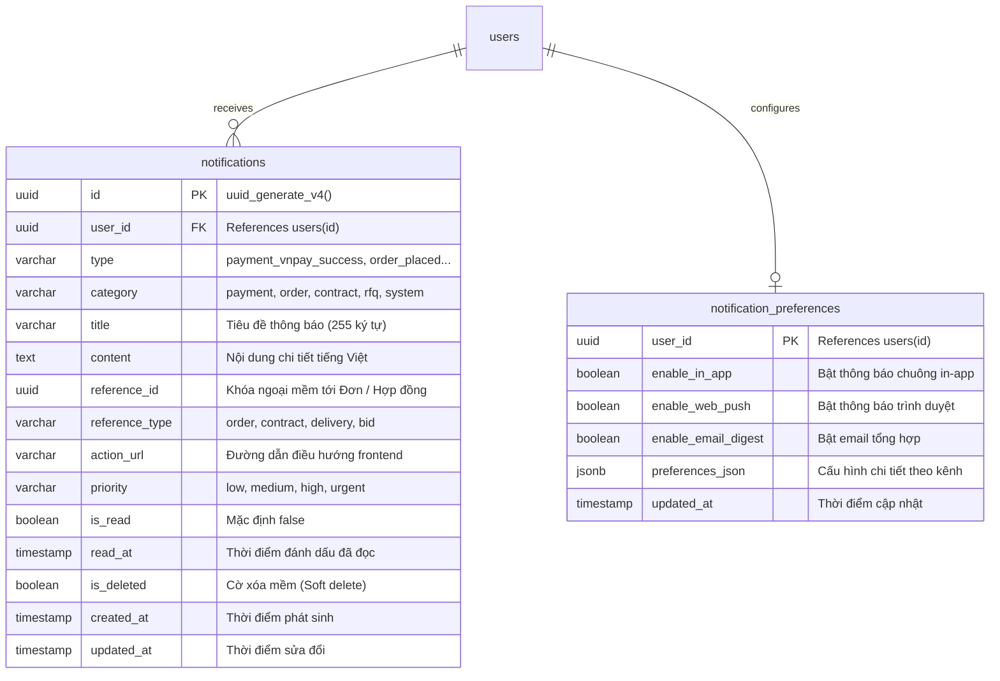

# [DATABASE-SECURITY] CƠ SỞ DỮ LIỆU, CHỈ MỤC TỐI ƯU & BẢO MẬT DỮ LIỆU THÔNG BÁO
## Tài Liệu Thiết Kế Chi Tiết (Detail Design Document - Part 06)

---

## I. THIẾT KẾ BẢNG CƠ SỞ DỮ LIỆU POSTGRESQL

Hệ thống thông báo được thiết kế tối ưu trên cơ sở dữ liệu quan hệ **PostgreSQL 16**, bao gồm 2 bảng trọng tâm: `notifications` (Hộp thư bền vững) và `notification_preferences` (Tùy chọn nhận tin người dùng).



---

## II. ĐẶC TẢ SQL DDL & INDEX TỐI ƯU HÓA HIỆU NĂNG

### 2.1. Mã Lệnh Khởi Tạo Bảng & Ràng Buộc
```sql
-- 1. Bảng lưu trữ thông báo bền vững
CREATE TABLE IF NOT EXISTS notifications (
    id UUID PRIMARY KEY DEFAULT gen_random_uuid(),
    user_id UUID NOT NULL REFERENCES users(id) ON DELETE CASCADE,
    type VARCHAR(100) NOT NULL,
    category VARCHAR(50) NOT NULL DEFAULT 'system',
    title VARCHAR(255) NOT NULL,
    content TEXT NOT NULL,
    reference_id UUID NULL,
    reference_type VARCHAR(50) NULL,
    action_url VARCHAR(500) NULL,
    priority VARCHAR(20) NOT NULL DEFAULT 'medium',
    is_read BOOLEAN NOT NULL DEFAULT FALSE,
    read_at TIMESTAMPTZ NULL,
    is_deleted BOOLEAN NOT NULL DEFAULT FALSE,
    created_at TIMESTAMPTZ NOT NULL DEFAULT NOW(),
    updated_at TIMESTAMPTZ NOT NULL DEFAULT NOW()
);

-- 2. Bảng cấu hình tùy chọn thông báo
CREATE TABLE IF NOT EXISTS notification_preferences (
    user_id UUID PRIMARY KEY REFERENCES users(id) ON DELETE CASCADE,
    enable_in_app BOOLEAN NOT NULL DEFAULT TRUE,
    enable_web_push BOOLEAN NOT NULL DEFAULT TRUE,
    enable_email_digest BOOLEAN NOT NULL DEFAULT FALSE,
    preferences_json JSONB NOT NULL DEFAULT '{}'::jsonb,
    updated_at TIMESTAMPTZ NOT NULL DEFAULT NOW()
);
```

### 2.2. Chiến Lược Chỉ Mục Phục Vụ Truy Vấn Hàng Triệu Bản Ghi (Index Optimization)
1. **Chỉ mục Partial Index siêu nhẹ phục vụ đếm Badge Unread:**
   ```sql
   -- Truy vấn: SELECT COUNT(*) FROM notifications WHERE user_id = @userId AND is_read = false AND is_deleted = false;
   -- Tốc độ truy vấn: O(1) - Kích thước index cực nhỏ vì chỉ đánh index trên các dòng chưa đọc
   CREATE INDEX IF NOT EXISTS idx_notif_unread 
   ON notifications (user_id, is_read) 
   WHERE (is_deleted = false AND is_read = false);
   ```
2. **Chỉ mục Dòng thời gian phân trang (Timeline Pagination):**
   ```sql
   -- Truy vấn: SELECT * FROM notifications WHERE user_id = @userId AND is_deleted = false ORDER BY created_at DESC LIMIT 20;
   CREATE INDEX IF NOT EXISTS idx_notif_user_timeline 
   ON notifications (user_id, created_at DESC) 
   WHERE (is_deleted = false);
   ```
3. **Chỉ mục Lọc theo Danh mục nghiệp vụ (Category Filter):**
   ```sql
   CREATE INDEX IF NOT EXISTS idx_notif_user_category 
   ON notifications (user_id, category, created_at DESC) 
   WHERE (is_deleted = false);
   ```

---

## III. XỬ LÝ ĐỒNG THỜI & CHỐNG TRANH CHẤP DỮ LIỆU (CONCURRENCY & IDEMPOTENCY)

### 3.1. Thao Tác Đọc Tất Cả An Toàn (Safe Read-All Operation)
Khi người dùng có hàng trăm thông báo chưa đọc và bấm nút *"Đánh dấu tất cả đã đọc"*:
- **Vấn đề tiềm ẩn:** Nếu một thông báo mới vừa được gửi tới máy chủ trong cùng tích tắc người dùng bấm nút, việc dùng câu lệnh `UPDATE ... WHERE is_read = false` sẽ vô tình đánh dấu đã đọc cả thông báo mới mà người dùng chưa hề nhìn thấy.
- **Giải pháp xử lý thời điểm (Read-through Timestamp Token):**
  Client gửi kèm `readThroughTimestamp` (thời điểm bản ghi mới nhất hiển thị trên màn hình):
  ```csharp
  public async Task<int> MarkAllAsReadAsync(Guid userId, DateTime readThroughUtc, CancellationToken ct)
  {
      return await _dbContext.Notifications
          .Where(n => n.UserId == userId && !n.IsRead && !n.IsDeleted && n.CreatedAt <= readThroughUtc)
          .ExecuteUpdateAsync(s => s
              .SetProperty(n => n.IsRead, true)
              .SetProperty(n => n.ReadAt, DateTime.UtcNow)
              .SetProperty(n => n.UpdatedAt, DateTime.UtcNow), ct);
  }
  ```
  Nhờ sử dụng EF Core 8 `ExecuteUpdateAsync`, câu lệnh được dịch trực tiếp thành một lệnh SQL duy nhất mà không cần tải dữ liệu vào bộ nhớ, đảm bảo hiệu năng tối đa ngay cả với tài khoản có số lượng thông báo lớn.

---

## IV. CHÍNH SÁCH LƯU TRỮ & DỌN DẸP DỮ LIỆU TỰ ĐỘNG (RETENTION POLICY)

Trong hệ thống B2B hoạt động lâu dài, số lượng thông báo sẽ tăng nhanh theo thời gian:
1. **Quy tắc dọn dẹp định kỳ (Archiving Job):**
   - Đăng ký một `IRecurringJob` mang tên `NotificationMaintenanceJob` chạy vào lúc `02:00 AM UTC` hàng ngày.
   - Xóa mềm (Soft delete) các thông báo mức độ `low` và `medium` đã đọc (`is_read = true`) có tuổi đời $> 90\text{ ngày}$.
   - **Ngoại lệ bảo tồn vĩnh viễn:** Các thông báo liên quan đến **Thanh toán VNPay**, **Hợp đồng điện tử ký số**, và **Bằng chứng giao hàng PoD** được giữ lại vĩnh viễn làm tài liệu pháp lý đối soát khi có tranh chấp thương mại.

---

## V. AN NINH BẢO MẬT & CÔ LẬP DỮ LIỆU NGƯỜI DÙNG (DATA ISOLATION)

1. **Nguyên tắc Cô Lập Đa Người Dùng (Strict Tenant / User Isolation):**
   - Mọi câu lệnh truy vấn hộp thư, đánh dấu đã đọc, hoặc xóa thông báo đều bắt buộc phải kèm điều kiện `WHERE user_id = @currentUserId` (được trích xuất từ JWT Claims ở tầng WebApi Controller).
   - Ngăn chặn hoàn toàn lỗ hổng IDOR (Insecure Direct Object Reference) - Người dùng không thể xem hay chỉnh sửa thông báo của người khác ngay cả khi đoán được UUID.
2. **Bảo vệ Tính Toàn Vẹn Của Thông Báo:**
   - Dữ liệu `title` và `content` được làm sạch (Sanitize HTML) trước khi lưu trữ và render trên giao diện để loại bỏ nguy cơ tấn công XSS (Cross-Site Scripting).

