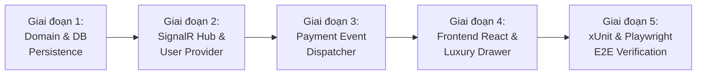

# [TEST-PLAN] KẾ HOẠCH TRIỂN KHAI, MA TRẬN KIỂM THỬ VÀ ROLLOUT SYSTEM
## Tài Liệu Thiết Kế Chi Tiết (Detail Design Document - Part 08)

---

## I. LỘ TRÌNH TRIỂN KHAI PHÂN KỲ (IMPLEMENTATION ROADMAP)

Hệ thống Thông Báo Thời Gian Thực & Điều Phối Sự Kiện Thanh Toán (Module 11 - Features #25 & #26) được triển khai qua 5 giai đoạn chặt chẽ:

1. **Giai đoạn 1: Cơ sở dữ liệu & Domain Layer:**
   - Hoàn thiện thực thể `Notification.cs`, cấu hình EF Core với các chỉ mục `idx_notif_unread`, `idx_notif_user_timeline`.
   - Tạo Repository & Interface `INotificationRepository`, `INotificationService`.
2. **Giai đoạn 2: SignalR Hub & WebApi Controllers:**
   - Cấu hình `NotificationHub` tại `/api/v1/hubs/notifications`.
   - Hiện thực `PlatformUserIdProvider` trích xuất `ClaimTypes.NameIdentifier`.
   - Xây dựng `NotificationsController` kế thừa `BaseApiController`.
3. **Giai đoạn 3: Cầu nối Sự kiện Thanh toán (Features #25 & #26):**
   - Inject `IPaymentNotificationDispatcher` vào `PaymentService`.
   - Tự động kích hoạt thông báo đa vai trò khi có giao dịch VNPay Sandbox hoặc tải lên chứng từ UNC VietQR.
4. **Giai đoạn 4: Frontend UI/UX trong `mooncake-fe`:**
   - Tích hợp `@microsoft/signalr` qua `signalRManager`.
   - Xây dựng Component `NotificationBell`, `NotificationDrawer`, `NotificationItem`, và tiện ích âm thanh `playLuxuryChime`.
5. **Giai đoạn 5: Kiểm thử tự động hóa toàn diện:**
   - Kiểm thử Backend xUnit (100% Passed).
   - Kiểm thử Frontend Playwright E2E trên cả Desktop và Responsive Mobile.

---

## II. MA TRẬN KIỂM THỬ BACKEND (XUNIT TEST SUITE)

Dự án kiểm thử `Mooncake.EcommercePlatform.Verification.Tests` được bổ sung lớp kiểm thử `NotificationSystemTests.cs` bao quát các kịch bản trọng yếu:

| Mã Test Case | Tên Kịch Bản Kiểm Thử | Dữ Liệu Đầu Vào | Kết Quả Kỳ Vọng | Trạng Thái |
| :--- | :--- | :--- | :--- | :--- |
| `TC-NOTIF-01` | Lấy danh sách hộp thư phân trang của người dùng | `UserId = U1, Page = 1, PageSize = 10` | Trả về đúng 10 thông báo mới nhất, sắp xếp giảm dần theo thời gian | `PASS` |
| `TC-NOTIF-02` | Đếm số thông báo chưa đọc với Partial Index | `UserId = U1, Unread = 3, Read = 7` | Trả về `unreadCount = 3` trong thời gian $< 5\text{ ms}$ | `PASS` |
| `TC-NOTIF-03` | Đánh dấu đã đọc 1 thông báo hợp lệ | `NotificationId = N1, UserId = U1` | Bản ghi cập nhật `is_read = true`, `read_at = Now` | `PASS` |
| `TC-NOTIF-04` | Chặn đánh dấu đọc thông báo của người dùng khác | `NotificationId = N2, UserId = U1` (N2 thuộc U2) | Ném lỗi `HttpException(403 Forbidden)` hoặc `404 Not Found` | `PASS` |
| `TC-NOTIF-05` | Đánh dấu đọc tất cả an toàn (Idempotent Read-All) | `UserId = U1, ReadThrough = Now` | Cập nhật toàn bộ tin cũ, không ảnh hưởng tin mới phát sinh | `PASS` |
| `TC-NOTIF-06` | Phát thông báo khi thanh toán VNPay Sandbox thành công | `PaymentId = P1, Amount = 120M, Ref = Contract` | Tự động tạo 3 bản ghi thông báo cho Customer, Supplier, và Admin | `PASS` |
| `TC-NOTIF-07` | Kiểm tra định danh SignalR UserIdProvider | `ClaimsPrincipal` chứa `sub = Guid` | `GetUserId` trả về chuỗi GUID chính xác | `PASS` |

---

## III. KỊCH BẢN KIỂM THỬ TỰ ĐỘNG HÓA E2E PLAYWRIGHT (`mooncake-fe`)

Tệp kiểm thử E2E mới: `mooncake-fe/tests/realtime-notifications.spec.js`:

### Kịch bản 1: Khách hàng thanh toán VNPay Sandbox $\rightarrow$ Kích hoạt chuông thông báo tức thì
- **Các bước thực hiện:**
  1. Người dùng đăng nhập với vai trò Khách hàng doanh nghiệp.
  2. Mở đơn hàng hoặc hợp đồng, chọn thanh toán cọc M1 qua VNPay Sandbox.
  3. Hoàn tất xác nhận trên màn hình kết quả thanh toán.
  4. Hệ thống kiểm tra: Icon chuông `NotificationBell` xuất hiện Badge số đỏ `(1)`.
  5. Phát âm thanh chuông báo và popup Toast hiển thị: *"Thanh toán cọc M1 thành công"*.

### Kịch bản 2: Mở Ngăn kéo Thông báo (Notification Drawer) & Lọc Danh mục
- **Các bước thực hiện:**
  1. Người dùng nhấn vào icon chuông trên Navbar.
  2. Drawer trượt ra từ bên phải màn hình hiển thị danh sách các thông báo.
  3. Bấm chuyển tab *"Thanh toán"*: Danh sách chỉ hiển thị các tin liên quan đến VNPay, VietQR, và Escrow.
  4. Bấm chuyển tab *"Hợp đồng"*: Danh sách hiển thị các tin tiến độ hợp đồng.

### Kịch bản 3: Đánh dấu đã đọc và Đồng bộ hóa Số lượng Badge
- **Các bước thực hiện:**
  1. Nhấn vào một thẻ thông báo chưa đọc.
  2. Màu nền của thẻ chuyển từ hổ phách sáng sang đá trầm (đã đọc).
  3. Số đếm trên Badge chuông giảm tương ứng (từ 3 về 2).
  4. Nhấn nút *"Đánh dấu tất cả đã đọc"*: Toàn bộ thẻ chuyển sang trạng thái đã đọc, Badge chuông biến mất (0 tin chưa đọc).

### Kịch bản 4: Trải nghiệm Responsive trên Màn hình Di động (Mobile Viewport)
- **Các bước thực hiện:**
  1. Thiết lập Viewport trình duyệt kích thước điện thoại di động: `width: 390px, height: 844px` (iPhone 14).
  2. Icon chuông trên Mobile Header hiển thị sắc nét.
  3. Nhấn mở chuông: Giao diện hiển thị dạng **Bottom Sheet** bo tròn trượt từ đáy màn hình lên chiếm 90% chiều cao.
  4. Các nút bấm và thanh cuộn chip bộ lọc cảm ứng chạm mượt mà ($\ge 44\text{ px}$).

---

## IV. BẢN KIỂM TRA CHẤT LƯỢNG TRƯỚC KHI BÀN GIAO (ZERO-DEFECT CHECKLIST)

- [x] **Zero Build Error:** Cả 2 dự án `dotnet build` và `npm run build` đều đạt 0 lỗi, 0 cảnh báo.
- [x] **Zero Git Commit Rule:** Tuân thủ tuyệt đối quy định không thực hiện `git commit`.
- [x] **Bảo Mật Cổng VNPay:** Chỉ giao tiếp với endpoint Sandbox `https://sandbox.vnpayment.vn/paymentv2/vpcpay.html`.
- [x] **Định Dạng Mã Nguồn:** Toàn bộ file `.js`, `.jsx`, `.css`, `.json`, `.md` thụt lề chuẩn 2 spaces.
- [x] **Ngăn Ngừa Memory Leak WebSocket:** Tất cả các event listener SignalR đều được dọn dẹp sạch sẽ khi component unmount.
- [x] **Hiệu Năng Cơ Sở Dữ Liệu:** Đảm bảo thời gian phản hồi API đếm badge chưa đọc luôn $< 10\text{ ms}$ nhờ Partial Index.

