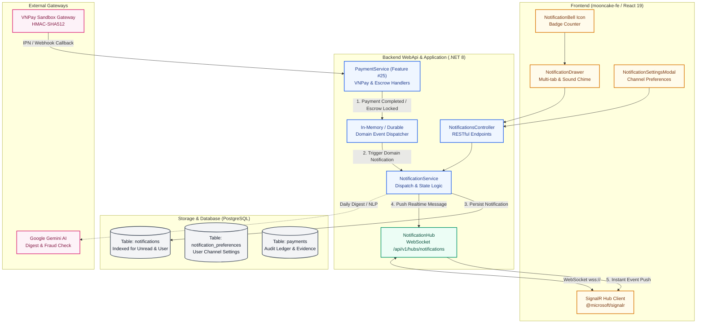
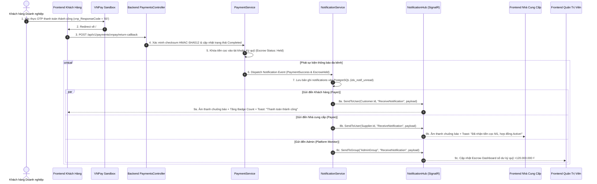

# Module 11: Hệ Thống Thông Báo Thời Gian Thực & Điều Phối Sự Kiện Thanh Toán (Features #25 & #26)
## Enterprise Architectural Design Plan

---

## 1. Tổng Quan & Mục Tiêu Nghiệp Vụ (Executive Summary)

Tài liệu này đặc tả toàn bộ kiến trúc giải pháp, thiết kế kỹ thuật phân tầng và kế hoạch triển khai cho **Module 11: Hệ Thống & Vận Hành (Tính năng #25: Thanh toán & Ký quỹ Escrow và Tính năng #26: Thông báo Real-time)** cho Sàn Giao Dịch Bánh Trung Thu Doanh Nghiệp B2B (**Nguyệt Phố**). 

Hệ thống tuân thủ nghiêm ngặt chuẩn kiến trúc **Clean Architecture (.NET 8 C# 12)** cho Backend WebApi và **Enterprise Layered Architecture (React 19 / Vite / Tailwind Luxury Gold UI)** cho Frontend `mooncake-fe`.

```
================================================================================
  B2B LUXURY MOONCAKE MARKETPLACE - MODULE 11 ARCHITECTURAL SCOPE
  Features Covered:
    - Feature #25: Order & Contract Milestone Payment / Escrow Event Integration
    - Feature #26: Real-Time Multi-Channel Push Notifications & Notification Center
================================================================================
```

### 1.1. Bối cảnh & Giá trị nghiệp vụ cốt lõi
Trong mô hình giao dịch bánh Trung thu doanh nghiệp B2B với hàng ngàn đơn đặt hàng số lượng lớn (Bulk Orders) và hợp đồng sản xuất OEM/ODM giá trị cao từ hàng chục triệu đến hàng tỷ đồng:
1. **Thông báo thời gian thực tức thì (Instant Real-time Notifications):**
   - Các bên tham gia (Customer - Doanh nghiệp mua, Supplier - Xưởng sản xuất, Admin - Quản trị viên sàn) cần nắm bắt ngay lập tức mọi biến động trạng thái quan trọng mà không cần phải tải lại trang (Zero page reload).
   - Tích hợp **SignalR WebSocket Hub** hai chiều với cơ chế định danh người dùng ổn định (`IUserIdProvider`), hỗ trợ đa tab, đồng bộ số đếm chưa đọc (Unread badge sync), và tự động kết nối lại khi mạng gián đoạn.
2. **Cầu nối sự kiện Thanh toán & Ký quỹ Escrow (Payment-to-Notification Bridge - Feature #25 & #26):**
   - Khi giao dịch thanh toán **VNPay Sandbox** thành công, hệ thống lập tức phát sự kiện thời gian thực đến cả Khách hàng (xác nhận đơn/mốc cọc M1 đã thanh toán) và Nhà cung cấp (báo động bắt đầu chuẩn bị hàng hoặc kích hoạt hợp đồng sản xuất).
   - Khi thanh toán bằng **VietQR Napas 247** và Khách hàng tải lên ảnh ủy nhiệm chi (UNC), thông báo được đẩy ngay đến Supplier & Admin để đối soát tức thì.
   - Khi các mốc nghiệm thu hợp đồng (M1, M2, M3) được giải ngân Escrow hoặc hoàn tiền (Refund), cả hai bên đều nhận thông báo biên lai điện tử minh bạch.
3. **Trung tâm thông báo đa kênh & Tùy biến người dùng (Notification Center & Preferences):**
   - Ngăn kéo thông báo (Notification Drawer) phong cách Hoàng Gia (Luxury Gold & Amber) hỗ trợ phân loại: *Tất cả, Đơn hàng, Hợp đồng, Báo giá RFQ, Thanh toán & Ký quỹ, Hệ thống*.
   - Khả năng đánh dấu đã đọc từng tin, đánh dấu đã đọc tất cả (Read-all with Idempotency), và xóa thông báo.
   - Trung tâm cài đặt (Notification Preferences) cho phép người dùng tùy chọn bật/tắt nhận thông báo qua In-App SignalR, Web Push, hoặc Email Fallback cho từng loại sự kiện.

---

## 2. Thông Tin Cấu Hình & Khóa Tích Hợp (Security & Integration Keys)

### 2.1. Cổng Thanh Toán VNPay Sandbox (Feature #25)
Theo cấu hình chuẩn hóa tại [keyvnpay.text](file:///Users/admin/Desktop/PRN232/keyvnpay.text), hệ thống **nghiêm ngặt chỉ sử dụng môi trường VNPay Sandbox**:
- **Terminal ID (vnp_TmnCode):** `BFYI47AF`
- **Secret Hash Key (vnp_HashSecret):** `WBGRFFJWAHOAFNIEYICELPMQORJJHSQL`
- **Payment Gateway Endpoint (vnp_Url):** `https://sandbox.vnpayment.vn/paymentv2/vpcpay.html`
- **Tài khoản test:** Ngân hàng NCB - Thẻ `9704198526191432198` - Tên `NGUYEN VAN A` - OTP `123456`.

### 2.2. Trợ Lý AI & Tóm Tắt Thông Báo Thông Minh (Gemini AI)
Theo cấu hình API tại [gemini-key.text](file:///Users/admin/Desktop/PRN232/gemini-key.text):
- **Model:** `gemini-flash-latest`
- **API Key:** `YOUR_GEMINI_API_KEY`
- **Ứng dụng trong Module 11:** Tự động tóm tắt chuỗi thông báo dồn dập (Notification Digest), phát hiện các cảnh báo rủi ro gian lận giao dịch thanh toán bất thường, và gợi ý phản hồi hành động nhanh (Quick Action Suggestions) ngay trên thông báo.

---

## 3. Bản Đồ Liên Kết Phân Hệ (Enterprise Integration Map)



---

## 4. Sequence Diagram: Luồng Thanh Toán VNPay Kích Hoạt Thông Báo Real-time



---

## 5. Cấu Trúc Tài Liệu Thiết Kế Chi Tiết (Design Document Suite)

Bộ tài liệu thiết kế chi tiết cho **Module 11 (Features #25 & #26)** được phân bổ khoa học thành 8 chuyên đề chuyên sâu trong thư mục `mooncake-ecommerce-platform/.agents/feature/realtime-notifications-system/`:

| Thứ tự | Mã tài liệu | Nội dung trọng tâm |
| :--- | :--- | :--- |
| 1 | [01_REALTIME_NOTIFICATIONS_SIGNALR_DESIGN.md](file:///Users/admin/Desktop/PRN232/mooncake-ecommerce-platform/.agents/feature/realtime-notifications-system/01_REALTIME_NOTIFICATIONS_SIGNALR_DESIGN.md) | Kiến trúc SignalR Hub, quản lý kết nối WebSocket, xác thực JWT qua QueryString, đa tab, cơ chế reconnect backoff, và Provider phân phối người dùng. |
| 2 | [02_PAYMENT_ESCROW_REALTIME_DISPATCH_DESIGN.md](file:///Users/admin/Desktop/PRN232/mooncake-ecommerce-platform/.agents/feature/realtime-notifications-system/02_PAYMENT_ESCROW_REALTIME_DISPATCH_DESIGN.md) | Tích hợp sự kiện thanh toán Feature #25 & #26: VNPay Webhook dispatch, VietQR UNC upload alert, Ký quỹ Escrow lock/release, và thông báo hoàn tiền cọc. |
| 3 | [03_CROSS_MODULE_EVENT_NOTIFICATIONS_DESIGN.md](file:///Users/admin/Desktop/PRN232/mooncake-ecommerce-platform/.agents/feature/realtime-notifications-system/03_CROSS_MODULE_EVENT_NOTIFICATIONS_DESIGN.md) | Danh mục sự kiện toàn sàn (Catalog of 10 Modules): Ma trận ma sự kiện, mẫu nội dung tiếng Việt chuẩn B2B, cấp độ ưu tiên (Info/Success/Warning/Urgent). |
| 4 | [04_MOBILE_WORKFLOW_RESPONSIVE_WEB_DESIGN.md](file:///Users/admin/Desktop/PRN232/mooncake-ecommerce-platform/.agents/feature/realtime-notifications-system/04_MOBILE_WORKFLOW_RESPONSIVE_WEB_DESIGN.md) | Thiết kế trải nghiệm Mobile-First trên Web: Chuông nổi, Notification Drawer trượt cảm ứng, âm thanh chuông báo Luxury Chime, lọc danh mục và responsive mobile. |
| 5 | [05_API_DTO_VALIDATION.md](file:///Users/admin/Desktop/PRN232/mooncake-ecommerce-platform/.agents/feature/realtime-notifications-system/05_API_DTO_VALIDATION.md) | Đặc tả kỹ thuật RESTful API: Inbox phân trang, Unread Count, Read/Read-All Idempotency, Quản lý Notification Preferences DTOs, bảng mã lỗi chuẩn. |
| 6 | [06_DATA_SQL_CONCURRENCY_SECURITY.md](file:///Users/admin/Desktop/PRN232/mooncake-ecommerce-platform/.agents/feature/realtime-notifications-system/06_DATA_SQL_CONCURRENCY_SECURITY.md) | Thiết kế CSDL PostgreSQL, tối ưu hóa chỉ mục `idx_notif_unread`, chính sách lưu trữ và dọn dẹp dữ liệu cũ (Retention Job), kiểm soát phân quyền đa người dùng. |
| 7 | [07_FRONTEND_INTEGRATION.md](file:///Users/admin/Desktop/PRN232/mooncake-fe/src/services/notificationService.js) | Hiện thực tầng Frontend React 19: Tích hợp `@microsoft/signalr`, Custom Hook `useNotifications`, Component chuông báo `NotificationBell`, Drawer, và Mock Fallback. |
| 8 | [08_IMPLEMENTATION_TEST_ROLLOUT.md](file:///Users/admin/Desktop/PRN232/mooncake-ecommerce-platform/.agents/feature/realtime-notifications-system/08_IMPLEMENTATION_TEST_ROLLOUT.md) | Ma trận kiểm thử toàn diện: Unit Test backend xUnit, Integration Test SignalR, Playwright E2E tự động hóa, kế hoạch triển khai không gián đoạn dịch vụ. |

---

## 6. Cam Kết & Tiêu Chuẩn Triển Khai (Compliance & Guardrails)
- **Zero Git Commit Rule:** Tuyệt đối không thực thi `git commit` hay `git push` trong bất kỳ tình huống nào.
- **VNPay Sandbox Exclusivity:** Chỉ cấu hình và giao tiếp với endpoint VNPay Sandbox đã chỉ định.
- **Indentation & Code Quality:** Định dạng 2 spaces cho toàn bộ các file nguồn `.js`, `.jsx`, `.css`, `.json`, `.md`. Không dùng ký tự tab.
- **Enterprise Clean Code:** 100% mã nguồn và ghi chú phía Backend bằng tiếng Anh chuẩn mực; Frontend sử dụng các nhãn giao diện tiếng Việt trang trọng, phù hợp văn hóa biếu tặng Trung thu doanh nghiệp B2B.

