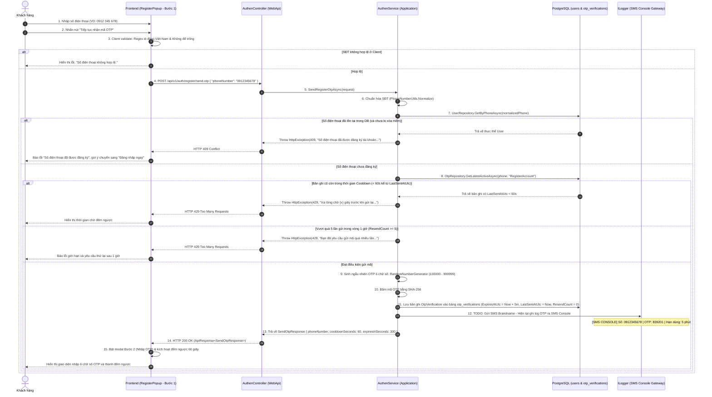
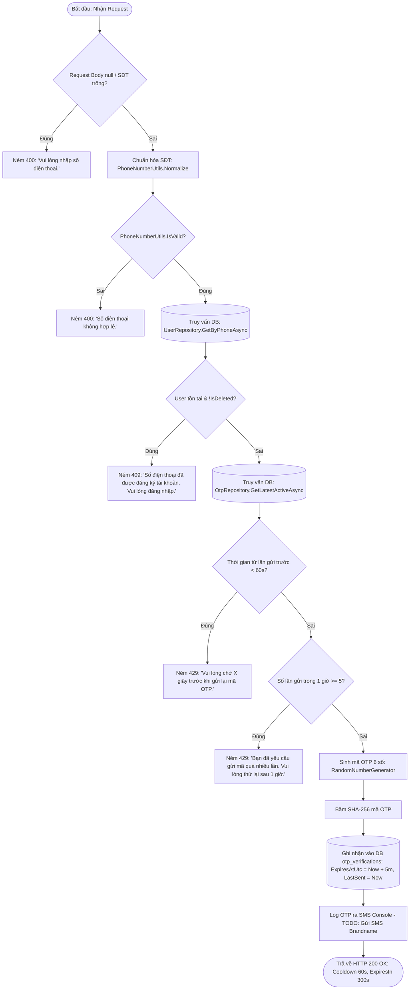

# API 01: YÊU CẦU GỬI MÃ XÁC THỰC SMS OTP LẦN ĐẦU (LƯU TRỮ DATABASE)

---

## I. TÊN TÀI LIỆU, TÍNH NĂNG & TỔNG QUAN

### 1.1. Thông tin tài liệu
- **Tên tài liệu:** Đặc tả chi tiết API Yêu cầu gửi mã xác thực SMS OTP đăng ký tài khoản (Lưu trữ Database)
- **Tính năng:** Đăng ký tài khoản (`register-account`) - Bước 1: Gửi mã OTP lần đầu
- **Tên API:** `SendRegisterOtp`
- **Phương thức & Endpoint:** `POST /api/v1/auth/register/send-otp`
- **Phiên bản:** `1.1.0` (Chuyển sang lưu trữ Database PostgreSQL)
- **Mục tiêu:** Tiếp nhận số điện thoại từ Frontend khi bắt đầu đăng ký, kiểm tra tính duy nhất trong hệ thống, thực thi chính sách chống spam đa tầng (Cooldown 60s, Hourly Quota, IP Rate Limit), sinh mã OTP ngẫu nhiên 6 chữ số, lưu trữ bản ghi vào bảng `otp_verifications` trong cơ sở dữ liệu PostgreSQL với thời hạn 5 phút và kích hoạt dịch vụ gửi SMS (trong giai đoạn phát triển: ghi log mã OTP ra SMS Console).

---

## II. FLOW CHART TOÀN BỘ LUỒNG (WORKFLOW DIAGRAM)

### 2.1. Sequence Diagram luồng gửi OTP lần đầu



### 2.2. Flowchart Logic rẽ nhánh tại Backend



---

## III. CHI TIẾT TỪNG BƯỚC XỬ LÝ (STEP-BY-STEP LOGIC)

### Bước 1: Kiểm tra tính hợp lệ và chuẩn hóa số điện thoại (Validate & Normalize)
1. **Kiểm tra rỗng:** Nếu `request.PhoneNumber` là `null` hoặc chuỗi khoảng trắng, ném `HttpException(400, MessageConstant.PhoneRequired)`.
2. **Chuẩn hóa định dạng:** Chuyển đổi số điện thoại thông qua hàm tĩnh `PhoneNumberUtils.Normalize(request.PhoneNumber)`:
   - Loại bỏ toàn bộ ký tự khoảng trắng, dấu gạch nối, dấu ngoặc.
   - Nếu bắt đầu bằng `+84` -> Chuyển thành `0`.
   - Nếu bắt đầu bằng `84` -> Chuyển thành `0`.
   - Kết quả thu được có định dạng chuỗi nội địa: `0xxxxxxxxx`.
3. **Validate số di động Việt Nam:** Sử dụng `PhoneNumberUtils.IsValid(phone)` (áp dụng Regex `^0[35789][0-9]{8}$`):
   - Đảm bảo đầu số thuộc dải mạng di động hợp lệ (Viettel, VinaPhone, MobiFone, Vietnamobile, Wintel, v.v.).
   - Độ dài cố định đúng 10 chữ số.
   - Nếu sai định dạng, ném `HttpException(400, MessageConstant.PhoneInvalid)`.

---

### Bước 2: Kiểm tra số điện thoại đã tồn tại trong Cơ sở dữ liệu (User Conflict Check)
1. Thực hiện truy vấn bất đồng bộ tới bảng `users`:
   ```csharp
   var existingUser = await userRepository.GetByPhoneAsync(normalizedPhone, cancellationToken);
   ```
2. Nếu `existingUser != null` và `!existingUser.IsDeleted`:
   - Số điện thoại đã được đăng ký và đang hoạt động.
   - Ném ngoại lệ `HttpException(409, MessageConstant.PhoneAlreadyRegistered)`:
     - Message hiển thị: `"Số điện thoại đã được đăng ký tài khoản. Vui lòng đăng nhập."`.
   - Lợi ích bảo mật & chi phí: Không phát sinh SMS OTP cho các số đã có tài khoản, đồng thời hướng người dùng sang form Đăng nhập.

---

### Bước 3: Kiểm tra chính sách chống Spam & Giới hạn tần suất từ Database (Anti-Spam Checks)
1. **Tầng Middleware (IP Rate Limiting):**
   - Áp dụng policy `auth-login` qua `[EnableRateLimiting("auth-login")]`.
   - Giới hạn tối đa 10 requests / 5 phút trên mỗi địa chỉ IP. Vượt quá sẽ bị chặn ở cấp độ mạng với HTTP 429.
2. **Tầng Database (Per-Phone Cooldown 60 giây):**
   - Truy vấn bản ghi OTP gần nhất của số điện thoại:
     ```csharp
     var latestOtp = await otpRepository.GetLatestActiveAsync(normalizedPhone, "RegisterAccount", cancellationToken);
     ```
   - Nếu bản ghi tồn tại và `(clock.UtcNow - latestOtp.LastSentAtUtc).TotalSeconds < 60`:
     - Tính số giây còn lại cần chờ: `remainingSeconds = 60 - (int)(clock.UtcNow - latestOtp.LastSentAtUtc).TotalSeconds`.
     - Ném ngoại lệ `HttpException(429, $"Vui lòng chờ {remainingSeconds} giây trước khi yêu cầu gửi lại mã OTP.")`.
3. **Tầng Database (Per-Phone Hourly Quota - Giới hạn giờ):**
   - Kiểm tra thuộc tính `latestOtp.ResendCount` trong khung cửa sổ trượt 1 giờ:
   - Nếu `latestOtp.ResendCount >= 5`:
     - Ném ngoại lệ `HttpException(429, "Bạn đã yêu cầu gửi mã OTP quá nhiều lần. Vui lòng thử lại sau 1 giờ.")`.

---

### Bước 4: Sinh mã OTP an toàn mật mã học (Cryptographic OTP Generation)
1. Sử dụng thư viện `System.Security.Cryptography.RandomNumberGenerator` để sinh ngẫu nhiên số nguyên an toàn trong khoảng `[100000, 999999]`:
   ```csharp
   var otpCode = RandomNumberGenerator.GetInt32(100000, 1000000).ToString("D6");
   ```
2. Tuyệt đối không dùng `Random` thông thường vì giá trị có thể dự đoán được (Pseudo-random).
3. Băm mã OTP bằng thuật toán SHA-256 trước khi lưu trữ nhằm chống rò rỉ khi kiểm tra cơ sở dữ liệu:
   ```csharp
   var otpHash = Convert.ToHexString(SHA256.HashData(Encoding.UTF8.GetBytes(otpCode)));
   ```

---

### Bước 5: Lưu trữ bản ghi OTP vào Database (PostgreSQL Persistence)
1. Nếu đã có bản ghi cũ chưa hết hạn, cập nhật lại hoặc tạo mới bản ghi `OtpVerification` trong cơ sở dữ liệu:
   ```csharp
   var otpRecord = new OtpVerification
   {
       Id = Guid.NewGuid(),
       Phone = normalizedPhone,
       OtpHash = otpHash,
       Purpose = "RegisterAccount",
       ExpiresAtUtc = clock.UtcNow.AddMinutes(5), // Hạn dùng: 5 phút
       LastSentAtUtc = clock.UtcNow,              // Mốc tính cooldown 60s
       ResendCount = 0,
       FailedAttempts = 0,
       IsVerified = false,
       CreatedAtUtc = clock.UtcNow,
       UpdatedAtUtc = clock.UtcNow
   };
   await otpRepository.CreateAsync(otpRecord, cancellationToken);
   ```
2. Dữ liệu được lưu vĩnh viễn cho đến khi được xác nhận hoặc được dọn dẹp tự động bởi `OtpCleanupBackgroundService`.

---

### Bước 6: Kênh gửi mã OTP (SMS Console Logger & TODO Notification)
1. Giai đoạn hiện tại (Development / Staging): Ghi mã OTP vào log hệ thống dưới định dạng SMS Gateway nổi bật để Developer/Tester dễ dàng kiểm tra mà không tốn chi phí viễn thông:
   ```csharp
   // TODO: Tích hợp dịch vụ SMS viễn thông (Twilio / eSMS / SpeedSMS / Vietguys) khi triển khai Production.
   // Hiện tại ghi log mã OTP ra SMS Console phục vụ môi trường phát triển & kiểm thử:
   logger.LogInformation("======================================================================");
   logger.LogInformation("[SMS CONSOLE GATEWAY] Gửi tin nhắn SMS đến: {PhoneNumber}", normalizedPhone);
   logger.LogInformation("[SMS CONSOLE GATEWAY] Nội dung: 'Ma xac thuc Nguyet Pho cua ban la {Otp}. Hieu luc 5 phut.'", otpCode);
   logger.LogInformation("[SMS CONSOLE GATEWAY] Thời gian phát hành: {IssuedAt:yyyy-MM-dd HH:mm:ss} UTC", clock.UtcNow);
   logger.LogInformation("======================================================================");
   ```

---

### Bước 7: Trả về kết quả phản hồi cho Frontend (HTTP Response Construction)
1. Đóng gói DTO `SendOtpResponse`:
   ```json
   {
     "phoneNumber": "0912345678",
     "cooldownSeconds": 60,
     "expiresInSeconds": 300
   }
   ```
2. Trả về mã `HTTP 200 OK` kèm `ApiResponse<SendOtpResponse>`:
   - `Message`: `"Mã xác thực OTP đã được gửi đến số điện thoại của bạn."`.
3. Frontend nhận kết quả thành công:
   - Chuyển `step = 2` trên giao diện `RegisterPopup`.
   - Bắt đầu bộ đếm thời gian lùi `countdown = 60` giây.
   - Vô hiệu hóa nút gửi lại trong 60 giây tiếp theo.

---

## IV. ĐẶC TẢ KỸ THUẬT API CONTRACT

### 4.1. Request Specifications
- **URL:** `/api/v1/auth/register/send-otp`
- **Method:** `POST`
- **Content-Type:** `application/json`
- **Authorization:** Không yêu cầu (Public Anonymous)
- **Rate Limit Policy:** `auth-login` (10 req/5 min)

#### Request Body
```json
{
  "phoneNumber": "0912345678"
}
```

### 4.2. Response Specifications

#### Phản hồi thành công (HTTP 200 OK)
```json
{
  "status": 200,
  "message": "Mã xác thực OTP đã được gửi đến số điện thoại của bạn.",
  "data": {
    "phoneNumber": "0912345678",
    "cooldownSeconds": 60,
    "expiresInSeconds": 300
  },
  "path": "/api/v1/auth/register/send-otp",
  "traceId": "a1b2c3d4e5f67890",
  "time": "2026-10-13T13:45:00.1234567Z"
}
```

#### Bảng thông điệp lỗi (Error Matrix)
| HTTP Status | Điều kiện kích hoạt | `message` hiển thị cho người dùng |
| :---: | :--- | :--- |
| `400 Bad Request` | Request Body rỗng hoặc không đúng JSON | `"Dữ liệu đăng ký không hợp lệ."` |
| `400 Bad Request` | Thiếu hoặc để trống trường `phoneNumber` | `"Vui lòng nhập số điện thoại."` |
| `400 Bad Request` | `phoneNumber` sai định dạng di động Việt Nam | `"Số điện thoại không hợp lệ."` |
| `409 Conflict` | Số điện thoại đã có tài khoản trong hệ thống | `"Số điện thoại đã được đăng ký tài khoản. Vui lòng đăng nhập."` |
| `429 Too Many Requests` | Yêu cầu gửi lại khi chưa hết 60 giây Cooldown | `"Vui lòng chờ {x} giây trước khi yêu cầu gửi lại mã OTP."` |
| `429 Too Many Requests` | Gửi quá 5 lần OTP cho 1 số trong vòng 1 giờ | `"Bạn đã yêu cầu gửi mã OTP quá nhiều lần. Vui lòng thử lại sau 1 giờ."` |
| `429 Too Many Requests` | IP vi phạm giới hạn Fixed Window Limiter | `"Bạn đã thử gửi yêu cầu quá nhiều lần. Vui lòng thử lại sau."` |
| `500 Server Error` | Lỗi ngoại lệ hệ thống ngoài dự kiến | `"Đã xảy ra lỗi hệ thống. Vui lòng thử lại sau."` |
