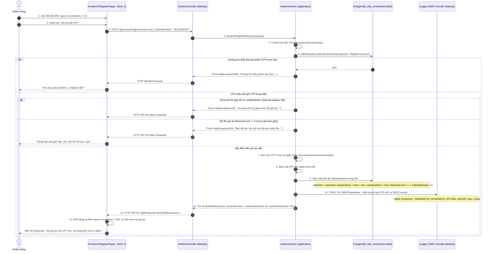

# API 02: YÊU CẦU GỬI LẠI MÃ XÁC THỰC SMS OTP (RESEND OTP)

---

## I. TÊN TÀI LIỆU, TÍNH NĂNG & TỔNG QUAN

### 1.1. Thông tin tài liệu
- **Tên tài liệu:** Đặc tả chi tiết API Yêu cầu gửi lại mã xác thực SMS OTP (Resend OTP)
- **Tính năng:** Đăng ký tài khoản (`register-account`) - Bước 2: Gửi lại mã OTP
- **Tên API:** `ResendRegisterOtp`
- **Phương thức & Endpoint:** `POST /api/v1/auth/register/resend-otp`
- **Phiên bản:** `1.0.0`
- **Mục tiêu:** Cho phép người dùng bấm "Gửi lại mã OTP" trên giao diện khi chưa nhận được tin nhắn sau khi hết 60 giây đếm ngược. Backend sẽ truy xuất bản ghi trong bảng `otp_verifications`, kiểm tra nghiêm ngặt quy tắc Cooldown 60s và giới hạn gửi lại (tối đa 5 lần), sinh mã OTP mới, cập nhật lại cơ sở dữ liệu, đặt lại bộ đếm số lần thử sai và ghi log mã OTP ra SMS Console (TODO: SMS Provider).

---

## II. FLOW CHART TOÀN BỘ LUỒNG (WORKFLOW DIAGRAM)

### 2.1. Sequence Diagram luồng gửi lại OTP



### 2.2. Flowchart Logic kiểm tra chi tiết tại Backend

```mermaid
flowchart TD
  Start([Nhận Request: phoneNumber]) --> V1{phoneNumber rỗng / sai định dạng?}
  V1 -- Có --> Err400_1[Ném 400: 'Số điện thoại không hợp lệ.']
  V1 -- Không --> Normalize[Chuẩn hóa SĐT: PhoneNumberUtils.Normalize]
  Normalize --> FindDB[(Truy vấn DB: OtpRepository.GetLatestActiveAsync)]
  FindDB --> ExistCheck{Bản ghi tồn tại & !IsDeleted?}
  ExistCheck -- Không --> Err400_2[Ném 400: 'Không tìm thấy phiên gửi OTP trước đó. Vui lòng thao tác lại.']
  ExistCheck -- Có --> CooldownCheck{Thời gian từ LastSentAtUtc < 60s?}
  CooldownCheck -- Đúng --> Err429_1[Ném 429: 'Vui lòng chờ X giây trước khi gửi lại mã OTP.']
  CooldownCheck -- Sai --> QuotaCheck{ResendCount >= 5?}
  QuotaCheck -- Đúng --> Err429_2[Ném 429: 'Bạn đã yêu cầu gửi lại mã OTP quá số lần cho phép (5 lần). Thử lại sau 1 giờ.']
  QuotaCheck -- Sai --> GenNewOtp[Sinh mã OTP 6 số mới & Hash SHA-256]
  GenNewOtp --> UpdateDB[(Cập nhật DB: OtpHash mới, ExpiresAtUtc = Now + 5m, LastSent = Now, ResendCount += 1, FailedAttempts = 0)]
  UpdateDB --> LogConsole[Log mã OTP mới ra SMS Console - TODO: SMS Provider]
  LogConsole --> Ret200([Trả về HTTP 200 OK: cooldownSeconds = 60, expiresInSeconds = 300])
```

---

## III. CHI TIẾT TỪNG BƯỚC XỬ LÝ (STEP-BY-STEP LOGIC)

### Bước 1: Kiểm tra tính hợp lệ và chuẩn hóa số điện thoại (Input Validation)
1. **Kiểm tra rỗng:** Nếu `request.PhoneNumber` rỗng hoặc khoảng trắng, ném `HttpException(400, MessageConstant.PhoneRequired)`.
2. **Chuẩn hóa định dạng:** Gọi `PhoneNumberUtils.Normalize(request.PhoneNumber)` đưa về chuẩn số nội địa `0xxxxxxxxx`.
3. **Kiểm tra định dạng di động Việt Nam:** Sử dụng `PhoneNumberUtils.IsValid(phone)`:
   - Nếu không thỏa mãn định dạng `^0[35789][0-9]{8}$`, ném `HttpException(400, MessageConstant.PhoneInvalid)`.

---

### Bước 2: Kiểm tra bản ghi phiên OTP trong Database (Session Record Verification)
1. Truy vấn cơ sở dữ liệu tìm bản ghi OTP đang hoạt động cho số điện thoại này:
   ```csharp
   var existingOtp = await otpRepository.GetLatestActiveAsync(normalizedPhone, "RegisterAccount", cancellationToken);
   ```
2. Nếu `existingOtp == null`:
   - Trường hợp người dùng chưa từng gọi API Bước 1 hoặc bản ghi đã bị xóa dọn dẹp.
   - Ném ngoại lệ `HttpException(400, MessageConstant.OtpSessionNotFound)`:
     - Message hiển thị: `"Không tìm thấy yêu cầu xác thực trước đó. Vui lòng quay lại bước nhập số điện thoại."`.

---

### Bước 3: Kiểm tra ràng buộc Cooldown 60 giây (Enforce 60-Second Cooldown)
1. Mặc dù giao diện Frontend đã có đồng hồ đếm ngược 60 giây để vô hiệu hóa nút bấm, Backend **bắt buộc** phải kiểm tra lại để phòng chống tấn công qua Postman / Script tự động.
2. Tính toán khoảng cách thời gian giữa thời điểm hiện tại và lần gửi gần nhất:
   ```csharp
   var secondsSinceLastSent = (clock.UtcNow - existingOtp.LastSentAtUtc).TotalSeconds;
   ```
3. Nếu `secondsSinceLastSent < 60`:
   - Tính số giây còn phải chờ: `var waitSeconds = 60 - (int)secondsSinceLastSent`.
   - Ném ngoại lệ `HttpException(429, $"Vui lòng chờ {waitSeconds} giây trước khi yêu cầu gửi lại mã OTP.")`.

---

### Bước 4: Kiểm tra giới hạn số lần gửi lại (Resend Quota Protection)
1. Kiểm tra thuộc tính `existingOtp.ResendCount`:
   - Nếu `existingOtp.ResendCount >= 5`:
     - Số điện thoại này đã yêu cầu gửi lại mã quá 5 lần liên tiếp.
     - Ném ngoại lệ `HttpException(429, "Bạn đã yêu cầu gửi lại mã OTP quá số lần cho phép (5 lần). Vui lòng thử lại sau 1 giờ.")`.
2. Giúp doanh nghiệp kiểm soát tối đa chi phí gửi tin nhắn SMS Brandname và ngăn chặn nguy cơ bị spammer dùng bot làm nghẽn gateway SMS.

---

### Bước 5: Sinh mã OTP mới an toàn (Generate New Cryptographic OTP)
1. Sinh chuỗi ngẫu nhiên gồm 6 chữ số mới từ `100000` đến `999999` bằng `RandomNumberGenerator`:
   ```csharp
   var newOtpCode = RandomNumberGenerator.GetInt32(100000, 1000000).ToString("D6");
   ```
2. Băm mã OTP bằng thuật toán SHA-256:
   ```csharp
   var newOtpHash = Convert.ToHexString(SHA256.HashData(Encoding.UTF8.GetBytes(newOtpCode)));
   ```

---

### Bước 6: Cập nhật bản ghi OTP trong Database (Update Database Entity)
1. Cập nhật trực tiếp trên thực thể `existingOtp` đang được theo dõi:
   ```csharp
   existingOtp.OtpHash = newOtpHash;
   existingOtp.ExpiresAtUtc = clock.UtcNow.AddMinutes(5); // Gia hạn thêm 5 phút kể từ thời điểm gửi lại
   existingOtp.LastSentAtUtc = clock.UtcNow;              // Đặt lại mốc tính Cooldown 60s
   existingOtp.ResendCount += 1;                          // Tăng số lượt gửi lại
   existingOtp.FailedAttempts = 0;                        // Reset số lần thử sai về 0
   existingOtp.UpdatedAtUtc = clock.UtcNow;

   await otpRepository.UpdateAsync(existingOtp, cancellationToken);
   ```
2. Lưu ý quan trọng: Việc reset `FailedAttempts = 0` giúp người dùng nếu lỡ nhập sai mã cũ quá số lần thì khi nhận mã mới vẫn có đủ 5 lượt nhập bình thường.

---

### Bước 7: Kênh gửi mã OTP mới (SMS Console Logger & TODO Notification)
1. Ghi log mã OTP mới ra console hệ thống phục vụ môi trường kiểm thử:
   ```csharp
   // TODO: Tích hợp dịch vụ SMS viễn thông (Twilio / eSMS / SpeedSMS / Vietguys) khi triển khai Production.
   // Hiện tại ghi log mã OTP gửi lại ra SMS Console phục vụ môi trường phát triển & kiểm thử:
   logger.LogInformation("======================================================================");
   logger.LogInformation("[SMS CONSOLE GATEWAY - RESEND] Gửi lại SMS OTP đến: {PhoneNumber}", normalizedPhone);
   logger.LogInformation("[SMS CONSOLE GATEWAY - RESEND] Mã OTP mới của bạn là: {Otp}", newOtpCode);
   logger.LogInformation("[SMS CONSOLE GATEWAY - RESEND] Lượt gửi lại thứ: {ResendCount}/5", existingOtp.ResendCount);
   logger.LogInformation("[SMS CONSOLE GATEWAY - RESEND] Hạn sử dụng mới: 5 phút");
   logger.LogInformation("======================================================================");
   ```

---

### Bước 8: Trả về kết quả và xử lý tại Frontend (Response & UI Handling)
1. Trả về DTO `SendOtpResponse` bọc trong `ApiResponse<SendOtpResponse>` với mã `HTTP 200 OK`:
   ```json
   {
     "status": 200,
     "message": "Đã gửi lại mã OTP mới. Vui lòng kiểm tra tin nhắn!",
     "data": {
       "phoneNumber": "0912345678",
       "cooldownSeconds": 60,
       "expiresInSeconds": 300
     }
   }
   ```
2. Phía Frontend:
   - Reset đồng hồ `countdown = 60` giây.
   - Vô hiệu hóa nút "Gửi lại mã OTP" và hiển thị văn bản `"Gửi lại sau 60s"`.
   - Hiển thị toast/banner màu xanh thành công: `"Đã gửi lại mã OTP mới. Vui lòng kiểm tra tin nhắn!"`.

---

## IV. ĐẶC TẢ KỸ THUẬT API CONTRACT

### 4.1. Request Specifications
- **URL:** `/api/v1/auth/register/resend-otp`
- **Method:** `POST`
- **Content-Type:** `application/json`
- **Authorization:** Không yêu cầu (Public Anonymous)
- **Rate Limit Policy:** `auth-login` (10 req/5 min)

#### Request Body
```json
{
  "phoneNumber": "0912345678"
}
```

### 4.2. Response Specifications

#### Phản hồi thành công (HTTP 200 OK)
```json
{
  "status": 200,
  "message": "Đã gửi lại mã OTP mới. Vui lòng kiểm tra tin nhắn!",
  "data": {
    "phoneNumber": "0912345678",
    "cooldownSeconds": 60,
    "expiresInSeconds": 300
  },
  "path": "/api/v1/auth/register/resend-otp",
  "traceId": "c4d5e6f789012345",
  "time": "2026-10-13T13:46:00.1234567Z"
}
```

#### Bảng thông điệp lỗi (Error Matrix)
| HTTP Status | Điều kiện kích hoạt | `message` hiển thị cho người dùng |
| :---: | :--- | :--- |
| `400 Bad Request` | Request Body rỗng hoặc thiếu `phoneNumber` | `"Vui lòng nhập số điện thoại."` |
| `400 Bad Request` | `phoneNumber` sai định dạng di động Việt Nam | `"Số điện thoại không hợp lệ."` |
| `400 Bad Request` | Không tìm thấy bản ghi phiên gửi OTP trước đó | `"Không tìm thấy yêu cầu xác thực trước đó. Vui lòng quay lại bước nhập số điện thoại."` |
| `429 Too Many Requests` | Bấm gửi lại khi chưa hết 60 giây Cooldown | `"Vui lòng chờ {x} giây trước khi yêu cầu gửi lại mã OTP."` |
| `429 Too Many Requests` | Gửi lại quá số lần cho phép (ResendCount >= 5) | `"Bạn đã yêu cầu gửi lại mã OTP quá số lần cho phép (5 lần). Vui lòng thử lại sau 1 giờ."` |
| `429 Too Many Requests` | IP vi phạm giới hạn Fixed Window Limiter | `"Bạn đã thử gửi yêu cầu quá nhiều lần. Vui lòng thử lại sau."` |
| `500 Server Error` | Lỗi ngoại lệ hệ thống ngoài dự kiến | `"Đã xảy ra lỗi hệ thống. Vui lòng thử lại sau."` |
