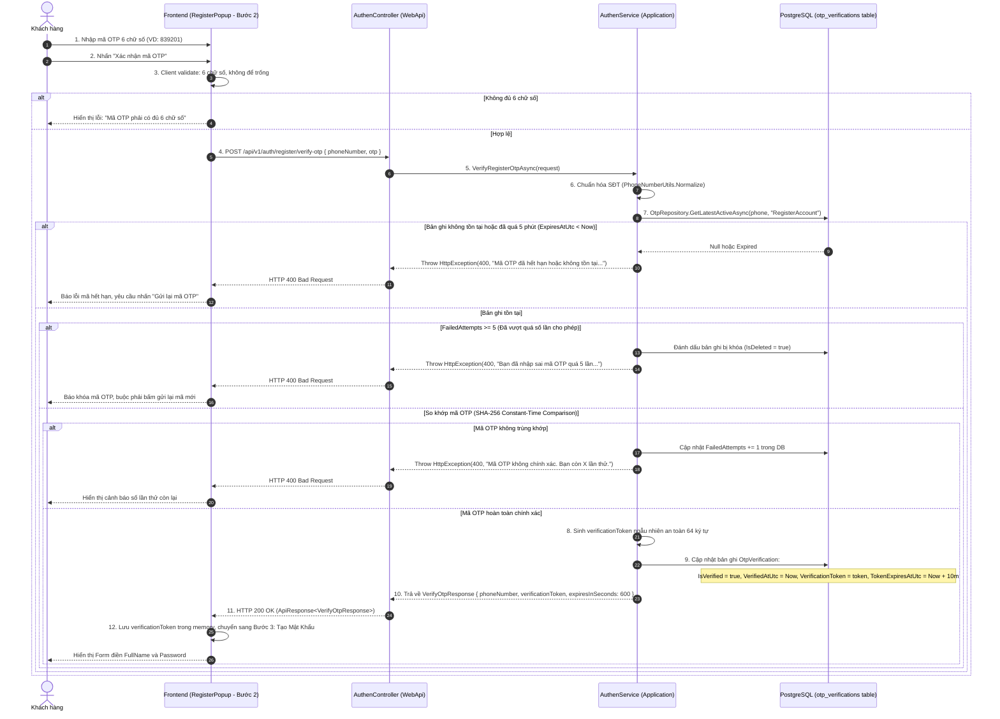
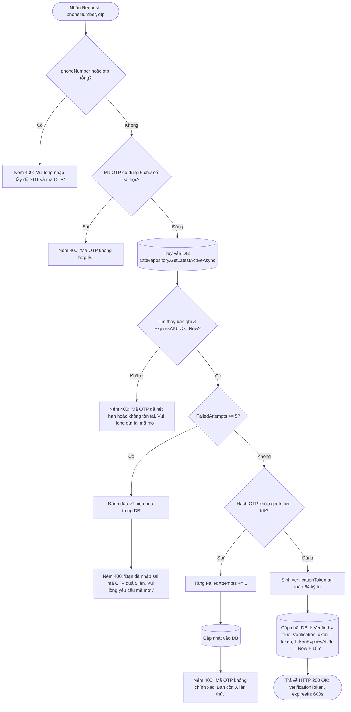

# API 03: XÁC THỰC MÃ OTP & CẤP TOKEN CHUYỂN BƯỚC (LƯU TRỮ DATABASE)

---

## I. TÊN TÀI LIỆU, TÍNH NĂNG & TỔNG QUAN

### 1.1. Thông tin tài liệu
- **Tên tài liệu:** Đặc tả chi tiết API Xác thực mã OTP SMS và Cấp mã phiên chuyển bước đăng ký (Lưu trữ Database)
- **Tính năng:** Đăng ký tài khoản (`register-account`) - Bước 3: Xác thực mã OTP
- **Tên API:** `VerifyRegisterOtp`
- **Phương thức & Endpoint:** `POST /api/v1/auth/register/verify-otp`
- **Phiên bản:** `1.1.0` (Lưu trữ trạng thái và token trong Database PostgreSQL)
- **Mục tiêu:** Nhận mã OTP 6 chữ số và số điện thoại từ Client, truy vấn bản ghi trong bảng `otp_verifications`, kiểm tra thời hạn và so khớp mã băm SHA-256. Xử lý khóa Brute-force nếu nhập sai quá 5 lần. Khi xác thực thành công, cập nhật `is_verified = true`, sinh `verificationToken` ngẫu nhiên an toàn lưu trực tiếp vào cơ sở dữ liệu với thời hạn 10 phút để ủy quyền cho Bước 4 (Tạo tài khoản).

---

## II. FLOW CHART TOÀN BỘ LUỒNG (WORKFLOW DIAGRAM)

### 2.1. Sequence Diagram luồng xác thực OTP



### 2.2. Flowchart Logic kiểm tra chi tiết tại Backend



---

## III. CHI TIẾT TỪNG BƯỚC XỬ LÝ (STEP-BY-STEP LOGIC)

### Bước 1: Kiểm tra tính toàn vẹn và định dạng dữ liệu đầu vào (Input Validation)
1. **Kiểm tra rỗng:**
   - Nếu `request.PhoneNumber` rỗng: Ném `HttpException(400, MessageConstant.PhoneRequired)`.
   - Nếu `request.Otp` rỗng: Ném `HttpException(400, MessageConstant.OtpRequired)`.
2. **Chuẩn hóa số điện thoại:** Áp dụng `PhoneNumberUtils.Normalize(request.PhoneNumber)` để đảm bảo đồng nhất định dạng.
3. **Validate định dạng mã OTP:**
   - Mã OTP bắt buộc có độ dài đúng 6 ký tự số: Regex `^[0-9]{6}$`.
   - Nếu chứa chữ cái, ký tự đặc biệt hoặc độ dài khác 6, ném `HttpException(400, MessageConstant.OtpInvalid)`.

---

### Bước 2: Truy xuất bản ghi OTP từ Cơ sở dữ liệu (Database Record Retrieval)
1. Thực hiện truy vấn cơ sở dữ liệu tới bảng `otp_verifications`:
   ```csharp
   var otpRecord = await otpRepository.GetLatestActiveAsync(normalizedPhone, "RegisterAccount", cancellationToken);
   ```
2. Kiểm tra sự tồn tại và thời hạn:
   - Nếu `otpRecord == null` hoặc `otpRecord.ExpiresAtUtc < clock.UtcNow`:
     - Mã đã hết hạn 5 phút hoặc người dùng chưa từng yêu cầu gửi mã.
     - Ném ngoại lệ `HttpException(400, MessageConstant.OtpExpiredOrNotFound)`:
       - Message hiển thị: `"Mã OTP đã hết hạn hoặc không tồn tại. Vui lòng gửi lại mã mới."`.

---

### Bước 3: Kiểm tra giới hạn số lần nhập sai (Brute-Force Attack Prevention)
1. Kiểm tra thuộc tính `otpRecord.FailedAttempts`:
   - Nếu `otpRecord.FailedAttempts >= 5`:
     - Mã OTP này đã bị nhập sai quá 5 lần liên tiếp.
     - Đánh dấu bản ghi bị hủy hoặc xóa mềm:
       ```csharp
       otpRecord.IsDeleted = true;
       await otpRepository.UpdateAsync(otpRecord, cancellationToken);
       ```
     - Ném ngoại lệ `HttpException(400, MessageConstant.OtpMaxAttemptsExceeded)`:
       - Message hiển thị: `"Bạn đã nhập sai mã OTP quá 5 lần. Mã xác thực đã bị vô hiệu hóa, vui lòng yêu cầu mã mới."`.

---

### Bước 4: So khớp mã xác thực mật mã học (Cryptographic Comparison)
1. Thực hiện băm SHA-256 chuỗi OTP do người dùng nhập vào:
   ```csharp
   var inputHash = Convert.ToHexString(SHA256.HashData(Encoding.UTF8.GetBytes(request.Otp.Trim())));
   ```
2. So sánh giá trị `inputHash` với `otpRecord.OtpHash` bằng hàm `CryptographicOperations.FixedTimeEquals`:
   ```csharp
   var isMatch = CryptographicOperations.FixedTimeEquals(
       Encoding.UTF8.GetBytes(inputHash),
       Encoding.UTF8.GetBytes(otpRecord.OtpHash)
   );
   ```
3. **Xử lý khi mã OTP không trùng khớp (Mismatch):**
   - Tăng số lần thử sai: `otpRecord.FailedAttempts += 1; otpRecord.UpdatedAtUtc = clock.UtcNow;`.
   - Lưu lại vào cơ sở dữ liệu: `await otpRepository.UpdateAsync(otpRecord, cancellationToken);`.
   - Số lần thử còn lại: `remaining = 5 - otpRecord.FailedAttempts`.
   - Ném ngoại lệ `HttpException(400, $"Mã OTP không chính xác. Bạn còn {remaining} lần thử.")`.

---

### Bước 5: Cập nhật trạng thái xác thực & Cấp `verificationToken` trong Database (Database Update)
1. Khi mã OTP hoàn toàn chính xác:
   - Sinh mã xác thực phiên ngẫu nhiên bảo mật 64 ký tự:
     ```csharp
     var verificationToken = Guid.NewGuid().ToString("N") + RandomNumberGenerator.GetHexString(32);
     ```
   - Cập nhật trực tiếp vào bản ghi `otpRecord`:
     ```csharp
     otpRecord.IsVerified = true;
     otpRecord.VerifiedAtUtc = clock.UtcNow;
     otpRecord.VerificationToken = verificationToken;
     otpRecord.TokenExpiresAtUtc = clock.UtcNow.AddMinutes(10); // Hiệu lực 10 phút để người dùng hoàn tất form
     otpRecord.UpdatedAtUtc = clock.UtcNow;

     await otpRepository.UpdateAsync(otpRecord, cancellationToken);
     ```
2. Dữ liệu token nằm an toàn trong Database, có thể truy xuất xác thực ở Bước 4 ngay cả khi backend được scale nhiều cụm máy chủ.

---

### Bước 6: Trả về kết quả và chuyển màn hình tại Frontend (Response & UI Transition)
1. Trả về DTO `VerifyOtpResponse` bọc trong `ApiResponse<VerifyOtpResponse>` với mã `HTTP 200 OK`:
   ```json
   {
     "phoneNumber": "0912345678",
     "verificationToken": "7f8b9c0d1e2f3a4b5c6d7e8f9a0b1c2d3e4f5a6b7c8d9e0f1a2b3c4d5e6f7a8b",
     "expiresInSeconds": 600
   }
   ```
2. Phía Frontend:
   - Lưu trữ `verificationToken` vào React Component state (không lưu vào `localStorage` công khai để đảm bảo an toàn).
   - Chuyển `step = 3` trên giao diện `RegisterPopup` (Form "Tạo Mật Khẩu & Thông Tin").
   - Hiển thị thông báo thành công: `"Xác thực số điện thoại thành công!"`.

---

## IV. ĐẶC TẢ KỸ THUẬT API CONTRACT

### 4.1. Request Specifications
- **URL:** `/api/v1/auth/register/verify-otp`
- **Method:** `POST`
- **Content-Type:** `application/json`
- **Authorization:** Không yêu cầu (Public Anonymous)

#### Request Body
```json
{
  "phoneNumber": "0912345678",
  "otp": "839201"
}
```

### 4.2. Response Specifications

#### Phản hồi thành công (HTTP 200 OK)
```json
{
  "status": 200,
  "message": "Xác thực mã OTP thành công.",
  "data": {
    "phoneNumber": "0912345678",
    "verificationToken": "7f8b9c0d1e2f3a4b5c6d7e8f9a0b1c2d3e4f5a6b7c8d9e0f1a2b3c4d5e6f7a8b",
    "expiresInSeconds": 600
  },
  "path": "/api/v1/auth/register/verify-otp",
  "traceId": "b2c3d4e5f6789012",
  "time": "2026-10-13T13:46:15.6543210Z"
}
```

#### Bảng thông điệp lỗi (Error Matrix)
| HTTP Status | Điều kiện kích hoạt | `message` hiển thị cho người dùng |
| :---: | :--- | :--- |
| `400 Bad Request` | Thiếu `phoneNumber` hoặc `otp` trong body | `"Dữ liệu xác thực không hợp lệ."` |
| `400 Bad Request` | `otp` không đúng định dạng 6 chữ số | `"Mã xác thực OTP phải gồm 6 chữ số."` |
| `400 Bad Request` | Mã OTP đã hết hạn (> 5 phút) hoặc không tồn tại trong DB | `"Mã OTP đã hết hạn hoặc không tồn tại. Vui lòng gửi lại mã mới."` |
| `400 Bad Request` | Nhập sai mã OTP từ lần 1 đến lần 4 | `"Mã OTP không chính xác. Bạn còn {X} lần thử."` |
| `400 Bad Request` | Nhập sai mã OTP quá 5 lần | `"Bạn đã nhập sai mã OTP quá 5 lần. Mã xác thực đã bị vô hiệu hóa, vui lòng yêu cầu mã mới."` |
| `500 Server Error` | Lỗi ngoại lệ hệ thống ngoài dự kiến | `"Đã xảy ra lỗi hệ thống. Vui lòng thử lại sau."` |
