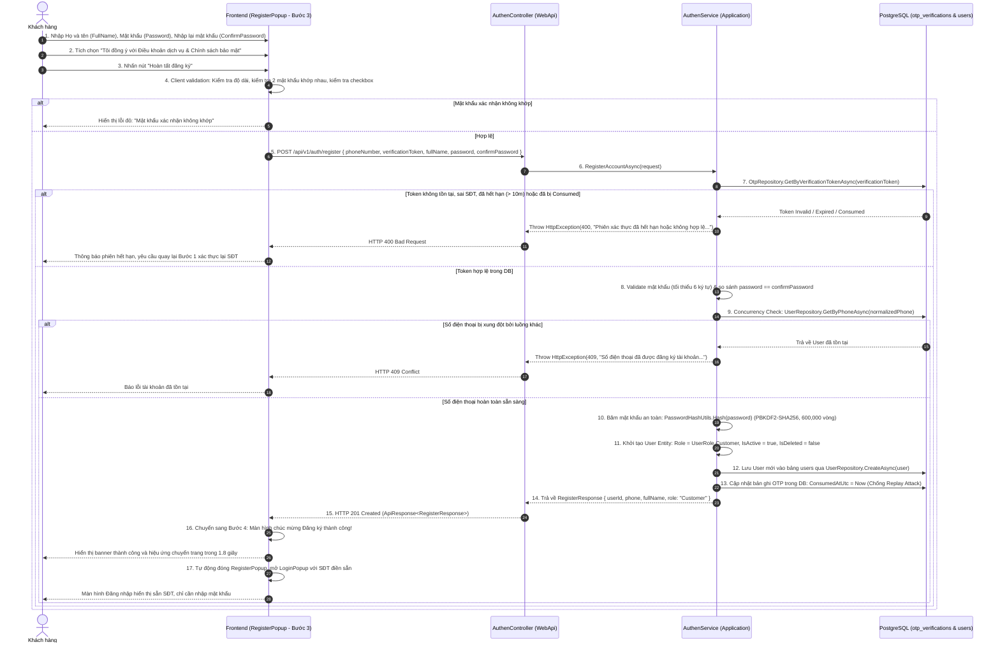
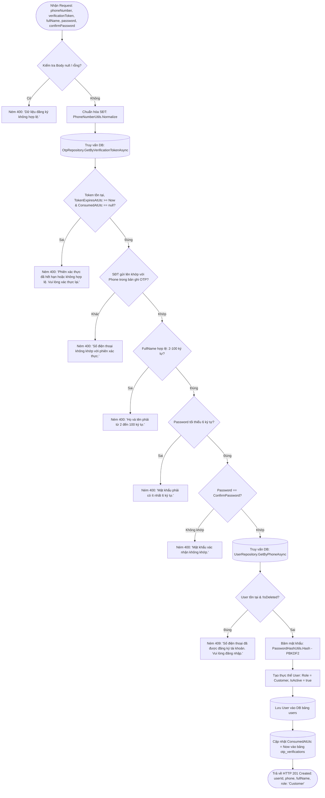

# API 04: HOÀN TẤT ĐĂNG KÝ TÀI KHOẢN (FULLNAME, PASSWORD & ROLE CUSTOMER)

---

## I. TÊN TÀI LIỆU, TÍNH NĂNG & TỔNG QUAN

### 1.1. Thông tin tài liệu
- **Tên tài liệu:** Đặc tả chi tiết API Hoàn tất đăng ký tài khoản người dùng (Xác thực Token Database)
- **Tính năng:** Đăng ký tài khoản (`register-account`) - Bước 4: Điền thông tin & Tạo tài khoản
- **Tên API:** `RegisterAccount`
- **Phương thức & Endpoint:** `POST /api/v1/auth/register`
- **Phiên bản:** `1.1.0` (Thẩm định token từ bảng `otp_verifications` trong PostgreSQL)
- **Mục tiêu:** Tiếp nhận thông tin người dùng (`phoneNumber`, `verificationToken`, `fullName`, `password`, `confirmPassword`), đối soát tính hợp lệ của `verificationToken` trực tiếp từ bảng cơ sở dữ liệu `otp_verifications`, băm mật khẩu an toàn theo chuẩn PBKDF2-SHA256, lưu thông tin vào bảng `users` với vai trò mặc định là `UserRole.Customer` (`Customer`), trạng thái kích hoạt `IsActive = true`, đánh dấu `consumed_at_utc` cho bản ghi OTP và hướng dẫn Frontend chuyển về màn hình đăng nhập với số điện thoại điền sẵn.

---

## II. FLOW CHART TOÀN BỘ LUỒNG (WORKFLOW DIAGRAM)

### 2.1. Sequence Diagram luồng tạo tài khoản



### 2.2. Flowchart Logic kiểm tra chi tiết tại Backend



---

## III. CHI TIẾT TỪNG BƯỚC XỬ LÝ (STEP-BY-STEP LOGIC)

### Bước 1: Kiểm tra tính toàn vẹn của Request Body (Body Validation)
1. Kiểm tra đối tượng `request` không được `null`.
2. Kiểm tra các trường bắt buộc không được để trống:
   - `request.PhoneNumber`: Bắt buộc.
   - `request.VerificationToken`: Bắt buộc.
   - `request.FullName`: Bắt buộc.
   - `request.Password`: Bắt buộc.
   - `request.ConfirmPassword`: Bắt buộc.
3. Nếu bất kỳ trường nào bị thiếu, ném `HttpException(400, MessageConstant.InvalidRegisterData)` (`"Dữ liệu đăng ký không đầy đủ."`).

---

### Bước 2: Thẩm định mã ủy quyền chuyển bước từ Database (`verificationToken` Verification)
1. Truy vấn cơ sở dữ liệu bảng `otp_verifications`:
   ```csharp
   var otpRecord = await otpRepository.GetByVerificationTokenAsync(request.VerificationToken, cancellationToken);
   ```
2. Thẩm định 4 điều kiện nghiêm ngặt:
   - **Tồn tại:** `otpRecord != null`.
   - **Còn hạn 10 phút:** `otpRecord.TokenExpiresAtUtc >= clock.UtcNow`.
   - **Chưa từng sử dụng:** `otpRecord.ConsumedAtUtc == null`.
   - **Số điện thoại trùng khớp:** `otpRecord.Phone == normalizedPhone`.
3. Nếu bất kỳ điều kiện nào không thỏa mãn:
   - Ném ngoại lệ `HttpException(400, MessageConstant.VerificationSessionExpired)`:
     - Message: `"Phiên xác thực số điện thoại đã hết hạn hoặc không hợp lệ. Vui lòng xác thực lại từ đầu."`.

---

### Bước 3: Kiểm tra nghiệp vụ họ tên và mật khẩu người dùng (User Details Validation)
1. **Kiểm tra Họ và tên (`FullName`):**
   - Cắt khoảng trắng đầu cuối: `var cleanFullName = request.FullName.Trim()`.
   - Độ dài tối thiểu: 2 ký tự; Độ dài tối đa: 100 ký tự.
   - Nếu vi phạm, ném `HttpException(400, MessageConstant.FullNameInvalid)` (`"Họ và tên phải có từ 2 đến 100 ký tự."`).
2. **Kiểm tra Mật khẩu (`Password`):**
   - Độ dài tối thiểu: 6 ký tự.
   - Nếu nhỏ hơn 6 ký tự, ném `HttpException(400, MessageConstant.PasswordTooShort)` (`"Mật khẩu phải có ít nhất 6 ký tự."`).
3. **Kiểm tra Mật khẩu xác nhận (`ConfirmPassword`):**
   - So sánh chuỗi: `request.Password == request.ConfirmPassword`.
   - Nếu không trùng khớp, ném `HttpException(400, MessageConstant.PasswordMismatch)` (`"Mật khẩu xác nhận không khớp."`).

---

### Bước 4: Kiểm tra xung đột dữ liệu lần cuối (Double Check Concurrency)
1. Trước khi ghi xuống Database, thực hiện truy vấn kiểm tra trùng lặp lần cuối:
   ```csharp
   var existingUser = await userRepository.GetByPhoneAsync(normalizedPhone, cancellationToken);
   ```
2. Nếu `existingUser != null` và `!existingUser.IsDeleted`:
   - Ném ngoại lệ `HttpException(409, MessageConstant.PhoneAlreadyRegistered)`:
     - Message: `"Số điện thoại đã được đăng ký tài khoản. Vui lòng đăng nhập."`.

---

### Bước 5: Băm mật khẩu chuẩn PBKDF2-SHA256 (Password Hashing)
1. Nền tảng áp dụng hàm băm bảo mật cao cấp trong `PasswordHashUtils.Hash(password)`:
   - Thuật toán: `PBKDF2` (Password-Based Key Derivation Function 2) với hàm băm `SHA256`.
   - Số vòng lặp (Iterations): `600,000` vòng.
   - Muối ngẫu nhiên (Salt): `16 bytes` sinh qua `RandomNumberGenerator.GetBytes(16)`.
   - Chiều dài khóa băm (Derived Hash): `32 bytes`.
   - Định dạng lưu trữ: `pbkdf2-sha256$600000$<Base64Salt>$<Base64Hash>`.
2. Tuyệt đối không lưu mật khẩu ở dạng plain-text hoặc Base64 thông thường.

---

### Bước 6: Khởi tạo thực thể User & Gán quyền mặc định (Entity Initialization)
1. Khởi tạo đối tượng `User` theo đúng kiến trúc Clean Architecture:
   ```csharp
   var newUser = new User
   {
       Id = Guid.NewGuid(),
       Phone = normalizedPhone,
       FullName = cleanFullName,
       PasswordHash = PasswordHashUtils.Hash(request.Password),
       Email = string.Empty,              // Mặc định rỗng đối với người dùng đăng ký qua SĐT
       Role = UserRole.Customer,          // BẮT BUỘC: ROLE MẶC ĐỊNH LÀ CUSTOMER
       IsActive = true,                   // Kích hoạt ngay lập tức vì SĐT đã được xác minh qua OTP
       IsDeleted = false,                 // Chưa xóa mềm
       CreatedAtUtc = clock.UtcNow,       // Chuẩn thời gian UTC
       UpdatedAtUtc = clock.UtcNow
   };
   ```
2. **Lưu ý về ràng buộc trường `email` trong Database:**
   - Trong schema hiện tại của PostgreSQL, nếu DB áp đặt ràng buộc `UNIQUE` và `NOT NULL`, hệ thống sẽ gán tạm thời `$"{normalizedPhone}@customer.mooncake.local"` để tránh lỗi vi phạm Unique index. Người dùng có thể cập nhật email chính thức sau trong trang cá nhân.

---

### Bước 7: Lưu User và Tiêu thụ Token trong Database Transaction (Atomic Persistence)
1. Thực thi trong một Database Transaction đảm bảo tính toàn vẹn:
   ```csharp
   await using var transaction = await dbContext.Database.BeginTransactionAsync(cancellationToken);
   try
   {
       // 1. Tạo User trong bảng users
       await userRepository.CreateAsync(newUser, cancellationToken);

       // 2. Đánh dấu consumed_at_utc cho bản ghi OTP trong bảng otp_verifications
       otpRecord.ConsumedAtUtc = clock.UtcNow;
       otpRecord.UpdatedAtUtc = clock.UtcNow;
       await otpRepository.UpdateAsync(otpRecord, cancellationToken);

       await transaction.CommitAsync(cancellationToken);
   }
   catch
   {
       await transaction.RollbackAsync(cancellationToken);
       throw;
   }
   ```
2. Đảm bảo nếu tạo User lỗi thì token không bị hủy; ngược lại nếu tạo User thành công thì token bị hủy vĩnh viễn, chống mọi nỗ lực Replay Attack.

---

### Bước 8: Trả về kết quả cho Frontend (HTTP Response Construction)
1. Đóng gói DTO phản hồi `RegisterResponse`:
   ```json
   {
     "userId": "e6a1b2c3-d4e5-4a6b-8c7d-9e0f1a2b3c4d",
     "phone": "0912345678",
     "fullName": "Nguyễn Văn A",
     "role": "Customer"
   }
   ```
2. Trả về mã `HTTP 201 Created` với message tiếng Việt: `"Đăng ký tài khoản thành công."`.

---

### Bước 9: Xử lý giao diện Frontend & Chuyển sang màn hình Đăng nhập (UX Flow)
1. **Bước 4 trên Frontend (Màn hình thành công):**
   - Modal hiển thị icon tích xanh animated, thông báo:
     `"Đăng ký tài khoản thành công! Đang chuyển về màn hình đăng nhập..."`.
   - Thanh tiến trình chạy trong 1.8 giây (`setTimeout 1800ms`).
2. **Tự động chuyển tiếp (Redirect to Login):**
   - Kích hoạt callback `onSwitchToLogin(phone)`.
   - Tắt `RegisterPopup` (`setShowRegister(false)`).
   - Mở `LoginPopup` (`setShowLogin(true)`).
   - Truyền sẵn giá trị `phone` vào state `initialPhone` của `LoginPopup`, focus thẳng vào ô nhập mật khẩu.
   - Người dùng chỉ cần nhập lại mật khẩu vừa tạo để đăng nhập lấy `accessToken` và `refreshToken`.

---

## IV. ĐẶC TẢ KỸ THUẬT API CONTRACT

### 4.1. Request Specifications
- **URL:** `/api/v1/auth/register`
- **Method:** `POST`
- **Content-Type:** `application/json`
- **Authorization:** Không yêu cầu (Public Anonymous)

#### Request Body
```json
{
  "phoneNumber": "0912345678",
  "verificationToken": "7f8b9c0d1e2f3a4b5c6d7e8f9a0b1c2d3e4f5a6b7c8d9e0f1a2b3c4d5e6f7a8b",
  "fullName": "Nguyễn Văn A",
  "password": "Password@123",
  "confirmPassword": "Password@123"
}
```

### 4.2. Response Specifications

#### Phản hồi thành công (HTTP 201 Created)
```json
{
  "status": 201,
  "message": "Đăng ký tài khoản thành công.",
  "data": {
    "userId": "e6a1b2c3-d4e5-4a6b-8c7d-9e0f1a2b3c4d",
    "phone": "0912345678",
    "fullName": "Nguyễn Văn A",
    "role": "Customer"
  },
  "path": "/api/v1/auth/register",
  "traceId": "c3d4e5f678901234",
  "time": "2026-10-13T13:47:30.9876543Z"
}
```

#### Bảng thông điệp lỗi (Error Matrix)
| HTTP Status | Điều kiện kích hoạt | `message` hiển thị cho người dùng |
| :---: | :--- | :--- |
| `400 Bad Request` | Body rỗng hoặc thiếu trường bắt buộc | `"Dữ liệu đăng ký không đầy đủ."` |
| `400 Bad Request` | `verificationToken` không hợp lệ, đã bị tiêu thụ hoặc quá 10 phút | `"Phiên xác thực số điện thoại đã hết hạn hoặc không hợp lệ. Vui lòng xác thực lại từ đầu."` |
| `400 Bad Request` | `phoneNumber` gửi lên khác với SĐT đã xác thực OTP trong DB | `"Số điện thoại không khớp với phiên xác thực mã OTP."` |
| `400 Bad Request` | `fullName` để trống hoặc độ dài ngoài khoảng [2, 100] | `"Họ và tên phải có từ 2 đến 100 ký tự."` |
| `400 Bad Request` | `password` có độ dài dưới 6 ký tự | `"Mật khẩu phải có ít nhất 6 ký tự."` |
| `400 Bad Request` | `password` và `confirmPassword` không trùng khớp | `"Mật khẩu xác nhận không khớp."` |
| `409 Conflict` | Số điện thoại đã được đăng ký trong hệ thống | `"Số điện thoại đã được đăng ký tài khoản. Vui lòng đăng nhập."` |
| `500 Server Error` | Lỗi ngoại lệ hệ thống ngoài dự kiến | `"Đã xảy ra lỗi hệ thống. Vui lòng thử lại sau."` |
