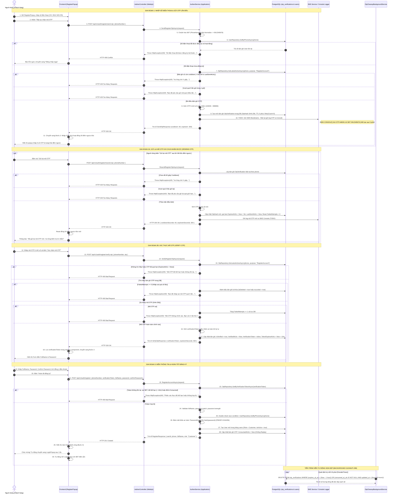

# [REGISTER-ACCOUNT] - TÀI LIỆU THIẾT KẾ CHI TIẾT TỔNG THỂ (OVERVIEW DETAIL DESIGN)

---

## I. TÊN TÀI LIỆU, TÍNH NĂNG & TỔNG QUAN HỆ THỐNG

### 1.1. Thông tin tài liệu
- **Tên tài liệu:** Thiết kế chi tiết tính năng Đăng ký tài khoản người dùng qua Số điện thoại & SMS OTP (Lưu trữ Database & Background Cleanup Job)
- **Mã tính năng:** `register-account`
- **Mô-đun:** Authentication & Authorization (`AuthenController` / `AuthenService`)
- **Phiên bản:** `1.1.0` (Cập nhật lưu trữ Database & Background Worker Service)
- **Hệ thống liên quan:**
  - Backend: `mooncake-ecommerce-platform` (ASP.NET Core 8 Web API - Clean Architecture)
  - Frontend: `mooncake-fe` (React 19, Tailwind CSS Luxury Theme, Axios apiClient)
- **Ngày lập:** 13/10/2026
- **Trạng thái:** `Under Review` (Chờ duyệt thiết kế kỹ thuật)

### 1.2. Mục tiêu nghiệp vụ (Business Objectives)
1. **Lưu trữ bền vững trong Database (Database-backed OTP Persistence):** Thay vì chỉ lưu bộ nhớ tạm thời RAM (`IMemoryCache`), toàn bộ phiên xác thực OTP và mã phiên đăng ký được lưu vào bảng cơ sở dữ liệu PostgreSQL `otp_verifications`. Đảm bảo tính nhất quán dữ liệu khi triển khai môi trường nhiều máy chủ (Multi-instance / Load Balancing) hoặc khi khởi động lại backend.
2. **Cơ chế dọn dẹp dữ liệu tự động (Background Worker Cleanup Service):** Xây dựng một Hosted Service nền `OtpCleanupBackgroundService` chạy định kỳ (quét mỗi 15 hoặc 30 phút) để tự động xóa sạch các bản ghi OTP đã hết hạn (`expires_at_utc < now`) hoặc đã sử dụng (`consumed_at_utc is not null`), giữ cho bảng `otp_verifications` luôn gọn nhẹ, tối ưu hóa dung lượng lưu trữ và tốc độ truy vấn.
3. **API Gửi lại OTP riêng biệt (Dedicated Resend OTP Endpoint):** Cung cấp API `POST /api/v1/auth/register/resend-otp` chuyên biệt cho nút bấm "Gửi lại mã OTP" trên giao diện popup, có logic quản lý số lần gửi lại, reset số lần thử sai, gia hạn thời gian sống và bảo vệ chống spam nghiêm ngặt (Cooldown 60s & Quota giờ).
4. **Chống lạm dụng & Spam SMS (Anti-Spam Cost Protection):**
   - **Cooldown 60 giây:** Mỗi số điện thoại chỉ được yêu cầu gửi/gửi lại OTP sau tối thiểu 60 giây kể từ lần gửi trước.
   - **Giới hạn số lần gửi (Rate Limit):** Tối đa 5 lượt yêu cầu OTP / số điện thoại trong 1 giờ; và IP Rate Limit 10 yêu cầu / 5 phút.
   - **Chống brute-force OTP:** Tối đa 5 lần nhập sai mã OTP; vượt quá sẽ hủy bỏ mã OTP ngay lập tức và bắt buộc yêu cầu mã mới.
5. **Bảo mật chuyển bước (Zero-Trust Step Transition):** Người dùng không thể bỏ qua bước xác thực OTP để gọi thẳng API đăng ký; Backend sinh một `verificationToken` một lần dùng có thời hạn 10 phút lưu trực tiếp vào bản ghi DB gắn chặt với số điện thoại đã xác minh.
6. **Phân quyền mặc định an toàn:** Tài khoản tạo mới thành công được gán vai trò mặc định là `UserRole.Customer` (`Customer`), trạng thái kích hoạt `IsActive = true`, mật khẩu băm PBKDF2-SHA256 theo chuẩn bảo mật cao nhất của nền tảng.
7. **Tích hợp SMS giai đoạn phát triển:** Ở giai đoạn này ghi log mã OTP ra SMS Console (`TODO: Gửi qua SMS Console`) để đội phát triển kiểm thử nhanh chóng mà không phụ thuộc hạ tầng nhà mạng bên ngoài.

### 1.3. Bảng phân rã các API trong tính năng
Tính năng `register-account` được phân tách độc lập thành 4 API con theo đúng chuẩn RESTful Clean Architecture:

| STT | API Endpoint | Phương thức | Tài liệu chi tiết | Tóm tắt chức năng |
| :---: | :--- | :---: | :--- | :--- |
| 1 | `/api/v1/auth/register/send-otp` | `POST` | [01_SEND_OTP_API.md](./01_SEND_OTP_API.md) | Kiểm tra số điện thoại, chặn spam, sinh OTP, lưu vào DB `otp_verifications`, ghi log OTP console. |
| 2 | `/api/v1/auth/register/resend-otp` | `POST` | [02_RESEND_OTP_API.md](./02_RESEND_OTP_API.md) | Kiểm tra cooldown 60s & quota giờ từ DB, cập nhật OTP mới vào DB, reset failed attempts, ghi log console. |
| 3 | `/api/v1/auth/register/verify-otp` | `POST` | [03_VERIFY_OTP_API.md](./03_VERIFY_OTP_API.md) | Kiểm tra mã OTP trong DB, khóa khi sai 5 lần, cấp `verificationToken` lưu vào DB có hạn 10 phút. |
| 4 | `/api/v1/auth/register` | `POST` | [04_REGISTER_API.md](./04_REGISTER_API.md) | Xác minh `verificationToken` từ DB, tạo User Role Customer, đánh dấu `consumed_at_utc`. |

---

## II. FLOW CHART TOÀN BỘ LUỒNG (END-TO-END WORKFLOW)

### 2.1. Sequence Diagram toàn bộ luồng đăng ký (Actor - FE - BE - DB - SMS Console - Background Job)



---

## III. THIẾT KẾ CƠ SỞ DỮ LIỆU & TIẾN TRÌNH NỀN (DB & BACKGROUND JOB)

### 3.1. Thiết kế thực thể `OtpVerification` (Domain & Infrastructure)

#### 1. Entity: `Mooncake.EcommercePlatform.Domain.Entities.OtpVerification.cs`
Kế thừa `BaseEntity` (đã có sẵn `Id`, `CreatedAt`, `UpdatedAt`, `IsDeleted`, `CreatedBy`, `UpdatedBy`):

```csharp
namespace Mooncake.EcommercePlatform.Domain.Entities;

using Mooncake.EcommercePlatform.Domain.Common;

/// <summary>Represents a database-backed SMS OTP verification session.</summary>
public class OtpVerification : BaseEntity
{
    public string Phone { get; set; } = string.Empty;

    public string OtpHash { get; set; } = string.Empty;

    public string Purpose { get; set; } = "RegisterAccount"; // e.g. RegisterAccount, ForgotPassword

    public DateTime ExpiresAtUtc { get; set; }

    public DateTime LastSentAtUtc { get; set; }

    public int ResendCount { get; set; } = 0;

    public int FailedAttempts { get; set; } = 0;

    public bool IsVerified { get; set; } = false;

    public DateTime? VerifiedAtUtc { get; set; }

    public string? VerificationToken { get; set; }

    public DateTime? TokenExpiresAtUtc { get; set; }

    public DateTime? ConsumedAtUtc { get; set; }
}
```

#### 2. EF Core Configuration: `OtpVerificationConfiguration.cs`
Bảng `otp_verifications` với các chỉ mục tăng tốc tra cứu và dọn dẹp:

```csharp
namespace Mooncake.EcommercePlatform.Infrastructure.Persistence.Configurations;

using Microsoft.EntityFrameworkCore;
using Microsoft.EntityFrameworkCore.Metadata.Builders;
using Mooncake.EcommercePlatform.Domain.Entities;

public class OtpVerificationConfiguration : IEntityTypeConfiguration<OtpVerification>
{
    public void Configure(EntityTypeBuilder<OtpVerification> builder)
    {
        builder.ToTable("otp_verifications");
        builder.HasKey(x => x.Id);
        builder.Property(x => x.Id).HasColumnName("id");
        builder.Property(x => x.Phone).HasMaxLength(20).IsRequired().HasColumnName("phone");
        builder.Property(x => x.OtpHash).HasMaxLength(64).IsRequired().HasColumnName("otp_hash");
        builder.Property(x => x.Purpose).HasMaxLength(50).IsRequired().HasColumnName("purpose");
        builder.Property(x => x.ExpiresAtUtc).HasColumnName("expires_at_utc");
        builder.Property(x => x.LastSentAtUtc).HasColumnName("last_sent_at_utc");
        builder.Property(x => x.ResendCount).HasDefaultValue(0).HasColumnName("resend_count");
        builder.Property(x => x.FailedAttempts).HasDefaultValue(0).HasColumnName("failed_attempts");
        builder.Property(x => x.IsVerified).HasDefaultValue(false).HasColumnName("is_verified");
        builder.Property(x => x.VerifiedAtUtc).HasColumnName("verified_at_utc");
        builder.Property(x => x.VerificationToken).HasMaxLength(128).HasColumnName("verification_token");
        builder.Property(x => x.TokenExpiresAtUtc).HasColumnName("token_expires_at_utc");
        builder.Property(x => x.ConsumedAtUtc).HasColumnName("consumed_at_utc");

        builder.Property(x => x.IsDeleted).HasColumnName("is_deleted");
        builder.Property(x => x.CreatedAt).HasColumnName("created_at");
        builder.Property(x => x.UpdatedAt).HasColumnName("updated_at");

        // Indexes phục vụ tra cứu nhanh
        builder.HasIndex(x => new { x.Phone, x.Purpose, x.IsDeleted }, "idx_otp_phone_purpose");
        builder.HasIndex(x => x.VerificationToken, "idx_otp_verification_token").IsUnique();
        builder.HasIndex(x => x.ExpiresAtUtc, "idx_otp_expires_at");
    }
}
```

#### 3. Bổ sung `DbSet` vào `ApplicationDbContext.cs`
```csharp
public DbSet<OtpVerification> OtpVerifications => Set<OtpVerification>();
```

---

### 3.2. Thiết kế Background Worker Service dọn dẹp OTP hết hạn

Lấy cảm hứng từ mẫu `GoogleLoginAttemptCleanupService` hiện có của dự án:

#### File: `Mooncake.EcommercePlatform.Infrastructure/Services/OtpCleanupBackgroundService.cs`
```csharp
namespace Mooncake.EcommercePlatform.Infrastructure.Services;

using Microsoft.EntityFrameworkCore;
using Microsoft.Extensions.DependencyInjection;
using Microsoft.Extensions.Hosting;
using Microsoft.Extensions.Logging;
using Mooncake.EcommercePlatform.Application.Common.Interfaces;
using Mooncake.EcommercePlatform.Infrastructure.Persistence;

/// <summary>
/// Background worker service executing periodic cleanup of expired and consumed OTP records.
/// </summary>
public class OtpCleanupBackgroundService(
    IServiceScopeFactory scopeFactory,
    ILogger<OtpCleanupBackgroundService> logger) : BackgroundService
{
    private const string CleanupFailureMessage = "OTP cleanup background execution failed.";
    private static readonly TimeSpan Interval = TimeSpan.FromMinutes(15); // Quét mỗi 15 phút

    protected override async Task ExecuteAsync(CancellationToken stoppingToken)
    {
        using var timer = new PeriodicTimer(Interval);
        while (await timer.WaitForNextTickAsync(stoppingToken))
        {
            try
            {
                await using var scope = scopeFactory.CreateAsyncScope();
                var dbContext = scope.ServiceProvider.GetRequiredService<ApplicationDbContext>();
                var clock = scope.ServiceProvider.GetRequiredService<IDateTimeProvider>();
                var now = clock.UtcNow;

                // Xóa các bản ghi đã hết hạn hơn 1 giờ trước hoặc đã hoàn tất đăng ký hơn 24 giờ trước
                var expiredThreshold = now.AddHours(-1);
                var consumedThreshold = now.AddHours(-24);

                var deletedCount = await dbContext.OtpVerifications
                    .Where(x => x.ExpiresAtUtc < expiredThreshold ||
                               (x.ConsumedAtUtc != null && x.ConsumedAtUtc < consumedThreshold))
                    .ExecuteDeleteAsync(stoppingToken);

                if (deletedCount > 0)
                {
                    logger.LogInformation("[OTP CLEANUP] Đã dọn dẹp thành công {Count} bản ghi OTP hết hạn khỏi cơ sở dữ liệu.", deletedCount);
                }
            }
            catch (OperationCanceledException) when (stoppingToken.IsCancellationRequested)
            {
                break;
            }
            catch (Exception exception)
            {
                logger.LogWarning(exception, CleanupFailureMessage);
            }
        }
    }
}
```

#### Đăng ký Hosted Service tại `Infrastructure/DependencyInjection.cs`:
```csharp
services.AddHostedService<OtpCleanupBackgroundService>();
```

---

## IV. BẢN ĐỒ PHÂN TẦNG VÀ TUÂN THỦ QUY TẮC MÃ NGUỒN

### 4.1. Clean Architecture Backend Mapping
- **Domain:**
  - Thực thể `OtpVerification : BaseEntity` trong `Domain/Entities/OtpVerification.cs`.
- **Application:**
  - Interface repository `IOtpRepository` trong `Application/Common/Interfaces/IOtpRepository.cs`.
  - Service `IAuthenService` bổ sung 3 method: `SendRegisterOtpAsync`, `ResendRegisterOtpAsync`, `VerifyRegisterOtpAsync`, `RegisterAccountAsync`.
  - Hằng số thông điệp tiếng Việt trong `Application/Common/Constant/MessageConstant.cs`.
- **Infrastructure:**
  - Hiện thực `OtpRepository` trong `Infrastructure/Repositories/OtpRepository.cs`.
  - Cấu hình EF Core `OtpVerificationConfiguration.cs` và migration.
  - Background Service `OtpCleanupBackgroundService.cs`.
- **WebApi:**
  - Controller `AuthenController.cs` tiếp nhận các endpoint `/api/v1/auth/register/*`.

### 4.2. Frontend Mapping (`mooncake-fe`)
- **Constants:** `src/constants/apiEndpoints.js` (Khai báo `SEND_OTP`, `RESEND_OTP`, `VERIFY_OTP`, `REGISTER`).
- **Services:** `src/services/authService.js` (Hàm `sendOtp`, `resendOtp`, `verifyOtp`, `register`).
- **Pages / Popups:** `src/Pages/RegisterPopup.jsx` (Giao diện 4 bước sang trọng, tích hợp nút gửi lại OTP đếm ngược 60s, form FullName & Password, chuyển mượt mà về `LoginPopup`).
