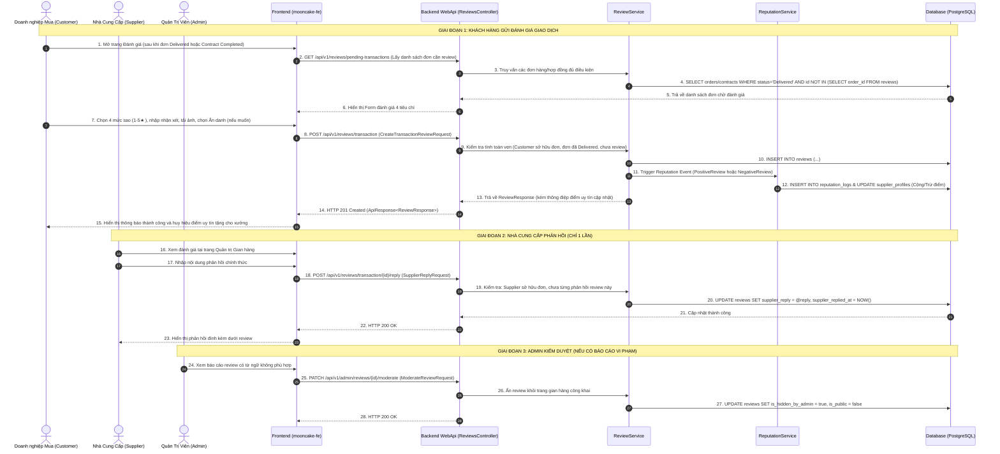
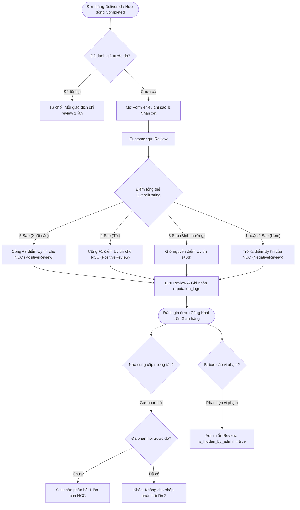

# FEATURE #21: ĐÁNH GIÁ & PHẢN HỒI SAU GIAO DỊCH (TRANSACTION REVIEWS)
## Tài Liệu Thiết Kế Chi Tiết (Detail Design)

---

## I. TÊN TÀI LIỆU, TÍNH NĂNG & TỔNG QUAN

### 1.1. Thông tin tài liệu
- **Tên tài liệu:** Thiết kế chi tiết tính năng Đánh giá & Phản hồi sau giao dịch (Transaction Reviews)
- **Mã tính năng:** `transaction-review` (Feature #21 thuộc Module 8)
- **Phiên bản:** `1.0.0`
- **Người thiết kế:** Enterprise Solution Architect
- **Trạng thái:** Approved / Ready for Implementation

### 1.2. Mục tiêu nghiệp vụ (Business Goals)
- Cho phép khách hàng doanh nghiệp (Customer) gửi đánh giá xác thực đa chiều về năng lực thực tế của Nhà cung cấp (Supplier) sau khi đơn hàng giao nhận thành công hoặc hợp đồng B2B hoàn tất nghiệm thu.
- Tự động kích hoạt cơ chế gửi thông báo/lời nhắc đánh giá sau giao hàng, nhắc lại sau 3 ngày nếu khách chưa thực hiện.
- Cung cấp đánh giá 4 tiêu chí sao độc lập (1–5★):
  1. **Chất lượng bánh & Vệ sinh an toàn thực phẩm** (`quality_rating`)
  2. **Đúng hạn giao hàng & Đóng gói bảo quản** (`delivery_rating`)
  3. **Dịch vụ hỗ trợ & Thiết kế mockup logo** (`service_rating`)
  4. **Mức độ hài lòng tổng thể** (`overall_rating`)
- Bảo mật thông tin doanh nghiệp mua qua tùy chọn **Đánh giá ẩn danh (Anonymous)**.
- Tạo kênh đối thoại minh bạch: Nhà cung cấp được quyền gửi phản hồi chính thức **1 lần duy nhất** cho mỗi đánh giá.
- Tự động kích hoạt Động cơ tính điểm uy tín (Reputation Engine) để thưởng/phạt điểm nhà cung cấp dựa trên điểm sao.

### 1.3. Phạm vi tính năng (Scope)
- **Bao gồm (In-scope):**
  - Giao diện Form đánh giá 4 tiêu chí kèm nhận xét và đính kèm ảnh thực tế.
  - Tích hợp tại trang Quản lý thanh toán & đánh giá của khách hàng ([`PaymentAndRate.jsx`](file:///Users/admin/Desktop/PRN232/mooncake-fe/src/Pages/Customer/PaymentAndRate.jsx)) và Pop-up nhắc đánh giá sau PoD.
  - Danh sách đánh giá hiển thị trên trang gian hàng công khai ([`PublicShopPage.jsx`](file:///Users/admin/Desktop/PRN232/mooncake-fe/src/Pages/PublicShopPage.jsx)).
  - Chức năng phản hồi của Nhà cung cấp (Supplier Reply Modal).
  - Quyền kiểm duyệt của Admin (ẩn/hiện các đánh giá vi phạm thuần phong mỹ tục hoặc chứa thông tin nhạy cảm).
  - Tác động trực tiếp vào `reputation_logs` (+3đ cho 5★, +1đ cho 4★, -2đ cho 1-2★).
- **Không bao gồm (Out-of-scope):**
  - Bình luận trực tiếp trên từng biến thể sản phẩm ngoài luồng đơn (xem Feature #22).
  - Trọng tài phân xử tranh chấp bồi thường tài chính (đã nằm trong Module 6 Hợp đồng).

---

## II. WORKFLOW & SEQUENCE DIAGRAM

### 2.1. Sequence Diagram: Luồng Đánh Giá Giao Dịch & Phản Hồi Nhà Cung Cấp



### 2.2. State Transition: Vòng đời của một Đánh Giá Giao Dịch



---

## III. CHI TIẾT TỪNG BƯỚC XỬ LÝ (STEP-BY-STEP LOGIC)

### Bước 1: Kiểm tra tính hợp lệ & Điều kiện tiên quyết (Pre-condition Checks)
1. Xác thực danh tính người dùng (`UserId`), đối soát với hồ sơ khách hàng (`CustomerProfile`).
2. Kiểm tra `OrderId` hoặc `ContractId` truyền lên:
   - Đơn hàng / Hợp đồng phải thuộc về khách hàng yêu cầu.
   - Trạng thái bắt buộc: Đối với Đơn hàng (`orders`) là `Delivered` hoặc `Completed`; Đối với Hợp đồng (`contracts`) là `Completed` hoặc `Terminated` (đã qua nghiệm thu).
   - Kiểm tra trùng lặp: Truy vấn bảng `reviews` kiểm tra xem đã tồn tại bản ghi với `order_id` hoặc `contract_id` này chưa. Nếu đã có $\rightarrow$ ném `HttpException(409, "Giao dịch này đã được quý khách đánh giá trước đó.")`.

### Bước 2: Chuẩn hóa & Validate dữ liệu đầu vào (Input Validation)
1. Thang điểm 4 tiêu chí:
   - `quality_rating`: 1 $\le$ rating $\le$ 5 (bắt buộc)
   - `delivery_rating`: 1 $\le$ rating $\le$ 5 (bắt buộc)
   - `service_rating`: 1 $\le$ rating $\le$ 5 (bắt buộc)
   - `overall_rating`: 1 $\le$ rating $\le$ 5 (bắt buộc)
2. Nội dung nhận xét (`comment`):
   - Tối thiểu 10 ký tự, tối đa 2000 ký tự.
   - Xóa bỏ các ký tự HTML độc hại (Anti-XSS Sanitization).
3. Tùy chọn ẩn danh (`is_anonymous`):
   - Nếu `true`: Khi trả về API công khai, tên doanh nghiệp khách hàng sẽ được ẩn dạng `Doanh nghiệp ***` hoặc `Khách hàng ẩn danh`, logo công ty hiển thị avatar mặc định.

### Bước 3: Động cơ tính điểm uy tín tự động (Reputation Calculation Hook)
Dựa trên giá trị `overall_rating`:
- Nếu `overall_rating == 5`: `scoreDelta = +3.0m`, `eventType = ReputationEvent.PositiveReview`, lý do: `Khách hàng đánh giá 5 sao xuất sắc cho đơn hàng {OrderNumber}`.
- Nếu `overall_rating == 4`: `scoreDelta = +1.0m`, `eventType = ReputationEvent.PositiveReview`, lý do: `Khách hàng đánh giá 4 sao hài lòng cho đơn hàng {OrderNumber}`.
- Nếu `overall_rating == 3`: Không thay đổi điểm (`scoreDelta = 0.0m`).
- Nếu `overall_rating <= 2`: `scoreDelta = -2.0m`, `eventType = ReputationEvent.NegativeReview`, lý do: `Khách hàng đánh giá không hài lòng ({Rating} sao) cho đơn hàng {OrderNumber}`.

### Bước 4: Lưu trữ nguyên tử (Atomic Persistence)
Trong một Transaction duy nhất (`IDbContextTransaction`):
1. Thêm bản ghi vào bảng `reviews`.
2. Nếu `scoreDelta != 0`:
   - Thêm bản ghi mới vào `reputation_logs` liên kết `reference_id = review.Id`, `reference_type = "Review"`.
   - Cập nhật trường `reputation_score = GREATEST(0, reputation_score + @scoreDelta)` trên bảng `supplier_profiles`.
   - Đồng bộ trường `avg_rating` của nhà cung cấp dựa trên trung bình cộng tất cả các đánh giá công khai.

### Bước 5: Phản hồi của Nhà Cung Cấp (Single Supplier Reply)
1. Nhà cung cấp đăng nhập xem danh sách đánh giá của gian hàng mình.
2. Kiểm tra `reviews.supplier_id == currentSupplier.Id`.
3. Kiểm tra trường `supplier_reply`: Nếu đã khác `null` $\rightarrow$ ném `HttpException(400, "Nhà cung cấp chỉ được gửi phản hồi 1 lần duy nhất cho mỗi đánh giá.")`.
4. Validate độ dài phản hồi: từ 5 đến 1000 ký tự.
5. Cập nhật `supplier_reply` và gán `supplier_replied_at = DateTime.UtcNow`.

---

## IV. ĐẶC TẢ KỸ THUẬT API (API CONTRACT SPECIFICATION)

### 4.1. Tạo đánh giá giao dịch (Create Transaction Review)
- **Endpoint:** `POST /api/v1/reviews/transaction`
- **Xác thực:** Bearer Token (Role: `Customer`)
- **Request Body:**
```json
{
  "orderId": "a1b2c3d4-e5f6-7890-abcd-ef1234567890",
  "contractId": null,
  "qualityRating": 5,
  "deliveryRating": 5,
  "serviceRating": 4,
  "overallRating": 5,
  "comment": "Bánh nướng thập cẩm rất thơm ngon, bao bì in ép kim logo công ty sắc sảo đúng như bản duyệt mockup.",
  "isAnonymous": false,
  "mediaUrls": [
    "https://storage.mooncake.vn/reviews/img_001.webp",
    "https://storage.mooncake.vn/reviews/img_002.webp"
  ]
}
```
- **Response Payload (HTTP 201 Created):**
```json
{
  "status": 201,
  "message": "Gửi đánh giá giao dịch thành công. Nhà cung cấp đã được cộng +3 điểm uy tín.",
  "data": {
    "reviewId": "f9e8d7c6-b5a4-3210-fedc-ba9876543210",
    "supplierId": "11223344-5566-7788-99aa-bbccddeeff00",
    "supplierName": "Xưởng Bánh Tràng An Nghệ Nhân",
    "overallRating": 5,
    "reputationScoreDelta": 3.0,
    "newReputationScore": 88.5,
    "createdAt": "2026-10-29T14:30:00Z"
  },
  "path": "/api/v1/reviews/transaction",
  "traceId": "rev-tx-771829",
  "time": "2026-10-29T14:30:00Z"
}
```

### 4.2. Nhà cung cấp phản hồi đánh giá (Supplier Reply)
- **Endpoint:** `POST /api/v1/reviews/transaction/{reviewId}/reply`
- **Xác thực:** Bearer Token (Role: `Supplier`)
- **Request Body:**
```json
{
  "replyContent": "Chân thành cảm ơn Quý doanh nghiệp đã tin tưởng lựa chọn xưởng bánh cho mùa Tết Trung Thu năm nay! Rất mong được tiếp tục đồng hành cùng Quý công ty."
}
```
- **Response Payload (HTTP 200 OK):**
```json
{
  "status": 200,
  "message": "Đã gửi phản hồi đánh giá thành công.",
  "data": {
    "reviewId": "f9e8d7c6-b5a4-3210-fedc-ba9876543210",
    "supplierReply": "Chân thành cảm ơn Quý doanh nghiệp đã tin tưởng lựa chọn xưởng bánh...",
    "supplierRepliedAt": "2026-10-29T14:45:00Z"
  },
  "path": "/api/v1/reviews/transaction/f9e8d7c6-b5a4-3210-fedc-ba9876543210/reply",
  "traceId": "rev-reply-192837",
  "time": "2026-10-29T14:45:00Z"
}
```

### 4.3. Lấy danh sách đánh giá của gian hàng (Get Shop Reviews)
- **Endpoint:** `GET /api/v1/shops/{slug}/reviews`
- **Xác thực:** Anonymous (Public)
- **Query Params:** `rating` (tùy chọn 1-5), `pageNumber` (mặc định 1), `pageSize` (mặc định 10)
- **Response Data:**
```json
{
  "status": 200,
  "message": "Lấy danh sách đánh giá thành công.",
  "data": {
    "supplierId": "11223344-5566-7788-99aa-bbccddeeff00",
    "averageRating": 4.85,
    "totalReviews": 142,
    "qualityAverage": 4.9,
    "deliveryAverage": 4.8,
    "serviceAverage": 4.85,
    "items": [
      {
        "id": "f9e8d7c6-b5a4-3210-fedc-ba9876543210",
        "customerDisplayName": "Công ty CP Tập đoàn FPT",
        "customerAvatarUrl": "https://storage.mooncake.vn/avatars/fpt.png",
        "isAnonymous": false,
        "overallRating": 5,
        "qualityRating": 5,
        "deliveryRating": 5,
        "serviceRating": 4,
        "comment": "Bánh nướng thập cẩm rất thơm ngon...",
        "mediaUrls": ["https://storage.mooncake.vn/reviews/img_001.webp"],
        "supplierReply": "Chân thành cảm ơn Quý doanh nghiệp...",
        "supplierRepliedAt": "2026-10-29T14:45:00Z",
        "createdAt": "2026-10-29T14:30:00Z"
      }
    ]
  }
}
```

---

## V. KIẾN TRÚC PHÂN TẦNG VÀ TỔ CHỨC MÃ NGUỒN

### 5.1. Backend (.NET 8 Clean Architecture)
- **Domain:**
  - Entity [`Review.cs`](file:///Users/admin/Desktop/PRN232/mooncake-ecommerce-platform/src/Mooncake.EcommercePlatform.Domain/Entities/Review.cs): bổ sung các trường `SupplierReply`, `SupplierRepliedAt`, `IsHiddenByAdmin`, `IsAnonymous`, `MediaUrls`.
- **Application:**
  - Interfaces: `ITransactionReviewService.cs`, `ITransactionReviewRepository.cs`.
  - DTOs:
    - Requests: `CreateTransactionReviewRequest.cs`, `SupplierReplyRequest.cs`, `ModerateReviewRequest.cs`.
    - Responses: `TransactionReviewResponse.cs`, `ShopReviewSummaryResponse.cs`.
  - Constants: Bổ sung message tiếng Việt chuẩn vào `MessageConstant.cs`.
- **Infrastructure:**
  - Mapping: Cập nhật [`ReviewConfiguration.cs`](file:///Users/admin/Desktop/PRN232/mooncake-ecommerce-platform/src/Mooncake.EcommercePlatform.Infrastructure/Persistence/Configurations/ReviewConfiguration.cs).
  - Repository: `TransactionReviewRepository.cs` thực hiện truy vấn tối ưu kèm thông tin Customer/Supplier.
- **WebApi:**
  - Controller: `TransactionReviewsController.cs` kế thừa `BaseApiController`.

### 5.2. Frontend (React 19)
- **Services:** `reviewService.js` (gọi endpoints qua `apiClient` tập trung và tích hợp mock fallback).
- **Components:**
  - `TransactionReviewModal.jsx`: Modal popup nhập 4 tiêu chí sao, nhận xét và đính kèm hình ảnh.
  - `SupplierReviewReplyModal.jsx`: Modal phản hồi 1 lần cho Nhà cung cấp.
- **Pages:**
  - Cập nhật [`PaymentAndRate.jsx`](file:///Users/admin/Desktop/PRN232/mooncake-fe/src/Pages/Customer/PaymentAndRate.jsx): Liên kết API gửi review thực tế và danh sách lịch sử.
  - Cập nhật [`PublicShopPage.jsx`](file:///Users/admin/Desktop/PRN232/mooncake-fe/src/Pages/PublicShopPage.jsx): Hiển thị chi tiết 4 tiêu chí và phản hồi của xưởng.

