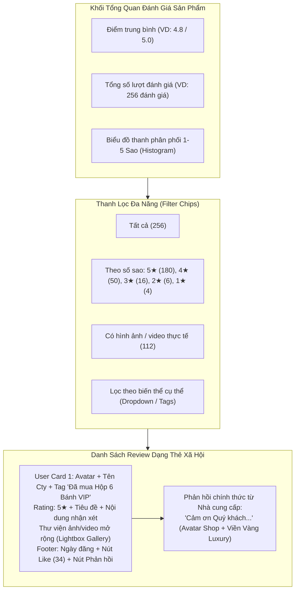

# FEATURE #22: ĐÁNH GIÁ & BÌNH LUẬN SẢN PHẨM / BIẾN THỂ (PRODUCT REVIEW STREAM)
## Tài Liệu Thiết Kế Chi Tiết (Detail Design)

---

## I. TÊN TÀI LIỆU, TÍNH NĂNG & TỔNG QUAN

### 1.1. Thông tin tài liệu
- **Tên tài liệu:** Thiết kế chi tiết tính năng Đánh giá & Bình luận sản phẩm / Biến thể (Product & Variant Social Review Stream)
- **Mã tính năng:** `product-reviews-stream` (Feature #22 thuộc Module 8)
- **Phiên bản:** `1.0.0`
- **Người thiết kế:** Enterprise Solution Architect
- **Trạng thái:** Approved / Ready for Implementation

### 1.2. Mục tiêu nghiệp vụ (Business Goals)
- Tạo dựng luồng tương tác xã hội sống động (Shopee/TikTok style social proof) ngay dưới trang chi tiết sản phẩm ([`ProductInformation.jsx`](file:///Users/admin/Desktop/PRN232/mooncake-fe/src/Pages/Products/ProductInformation.jsx)), giúp doanh nghiệp đặt hàng có góc nhìn chân thực về chất lượng từng mẫu bánh trước khi chốt hợp đồng B2B.
- Áp dụng cơ chế chứng thực **Verified Purchase**: Chỉ khách hàng đã hoàn tất mua hàng biến thể cụ thể đó (thông qua `order_items`) mới được quyền viết đánh giá chính thức.
- Định danh chính xác theo **biến thể sản phẩm (Variant Tag)**: Phân biệt rõ nhận xét dành cho *Hộp 4 bánh Thập cẩm 150g*, *Set VIP Yến sào 200g*, hay *Bánh dẻo Hạt sen*.
- Hỗ trợ đa phương tiện (Rich Media): Khách hàng đính kèm ảnh chụp thực tế món bánh sau khi mở hộp, video ngắn ghi lại trải nghiệm hoặc logo dập nổi trên vỏ bánh.
- Tăng tương tác người dùng:
  - Nút **Hữu ích / Thích (Like)**: Cho phép khách mua khác nhấn thích các bình luận hữu ích, xếp hạng đánh giá nổi bật lên đầu luồng.
  - Phản hồi từ Nhà cung cấp: Mỗi review cho phép xưởng bánh phản hồi 1 lần giải đáp thắc mắc hoặc cảm ơn khách hàng.
- Bảng phân tích trực quan: Tổng số lượng review, điểm trung bình, biểu đồ phân phối sao (1–5★ histogram), và bộ lọc linh hoạt (Lọc theo Biến thể, Lọc bài có ảnh/video, Lọc theo số sao).

---

## II. WORKFLOW & SEQUENCE DIAGRAM

### 2.1. Sequence Diagram: Luồng Đánh Giá Sản Phẩm & Tương Tác Like

```mermaid
sequenceDiagram
  autonumber
  actor Cust as Khách Hàng (Customer)
  actor Visitor as Khách Xem Hàng (Visitor)
  actor Supp as Nhà Cung Cấp (Supplier)
  participant FE as Frontend (ProductInformation.jsx)
  participant API as Backend WebApi (ProductReviewsController)
  participant SVC as ProductReviewService
  participant DB as Database (PostgreSQL)

  Note over Visitor, DB: XEM LUỒNG REVIEW & THỐNG KÊ TRÊN TRANG SẢN PHẨM
  Visitor->>FE: 1. Truy cập trang Chi tiết Sản phẩm
  FE->>API: 2. GET /api/v1/products/{productId}/reviews?variantId=...&hasMedia=true&rating=5
  API->>SVC: 3. Lấy danh sách review kèm số liệu thống kê (Aggregation)
  SVC->>DB: 4. SELECT AVG(rating), COUNT(*), GROUP BY rating; SELECT * FROM product_reviews
  DB-->>API: 5. Trả về thống kê + danh sách review đã kiểm duyệt
  API-->>FE: 6. Hiển thị Star Histogram + Filter Chips + Social Review Feed

  Note over Cust, DB: KHÁCH ĐÃ MUA GỬI REVIEW VERIFIED PURCHASE
  Cust->>FE: 7. Bấm "Viết đánh giá sản phẩm đã mua"
  FE->>API: 8. GET /api/v1/products/{productId}/eligible-order-items
  API->>SVC: 9. Kiểm tra các OrderItem đã hoàn tất của Customer cho Product này
  SVC->>DB: 10. SELECT oi.id, oi.product_variant_id FROM order_items oi WHERE oi.status='Delivered' AND NOT EXISTS (...)
  DB-->>API: 11. Trả về danh sách OrderItem đủ điều kiện
  API-->>FE: 12. Hiển thị Form kèm nhãn biến thể đã mua
  Cust->>FE: 13. Chọn số sao (1-5★), tiêu đề, nội dung nhận xét, upload ảnh/video thực tế
  FE->>API: 14. POST /api/v1/products/{productId}/reviews (CreateProductReviewRequest)
  API->>SVC: 15. Kiểm tra ràng buộc Unique (CustomerId, OrderItemId)
  SVC->>DB: 16. INSERT INTO product_reviews (...)
  DB-->>API: 17. Lưu thành công (IsVerifiedPurchase = true)
  API-->>FE: 18. HTTP 201 Created
  FE-->>Cust: 19. Đánh giá xuất hiện ngay lập tức trong luồng với huy hiệu "Đã Mua Hàng"

  Note over Visitor, DB: THẢ LIKE CHO REVIEW HỮU ÍCH
  Visitor->>FE: 20. Bấm icon Like (Hữu ích) trên một đánh giá
  FE->>API: 21. POST /api/v1/products/reviews/{reviewId}/like (ToggleLike)
  API->>SVC: 22. Kiểm tra trạng thái like của user hiện tại
  SVC->>DB: 23. UPSERT INTO product_review_likes & UPDATE product_reviews SET like_count = like_count +/- 1
  DB-->>API: 24. Trả về số lượng like mới và trạng thái isLiked
  API-->>FE: 25. HTTP 200 OK (Cập nhật micro-animation icon tim/like)
```

### 2.2. Kiến Trúc Luồng Bình Luận Xã Hội (Social Stream Architecture)



---

## III. CHI TIẾT TỪNG BƯỚC XỬ LÝ (STEP-BY-STEP LOGIC)

### Bước 1: Kiểm soát điều kiện Mua Hàng Xác Thực (Verified Purchase Enforcement)
1. Để đảm bảo 100% tính xác thực và ngăn chặn review ảo (Spam/Seeding), mỗi bản ghi `product_reviews` bắt buộc liên kết với một `OrderItemId` hợp lệ.
2. Kiểm tra điều kiện:
   - `order_items.id == request.OrderItemId`
   - `order_items.order.customer_id == currentCustomer.Id`
   - Trạng thái đơn hàng cha phải là `Delivered` hoặc `Completed`.
   - Ràng buộc duy nhất tại CSDL: Index `product_reviews_customer_id_order_item_id_key` trên `(customer_id, order_item_id)`. Nếu khách hàng đã từng review cho món hàng này trong đơn, hệ thống từ chối với HTTP 409 Conflict: *"Quý khách đã gửi đánh giá cho sản phẩm trong đơn hàng này rồi."*

### Bước 2: Xử lý và Tối ưu Đa Phương Tiện (Rich Media Processing)
1. Khách hàng có thể đính kèm tối đa **5 ảnh** hoặc **1 video ngắn $\le$ 30 giây** (dung lượng $\le$ 15MB).
2. Ảnh upload lên Storage sẽ được kiểm tra định dạng (`jpg`, `jpeg`, `png`, `webp`).
3. Chuỗi URLs được đóng gói dưới dạng mảng JSONB lưu vào trường `media_urls`.
4. Trên giao diện, người dùng click vào ảnh sẽ kích hoạt Lightbox xem phóng to toàn màn hình hoặc swipe trượt trên thiết bị di động.

### Bước 3: Cơ chế Đếm Lượt Thích Độc Lập (Toggle Like Counter)
1. Khách hàng xem sản phẩm (đã đăng nhập) có thể bấm Thích (Like) đánh giá.
2. Kiểm tra bảng `product_review_likes`:
   - Nếu bản ghi `(product_review_id, customer_id)` chưa tồn tại:
     - Tạo bản ghi mới trong `product_review_likes`.
     - Tăng nguyên tử `like_count = like_count + 1` trên `product_reviews`.
     - Trả về `isLiked: true`, `likeCount: N + 1`.
   - Nếu bản ghi đã tồn tại (User bấm Like lần 2 để hủy):
     - Xóa bản ghi trong `product_review_likes`.
     - Giảm nguyên tử `like_count = GREATEST(0, like_count - 1)` trên `product_reviews`.
     - Trả về `isLiked: false`, `likeCount: N - 1`.

### Bước 4: Nhà Cung Cấp Trả Lời Đánh Giá (Supplier Reply)
1. Chỉ chủ gian hàng sở hữu sản phẩm mới có quyền phản hồi: `product.supplier_id == currentSupplier.Id`.
2. Kiểm tra `product_reviews.supplier_reply`: Nếu đã có dữ liệu $\rightarrow$ Không cho phép sửa đổi hoặc gửi thêm lần 2.
3. Nội dung phản hồi có độ dài từ 5 đến 1000 ký tự.
4. Lưu `supplier_reply` và gán `supplier_replied_at = DateTime.UtcNow`.

### Bước 5: Kiểm duyệt nội dung từ Quản trị viên (Content Moderation)
1. Mặc định `is_public = true` và `is_hidden_by_admin = false`.
2. Khi bị người dùng báo cáo (Report) hoặc phát hiện từ khóa cấm/nhạy cảm:
   - Admin kích hoạt cờ `is_hidden_by_admin = true`.
   - Các API truy vấn công khai sẽ tự động lọc bỏ các bản ghi bị ẩn qua Global Query Filter: `.Where(r => !r.IsHiddenByAdmin && !r.IsDeleted)`.

---

## IV. ĐẶC TẢ KỸ THUẬT API (API CONTRACT SPECIFICATION)

### 4.1. Lấy luồng đánh giá sản phẩm & Thống kê (Get Product Reviews Feed)
- **Endpoint:** `GET /api/v1/products/{productId}/reviews`
- **Xác thực:** Anonymous (Công khai)
- **Query Parameters:**
  - `variantId` (Guid, optional): Lọc theo biến thể cụ thể
  - `rating` (int, optional, 1-5): Lọc theo số sao
  - `hasMedia` (bool, optional): Chỉ lấy đánh giá có kèm hình ảnh/video
  - `pageNumber` (int, default 1), `pageSize` (int, default 10)
  - `sortBy` (string, default "most_helpful"): `"most_helpful"` (theo like_count) hoặc `"newest"` (theo created_at)
- **Response Payload (HTTP 200 OK):**
```json
{
  "status": 200,
  "message": "Lấy danh sách đánh giá sản phẩm thành công.",
  "data": {
    "productId": "8899aabb-ccdd-eeff-0011-223344556677",
    "productName": "Bánh Trung Thu Thập Cẩm Bát Bửu Thượng Hạng",
    "summary": {
      "averageRating": 4.88,
      "totalReviews": 128,
      "verifiedPurchaseCount": 128,
      "withMediaCount": 64,
      "starDistribution": {
        "star5": 115,
        "star4": 10,
        "star3": 2,
        "star2": 1,
        "star1": 0
      }
    },
    "items": [
      {
        "id": "e1f2a3b4-5678-90ab-cdef-1234567890ab",
        "authorName": "Đoàn Minh Khoa (FPT Telecom)",
        "authorAvatarUrl": "https://storage.mooncake.vn/avatars/user1.png",
        "isVerifiedPurchase": true,
        "variantId": "aa11bb22-3344-5566-7788-9900aabbccdd",
        "variantName": "Hộp VIP 4 Bánh 180g (Kèm Trà Ô Long)",
        "rating": 5,
        "title": "Bánh rất ngon, nhân thập cẩm đượm vị truyền thống!",
        "content": "Doanh nghiệp mình đặt 350 hộp tặng cán bộ nhân viên và đối tác. Ai cũng khen vỏ bánh mềm thơm, trứng muối bùi béo không bị tanh, logo công ty dập kim rất sang.",
        "mediaUrls": [
          "https://storage.mooncake.vn/reviews/fpt_open_box.jpg",
          "https://storage.mooncake.vn/reviews/fpt_table.jpg"
        ],
        "likeCount": 28,
        "isLikedByMe": false,
        "supplierReply": "Xưởng Bánh Tràng An xin chân thành cảm ơn FPT Telecom đã tin tưởng!",
        "supplierRepliedAt": "2026-10-25T10:00:00Z",
        "createdAt": "2026-10-24T16:20:00Z"
      }
    ],
    "pageNumber": 1,
    "pageSize": 10,
    "totalPages": 13,
    "hasMore": true
  },
  "path": "/api/v1/products/8899aabb-ccdd-eeff-0011-223344556677/reviews",
  "traceId": "prod-rev-99201",
  "time": "2026-10-29T14:40:00Z"
}
```

### 4.2. Gửi đánh giá sản phẩm (Create Verified Product Review)
- **Endpoint:** `POST /api/v1/products/{productId}/reviews`
- **Xác thực:** Bearer Token (Role: `Customer`)
- **Request Body:**
```json
{
  "orderItemId": "33445566-7788-99aa-bbcc-ddeeff001122",
  "productVariantId": "aa11bb22-3344-5566-7788-9900aabbccdd",
  "rating": 5,
  "title": "Chất lượng vượt trội so với tầm giá",
  "content": "Bánh đóng gói cẩn thận từng gói hút chân không, hạn sử dụng rõ ràng. Mẫu mã rất thích hợp để mang biếu tặng đối tác cấp cao.",
  "mediaUrls": [
    "https://storage.mooncake.vn/reviews/upload_123.jpg"
  ]
}
```
- **Response Payload (HTTP 201 Created):**
```json
{
  "status": 201,
  "message": "Đăng đánh giá sản phẩm thành công.",
  "data": {
    "reviewId": "e1f2a3b4-5678-90ab-cdef-1234567890ab",
    "isVerifiedPurchase": true,
    "createdAt": "2026-10-29T14:42:00Z"
  },
  "path": "/api/v1/products/8899aabb-ccdd-eeff-0011-223344556677/reviews",
  "traceId": "prod-rev-create-12",
  "time": "2026-10-29T14:42:00Z"
}
```

### 4.3. Thả thích / Bỏ thích đánh giá (Toggle Like)
- **Endpoint:** `POST /api/v1/products/reviews/{reviewId}/like`
- **Xác thực:** Bearer Token (Role: `Customer` hoặc `Supplier`)
- **Response Payload (HTTP 200 OK):**
```json
{
  "status": 200,
  "message": "Thao tác thành công.",
  "data": {
    "reviewId": "e1f2a3b4-5678-90ab-cdef-1234567890ab",
    "isLiked": true,
    "likeCount": 29
  },
  "path": "/api/v1/products/reviews/e1f2a3b4-5678-90ab-cdef-1234567890ab/like",
  "traceId": "like-toggle-88",
  "time": "2026-10-29T14:45:00Z"
}
```

---

## V. KIẾN TRÚC PHÂN TẦNG VÀ TỔ CHỨC MÃ NGUỒN

### 5.1. Backend (.NET 8 Clean Architecture)
- **Domain:**
  - Entity [`ProductReview.cs`](file:///Users/admin/Desktop/PRN232/mooncake-ecommerce-platform/src/Mooncake.EcommercePlatform.Domain/Entities/ProductReview.cs).
  - Entity [`ProductReviewLike.cs`](file:///Users/admin/Desktop/PRN232/mooncake-ecommerce-platform/src/Mooncake.EcommercePlatform.Domain/Entities/ProductReviewLike.cs).
- **Application:**
  - Interfaces: `IProductReviewService.cs`, `IProductReviewRepository.cs`.
  - DTOs: `ProductReviewFeedResponse.cs`, `ProductReviewSummaryDto.cs`, `CreateProductReviewRequest.cs`, `ToggleReviewLikeResponse.cs`.
  - Validators: `CreateProductReviewRequestValidator.cs` (FluentValidation).
- **Infrastructure:**
  - Configurations: [`ProductReviewConfiguration.cs`](file:///Users/admin/Desktop/PRN232/mooncake-ecommerce-platform/src/Mooncake.EcommercePlatform.Infrastructure/Persistence/Configurations/ProductReviewConfiguration.cs), [`ProductReviewLikeConfiguration.cs`](file:///Users/admin/Desktop/PRN232/mooncake-ecommerce-platform/src/Mooncake.EcommercePlatform.Infrastructure/Persistence/Configurations/ProductReviewLikeConfiguration.cs).
  - Repository: `ProductReviewRepository.cs` với truy vấn nhóm đếm hiệu năng cao (EF Core GroupBy / Raw SQL Aggregates).
- **WebApi:**
  - Controller: `ProductReviewsController.cs` cung cấp các API công khai và bảo mật.

### 5.2. Frontend (React 19)
- **Components:**
  - `ProductReviewStream.jsx`: Thành phần chính hiển thị danh sách đánh giá dạng mạng xã hội, tích hợp phân trang vô hạn hoặc nút "Xem thêm".
  - `RatingHistogram.jsx`: Thanh bar chart màu vàng Gold phân bổ tỉ lệ 1–5 sao.
  - `FilterChipBar.jsx`: Bộ nút lọc nhanh (Tất cả, Có ảnh/video, Theo số sao, Theo biến thể).
  - `WriteProductReviewModal.jsx`: Modal popup cho khách đã mua hàng viết review, chấm sao và tải ảnh.
- **Tích hợp:** Nhúng toàn bộ `ProductReviewStream` vào phần cuối của [`ProductInformation.jsx`](file:///Users/admin/Desktop/PRN232/mooncake-fe/src/Pages/Products/ProductInformation.jsx).

