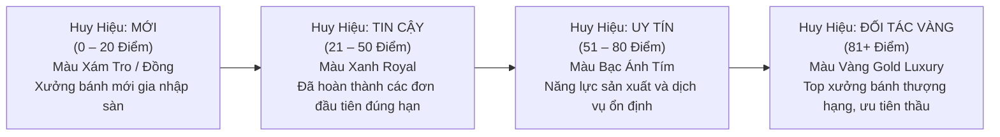
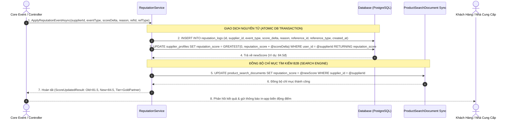

# FEATURE #22 (MỞ RỘNG): ĐỘNG CƠ TÍNH ĐIỂM UY TÍN & HUY HIỆU NHÀ CUNG CẤP (SUPPLIER REPUTATION ENGINE & BADGES)
## Tài Liệu Thiết Kế Chi Tiết (Detail Design)

---

## I. TỔNG QUAN NGHIỆP VỤ & MÔ HÌNH TOÁN HỌC (MATHEMATICAL MODEL)

### 1.1. Mục tiêu kiến trúc
Điểm uy tín nhà cung cấp (**Reputation Score**) là chỉ số tín nhiệm kỹ thuật số định lượng được, phản ánh chính xác năng lực thực thi cam kết B2B của Xưởng bánh trong suốt chu kỳ hoạt động trên sàn Mooncake Platform.

Hệ thống tính điểm đảm bảo 4 nguyên tắc vàng:
1. **Khách quan & Minh bạch:** Điểm số được sinh ra tự động từ các sự kiện vận hành có bằng chứng (Biên bản giao hàng PoD, Hợp đồng hoàn thành, Đánh giá xác thực).
2. **Không thể can thiệp trái phép (Immutable Audit Trail):** Mỗi biến động điểm đều tạo 1 bản ghi cố định trong bảng `reputation_logs` kèm nguyên nhân và mã tham chiếu (`reference_id`).
3. **Phản ánh giá trị thị trường:** Điểm uy tín tác động trực tiếp vào thuật toán xếp hạng tìm kiếm sản phẩm và cơ chế đề xuất mời thầu tự động của hệ thống RFQ.
4. **Bảo toàn dữ liệu dưới tải cao:** Đảm bảo tính toán nguyên tử (Atomic Update) chống xung đột Race Condition khi nhiều đơn hàng hoàn thành đồng thời.

---

### 1.2. Bảng Quy Tắc Biến Động Điểm (Scoring Matrix)

Dựa trên tài liệu nghiệp vụ [`mooncake-marketplace.md`](file:///Users/admin/Desktop/PRN232/mooncake-ecommerce-platform/.agents/business/mooncake-marketplace.md#L200-L208):

| STT | Sự kiện nghiệp vụ (`ReputationEvent`) | Điểm biến động (`ScoreDelta`) | Điều kiện kích hoạt | Mã tham chiếu (`reference_type`) |
| :---: | :--- | :---: | :--- | :--- |
| 1 | `CompletedOnTime` | **+10.0đ** | Hợp đồng / Đơn hàng hoàn tất đúng hạn giao kết (`due_date`) | `Contract` / `Order` |
| 2 | `CompletedLate` | **-5.0đ** | Hoàn tất giao hàng nhưng trễ so với cam kết ban đầu | `Contract` / `Order` |
| 3 | `Breached` | **-20.0đ** | Vi phạm nghiêm trọng hợp đồng (Hủy đơn đơn phương, giao hàng sai quy cách không khắc phục) | `Contract` / `Dispute` |
| 4 | `PositiveReview` (5★) | **+3.0đ** | Khách hàng đánh giá giao dịch mức độ 5 Sao xuất sắc | `Review` |
| 5 | `PositiveReview` (4★) | **+1.0đ** | Khách hàng đánh giá giao dịch mức độ 4 Sao hài lòng | `Review` |
| 6 | `NeutralReview` (3★) | **0.0đ** | Đánh giá 3 Sao trung bình (Ghi nhận, không đổi điểm) | `Review` |
| 7 | `NegativeReview` (1–2★) | **-2.0đ** | Khách hàng đánh giá giao dịch 1 hoặc 2 Sao không hài lòng | `Review` |
| 8 | `AdminPenalty` | **-N đ** | Chế tài xử phạt vi phạm chính sách sàn từ Ban quản trị | `AdminAction` |
| 9 | `AdminBonus` | **+N đ** | Thưởng thành tích xuất sắc (Ví dụ: Đạt chứng nhận ISO/HACCP quốc tế) | `AdminAction` |

> [!NOTE]
> Điểm uy tín có cận dưới là `0.0` điểm: `reputation_score = GREATEST(0.0, reputation_score + @scoreDelta)`. Không có điểm âm.

---

### 1.3. Hệ Thống Phân Cấp Huy Hiệu (Reputation Badge Tiers)

Dựa trên tổng điểm uy tín hiện tại (`reputation_score`), hệ thống tự động phân loại và cấp Huy hiệu cho Nhà cung cấp:



| Cấp bậc Huy hiệu | Thang điểm | Màu sắc UI (Tailwind) | Đặc quyền nền tảng |
| :--- | :---: | :--- | :--- |
| **Mới (New)** | 0 – 20 | `bg-stone-100 text-stone-700 border-stone-300` | Giới hạn tối đa 3 hợp đồng B2B cùng lúc để kiểm định năng lực |
| **Tin cậy (Reliable)** | 21 – 50 | `bg-blue-50 text-blue-700 border-blue-300` | Được tham gia báo giá các gói thầu RFQ tiêu chuẩn |
| **Uy tín (Reputable)** | 51 – 80 | `bg-purple-50 text-purple-700 border-purple-300` | Tăng 15% trọng số hiển thị tìm kiếm, huy hiệu sáng trên gian hàng |
| **Đối tác Vàng (Gold Partner)** | 81+ | `bg-amber-50 text-amber-800 border-amber-400 font-bold shadow-sm` | Tự động nằm trong Top 3 gợi ý thầu RFQ; gắn huy hiệu Vàng trên ảnh sản phẩm |

---

## II. KIẾN TRÚC SỰ KIỆN & SEQUENCE DIAGRAM (EVENT-DRIVEN ARCHITECTURE)



---

## III. TÁC ĐỘNG VÀO CÁC THUẬT TOÁN SÀN (ALGORITHMIC IMPACT)

### 3.1. Thuật toán Xếp hạng Tìm kiếm Sản phẩm (Search Ranking Boost)
Trong bảng `product_search_documents`, trường `reputation_score` đóng vai trò là một hệ số trọng số quan trọng trong câu lệnh tính điểm độ liên quan (Relevance Scoring):

$$\text{FinalScore} = \text{TextMatchScore} \times 0.5 + (\text{ReputationScore} \times 0.3) + (\text{AverageRating} \times 20 \times 0.2)$$

- Các nhà cung cấp đạt huy hiệu **Đối tác Vàng (Gold Partner $\ge$ 81đ)** sẽ có vị trí hiển thị ưu tiên tại trang Tìm kiếm ([`SearchPage.jsx`](file:///Users/admin/Desktop/PRN232/mooncake-fe/src/Pages/SearchPage.jsx)) và trang chủ ([`HomePage.jsx`](file:///Users/admin/Desktop/PRN232/mooncake-fe/src/Pages/HomePage.jsx)).
- Xưởng bánh có điểm uy tín thấp ($< 20$đ) hoặc từng bị vi phạm (`Breached`) sẽ bị đẩy xuống cuối trang kết quả.

### 3.2. Thuật toán Tự động Gợi ý Mời thầu RFQ (Smart RFQ Recommendation)
Khi khách hàng tạo yêu cầu báo giá RFQ (Tính năng #11 trong Module 5), hệ thống tự động lọc danh sách Top 10 nhà cung cấp phù hợp theo công thức:
1. Có danh mục bánh khớp với yêu cầu RFQ.
2. Cùng khu vực địa lý giao hàng.
3. **Xếp theo `reputation_score` giảm dần**: Tối thiểu 50% số lượng lời mời tự động được phân bổ cho các nhà cung cấp thuộc nhóm *Uy tín* và *Đối tác Vàng*.

---

## IV. ĐẶC TẢ KỸ THUẬT API (API CONTRACT SPECIFICATION)

### 4.1. Lấy thông tin điểm uy tín, huy hiệu & lịch sử biến động
- **Endpoint:** `GET /api/v1/suppliers/{supplierId}/reputation`
- **Xác thực:** Bearer Token (Supplier xem của chính mình, Customer/Admin xem công khai)
- **Response Payload (HTTP 200 OK):**
```json
{
  "status": 200,
  "message": "Lấy thông tin điểm uy tín thành công.",
  "data": {
    "supplierId": "11223344-5566-7788-99aa-bbccddeeff00",
    "companyName": "Xưởng Bánh Tràng An Nghệ Nhân",
    "reputationScore": 84.5,
    "badgeTier": "GoldPartner",
    "badgeTitle": "Đối tác Vàng",
    "badgeColor": "amber",
    "stats": {
      "totalContracts": 32,
      "contractsOnTime": 30,
      "contractsLate": 2,
      "contractsBreached": 0,
      "averageRating": 4.88,
      "positiveReviewsCount": 45,
      "negativeReviewsCount": 1
    },
    "recentLogs": [
      {
        "id": "c1c2c3c4-d5d6-e7e8-f9f0-123456789012",
        "eventType": "PositiveReview",
        "scoreDelta": 3.0,
        "reason": "Khách hàng đánh giá 5 sao cho hợp đồng HĐ-2026-00109",
        "referenceId": "f9e8d7c6-b5a4-3210-fedc-ba9876543210",
        "referenceType": "Review",
        "createdAt": "2026-10-29T14:30:00Z"
      },
      {
        "id": "b1b2b3b4-c5c6-d7d8-e9e0-123456789012",
        "eventType": "CompletedOnTime",
        "scoreDelta": 10.0,
        "reason": "Hoàn tất hợp đồng HĐ-2026-00098 đúng hạn giao kết",
        "referenceId": "88776655-4433-2211-00aa-bbccddeeff99",
        "referenceType": "Contract",
        "createdAt": "2026-10-20T09:15:00Z"
      }
    ]
  },
  "path": "/api/v1/suppliers/11223344-5566-7788-99aa-bbccddeeff00/reputation",
  "traceId": "rep-info-5561",
  "time": "2026-10-29T14:50:00Z"
}
```

### 4.2. Admin áp dụng chế tài xử phạt hoặc thưởng điểm thủ công
- **Endpoint:** `POST /api/v1/admin/suppliers/{supplierId}/reputation/adjustment`
- **Xác thực:** Bearer Token (Role: `Admin`)
- **Request Body:**
```json
{
  "eventType": "AdminPenalty",
  "scoreDelta": -15.0,
  "reason": "Nhà cung cấp vi phạm quy chuẩn an toàn đóng gói hộp theo báo cáo giám định chất lượng #BCTĐ-441",
  "referenceId": "55667788-99aa-bbcc-ddee-ff0011223344",
  "referenceType": "InspectionReport"
}
```
- **Response Payload (HTTP 200 OK):**
```json
{
  "status": 200,
  "message": "Đã áp dụng chế tài điều chỉnh điểm uy tín thành công.",
  "data": {
    "supplierId": "11223344-5566-7788-99aa-bbccddeeff00",
    "previousScore": 84.5,
    "scoreDelta": -15.0,
    "newReputationScore": 69.5,
    "newBadgeTier": "Reputable"
  },
  "path": "/api/v1/admin/suppliers/11223344-5566-7788-99aa-bbccddeeff00/reputation/adjustment",
  "traceId": "adm-adj-882",
  "time": "2026-10-29T14:55:00Z"
}
```

---

## V. KIẾN TRÚC PHÂN TẦNG VÀ TỔ CHỨC MÃ NGUỒN

### 5.1. Backend (.NET 8 Clean Architecture)
- **Domain:**
  - Enum [`ReputationEvent.cs`](file:///Users/admin/Desktop/PRN232/mooncake-ecommerce-platform/src/Mooncake.EcommercePlatform.Domain/Enums/ReputationEvent.cs).
  - Entity [`ReputationLog.cs`](file:///Users/admin/Desktop/PRN232/mooncake-ecommerce-platform/src/Mooncake.EcommercePlatform.Domain/Entities/ReputationLog.cs).
  - Entity [`SupplierProfile.cs`](file:///Users/admin/Desktop/PRN232/mooncake-ecommerce-platform/src/Mooncake.EcommercePlatform.Domain/Entities/SupplierProfile.cs).
- **Application:**
  - Interfaces: `IReputationService.cs`, `IReputationLogRepository.cs`.
  - Helpers: `ReputationBadgeHelper.cs` (Tính toán tier, label, màu sắc dựa trên score).
  - DTOs: `SupplierReputationResponse.cs`, `ReputationLogDto.cs`, `AdminAdjustReputationRequest.cs`.
- **Infrastructure:**
  - Configuration: [`ReputationLogConfiguration.cs`](file:///Users/admin/Desktop/PRN232/mooncake-ecommerce-platform/src/Mooncake.EcommercePlatform.Infrastructure/Persistence/Configurations/ReputationLogConfiguration.cs).
  - Repositories: `ReputationLogRepository.cs`, `SupplierProfileRepository.cs`.
- **WebApi:**
  - Endpoints tích hợp trong `SuppliersController.cs` và `AdminPlatformController.cs`.

### 5.2. Frontend (React 19)
- **Components:**
  - `ReputationBadge.jsx`: Huy hiệu chuẩn luxury hiển thị trên header gian hàng, card sản phẩm và bảng báo giá RFQ.
  - `ReputationHistoryTimeline.jsx`: Biểu đồ dòng thời gian trực quan ghi nhận chi tiết lịch sử cộng/trừ điểm.
- **Tích hợp:**
  - [`SuppilerProfile.jsx`](file:///Users/admin/Desktop/PRN232/mooncake-fe/src/Pages/Supplier/SuppilerProfile.jsx): Bổ sung tab "Hồ sơ Uy tín & Nhật ký Tín nhiệm".
  - [`TradingOperating.jsx`](file:///Users/admin/Desktop/PRN232/mooncake-fe/src/Pages/Admin/TradingOperating.jsx): Bảng giám sát điểm uy tín toàn sàn của Admin.

