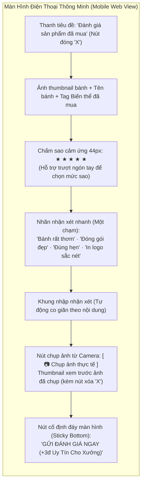

# FEATURE #21 & #22: THIẾT KẾ TRẢI NGHIỆM MOBILE WEB RESPONSIVE & ĐỊNH HƯỚNG NATIVE MOBILE
## Tài Liệu Thiết Kế Chi Tiết (Mobile Workflow & Responsive Web Design)

---

## I. TỔNG QUAN CHIẾN LƯỢC MOBILE-FIRST

Theo yêu cầu từ ban dự án, quy trình đánh giá và duyệt bình luận sản phẩm phải được thiết kế theo tư duy **Mobile-First**. Giai đoạn hiện tại sẽ hiện thực hóa toàn bộ trải nghiệm này trên nền tảng **Responsive Web** (hoạt động mượt mà trên trình duyệt Safari iOS, Chrome Android, máy tính bảng và màn hình máy tính), đồng thời cung cấp kiến trúc chuẩn bị sẵn sàng (Blueprint) cho việc đóng gói ứng dụng di động Native (Flutter / React Native) ở giai đoạn tiếp theo.

### 1.1. Mục tiêu trải nghiệm người dùng trên thiết bị di động
1. **Thao tác nhanh dưới 60 giây (Fast 60s Review):** Khách hàng sau khi nhận hàng từ tài xế (ký nhận PoD) có thể ngay lập tức mở điện thoại, chạm chọn số sao, chụp nhanh ảnh hộp bánh và gửi đánh giá chỉ với vài chạm.
2. **Kích thước vùng chạm thân thiện ngón tay (Touch Targets $\ge$ 44px):** Các ngôi sao đánh giá, nút Like, nút bộ lọc chip được thiết kế tối thiểu 44x44px theo tiêu chuẩn Apple Human Interface Guidelines và Google Material Design 3.
3. **Tích hợp Camera phần cứng di động:** Cho phép truy cập trực tiếp vào camera điện thoại (`capture="environment"`) để chụp ảnh thực tế tại bàn tiệc mà không cần qua nhiều bước trung gian.
4. **Luồng bình luận mạng xã hội dạng trượt dọc (Vertical Social Feed):** Tối ưu hóa trải nghiệm đọc nhận xét tương tự TikTok/Shopee, vuốt mượt mà (smooth scrolling), thư viện ảnh chạm để phóng to (pinch-to-zoom / tap-to-expand).
5. **Đồng nhất API 100%:** Phiên bản Responsive Web và ứng dụng Native Mobile trong tương lai cùng sử dụng chung 1 tập hợp RESTful API endpoints, không tạo ra sự phân mảnh nghiệp vụ.

---

## II. THIẾT KẾ GIAO DIỆN WEB RESPONSIVE (BREAKPOINTS & LAYOUTS)

### 2.1. Ma trận hiển thị theo kích thước màn hình

| Điểm ngắt (Breakpoint) | Thiết bị mục tiêu | Layout Form Đánh giá | Layout Luồng Review Sản phẩm | Khối Điểm Uy Tín |
| :--- | :--- | :--- | :--- | :--- |
| **Mobile (`xs < 576px`)** | iPhone 13/14/15, Galaxy S23 | Bottom Sheet / Drawer trượt từ dưới lên, chiếm 90% chiều cao màn hình | 1 cột toàn màn hình, nút lọc dạng ngang trượt vuốt (`overflow-x-auto`) | Card thu gọn, click để mở popup xem chi tiết lịch sử |
| **Tablet (`sm / md 576px – 991px`)** | iPad Mini, iPad Air, Galaxy Tab | Modal căn giữa màn hình (rộng 520px) | 1 cột rộng, thanh lọc cố định trên đầu | Card 2 cột (Điểm số + Huy hiệu bên trái, Biểu đồ bên phải) |
| **Desktop (`lg / xl $\ge$ 992px`)** | Macbook, Laptop, Màn hình văn phòng | Modal chuẩn Luxury Gold rộng 680px hoặc form 2 cột chia đôi trang | Chia 2 cột: Cột trái (35%) Tổng quan Histogram, Cột phải (65%) Social Stream | Bảng điều khiển đa tab đầy đủ công cụ quản trị |

---

### 2.2. Chi tiết Thành phần Giao diện Di động (Mobile Components)



---

## III. THIẾT KẾ CÁC TƯƠNG TÁC CẢM ỨNG ĐẶC THÙ (MOBILE TOUCH INTERACTIONS)

### 3.1. Chụp ảnh trực tiếp từ Camera điện thoại (HTML5 Mobile Capture)
Để mang lại trải nghiệm tiện lợi như ứng dụng bản địa, thẻ `<input>` trên web được tối ưu hóa đặc biệt:

```jsx
<input
  type="file"
  id="mobile-review-camera"
  accept="image/*"
  capture="environment"
  className="hidden"
  onChange={handleMobilePhotoCapture}
/>
<label
  htmlFor="mobile-review-camera"
  className="flex items-center justify-center gap-2 p-3 border-2 border-dashed border-amber-300 rounded-xl bg-amber-50/50 active:bg-amber-100 cursor-pointer min-h-[48px]"
>
  <CameraOutlined className="text-xl text-amber-800" />
  <span className="text-sm font-semibold text-amber-900">
    Chụp ảnh bánh thực tế
  </span>
</label>
```
- Khi người dùng chạm nút trên điện thoại, hệ thống tự động mở Camera chụp ảnh thực tế.
- Ảnh được nén phía Client (Client-side Image Compression) xuống dung lượng $\le$ 1MB và chuyển đổi sang định dạng WebP trước khi upload để tiết kiệm băng thông 4G/5G.

### 3.2. Hiệu ứng Micro-Animation Thả Like trên thiết bị di động
- Khi người dùng chạm vào nút Tim/Like trên bài đánh giá:
  - Kích hoạt hiệu ứng haptic vibration nhẹ trên điện thoại: `navigator.vibrate?.(40);`.
  - Icon trái tim nảy to (`scale-125`) và chuyển sang màu đỏ ánh kim sang trọng (`text-rose-600 transition-transform duration-200`).
  - Bộ đếm lượt like nhảy số mượt mà không tải lại trang.

### 3.3. Xem thư viện ảnh toàn màn hình (Mobile Lightbox Swiper)
- Nhấn vào bất kỳ ảnh nào trong đánh giá sẽ mở cửa sổ Lightbox toàn màn hình nền đen (`bg-black/95 z-50`).
- Cho phép vuốt ngón tay sang trái/phải (`TouchSwipe`) để chuyển ảnh tiếp theo.
- Nút "Đóng" to ở góc trên bên phải dễ bấm bằng ngón tay cái.

---

## IV. BẢN VẼ ĐỊNH HƯỚNG CHO NATIVE MOBILE APP (PHASE TIẾP THEO)

Khi đội ngũ phát triển mở rộng sang ứng dụng di động hoàn chỉnh (Flutter / React Native), toàn bộ kiến trúc Backend hiện tại được tái sử dụng 100%:

### 4.1. Bản đồ Module Ứng dụng Di động (Mobile App Feature Mapping)
```text
mobile-app/
├── lib/
│   ├── features/
│   │   ├── reviews/
│   │   │   ├── data/
│   │   │   │   ├── datasources/review_remote_data_source.dart  # Gọi REST API .NET 8
│   │   │   │   └── repositories/review_repository_impl.dart
│   │   │   ├── domain/
│   │   │   │   ├── entities/product_review_entity.dart
│   │   │   │   └── usecases/submit_transaction_review.dart
│   │   │   └── presentation/
│   │   │       ├── screens/mobile_write_review_screen.dart     # Màn hình viết đánh giá
│   │   │       ├── screens/mobile_product_reviews_feed.dart    # Luồng bình luận Shopee/TikTok style
│   │   │       └── widgets/interactive_star_rating.dart        # Widget chấm sao cảm ứng
│   │   └── reputation/
│   │       └── widgets/luxury_reputation_badge.dart            # Widget huy hiệu uy tín
```

### 4.2. Cơ chế Lưu nháp Ngoại tuyến (Offline Review Draft Queue)
- Nếu người dùng viết đánh giá tại khu vực sóng yếu (kho lạnh bánh, tầng hầm nhà xưởng):
  - Ứng dụng tự động lưu bản nháp vào Local Storage (`review_drafts_queue`).
  - Khi có kết nối mạng (`network.isOnline == true`), hệ thống tự động đẩy dữ liệu lên Backend mà không làm mất nội dung người dùng đã viết.

### 4.3. Thông báo Đẩy Nhắc Đánh Giá (Push Notifications)
- Tích hợp Firebase Cloud Messaging (FCM):
  - Ngay sau khi ký PoD thành công: Gửi Push Notification: *"Đơn hàng #DH-2026-992 đã được giao thành công! Bạn có hài lòng với chất lượng bánh? Chạm để đánh giá ngay và tích điểm uy tín."*
  - Sau 3 ngày nếu khách chưa đánh giá: Gửi Push Notification nhắc nhở lần cuối.

