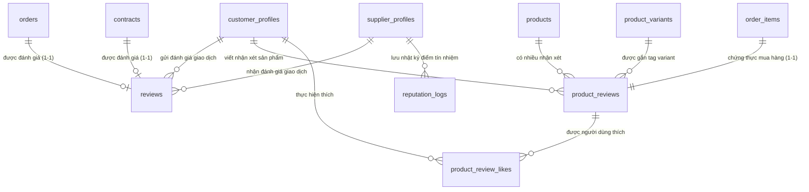

# MODULE 8: CƠ SỞ DỮ LIỆU, ĐỒNG THỜI & BẢO MẬT (DATA, SQL, CONCURRENCY & SECURITY)
## Tài Liệu Thiết Kế Chi Tiết (Database Architecture & Security Blueprint)

---

## I. MÔ HÌNH DỮ LIỆU QUAN HỆ (DATA SCHEMA & ENTITY FRAMEWORK CORE)

Hệ thống cơ sở dữ liệu của Module 8 sử dụng PostgreSQL 15+ trên nền tảng Supabase / RDS, tích hợp Entity Framework Core 8 Code-First với cơ chế Snake_Case quy chuẩn.

### 1.1. Sơ đồ Quan Hệ Thực Thể (ERD - Entity Relationship Diagram)



---

### 1.2. Đặc Tả Chi Tiết Các Bảng Dữ Liệu (DDL Specification)

#### Bảng 1: `reviews` (Đánh giá giao dịch Đơn hàng / Hợp đồng)
```sql
CREATE TABLE IF NOT EXISTS reviews (
    id UUID PRIMARY KEY DEFAULT uuid_generate_v4(),
    customer_id UUID NOT NULL REFERENCES customer_profiles(id) ON DELETE RESTRICT,
    supplier_id UUID NOT NULL REFERENCES supplier_profiles(id) ON DELETE RESTRICT,
    order_id UUID NULL REFERENCES orders(id) ON DELETE SET NULL,
    contract_id UUID NULL REFERENCES contracts(id) ON DELETE SET NULL,
    overall_rating SMALLINT NOT NULL CHECK (overall_rating BETWEEN 1 AND 5),
    quality_rating SMALLINT NOT NULL CHECK (quality_rating BETWEEN 1 AND 5),
    delivery_rating SMALLINT NOT NULL CHECK (delivery_rating BETWEEN 1 AND 5),
    service_rating SMALLINT NOT NULL CHECK (service_rating BETWEEN 1 AND 5),
    comment TEXT NOT NULL,
    media_urls JSONB NULL DEFAULT '[]'::jsonb,
    is_anonymous BOOLEAN NOT NULL DEFAULT FALSE,
    is_public BOOLEAN NOT NULL DEFAULT TRUE,
    is_hidden_by_admin BOOLEAN NOT NULL DEFAULT FALSE,
    supplier_reply TEXT NULL,
    supplier_replied_at TIMESTAMPTZ NULL,
    is_deleted BOOLEAN NOT NULL DEFAULT FALSE,
    created_at TIMESTAMPTZ NOT NULL DEFAULT NOW(),
    updated_at TIMESTAMPTZ NOT NULL DEFAULT NOW(),
    created_by UUID NULL,
    updated_by UUID NULL
);

-- Ràng buộc: Mỗi đơn hàng hoặc hợp đồng chỉ được review duy nhất 1 lần
CREATE UNIQUE INDEX IF NOT EXISTS uq_reviews_order_id ON reviews(order_id) WHERE order_id IS NOT NULL AND is_deleted = FALSE;
CREATE UNIQUE INDEX IF NOT EXISTS uq_reviews_contract_id ON reviews(contract_id) WHERE contract_id IS NOT NULL AND is_deleted = FALSE;

-- Chỉ mục tối ưu truy vấn gian hàng
CREATE INDEX IF NOT EXISTS idx_rev_supplier_feed ON reviews(supplier_id, created_at DESC) 
WHERE is_deleted = FALSE AND is_hidden_by_admin = FALSE;
```

#### Bảng 2: `product_reviews` (Bình luận mạng xã hội trên Sản phẩm / Biến thể)
```sql
CREATE TABLE IF NOT EXISTS product_reviews (
    id UUID PRIMARY KEY DEFAULT uuid_generate_v4(),
    customer_id UUID NOT NULL REFERENCES customer_profiles(id) ON DELETE RESTRICT,
    product_id UUID NOT NULL REFERENCES products(id) ON DELETE CASCADE,
    product_variant_id UUID NULL REFERENCES product_variants(id) ON DELETE SET NULL,
    order_item_id UUID NOT NULL REFERENCES order_items(id) ON DELETE RESTRICT,
    rating SMALLINT NOT NULL CHECK (rating BETWEEN 1 AND 5),
    title VARCHAR(255) NULL,
    content TEXT NOT NULL,
    media_urls JSONB NULL DEFAULT '[]'::jsonb,
    is_verified_purchase BOOLEAN NOT NULL DEFAULT TRUE,
    like_count INTEGER NOT NULL DEFAULT 0,
    supplier_reply TEXT NULL,
    supplier_replied_at TIMESTAMPTZ NULL,
    is_public BOOLEAN NOT NULL DEFAULT TRUE,
    is_hidden_by_admin BOOLEAN NOT NULL DEFAULT FALSE,
    is_deleted BOOLEAN NOT NULL DEFAULT FALSE,
    created_at TIMESTAMPTZ NOT NULL DEFAULT NOW(),
    updated_at TIMESTAMPTZ NOT NULL DEFAULT NOW(),
    created_by UUID NULL,
    updated_by UUID NULL
);

-- Ràng buộc cốt lõi: 1 Khách hàng chỉ review 1 chi tiết món hàng trong đơn đúng 1 lần
CREATE UNIQUE INDEX IF NOT EXISTS product_reviews_customer_id_order_item_id_key 
ON product_reviews(customer_id, order_item_id);

-- Chỉ mục phủ (Covering Index) tối ưu truy vấn luồng review theo sản phẩm
CREATE INDEX IF NOT EXISTS idx_prev_product_feed 
ON product_reviews(product_id, created_at DESC) 
WHERE is_deleted = FALSE AND is_hidden_by_admin = FALSE;

-- Chỉ mục lọc theo biến thể và số sao
CREATE INDEX IF NOT EXISTS idx_prev_variant_id ON product_reviews(product_variant_id) WHERE product_variant_id IS NOT NULL AND is_deleted = FALSE;
CREATE INDEX IF NOT EXISTS idx_prev_rating ON product_reviews(product_id, rating) WHERE is_deleted = FALSE;
CREATE INDEX IF NOT EXISTS idx_prev_like_count ON product_reviews(product_id, like_count DESC) WHERE is_deleted = FALSE;
```

#### Bảng 3: `product_review_likes` (Bảng ghi nhận lượt thích review)
```sql
CREATE TABLE IF NOT EXISTS product_review_likes (
    id UUID PRIMARY KEY DEFAULT uuid_generate_v4(),
    product_review_id UUID NOT NULL REFERENCES product_reviews(id) ON DELETE CASCADE,
    customer_id UUID NOT NULL REFERENCES customer_profiles(id) ON DELETE CASCADE,
    created_at TIMESTAMPTZ NOT NULL DEFAULT NOW(),
    is_deleted BOOLEAN NOT NULL DEFAULT FALSE,
    created_by UUID NULL,
    updated_by UUID NULL,
    updated_at TIMESTAMPTZ NOT NULL DEFAULT NOW()
);

-- Ràng buộc: Mỗi người dùng chỉ like 1 bài review tối đa 1 lần
CREATE UNIQUE INDEX IF NOT EXISTS uq_review_likes ON product_review_likes(product_review_id, customer_id);
```

#### Bảng 4: `reputation_logs` (Nhật ký kiểm toán biến động điểm uy tín)
```sql
CREATE TABLE IF NOT EXISTS reputation_logs (
    id UUID PRIMARY KEY DEFAULT uuid_generate_v4(),
    supplier_id UUID NOT NULL REFERENCES supplier_profiles(id) ON DELETE CASCADE,
    event_type VARCHAR(50) NOT NULL, -- CompletedOnTime, CompletedLate, Breached, PositiveReview, NegativeReview, AdminPenalty, AdminBonus
    score_delta NUMERIC(5, 2) NOT NULL,
    reason TEXT NULL,
    reference_id UUID NULL,
    reference_type VARCHAR(50) NULL, -- Order, Contract, Review, Dispute, AdminAction
    is_deleted BOOLEAN NOT NULL DEFAULT FALSE,
    created_at TIMESTAMPTZ NOT NULL DEFAULT NOW(),
    updated_at TIMESTAMPTZ NOT NULL DEFAULT NOW(),
    created_by UUID NULL,
    updated_by UUID NULL
);

CREATE INDEX IF NOT EXISTS idx_rl_supplier_timeline ON reputation_logs(supplier_id, created_at DESC);
CREATE INDEX IF NOT EXISTS idx_rl_reference ON reputation_logs(reference_id, reference_type) WHERE reference_id IS NOT NULL;
```

---

## II. ĐIỀU KHIỂN ĐỒNG THỜI (CONCURRENCY CONTROL)

### 2.1. Cập nhật Điểm Uy Tín Nguyên Tử (Atomic Score Increments)
Khi nhiều đơn hàng của cùng một xưởng bánh hoàn thành đồng thời trong mùa cao điểm Tết Trung Thu, việc đọc và ghi điểm uy tín có thể xảy ra xung đột `Lost Update`.

Giải pháp kiến trúc: Sử dụng câu lệnh cập nhật trực tiếp tại tầng CSDL với hàm điều kiện `GREATEST(0, ...)` thay vì load entity lên RAM rồi gán lại:
```sql
UPDATE supplier_profiles 
SET 
    reputation_score = GREATEST(0.0, reputation_score + @scoreDelta),
    avg_rating = (
        SELECT ROUND(AVG(overall_rating)::numeric, 2) 
        FROM reviews 
        WHERE supplier_id = @supplierId AND is_deleted = FALSE AND is_hidden_by_admin = FALSE
    ),
    updated_at = NOW()
WHERE user_id = @supplierId;
```

### 2.2. Xử lý Thả Like Đồng Thời (Optimistic Concurrency & Idempotency)
Để tránh spam request bấm nút Thích liên tục:
1. Thao tác Toggle Like sử dụng transaction ngắn (Short Transaction).
2. Khi User click Like: Kiểm tra bản ghi `product_review_likes`. Nếu chưa có $\rightarrow$ `INSERT` và `like_count = like_count + 1`. Nếu đã có $\rightarrow$ `DELETE` và `like_count = GREATEST(0, like_count - 1)`.
3. Áp dụng Rate-Limiter: Giới hạn tối đa **10 lần toggle/phút** trên mỗi tài khoản.

---

## III. BẢO MẬT & CHỐNG GIAN LẬN ĐÁNH GIÁ (SECURITY & FRAUD PREVENTION)

### 3.1. Chống Đánh Giá Giả Mạo & Seeding (Anti-Fraud & Verified Purchase)
- **100% Verified Purchase:** Tuyệt đối không cho phép tài khoản chưa từng mua hàng để lại nhận xét trên sản phẩm. Hệ thống đối soát trực tiếp với `order_items` có trạng thái thanh toán và giao hàng thành công.
- **Ràng buộc quan hệ:** Không cho phép chính chủ gian hàng (`SupplierProfile.UserId`) tự mua hoặc tự viết đánh giá cho sản phẩm của gian hàng mình (`Self-review blocking`).

### 3.2. Làm sạch nội dung & Chống XSS (Content Sanitization)
- Mọi trường văn bản (`title`, `content`, `comment`, `supplier_reply`) được chuẩn hóa loại bỏ toàn bộ các thẻ HTML độc hại (`<script>`, `<iframe>`, `javascript:`) bằng bộ thư viện `HtmlSanitizer` hoặc Regex Whitelist.
- Lưu trữ an toàn dưới dạng Plain Text.

### 3.3. Quyền hạn Kiểm duyệt của Quản Trị Viên (Admin Content Moderation)
- Đánh giá bị người dùng báo cáo (Flagged Reviews) sẽ được đưa vào hàng đợi kiểm duyệt của Admin ([`TradingOperating.jsx`](file:///Users/admin/Desktop/PRN232/mooncake-fe/src/Pages/Admin/TradingOperating.jsx)).
- Khi Admin ẩn bài đánh giá (`is_hidden_by_admin = true`):
  - Bài đánh giá biến mất ngay lập tức khỏi luồng công khai của sản phẩm và gian hàng.
  - Điểm sao của bài đánh giá bị ẩn sẽ được loại bỏ khỏi công thức tính `avg_rating` của sản phẩm và nhà cung cấp.

