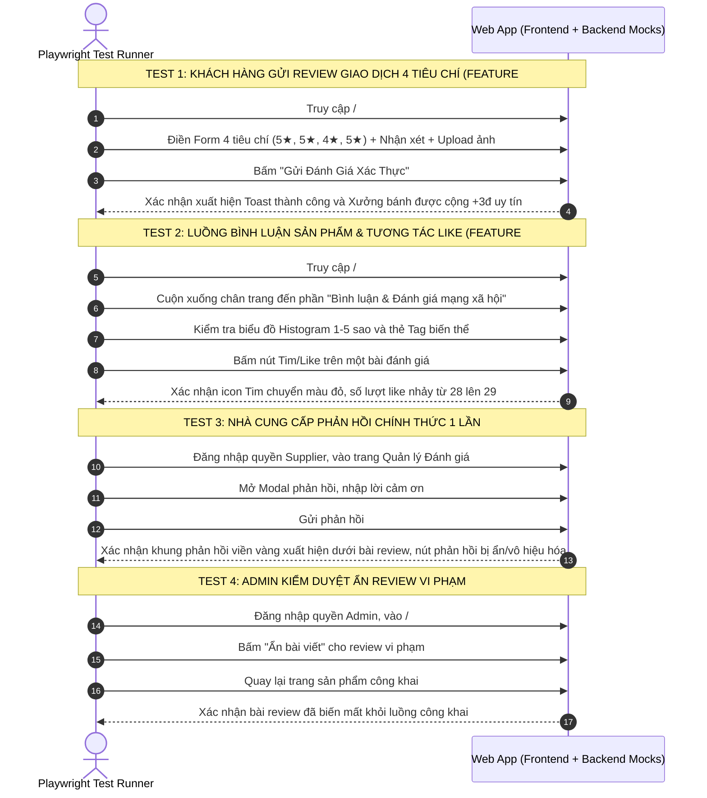
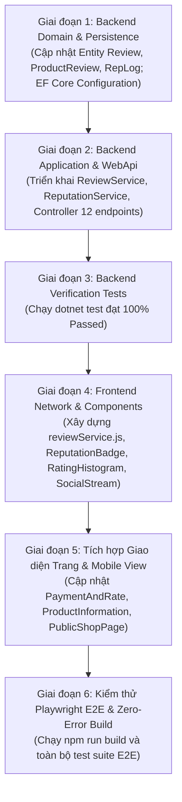

# MODULE 8: KẾ HOẠCH TRIỂN KHAI, KIỂM THỬ & BÀN GIAO (IMPLEMENTATION, TEST & ROLLOUT)
## Tài Liệu Thiết Kế Chi Tiết (Verification Matrix & Rollout Roadmap)

---

## I. MA TRẬN KIỂM THỬ TOÀN DIỆN (VERIFICATION MATRIX)

Để đảm bảo Module 8 đạt chuẩn Enterprise Zero-Error, kế hoạch kiểm thử bao gồm kiểm thử tự động nhiều tầng: Domain Unit Tests, WebApi HTTP Integration Tests, và Playwright End-to-End Tests.

### 1.1. Ma trận Kịch bản Kiểm thử Backend (xUnit / .NET 8)

| Mã Test | Tên Kịch bản Kiểm thử | Tầng thực thi | Kết quả kỳ vọng |
| :--- | :--- | :--- | :--- |
| **REV-BE-01** | `CreateTransactionReview_With5Stars_IncrementsReputationBy3Points` | Domain / Application | Đánh giá 5★ thành công; bản ghi `reputation_logs` sinh ra với `score_delta = +3.0`; `supplier_profiles.reputation_score` tăng 3 điểm |
| **REV-BE-02** | `CreateTransactionReview_With1Or2Stars_DecrementsReputationBy2Points` | Domain / Application | Đánh giá 1 hoặc 2 sao; `reputation_logs` sinh ra `score_delta = -2.0`; điểm uy tín giảm 2 điểm nhưng không âm ($Score \ge 0$) |
| **REV-BE-03** | `CreateTransactionReview_WhenNotDelivered_ThrowsBadRequestException` | Application Service | Đơn hàng trạng thái `Pending` hoặc `Processing` gửi review bị từ chối với HTTP 400 |
| **REV-BE-04** | `CreateTransactionReview_WhenAlreadyReviewed_ThrowsConflictException` | Domain / Application | Đơn hàng đã có bản ghi trong bảng `reviews` gửi tiếp lần 2 bị chặn với HTTP 409 Conflict |
| **REV-BE-05** | `SupplierReply_WhenAlreadyReplied_ThrowsBadRequestException` | Application Service | Nhà cung cấp gửi phản hồi lần thứ 2 cho cùng 1 review bị từ chối với HTTP 400 |
| **REV-BE-06** | `CreateProductReview_VerifiedPurchaseEnforced` | Application Service | Kiểm tra `order_items`; nếu User chưa từng mua biến thể này sẽ bị chặn với HTTP 403 Forbidden |
| **REV-BE-07** | `ProductReview_ToggleLike_IncrementsAndDecrementsCountAtomically` | Application / DB | Lần 1 bấm like: `isLiked = true, count = 1`; Lần 2 bấm like: `isLiked = false, count = 0` |
| **REV-BE-08** | `AdminAdjustReputation_AppliesPenaltyAndWritesAuditLog` | Application / Admin | Admin phạt -15đ; ghi nhận `reputation_logs`, điểm xưởng bánh cập nhật và hạ bậc huy hiệu tương ứng |
| **REV-BE-09** | `ReviewsController_HttpEnvelopes_ConformsToApiResponse` | WebApi Integration | Phản hồi API luôn bọc trong `ApiResponse<T>`, có `TraceId`, `Path`, và `Time` UTC |

---

### 1.2. Kịch bản Kiểm thử End-to-End Tự động Frontend (Playwright E2E)

File kịch bản: `mooncake-fe/tests/reviews-reputation.spec.js`

---

## II. LỘ TRÌNH TRIỂN KHAI TỪNG BƯỚC (STEP-BY-STEP ROLLOUT ROADMAP)

### Chi tiết các bước thực hiện:

1. **Bước 1 — Backend Persistence:**
   - Bổ sung các trường còn thiếu trong [`Review.cs`](file:///Users/admin/Desktop/PRN232/mooncake-ecommerce-platform/src/Mooncake.EcommercePlatform.Domain/Entities/Review.cs): `SupplierReply`, `SupplierRepliedAt`, `IsHiddenByAdmin`, `IsAnonymous`, `MediaUrls`.
   - Cập nhật [`ReviewConfiguration.cs`](file:///Users/admin/Desktop/PRN232/mooncake-ecommerce-platform/src/Mooncake.EcommercePlatform.Infrastructure/Persistence/Configurations/ReviewConfiguration.cs).
2. **Bước 2 — Backend Services & Controllers:**
   - Tạo `IReviewService.cs` và `IReputationService.cs`.
   - Viết `ReviewService.cs` và `ReputationService.cs` xử lý tính điểm, kiểm tra verified purchase và ghi log.
   - Viết `ReviewsController.cs` và `ProductReviewsController.cs`.
   - Đăng ký Dependency Injection tại `Application/DependencyInjection.cs` và `Infrastructure/DependencyInjection.cs`.
3. **Bước 3 — Backend Tests:**
   - Tạo bộ test xUnit trong project `Mooncake.EcommercePlatform.Verification.Tests`.
   - Chạy `dotnet test` đảm bảo 100% test case xanh.
4. **Bước 4 — Frontend Core:**
   - Thêm endpoints vào [`apiEndpoints.js`](file:///Users/admin/Desktop/PRN232/mooncake-fe/src/constants/apiEndpoints.js).
   - Viết [`reviewService.js`](file:///Users/admin/Desktop/PRN232/mooncake-fe/src/services/reviewService.js) kèm mock fallback phong phú.
   - Xây dựng các component luxury: `ReputationBadge.jsx`, `RatingHistogram.jsx`, `ProductReviewStream.jsx`, `TransactionReviewModal.jsx`.
5. **Bước 5 — Frontend Pages & Mobile Web:**
   - Nhúng luồng review vào [`ProductInformation.jsx`](file:///Users/admin/Desktop/PRN232/mooncake-fe/src/Pages/Products/ProductInformation.jsx).
   - Nâng cấp [`PaymentAndRate.jsx`](file:///Users/admin/Desktop/PRN232/mooncake-fe/src/Pages/Customer/PaymentAndRate.jsx).
   - Nâng cấp [`PublicShopPage.jsx`](file:///Users/admin/Desktop/PRN232/mooncake-fe/src/Pages/PublicShopPage.jsx).
   - Tối ưu hóa giao diện di động (Drawer trượt, camera HTML5, touch star rating).
6. **Bước 6 — E2E Verification & Bàn giao:**
   - Tạo file test E2E `tests/reviews-reputation.spec.js`.
   - Kiểm tra `npm run build` đạt 0 lỗi.
   - Chạy Playwright E2E suite kiểm tra thông suốt luồng.

