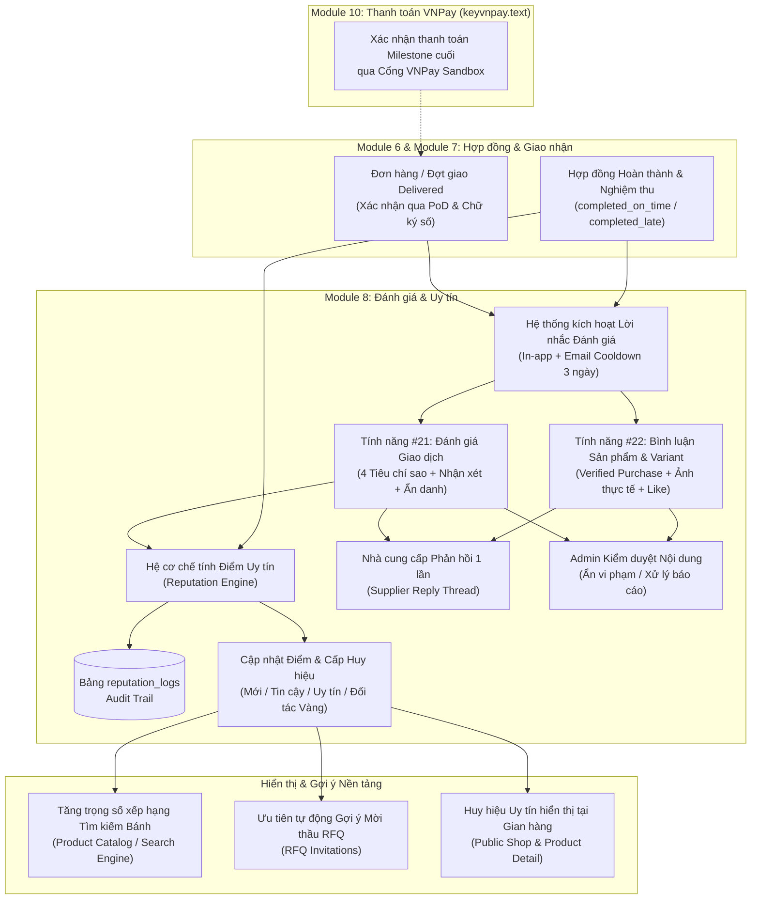

# Module 8: Đánh Giá & Điểm Uy Tín Nhà Cung Cấp (Reviews & Reputation Management)
## Tính Năng #21 & #22 — Tài Liệu Thiết Kế Chi Tiết Chuẩn Enterprise

---

## 1. TỔNG QUAN HỆ THỐNG & MỤC TIÊU NGHIỆP VỤ

Module 8 là mắt xích thiết yếu trong chu trình thương mại điện tử B2B Mooncake Platform, đảm bảo tính minh bạch, xây dựng niềm tin số (Digital Trust) và thúc đẩy chất lượng dịch vụ giữa Doanh nghiệp đặt hàng (Customer) và Xưởng sản xuất bánh (Supplier).

Module chịu trách nhiệm quản lý 3 trụ cột nghiệp vụ cốt lõi:
1. **Tính năng #21 – Đánh giá & Phản hồi sau giao dịch (Transaction Reviews):**
   - Kích hoạt sau khi Đơn hàng đạt trạng thái `delivered` (Module 4) hoặc Hợp đồng chuyển sang `completed` (Module 6) sau khi ký nhận biên bản PoD thành công (Module 7).
   - Đánh giá đa chiều 4 tiêu chí (1–5★): **Chất lượng bánh**, **Đúng hạn giao hàng**, **Dịch vụ hỗ trợ & Mockup logo**, **Mức độ hài lòng tổng thể**.
   - Quyền ẩn danh (Anonymous) bảo vệ thông tin doanh nghiệp mua; Nhà cung cấp có quyền phản hồi chính thức 1 lần; Quản trị viên (Admin) kiểm duyệt nội dung vi phạm.
2. **Tính năng #22 – Đánh giá & Bình luận sản phẩm / Biến thể (Product & Variant Social Review Stream):**
   - Luồng bình luận mạng xã hội trực quan (Shopee/TikTok style) trực tiếp dưới trang chi tiết sản phẩm ([`ProductInformation.jsx`](file:///Users/admin/Desktop/PRN232/mooncake-fe/src/Pages/Products/ProductInformation.jsx)).
   - Chứng nhận mua hàng thực tế (**Verified Purchase**) gắn chặt với từng chi tiết đơn hàng (`order_item_id`).
   - Tag biến thể cụ thể (ví dụ: *Bánh Nướng Thập Cẩm Bát Bửu 180g*), đính kèm bộ sưu tập ảnh/video thực tế tại bàn tiệc/doanh nghiệp.
   - Tương tác cộng đồng: Bộ đếm lượt thích (Like Counter) và phản hồi từ gian hàng.
   - Thống kê phân tích: Phân phối số sao (Histogram 1–5★), điểm trung bình và bộ lọc theo biến thể/đa phương tiện.
3. **Tính năng #22 (Mở rộng) – Động cơ tính điểm uy tín & Hệ thống Huy hiệu (Supplier Reputation Engine & Badges):**
   - Động cơ tính điểm thời gian thực (Event-driven) dựa trên các sự kiện vận hành:
     - Giao hàng / Hoàn thành đúng hạn: **+10đ**
     - Hoàn thành trễ hạn: **-5đ**
     - Vi phạm hợp đồng (Breach): **-20đ**
     - Đánh giá 5★: **+3đ**; Đánh giá 4★: **+1đ**; Đánh giá 1–2★: **-2đ**
     - Biện pháp phạt / Thưởng từ Admin: **$\pm$N đ**
   - Phân cấp Huy hiệu Nhà cung cấp: **Mới (0–20đ)** $\rightarrow$ **Tin cậy (21–50đ)** $\rightarrow$ **Uy tín (51–80đ)** $\rightarrow$ **Đối tác Vàng (81+ đ)**.
   - Tác động sâu rộng: Thứ hạng tìm kiếm sản phẩm (`ProductSearchDocument`), tỷ lệ đề xuất mời thầu tự động (`rfq_invitations`), và hiển thị trực quan trên toàn sàn.

---

## 2. BẢN ĐỒ NGHIỆP VỤ & QUAN HỆ LIÊN MODULE (SYSTEM CONTEXT)

---

## 3. DANH MỤC TÀI LIỆU THIẾT KẾ CHI TIẾT

Bộ tài liệu thiết kế được phân chia thành 8 chuyên đề kỹ thuật chuyên sâu theo đúng chuẩn Enterprise Template:

| STT | Mã tài liệu | Nội dung chuyên đề | Trạng thái |
| :---: | :--- | :--- | :---: |
| 1 | [`01_TRANSACTION_REVIEWS_DESIGN.md`](file:///Users/admin/Desktop/PRN232/mooncake-ecommerce-platform/.agents/feature/reviews-reputation-management/01_TRANSACTION_REVIEWS_DESIGN.md) | Thiết kế Tính năng #21: Đánh giá giao dịch 4 tiêu chí, luồng nhắc nhở, ẩn danh và phản hồi NCC | Đã hoàn tất |
| 2 | [`02_PRODUCT_REVIEWS_STREAM_DESIGN.md`](file:///Users/admin/Desktop/PRN232/mooncake-ecommerce-platform/.agents/feature/reviews-reputation-management/02_PRODUCT_REVIEWS_STREAM_DESIGN.md) | Thiết kế Tính năng #22: Luồng bình luận sản phẩm/biến thể, xác thực Verified Purchase, tải ảnh/video, bộ đếm like | Đã hoàn tất |
| 3 | [`03_SUPPLIER_REPUTATION_ENGINE_DESIGN.md`](file:///Users/admin/Desktop/PRN232/mooncake-ecommerce-platform/.agents/feature/reviews-reputation-management/03_SUPPLIER_REPUTATION_ENGINE_DESIGN.md) | Động cơ tính điểm uy tín thời gian thực, cấp bậc huy hiệu, nhật ký kiểm toán và ảnh hưởng thuật toán | Đã hoàn tất |
| 4 | [`04_MOBILE_WORKFLOW_RESPONSIVE_WEB_DESIGN.md`](file:///Users/admin/Desktop/PRN232/mooncake-ecommerce-platform/.agents/feature/reviews-reputation-management/04_MOBILE_WORKFLOW_RESPONSIVE_WEB_DESIGN.md) | Luồng trải nghiệm Mobile Web Responsive: chấm sao cảm ứng, camera chụp ảnh trực tiếp, drawer bình luận tiện dụng | Đã hoàn tất |
| 5 | [`05_API_DTO_VALIDATION.md`](file:///Users/admin/Desktop/PRN232/mooncake-ecommerce-platform/.agents/feature/reviews-reputation-management/05_API_DTO_VALIDATION.md) | Đặc tả 12 RESTful API endpoints, request/response DTOs bọc `ApiResponse<T>`, FluentValidation, Rate limit & Error codes | Đã hoàn tất |
| 6 | [`06_DATA_SQL_CONCURRENCY_SECURITY.md`](file:///Users/admin/Desktop/PRN232/mooncake-ecommerce-platform/.agents/feature/reviews-reputation-management/06_DATA_SQL_CONCURRENCY_SECURITY.md) | Thiết kế CSDL PostgreSQL, EF Core mapping, unique constraints chống spam đánh giá, concurrency và bảo mật kiểm duyệt | Đã hoàn tất |
| 7 | [`07_FRONTEND_INTEGRATION.md`](file:///Users/admin/Desktop/PRN232/mooncake-ecommerce-platform/.agents/feature/reviews-reputation-management/07_FRONTEND_INTEGRATION.md) | Kiến trúc React 19 Luxury UI, component hierarchy, service layer với mock fallback, tích hợp trang chi tiết và gian hàng | Đã hoàn tất |
| 8 | [`08_IMPLEMENTATION_TEST_ROLLOUT.md`](file:///Users/admin/Desktop/PRN232/mooncake-ecommerce-platform/.agents/feature/reviews-reputation-management/08_IMPLEMENTATION_TEST_ROLLOUT.md) | Kế hoạch kiểm thử xUnit backend, Playwright E2E frontend, quy trình migrate dữ liệu và giám sát vận hành | Đã hoàn tất |

---

## 4. MA TRẬN PHÂN QUYỀN VÀ TRÁCH NHIỆM (RACI MATRIX)

| Hành động / Nghiệp vụ | Customer | Supplier | Admin | System Scheduler |
| :--- | :---: | :---: | :---: | :---: |
| Gửi đánh giá giao dịch (Feature #21) | **A / R** | I | I | C (Trigger reminder) |
| Đăng review sản phẩm & variant (Feature #22) | **A / R** (Verified) | I | I | - |
| Thích (Like) review sản phẩm | **R** | **R** | I | - |
| Trả lời review (1 lần duy nhất) | I | **A / R** | I | - |
| Kiểm duyệt ẩn review vi phạm | I | C (Report) | **A / R** | - |
| Áp dụng phạt/thưởng điểm thủ công | I | I | **A / R** | - |
| Tính toán điểm uy tín & cấp huy hiệu | I | I | I | **A / R** (Real-time) |
| Tra cứu lịch sử biến động điểm uy tín | I | **R** (Own shop) | **R** (All) | - |

*Ký hiệu: **A**: Accountable (Chịu trách nhiệm chính), **R**: Responsible (Người thực hiện), **C**: Consulted (Được tham vấn), **I**: Informed (Nhận thông báo).*

---

## 5. CÁC QUY TẮC PHÁT TRIỂN & CHUẨN MỰC BẮT BUỘC

1. **Chuẩn mã nguồn Backend (.NET 8 Clean Architecture):**
   - 100% tiếng Anh cho Class, Method, DTO, Entity, Exception và Log.
   - Trả về cấu trúc bao gói chuẩn `ApiResponse<T>` qua `ResponseHelper`.
   - Thông điệp tiếng Việt thân thiện lưu trữ tập trung tại `MessageConstant.cs`.
2. **Chuẩn mã nguồn Frontend (React 19 + Tailwind CSS + Ant Design 6):**
   - Tab size = **2 spaces**, không dùng tab cứng (`\t`).
   - Dấu nháy đơn `'...'` cho chuỗi JS, dấu nháy kép `"..."` cho thuộc tính JSX.
   - Tuyệt đối không dùng `var`, ưu tiên `const` và Optional Chaining (`?.`).
   - Mọi request API đi qua `apiClient.js` và tích hợp Mock Fallback (`VITE_ENABLE_MOCK_FALLBACK=true`).
   - Đảm bảo Zero-Error build (`npm run build`).
3. **Liên kết Thanh toán VNPay:**
   - Nghiệp vụ kiểm tra trạng thái thanh toán giải ngân/đặt cọc tham chiếu cấu hình VNPay tại [`keyvnpay.text`](file:///Users/admin/Desktop/PRN232/keyvnpay.text) (đã tích hợp trong `appsettings.json`).
4. **Quy tắc Git:** Tuyệt đối **không commit lên git** trong suốt quá trình triển khai trừ khi có lệnh trực tiếp từ người dùng.

