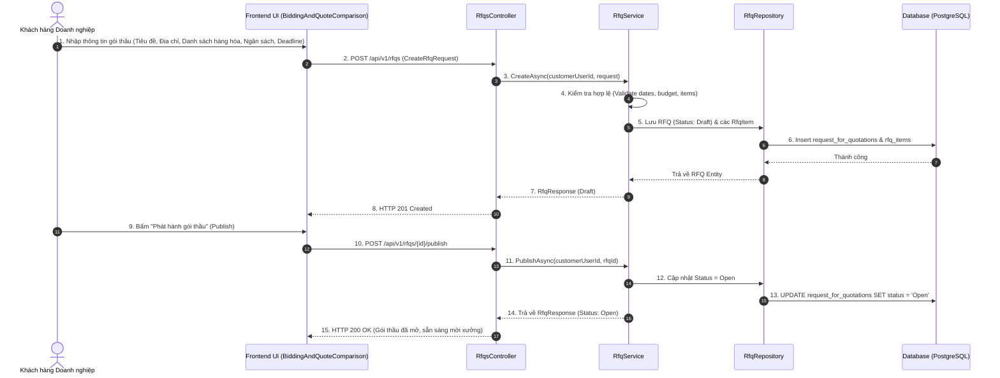
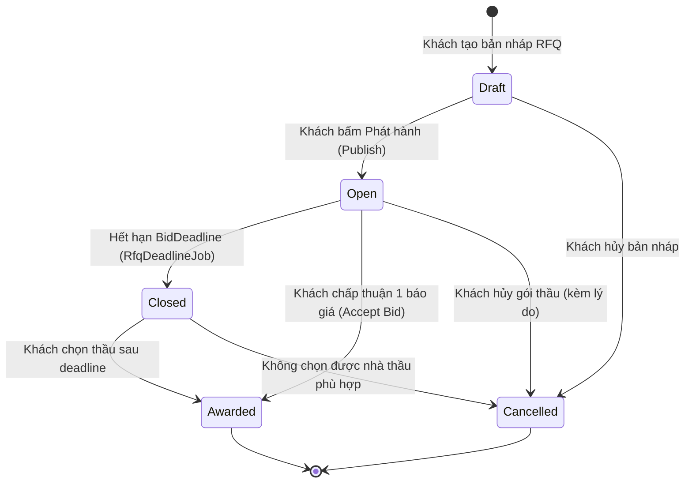

# [RFQ-BIDDING-10] - TÀI LIỆU THIẾT KẾ CHI TIẾT TẠO YÊU CẦU BÁO GIÁ (RFQ CREATION & LIFECYCLE)

---

## I. TÊN TÀI LIỆU, TÍNH NĂNG & TỔNG QUAN

### 1.1. Thông tin tài liệu
- **Tên tài liệu:** Tài liệu thiết kế chi tiết tính năng Tạo & Quản lý yêu cầu báo giá (RFQ Creation & Lifecycle)
- **Mã tính năng (Feature Key):** `rfq-bidding-create` (Module 5, Tính năng #10)
- **Độ ưu tiên:** 🔴 P0 Critical
- **Phiên bản:** `1.0.0` | **Ngày lập:** 2026-10-29
- **Tác nhân tham gia (Actors):**
  - **Customer:** Khách hàng doanh nghiệp tạo yêu cầu báo giá gồm danh sách các dòng bánh, yêu cầu kỹ thuật, ngân sách, ngày giao và thời hạn nhận báo giá.
  - **Supplier:** Xem chi tiết các yêu cầu trong RFQ khi được mời để quyết định tham gia.
  - **System (Background Job):** Tự động đóng cổng nhận thầu khi đến hạn chót (`BidDeadline`).

### 1.2. Mục tiêu nghiệp vụ (Business Goals)
- Cho phép các doanh nghiệp lớn phát hành hồ sơ mời chào giá công khai hoặc gửi riêng cho các xưởng bánh uy tín để tìm đối tác sản xuất tối ưu về chi phí và chất lượng.
- Chuẩn hóa thông tin yêu cầu: Mỗi RFQ có thể chứa nhiều dòng sản phẩm (`RfqItem`) với số lượng, giá mục tiêu, yêu cầu đóng gói in logo riêng biệt.
- Cơ chế quản lý trạng thái minh bạch: Lưu nháp (`Draft`), phát hành (`Open`), đóng thầu (`Closed`), trao thầu (`Awarded`) và hủy thầu (`Cancelled`).

### 1.3. Phạm vi tính năng (Scope)
- **Bao gồm (In-scope):**
  - Tạo RFQ dạng bản nháp (`Draft`) gồm nhiều dòng sản phẩm `RfqItem`.
  - Sinh mã tự động chuẩn: `RFQ-YYYY-XXXXXX`.
  - Thiết lập khoảng ngân sách dự kiến: `budget_range_min` đến `budget_range_max`.
  - Thiết lập ngày cần giao hàng (`delivery_date_required`) và hạn chót nộp báo giá (`bid_deadline`).
  - Phát hành RFQ sang trạng thái `Open` để bắt đầu mời và nhận hồ sơ chào thầu.
  - Hủy RFQ khi còn mở (chỉ cho phép khi chưa có báo giá được chấp nhận) kèm lý do hủy.
- **Không bao gồm (Out-of-scope):**
  - Quản lý tài liệu kỹ thuật CAD/3D phức tạp vượt quá 20MB (tập trung vào file đặc tả PDF/Excel tiêu chuẩn).

### 1.4. Ràng buộc & Điều kiện tiên quyết (Invariants & Prerequisites)
| Quy tắc | Ràng buộc kỹ thuật |
| :--- | :--- |
| **Quyền khởi tạo** | Chỉ người dùng đã đăng nhập với vai trò `Customer` mới có quyền tạo và quản lý RFQ của mình. |
| **Thời hạn báo giá** | `BidDeadline > UtcNow` và `BidDeadline <= DeliveryDateRequired`. |
| **Thời hạn giao hàng** | `DeliveryDateRequired >= DateOnly.FromDateTime(UtcNow)`. |
| **Khoảng ngân sách** | Nếu có cả min và max: `BudgetRangeMin >= 0`, `BudgetRangeMax >= BudgetRangeMin`. |
| **Số lượng mặt hàng** | Danh sách `Items` phải có từ 1 đến 100 sản phẩm; mỗi sản phẩm `Quantity >= 1`. |

---

## II. FLOW CHART TOÀN BỘ LUỒNG (WORKFLOW DIAGRAM)

### 2.1. Sequence Diagram - Luồng tạo và phát hành RFQ



### 2.2. State Transition Diagram - Vòng đời trạng thái RFQ



---

## III. CHI TIẾT TỪNG BƯỚC XỬ LÝ (STEP-BY-STEP LOGIC)

### Bước 1: Tiếp nhận dữ liệu khởi tạo RFQ & Validate
1. Chuẩn hóa chuỗi văn bản (`Trim()` tiêu đề, địa chỉ, mô tả, tên từng mặt hàng).
2. Kiểm tra danh sách mặt hàng (`Items`):
   - Danh sách không được rỗng (tối thiểu 1 mặt hàng, tối đa 100 mặt hàng).
   - Từng mặt hàng phải có `ProductName` không rỗng, `Unit` (hộp, set, chiếc), và `Quantity >= 1`.
   - Nếu có `TargetPrice`: Phải `>= 0`.
3. Kiểm tra các mốc thời gian:
   - `BidDeadline` phải ở tương lai (`> clock.UtcNow`).
   - `DeliveryDateRequired` phải ở tương lai và sau ngày của `BidDeadline`.
4. Kiểm tra ngân sách:
   - Nếu cung cấp `BudgetRangeMin` và `BudgetRangeMax`, yêu cầu `BudgetRangeMin <= BudgetRangeMax`.
   - Nếu vi phạm -> Ném `HttpException(400, "The RFQ budget range is invalid.")`.

### Bước 2: Sinh mã định danh & Lưu trữ vào Database
1. Sinh mã số RFQ độc bản theo quy ước: `RFQ-YYYY-XXXXXX` (Ví dụ: `RFQ-2026-A1B2C3D4E5`).
2. Mở Transaction cơ sở dữ liệu:
   - Tạo bản ghi `RequestForQuotation` với `Status = RfqStatus.Draft`.
   - Tạo các bản ghi `RfqItem` liên kết với `RfqId`.
3. Commit Transaction và trả về `RfqResponse`.

### Bước 3: Phát hành gói thầu (Publishing RFQ)
1. Chỉ chủ sở hữu gói thầu (`CustomerId == CurrentUser.Id`) mới được phát hành.
2. Kiểm tra trạng thái hiện tại: Bắt buộc đang là `Draft`. Nếu không -> Ném `HttpException(409, "Only a draft RFQ can be published.")`.
3. Re-validate thời hạn: Đảm bảo `BidDeadline` và `DeliveryDateRequired` vẫn còn hợp lệ ở thời điểm phát hành.
4. Chuyển trạng thái `Status = RfqStatus.Open`.

### Bước 4: Hủy bỏ gói thầu (Cancel RFQ)
1. Bắt buộc cung cấp lý do hủy thầu (`Reason` từ 5 đến 500 ký tự).
2. Nếu RFQ đã ở trạng thái `Awarded` (đã ký kết thầu) hoặc `Cancelled` -> Ném `HttpException(409, "An awarded or cancelled RFQ cannot be cancelled.")`.
3. Chuyển trạng thái sang `Cancelled`, ghi nhận `CancellationReason` và kích hoạt thông báo cho các xưởng đã nộp hồ sơ.

---

## IV. ĐẶC TẢ KỸ THUẬT API (API CONTRACT SPECIFICATION)

### 4.1. Tạo RFQ (Create RFQ)
- **Endpoint:** `POST /api/v1/rfqs`
- **Quyền:** `Authorized (Role: Customer)`
- **Request Body:**
```json
{
  "title": "Gói thầu Quà tặng Trung Thu Doanh Nghiệp 2026 (500 Hộp Sơn Mài Cao Cấp)",
  "description": "Nhu cầu đặt làm quà biếu đối tác VVIP, yêu cầu đóng hộp gỗ sơn mài đỏ, in logo ép kim vàng.",
  "deliveryAddress": "Tòa nhà Keangnam Landmark 72, Phạm Hùng, Hà Nội",
  "deliveryDateRequired": "2026-09-15",
  "budgetRangeMin": 300000000.00,
  "budgetRangeMax": 350000000.00,
  "bidDeadline": "2026-08-25T18:00:00Z",
  "items": [
    {
      "productName": "Hộp Sơn Mài 4 Bánh Nướng Thập Cẩm & Trà Sen VVIP",
      "description": "Bánh nướng 2 trứng 200g, nhân thập cẩm bào ngư, vi cá. Kèm 100g trà sen Tây Hồ.",
      "quantity": 300,
      "unit": "Hộp",
      "targetPrice": 650000.00,
      "specifications": "Hộp gỗ sơn mài mài bóng 7 lớp, lót nhung đỏ, khóa đồng cổ.",
      "packagingRequirements": "In logo công ty ép kim 24k mặt ngoài hộp.",
      "needsCustomPackaging": true
    },
    {
      "productName": "Hộp Giấy Mỹ Thuật 4 Bánh Dẻo Hương Bưởi",
      "description": "Bánh dẻo đậu xanh hạt sen 150g.",
      "quantity": 200,
      "unit": "Hộp",
      "targetPrice": 350000.00,
      "specifications": "Giấy mỹ thuật dập nổi hoa cúc.",
      "packagingRequirements": "Thắt nơ lụa vàng.",
      "needsCustomPackaging": false
    }
  ]
}
```

- **Response Body (HTTP 201 Created):**
```json
{
  "status": 201,
  "message": "RFQ created successfully.",
  "data": {
    "id": "1fa85f64-5717-4562-b3fc-2c963f66afa1",
    "rfqNumber": "RFQ-2026-089100",
    "title": "Gói thầu Quà tặng Trung Thu Doanh Nghiệp 2026 (500 Hộp Sơn Mài Cao Cấp)",
    "description": "Nhu cầu đặt làm quà biếu đối tác VVIP, yêu cầu đóng hộp gỗ sơn mài đỏ, in logo ép kim vàng.",
    "deliveryAddress": "Tòa nhà Keangnam Landmark 72, Phạm Hùng, Hà Nội",
    "deliveryDateRequired": "2026-09-15",
    "budgetRangeMin": 300000000.00,
    "budgetRangeMax": 350000000.00,
    "bidDeadline": "2026-08-25T18:00:00Z",
    "status": "Draft",
    "items": [
      {
        "id": "2fa85f64-5717-4562-b3fc-2c963f66afa2",
        "productName": "Hộp Sơn Mài 4 Bánh Nướng Thập Cẩm & Trà Sen VVIP",
        "quantity": 300,
        "unit": "Hộp",
        "targetPrice": 650000.00,
        "needsCustomPackaging": true
      }
    ],
    "invitationCount": 0,
    "bidCount": 0
  },
  "path": "/api/v1/rfqs",
  "traceId": "trace-rfq-001",
  "time": "2026-08-01T09:00:00Z"
}
```

### 4.2. Phát hành RFQ (Publish RFQ)
- **Endpoint:** `POST /api/v1/rfqs/{rfqId}/publish`
- **Quyền:** `Authorized (Role: Customer)`
- **Response Body (HTTP 200 OK):**
```json
{
  "status": 200,
  "message": "RFQ published successfully.",
  "data": {
    "id": "1fa85f64-5717-4562-b3fc-2c963f66afa1",
    "status": "Open",
    "invitationCount": 0,
    "bidCount": 0
  },
  "path": "/api/v1/rfqs/1fa85f64-5717-4562-b3fc-2c963f66afa1/publish",
  "traceId": "trace-rfq-002",
  "time": "2026-08-01T09:15:00Z"
}
```

---

## V. KIẾN TRÚC PHÂN TẦNG VÀ TỔ CHỨC MÃ NGUỒN (LAYER MAPPING)

```text
src/
├── Mooncake.EcommercePlatform.Domain/
│   ├── Entities/RequestForQuotation.cs         # Thực thể RFQ
│   ├── Entities/RfqItem.cs                    # Các mặt hàng chi tiết trong gói thầu
│   └── Enums/RfqStatus.cs                     # Draft, Open, InNegotiation, Awarded, Closed, Cancelled
│
├── Mooncake.EcommercePlatform.Application/
│   ├── DTOs/Rfqs/Requests/CreateRfqRequest.cs
│   ├── DTOs/Rfqs/Responses/RfqResponse.cs
│   ├── Services/Interfaces/IRfqService.cs
│   ├── Services/Implementations/RfqService.cs
│   └── Common/Interfaces/IRfqRepository.cs
│
├── Mooncake.EcommercePlatform.Infrastructure/
│   ├── Persistence/Configurations/RfqConfiguration.cs
│   ├── Persistence/Configurations/RfqItemConfiguration.cs
│   └── Repositories/RfqRepository.cs
│
└── Mooncake.EcommercePlatform.WebApi/
    ├── Controllers/RfqsController.cs          # RESTful Endpoints
    └── Background/RfqDeadlineJob.cs           # Tự động đóng thầu khi đến deadline
```

---

## VI. BẢO MẬT & KIỂM THỬ (SECURITY & TESTING PLAN)

### 6.1. Tiêu chuẩn bảo mật
- [x] **Bảo vệ quyền riêng tư giá mục tiêu:** Khi nhà cung cấp xem danh sách RFQ công khai, trường `TargetPrice` có thể được ẩn đi nếu khách hàng cấu hình giữ bí mật ngân sách đấu thầu.
- [x] **Kiểm soát quyền sở hữu:** Chỉ tài khoản `CustomerId` tạo ra RFQ mới được phép sửa đổi, phát hành hoặc hủy bỏ gói thầu.

### 6.2. Kịch bản kiểm thử (Test Cases)
1. **Happy Path:** Khách tạo RFQ với 2 items -> Status là Draft -> Bấm Publish -> Status chuyển Open -> Supplier thấy gói thầu mở.
2. **Negative - Deadline quá khứ:** Nhập `BidDeadline = Hôm qua` -> Trả về HTTP 400 Bad Request.
3. **Negative - Deadline sau ngày giao:** Nhập `BidDeadline = 20/09` nhưng `DeliveryDateRequired = 15/09` -> Trả về HTTP 400 Bad Request.
4. **Hủy RFQ thành công:** Khách gửi lý do hủy -> RFQ chuyển `Cancelled` -> Chặn nộp bid mới.

