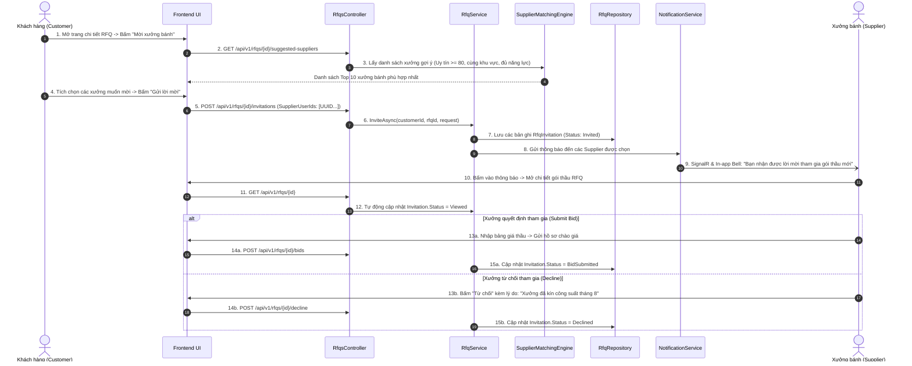
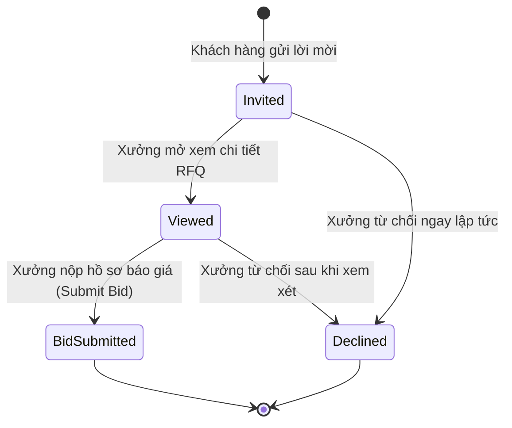

# [RFQ-BIDDING-11] - TÀI LIỆU THIẾT KẾ CHI TIẾT MỜI NHÀ CUNG CẤP & GỢI Ý XƯỞNG (SUPPLIER INVITATION & MATCHING)

---

## I. TÊN TÀI LIỆU, TÍNH NĂNG & TỔNG QUAN

### 1.1. Thông tin tài liệu
- **Tên tài liệu:** Tài liệu thiết kế chi tiết tính năng Mời nhà cung cấp tham gia RFQ & Thuật toán gợi ý xưởng (Supplier Invitation & Matching)
- **Mã tính năng (Feature Key):** `rfq-bidding-invitation` (Module 5, Tính năng #11)
- **Độ ưu tiên:** 🟠 P1 High
- **Phiên bản:** `1.0.0` | **Ngày lập:** 2026-10-29
- **Tác nhân tham gia (Actors):**
  - **Customer:** Chọn mời đích danh các xưởng bánh uy tín tham gia chào giá (tối đa 10 xưởng); xem thống kê phản hồi lời mời.
  - **Supplier:** Nhận thông báo mời thầu, xem hồ sơ RFQ, xác nhận tham gia nộp hồ sơ hoặc từ chối kèm lý do.
  - **System (Matching Engine):** Tự động phân tích nhu cầu trong RFQ và gợi ý danh sách xưởng bánh phù hợp nhất.

### 1.2. Mục tiêu nghiệp vụ (Business Goals)
- Giúp khách hàng doanh nghiệp nhanh chóng tiếp cận được các xưởng sản xuất có năng lực đáp ứng thực tế cao nhất, không mất thời gian tìm kiếm thủ công.
- Tăng tỷ lệ phản hồi thầu và đảm bảo tính cạnh tranh lành mạnh về giá và chất lượng giữa các xưởng bánh.
- Theo dõi chặt chẽ tiến độ mời thầu thông qua các trạng thái: `Invited -> Viewed -> BidSubmitted / Declined`.

### 1.3. Phạm vi tính năng (Scope)
- **Bao gồm (In-scope):**
  - Gửi lời mời tới tối đa 10 Supplier cho mỗi RFQ (`InviteSuppliersRequest`).
  - Thuật toán gợi ý xưởng phù hợp (dựa trên trạng thái `Verified`, điểm uy tín `ReputationScore >= 80`, danh mục tương thích, khu vực địa lý).
  - Gửi thông báo đa kênh: In-app notification, SignalR Realtime Hub và Email.
  - Cơ chế tự động ghi nhận khi Supplier mở xem chi tiết RFQ (`Invited -> Viewed`).
  - Cho phép Supplier từ chối tham gia chào thầu kèm lý do (`Declined`).
  - Thống kê tỷ lệ phản hồi cho khách hàng: Số lượng đã mời / đã xem / đã nộp báo giá / đã từ chối.
- **Không bao gồm (Out-of-scope):**
  - Tự động nộp báo giá thay mặt xưởng bằng bot (bắt buộc đại diện xưởng thẩm định và gửi giá thủ công).

### 1.4. Ràng buộc & Điều kiện tiên quyết (Invariants & Prerequisites)
| Quy tắc | Ràng buộc kỹ thuật |
| :--- | :--- |
| **Trạng thái RFQ** | Chỉ RFQ đang ở trạng thái `Open` và chưa hết hạn `BidDeadline` mới được mời xưởng. |
| **Giới hạn số lượng mời** | Tối đa 10 xưởng cho mỗi RFQ (`MaximumInvitations = 10`). |
| **Điều kiện xưởng được mời** | Supplier phải ở trạng thái đã xác minh (`Verified`), gian hàng đang `Active` và tài khoản không bị khóa. |
| **Chống mời trùng lặp** | Mỗi xưởng chỉ có tối đa 1 bản ghi `RfqInvitation` cho cùng 1 RFQ (Ràng buộc Unique `[RfqId, SupplierId]`). |

---

## II. FLOW CHART TOÀN BỘ LUỒNG (WORKFLOW DIAGRAM)

### 2.1. Sequence Diagram - Luồng gửi lời mời & Phản hồi tham gia thầu



### 2.2. State Transition Diagram - Vòng đời trạng thái Lời mời thầu



---

## III. CHI TIẾT TỪNG BƯỚC XỬ LÝ (STEP-BY-STEP LOGIC)

### Bước 1: Thuật toán gợi ý nhà cung cấp phù hợp (Supplier Matching Engine)
Khi khách hàng mở chức năng mời thầu, hệ thống chấm điểm và sắp xếp các nhà cung cấp theo các tiêu chí:
1. **Xác minh pháp lý:** Bắt buộc `SupplierProfile.VerificationStatus == Verified`.
2. **Điểm uy tín (Reputation Score):** Ưu tiên các xưởng có điểm `>= 80/100`.
3. **Mức độ tương thích sản phẩm:** Xưởng đã từng bán hoặc có sản phẩm thuộc danh mục bánh yêu cầu trong RFQ (+30 điểm).
4. **Vị trí địa lý:** Xưởng có địa chỉ cùng tỉnh/thành phố với địa chỉ giao hàng của RFQ (+20 điểm).
5. **Tỷ lệ đúng hạn:** Lịch sử hoàn thành các đơn hàng hoặc hợp đồng đúng hạn `>= 95%` (+10 điểm).
6. Kết quả trả về danh sách Top 10 xưởng uy tín nhất kèm huy hiệu (Đối tác Vàng, Top Uy Tín).

### Bước 2: Gửi lời mời tham gia chào giá
1. Kiểm tra giới hạn: Tổng số lời mời đã gửi + số lượng mời mới không được vượt quá 10. Nếu vượt quá -> Ném `HttpException(400, "Maximum of 10 suppliers can be invited per RFQ.")`.
2. Kiểm tra tính hợp lệ của danh sách `SupplierUserIds`:
   - Phải là các tài khoản Supplier hợp lệ đang hoạt động.
   - Không được mời lại xưởng đã được mời trước đó.
3. Tạo các bản ghi `RfqInvitation` với `Status = RfqInvitationStatus.Invited` và `InvitedAt = clock.UtcNow`.
4. Gửi thông báo đến từng xưởng được mời.

### Bước 3: Tự động ghi nhận khi xưởng xem hồ sơ (View Tracking)
1. Khi xưởng bánh gọi API `GET /api/v1/rfqs/{rfqId}`:
   - Hệ thống tìm bản ghi `RfqInvitation` của xưởng này.
   - Nếu trạng thái đang là `Invited` -> Tự động chuyển thành `Viewed` và cập nhật `RespondedAt = clock.UtcNow`.

### Bước 4: Xưởng từ chối tham gia chào thầu (Decline Invitation)
1. Khi xưởng gọi API `POST /api/v1/rfqs/{rfqId}/decline`:
   - Bắt buộc cung cấp lý do từ chối (`Reason` từ 3 đến 1000 ký tự).
   - Kiểm tra trạng thái hiện tại của RFQ: Phải đang là `Open`.
   - Cập nhật `Invitation.Status = RfqInvitationStatus.Declined` và lưu lý do từ chối.
   - Gửi thông báo cho khách hàng biết để có thể mời xưởng dự phòng khác nếu muốn.

---

## IV. ĐẶC TẢ KỸ THUẬT API (API CONTRACT SPECIFICATION)

### 4.1. Gửi lời mời tham gia RFQ (Invite Suppliers)
- **Endpoint:** `POST /api/v1/rfqs/{rfqId}/invitations`
- **Quyền:** `Authorized (Role: Customer)`
- **Request Body:**
```json
{
  "supplierUserIds": [
    "3fa85f64-5717-4562-b3fc-2c963f66afa3",
    "4fa85f64-5717-4562-b3fc-2c963f66afa4"
  ]
}
```

- **Response Body (HTTP 200 OK):**
```json
{
  "status": 200,
  "message": "Suppliers invited successfully.",
  "data": {
    "rfqId": "1fa85f64-5717-4562-b3fc-2c963f66afa1",
    "totalInvitationsCount": 2,
    "invitations": [
      {
        "supplierId": "3fa85f64-5717-4562-b3fc-2c963f66afa3",
        "supplierName": "Xưởng Bánh Tràng An Nghệ Nhân",
        "status": "Invited",
        "invitedAtUtc": "2026-08-01T10:00:00Z"
      },
      {
        "supplierId": "4fa85f64-5717-4562-b3fc-2c963f66afa4",
        "supplierName": "Hữu Nghị Luxury Mooncake",
        "status": "Invited",
        "invitedAtUtc": "2026-08-01T10:00:00Z"
      }
    ]
  },
  "path": "/api/v1/rfqs/1fa85f64-5717-4562-b3fc-2c963f66afa1/invitations",
  "traceId": "trace-inv-001",
  "time": "2026-08-01T10:00:00Z"
}
```

### 4.2. Xưởng từ chối lời mời (Decline Invitation)
- **Endpoint:** `POST /api/v1/rfqs/{rfqId}/decline`
- **Quyền:** `Authorized (Role: Supplier)`
- **Request Body:**
```json
{
  "reason": "Xưởng đã nhận đủ công suất sản xuất hộp sơn mài cho mùa Trung Thu 2026."
}
```

- **Response Body (HTTP 200 OK):**
```json
{
  "status": 200,
  "message": "RFQ invitation declined successfully.",
  "data": null,
  "path": "/api/v1/rfqs/1fa85f64-5717-4562-b3fc-2c963f66afa1/decline",
  "traceId": "trace-inv-002",
  "time": "2026-08-01T11:00:00Z"
}
```

---

## V. KIẾN TRÚC PHÂN TẦNG VÀ TỔ CHỨC MÃ NGUỒN (LAYER MAPPING)

```text
src/
├── Mooncake.EcommercePlatform.Domain/
│   ├── Entities/RfqInvitation.cs              # Thực thể Lời mời
│   └── Enums/RfqInvitationStatus.cs          # Invited, Viewed, BidSubmitted, Declined
│
├── Mooncake.EcommercePlatform.Application/
│   ├── DTOs/Rfqs/Requests/InviteSuppliersRequest.cs
│   ├── DTOs/Rfqs/Requests/DeclineInvitationRequest.cs
│   ├── Services/Interfaces/IRfqService.cs
│   └── Common/Helpers/SupplierMatchingEngine.cs # Thuật toán tính điểm và gợi ý xưởng
│
├── Mooncake.EcommercePlatform.Infrastructure/
│   ├── Persistence/Configurations/RfqInvitationConfiguration.cs
│   └── Repositories/RfqRepository.cs
│
└── Mooncake.EcommercePlatform.WebApi/
    └── Controllers/RfqsController.cs
```

---

## VI. BẢO MẬT & KIỂM THỬ (SECURITY & TESTING PLAN)

### 6.1. Tiêu chuẩn bảo mật
- [x] **Ngăn chặn Spam lời mời:** Giới hạn tối đa 10 lời mời / RFQ để tránh việc người mua tạo RFQ rác gửi ồ ạt tới toàn bộ xưởng trên sàn.
- [x] **Ẩn thông tin nhạy cảm:** Nhà cung cấp chỉ nhìn thấy hồ sơ RFQ khi đã được mời hoặc gói thầu được đặt ở chế độ công khai.

### 6.2. Kịch bản kiểm thử (Test Cases)
1. **Happy Path:** Khách mời 3 xưởng -> 3 xưởng nhận thông báo -> Xưởng 1 mở xem (chuyển sang Viewed) -> Xưởng 1 nộp bid (chuyển sang BidSubmitted).
2. **Xưởng từ chối:** Xưởng 2 bấm từ chối với lý do -> Lời mời chuyển `Declined` -> Khách thấy thống kê 1 từ chối.
3. **Chặn mời vượt quá 10 xưởng:** Mời lần 1 được 8 xưởng, mời tiếp lần 2 thêm 3 xưởng (tổng 11) -> Bị chặn với HTTP 400 Bad Request.
4. **Chặn mời xưởng chưa xác minh:** Mời một tài khoản Supplier chưa có badge `Verified` -> Bị loại trừ với HTTP 400 Bad Request.

