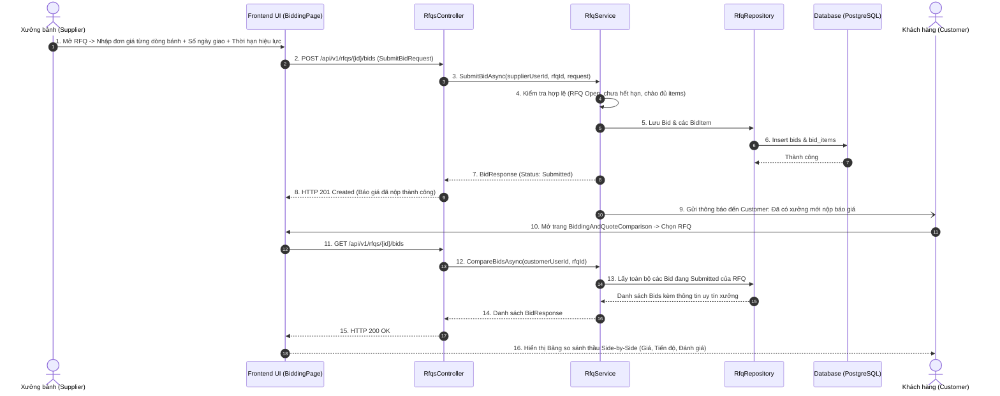
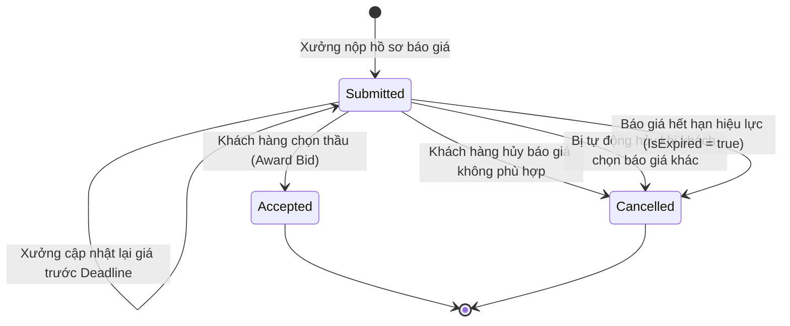

# [RFQ-BIDDING-12] - TÀI LIỆU THIẾT KẾ CHI TIẾT NỘP BÁO GIÁ & SO SÁNH THẦU (SUPPLIER BIDDING & COMPARISON)

---

## I. TÊN TÀI LIỆU, TÍNH NĂNG & TỔNG QUAN

### 1.1. Thông tin tài liệu
- **Tên tài liệu:** Tài liệu thiết kế chi tiết tính năng Nhà cung cấp nộp hồ sơ báo giá & Bảng so sánh thầu (Supplier Bidding & Side-by-Side Comparison)
- **Mã tính năng (Feature Key):** `rfq-bidding-quote` (Module 5, Tính năng #12)
- **Độ ưu tiên:** 🔴 P0 Critical
- **Phiên bản:** `1.0.0` | **Ngày lập:** 2026-10-29
- **Tác nhân tham gia (Actors):**
  - **Supplier:** Đại diện xưởng bánh tính toán giá vốn, nhập đơn giá từng dòng hàng, cam kết thời gian giao, ấn định thời hạn hiệu lực của báo giá và nộp hồ sơ (`Submit Bid`).
  - **Customer:** Nhận thông báo khi có xưởng nộp hồ sơ, sử dụng bảng so sánh đa chiều (Side-by-Side) để đánh giá về giá cả, uy tín, tiến độ.
  - **System (Background Job):** `RfqDeadlineJob` quét định kỳ và tự động khóa cổng nhận báo giá khi chạm mốc `BidDeadline`.

### 1.2. Mục tiêu nghiệp vụ (Business Goals)
- Cung cấp công cụ báo giá chuyên nghiệp cho các xưởng bánh B2B: Báo giá chi tiết từng mã bánh, tính tổng giá trị tự động, đính kèm cam kết dịch vụ (in ấn, vận chuyển xe lạnh, quà tặng kèm).
- Trực quan hóa dữ liệu cho khách hàng doanh nghiệp: Bảng so sánh ma trận (Side-by-Side) đặt các xưởng cạnh nhau để so sánh trực diện về Tổng tiền, Đơn giá từng loại bánh, Thời gian giao hàng, Điểm uy tín và Badge chứng nhận.
- Đảm bảo tính bí mật và công bằng: Các xưởng không thể xem trộm giá của đối thủ trong suốt thời gian mở thầu.

### 1.3. Phạm vi tính năng (Scope)
- **Bao gồm (In-scope):**
  - Tạo hồ sơ chào giá (`Bid`) gồm các dòng chi tiết (`BidItem`) khớp với từng `RfqItem`.
  - Sinh mã báo giá chuẩn: `BID-YYYY-XXXXXX`.
  - Thiết lập các thông số cam kết: Tổng giá trị (`TotalPrice`), Số ngày giao hàng dự kiến (`EstimatedDeliveryDays`), Thời hạn hiệu lực báo giá (`ValidityDays`, mặc định 30 ngày).
  - Cho phép chỉnh sửa nội dung báo giá khi còn trong thời hạn nhận thầu (`BidDeadline`).
  - Khách hàng hủy báo giá không phù hợp (`POST /rfqs/{id}/bids/{bidId}/cancel`).
  - Bảng so sánh thầu trực quan Side-by-Side trên giao diện Frontend (`BiddingAndQuoteComparison.jsx`).
  - Background Job tự động chuyển trạng thái RFQ từ `Open -> Closed` khi hết hạn nhận thầu.
- **Không bao gồm (Out-of-scope):**
  - Vòng thương lượng giá qua chat trực tiếp (Hệ thống B2B hoạt động theo cơ chế đấu thầu kín cạnh tranh một lần duy nhất).

### 1.4. Ràng buộc & Điều kiện tiên quyết (Invariants & Prerequisites)
| Quy tắc | Ràng buộc kỹ thuật |
| :--- | :--- |
| **Quyền nộp báo giá** | Phải là Supplier đã được xác minh (`Verified`), sở hữu gian hàng đang `Active` và đã được mời (hoặc RFQ ở chế độ công khai). |
| **Trạng thái RFQ** | Chỉ được nộp hoặc sửa báo giá khi RFQ đang ở trạng thái `Open` và `clock.UtcNow < rfq.BidDeadline`. |
| **Độ phủ mặt hàng** | Báo giá phải chào giá cho đầy đủ 100% các dòng mặt hàng (`RfqItem`) có trong yêu cầu báo giá. |
| **Giá chào thầu hợp lệ** | Mọi `UnitPrice` phải là số dương `> 0`. `TotalPrice = sum(unitPrice * quantity)`. |
| **Thời hạn hiệu lực** | `ValidityDays` từ 1 đến 365 ngày; báo giá tự động hết hiệu lực nếu quá hạn. |

---

## II. FLOW CHART TOÀN BỘ LUỒNG (WORKFLOW DIAGRAM)

### 2.1. Sequence Diagram - Luồng xưởng nộp báo giá & Khách hàng so sánh



### 2.2. State Transition Diagram - Vòng đời trạng thái Báo giá (Bid State Machine)



---

## III. CHI TIẾT TỪNG BƯỚC XỬ LÝ (STEP-BY-STEP LOGIC)

### Bước 1: Tiếp nhận và Validate Hồ sơ Báo giá của Xưởng
1. Xác định danh tính xưởng:
   - Truy vấn `SupplierProfileId` từ `UserId`.
   - Kiểm tra trạng thái xác minh: Bắt buộc `VerificationStatus == Verified`.
2. Kiểm tra trạng thái RFQ:
   - RFQ phải tồn tại, chưa bị xóa mềm, đang ở trạng thái `Open`.
   - Thời gian hiện tại phải trước hạn chót: `clock.UtcNow < rfq.BidDeadline`. Nếu đã quá hạn -> Ném `HttpException(409, "The RFQ is closed and no longer accepts responses.")`.
3. Kiểm tra tính đầy đủ của các dòng chào thầu (`Items`):
   - Lấy toàn bộ danh sách `RfqItem` của RFQ.
   - Báo giá phải chào giá cho từng `RfqItemId`. Nếu thiếu hoặc thừa mặt hàng -> Ném `HttpException(400, "A bid must quote all requested RFQ items.")`.
   - Từng `UnitPrice` phải lớn hơn 0.
4. Tính tổng giá trị báo giá:
   - `subtotal = unitPrice * rfqItem.Quantity`.
   - `totalPrice = sum(subtotal)`.
5. Sinh mã số báo giá tự động: `BID-YYYY-XXXXXX`.

### Bước 2: Lưu trữ Báo giá vào Cơ sở dữ liệu
1. Mở Transaction cơ sở dữ liệu:
   - Kiểm tra xem xưởng này đã từng nộp báo giá cho RFQ này chưa:
     - Nếu đã nộp và đang là `Submitted`: Cập nhật lại các dòng giá mới và thời gian `UpdatedAt`.
     - Nếu chưa nộp: Tạo bản ghi `Bid` mới với trạng thái `Status = BidStatus.Submitted`.
   - Lưu các bản ghi `BidItem` tương ứng.
   - Cập nhật trạng thái của bản ghi `RfqInvitation` thành `BidSubmitted`.
2. Commit Transaction và kích hoạt Notification gửi đến Customer.

### Bước 3: Khách hàng mở xem Bảng so sánh thầu (Side-by-Side Comparison)
1. Xác thực: Chỉ khách hàng sở hữu RFQ mới được xem danh sách so sánh các báo giá.
2. Truy vấn toàn bộ các `Bid` có `Status == BidStatus.Submitted`.
3. Với mỗi báo giá:
   - Bổ sung thông tin xưởng: Tên công ty, Điểm uy tín (`ReputationScore`), Badge đối tác, Tỷ lệ giao hàng đúng hạn.
   - Kiểm tra xem báo giá đã hết hạn chưa: `isExpired = (bid.SubmittedAt.AddDays(bid.ValidityDays) <= clock.UtcNow)`.
4. Trả về cấu trúc dữ liệu ma trận giúp Frontend render bảng so sánh đa cột.

### Bước 4: Khách hàng hủy báo giá không phù hợp (Cancel Bid)
1. Khách hàng có thể chủ động loại bỏ một báo giá không phù hợp trước hoặc sau deadline:
   - Kiểm tra quyền sở hữu RFQ.
   - Chuyển trạng thái `Bid.Status = BidStatus.Cancelled`.
   - Gửi thông báo đến xưởng có báo giá bị loại.

---

## IV. ĐẶC TẢ KỸ THUẬT API (API CONTRACT SPECIFICATION)

### 4.1. Xưởng nộp báo giá (Submit Bid)
- **Endpoint:** `POST /api/v1/rfqs/{rfqId}/bids`
- **Quyền:** `Authorized (Role: Supplier)`
- **Request Body:**
```json
{
  "estimatedDeliveryDays": 7,
  "validityDays": 15,
  "notes": "Xưởng cam kết sử dụng nguyên liệu hạt sen tươi Huế. Miễn phí in ấn logo ép kim 24k và thiệp chúc mừng doanh nghiệp.",
  "items": [
    {
      "rfqItemId": "2fa85f64-5717-4562-b3fc-2c963f66afa2",
      "unitPrice": 620000.00,
      "notes": "Hộp gỗ sơn mài đỏ lót lụa vàng, kèm 100g trà Ô Long Thượng Hạng."
    },
    {
      "rfqItemId": "3fa85f64-5717-4562-b3fc-2c963f66afa3",
      "unitPrice": 320000.00,
      "notes": "Giấy mỹ thuật dập nổi hoa cúc thủ công."
    }
  ]
}
```

- **Response Body (HTTP 201 Created):**
```json
{
  "status": 201,
  "message": "Bid submitted successfully.",
  "data": {
    "id": "5fa85f64-5717-4562-b3fc-2c963f66afa5",
    "bidNumber": "BID-2026-001234",
    "supplierId": "3fa85f64-5717-4562-b3fc-2c963f66afa3",
    "totalPrice": 250000000.00,
    "estimatedDeliveryDays": 7,
    "validityDays": 15,
    "submittedAt": "2026-08-05T14:30:00Z",
    "isExpired": false,
    "status": "Submitted",
    "items": [
      {
        "rfqItemId": "2fa85f64-5717-4562-b3fc-2c963f66afa2",
        "productName": "Hộp Sơn Mài 4 Bánh Nướng Thập Cẩm & Trà Sen VVIP",
        "quantity": 300,
        "unit": "Hộp",
        "unitPrice": 620000.00,
        "subtotal": 186000000.00,
        "notes": "Hộp gỗ sơn mài đỏ lót lụa vàng, kèm 100g trà Ô Long Thượng Hạng."
      },
      {
        "rfqItemId": "3fa85f64-5717-4562-b3fc-2c963f66afa3",
        "productName": "Hộp Giấy Mỹ Thuật 4 Bánh Dẻo Hương Bưởi",
        "quantity": 200,
        "unit": "Hộp",
        "unitPrice": 320000.00,
        "subtotal": 64000000.00,
        "notes": "Giấy mỹ thuật dập nổi hoa cúc thủ công."
      }
    ]
  },
  "path": "/api/v1/rfqs/1fa85f64-5717-4562-b3fc-2c963f66afa1/bids",
  "traceId": "trace-bid-001",
  "time": "2026-08-05T14:30:00Z"
}
```

### 4.2. Khách hàng lấy danh sách báo giá so sánh (Compare Bids)
- **Endpoint:** `GET /api/v1/rfqs/{rfqId}/bids`
- **Quyền:** `Authorized (Role: Customer)`
- **Response Body (HTTP 200 OK):**
```json
{
  "status": 200,
  "message": "Bids retrieved successfully.",
  "data": [
    {
      "id": "5fa85f64-5717-4562-b3fc-2c963f66afa5",
      "bidNumber": "BID-2026-001234",
      "supplierName": "Xưởng Bánh Tràng An Nghệ Nhân",
      "reputationScore": 98,
      "badge": "Đối Tác Vàng",
      "totalPrice": 250000000.00,
      "estimatedDeliveryDays": 7,
      "validityDays": 15,
      "submittedAt": "2026-08-05T14:30:00Z",
      "isExpired": false,
      "status": "Submitted"
    }
  ],
  "path": "/api/v1/rfqs/1fa85f64-5717-4562-b3fc-2c963f66afa1/bids",
  "traceId": "trace-bid-002",
  "time": "2026-08-05T15:00:00Z"
}
```

---

## V. KIẾN TRÚC PHÂN TẦNG VÀ TỔ CHỨC MÃ NGUỒN (LAYER MAPPING)

```text
src/
├── Mooncake.EcommercePlatform.Domain/
│   ├── Entities/Bid.cs                        # Thực thể Báo giá
│   ├── Entities/BidItem.cs                    # Chi tiết giá từng mặt hàng
│   └── Enums/BidStatus.cs                     # Submitted, Accepted, Cancelled
│
├── Mooncake.EcommercePlatform.Application/
│   ├── DTOs/Rfqs/Requests/SubmitBidRequest.cs
│   ├── DTOs/Rfqs/Responses/BidResponse.cs
│   ├── Services/Interfaces/IRfqService.cs
│   └── Services/Implementations/RfqService.cs
│
├── Mooncake.EcommercePlatform.Infrastructure/
│   ├── Persistence/Configurations/BidConfiguration.cs
│   ├── Persistence/Configurations/BidItemConfiguration.cs
│   └── Repositories/RfqRepository.cs
│
└── Mooncake.EcommercePlatform.WebApi/
    ├── Controllers/RfqsController.cs
    └── Background/RfqDeadlineJob.cs           # Tự động đóng cổng nộp thầu
```

---

## VI. BẢO MẬT & KIỂM THỬ (SECURITY & TESTING PLAN)

### 6.1. Tiêu chuẩn bảo mật
- [x] **Đấu thầu kín (Sealed Bid Invariant):** Không cho phép nhà cung cấp xem báo giá của đối thủ. Chỉ khách hàng tạo RFQ mới có quyền xem toàn bộ báo giá.
- [x] **Khóa thầu sau hạn chót (Deadline Enforcement):** Chặn hoàn toàn mọi request nộp hoặc sửa giá khi `clock.UtcNow >= rfq.BidDeadline`.

### 6.2. Kịch bản kiểm thử (Test Cases)
1. **Happy Path:** Xưởng được mời nộp báo giá hợp lệ cho tất cả 2 mặt hàng -> Bid tạo thành công trạng thái `Submitted`.
2. **Negative - Quá hạn deadline:** Nộp bid khi RFQ đã quá giờ `BidDeadline` -> Trả về HTTP 409 Conflict.
3. **Negative - Báo giá thiếu mặt hàng:** RFQ có 3 items nhưng xưởng chỉ chào giá cho 2 items -> Bị chặn với HTTP 400 Bad Request.
4. **Cập nhật báo giá:** Xưởng sửa lại đơn giá khi RFQ vẫn còn mở -> Cập nhật thành công và ghi đè giá cũ mà không tạo thêm bản ghi rác.

